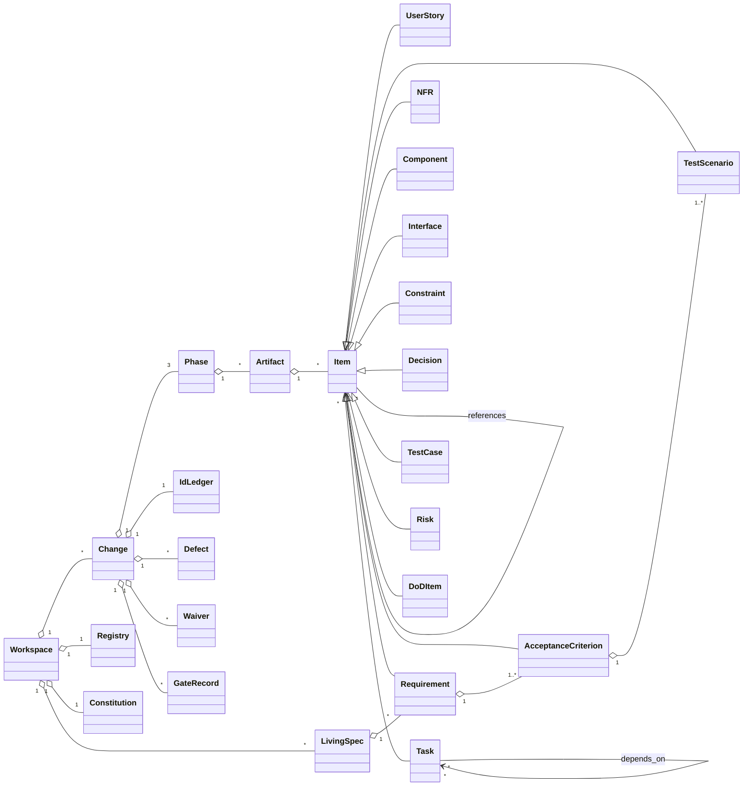

# C001 — Domain model

The domain of the suite is the **SDD workspace**: changes, phases, artifacts, identifiers
and the links between them. Persistence is plain files under `.sdd/` (markdown with YAML
frontmatter, JSON). Owning components refer to the catalogue in
`../60-architecture/architecture.md`.

## 1. Entity overview

## 2. Entities

### 2.1 Workspace
- **Attributes:** `root` (path, always `<repo>/.sdd`), `sdd_version` (integer ≥ 1), `generator` (string), `id_scheme` (string, fixed `C{NNN}-{TYPE}-{seq}`)
- **Relationships:** contains Changes (active and archived), one Registry, one Constitution, LivingSpecs
- **Owning component:** C001-COMP-03 (workspace module)
- **Invariants:**
  - **C001-INV-01** Change numbers are unique across `.sdd/` and `.sdd/_archive/` and are never reused.
  - **C001-INV-02** Unknown entries in `.sdd/` are preserved byte-identical by every command.

### 2.2 Registry (`registry.json`)
- **Attributes:** `sdd_version`, `generated_at` (ISO-8601), `changes[]` (id, slug, title, kind, profile, status, phase, phases{…}, implementation{…}, defects[], waivers[])
- **Relationships:** derived from Change manifests, phase artifact frontmatter and Task frontmatter
- **Owning component:** C001-COMP-03
- **Invariants:**
  - **C001-INV-03** The registry equals the rebuild from frontmatter, apart from `generated_at`; any difference is drift (`LINT-REG-001`).

### 2.3 Constitution
- **Attributes:** `status` (draft, approved, stale), sections (Principles, Quality bar, NFR defaults, Global DoD, Forbidden technologies, Profile thresholds, Language & conventions), `toolchain.md` rows, glossary terms
- **Owning component:** C001-COMP-03 (files), C001-COMP-01 (interview)
- **Invariants:**
  - **C001-INV-04** No change may enter ideation unless the constitution is approved (G0).

### 2.4 Change
- **Attributes:** `id` (`CHG-NNN`), `number` (1–999), `slug` (≤ 40 chars, `[a-z0-9-]`), `title` (non-empty), `kind` (greenfield, brownfield, mixed), `profile` (lite, full), `status` (active, stopped, archived), `phase` (current phase name), `owners[]`
- **Relationships:** three Phases, one IdLedger, Defects, Waivers, GateRecords, approvals store
- **Owning component:** C001-COMP-03
- **Invariants:**
  - **C001-INV-05** `profile` may change only from lite to full.
  - **C001-INV-06** A stopped or archived change accepts no phase start, gate or task update.
  - **C001-INV-07** `implementation.status` is a function of the task statuses (state-machines §5).

### 2.5 Phase
- **Attributes:** `name` (`00-ideation`, `10-spec`, `20-plan`), `status` (not-started, draft, in-review, approved, stale, in-revision), `approved_hash` (`sha256:<64 hex>` or null), `approved_at`, `approved_by`
- **Relationships:** belongs to a Change; contains Artifacts
- **Owning component:** C001-COMP-03 (state), C001-COMP-05 (gate engine)
- **Invariants:**
  - **C001-INV-08** A phase is `approved` only if its recomputed hash equals `approved_hash`; otherwise it is `stale`.
  - **C001-INV-09** A phase can be started only when its predecessor is `approved` (G1 → spec, G2 → plan).
  - **C001-INV-10** When a phase leaves `approved`, every later approved phase of the change becomes `stale`.

### 2.6 Artifact
- **Attributes:** `path` (relative to change root), `artifact` type (frontmatter), `status`, generated flag (true for `80-traceability.md`, `85-open-items.md`)
- **Relationships:** belongs to a Phase; defines and references Items
- **Owning component:** authoring agents (write), C001-COMP-04 (parse)
- **Invariants:**
  - **C001-INV-11** Generated artifacts are excluded from phase hashes and are never hand-edited (overwritten by the next generation).

### 2.7 Item (abstract) and its kinds
- **Attributes (common):** `id` (full form `C{NNN}-{TYPE}-{seq}` or AC form `C{NNN}-AC-{req}.{n}`), `type`, `title`, defining `file` and `line`, `content_hash`
- **Kinds and specific attributes:**

| Kind | Type code | Specific attributes |
|---|---|---|
| UserStory | US | persona, want, so_that, value, priority (Must/Should/Could/Won't), size (S/M/L), capability, notes, out_of_scope, requirements[], traces_to[] |
| Requirement | REQ | pattern (ubiquitous, event-driven, state-driven, unwanted-behaviour, optional-feature, complex), statement, rationale, stories[], priority, acceptance[], delta (ADDED, MODIFIED, REMOVED, RENAMED), supersedes (ID), evidence[] |
| AcceptanceCriterion | AC | condition, scenarios[] |
| TestScenario | TS | title, steps (Given+, When, Then+), examples table |
| NFR | NFR | category, statement, metric, threshold, method, environment, rationale, dod[] |
| Component | COMP | name, responsibility, owned_data, interfaces[], depends_on[], realizes[], status, evidence[] |
| Interface | IF | kind, file, provider, consumers[], serves[] |
| Constraint | CON | statement, source, affects[] |
| Decision | DEC / ADR | context, options (OA link), decision, consequences, decided_by, decided_at, words |
| OptionAnalysis | OA | problem, criteria[{name, weight}], candidates[{name, scores[], total}], presented[], recommendation, rejected[] |
| ResearchNote | R | question, method, findings[{text, sources[{url, date}], confidence, reason}] |
| Task | T | milestone, status, depends_on[], implements[], satisfies_ac[], verified_by[], components[], risk_refs[], estimate, report{commit, completed_at, notes} |
| TestCase | TC | level, location, data, environment, scenarios[], tasks[] |
| Risk | RISK | likelihood, impact, mitigation, trigger, owner, refs[] |
| DoDItem | DOD | statement, evidence_type, covers[] or "global" |
| Milestone | M | goal, exit_criterion, tasks[] |
| Rollback step | RB | step, refs[] |

- **Owning component:** C001-COMP-04 (parser and graph)
- **Invariants:**
  - **C001-INV-12** An ID is defined at most once in the workspace (TR-13).
  - **C001-INV-13** Every referenced ID is defined or tombstoned (TR-12).
  - **C001-INV-14** An AcceptanceCriterion belongs to exactly one Requirement, whose sequence number appears in the AC ID.
  - **C001-INV-15** The traceability rules TR-01 … TR-15 of C001-IF-04 §5 hold for an approved phase, except for items waived at its gate.

### 2.8 IdLedger (`ids.json`)
- **Attributes:** `change` (CHG-NNN), `allocated{TYPE: max_seq}`, `blocks[{TYPE, from, to, capability}]`, `tombstones[{id, reason, date}]`
- **Owning component:** C001-COMP-03
- **Invariants:**
  - **C001-INV-16** No allocated or tombstoned ID is ever allocated again (C001-REQ-110).

### 2.9 Defect
- **Attributes:** `id` (`D-<seq>` per change), `ref` (ID), `summary`, `reporter`, `date`, `status` (open, closed), `resolution`, `closed_at`
- **Owning component:** C001-COMP-03
- **Invariants:**
  - **C001-INV-17** `ref` is an ID defined in the change when the defect is created.
  - **C001-INV-18** A change with an open defect cannot be archived.

### 2.10 Waiver
- **Attributes:** `item` (ID, rule code, finding ID or question ID), `gate`, `date`, `note`
- **Owning component:** C001-COMP-05
- **Invariants:**
  - **C001-INV-19** A waiver exists only as part of a successful approval; waivers are never removed, only superseded by a later gate record.

### 2.11 GateRecord and Approval store
- **Attributes:** GateRecord: `date`, `gate` (G0–G3), `decision` (approve, approve-with-waivers, revise, stop), `note` (verbatim), `waivers[]`, `usage`. Approval store (`approvals.json`): per phase `{hash, ids{ID: content_hash}}`
- **Owning component:** C001-COMP-05
- **Invariants:**
  - **C001-INV-20** Every phase status change to `approved` has exactly one GateRecord with decision approve or approve-with-waivers and a non-empty note.

### 2.12 LivingSpec (`_living/CAP-<slug>.md`)
- **Attributes:** `capability`, `inventory_only` (boolean), inventory sections, requirements (with ACs and TSs), History rows `{id, event (added, superseded-by, removed, renamed, moved), change, date}`
- **Owning component:** C001-COMP-06 (archive module)
- **Invariants:**
  - **C001-INV-21** An `inventory_only: true` file contains no requirement entry.
  - **C001-INV-22** Every requirement in `_living/` came from an archived change whose G3 was approved.

### 2.13 InterviewRound and Question
- **Attributes:** Round: `phase`, `number`, `date`, `questions[]`. Question per C001-IF-05: `id`, `topic`, `question`, `why_it_matters`, `blocking`, `candidates_considered`, `options[{label, rationale, score}]`, `rejected[{label, reason}]`, `source_refs[]`, `answer` (verbatim), `extracted_instructions[]`
- **Owning component:** C001-COMP-01 (conductor)
- **Invariants:**
  - **C001-INV-23** Rounds contain 1–4 questions; options per question 2–3 with the recommended one first.

### 2.14 EvidenceEntry
- **Attributes:** `path`, `line`, `symbol` (or `-`), `claim`, `layer` (ripwire, serena, lsp, grep, ast-grep), `confidence` (high, medium, low), `disclosures` (text or `none`), `commit` (HEAD SHA when recorded)
- **Owning component:** C001-COMP-02 (cartographer)
- **Invariants:**
  - **C001-INV-24** An evidence entry with layer `grep` has confidence at most `medium` (no semantic resolution).
