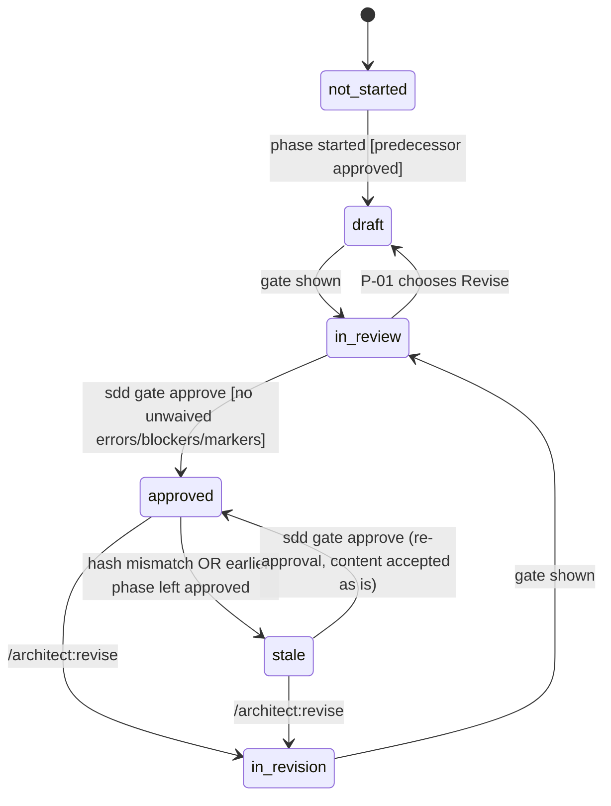
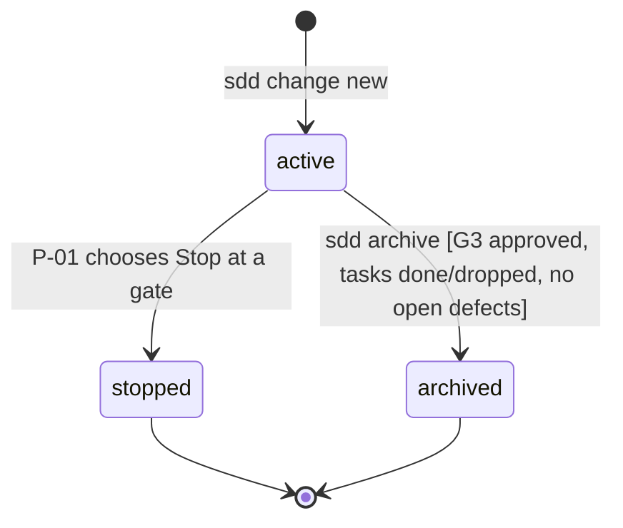
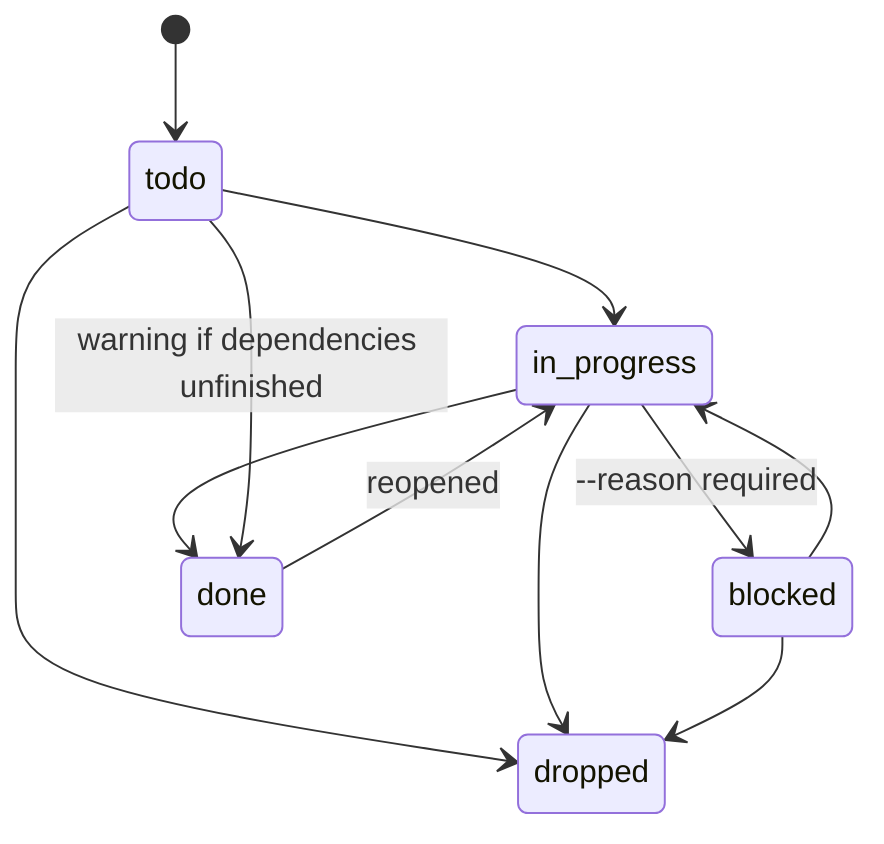
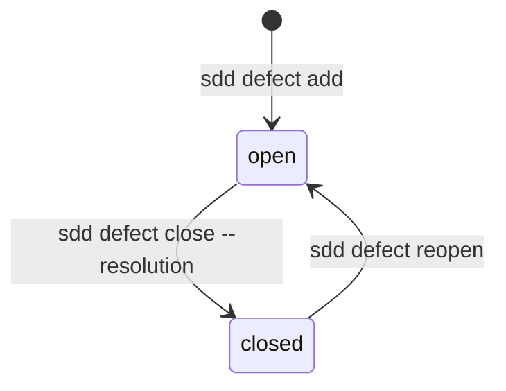

# C001 — State machines

## 1. Phase status

| From | Event | Guard | To | Effect |
|---|---|---|---|---|
| not-started | phase started | predecessor `approved` (C001-INV-09) | draft | conductor creates phase files |
| draft | gate shown (`sdd gate show` by conductor) | lint and critic have run | in-review | gate summary presented |
| in-review | P-01 chooses Revise | — | draft | gate-log row `revise` |
| in-review | `sdd gate approve` | no unwaived lint errors, critic blockers or open markers | approved | hash, approvals.json, gate-log row |
| approved | `sdd stale check` finds hash mismatch | — | stale | later approved phases → stale |
| approved | earlier phase leaves approved | — | stale | — |
| approved | `/architect:revise` | — | in-revision | later approved phases → stale; gate-log row |
| stale | `/architect:revise` | — | in-revision | gate-log row |
| stale | `sdd gate approve` | same guards as in-review → approved | approved | new hash; gate-log row |
| in-revision | gate shown | lint and critic have run | in-review | impact list presented (C001-REQ-813) |

## 2. Change status

| From | Event | Guard | To | Effect |
|---|---|---|---|---|
| (none) | `sdd change new` | workspace exists | active | folder, manifest, ids.json |
| active | Stop at a gate | — | stopped | reason and date recorded (C001-REQ-815) |
| active | `sdd archive` | C001-REQ-913 preconditions | archived | merge into `_living/`, folder moved (C001-REQ-920) |

## 3. Task status

| From | Event (`sdd task set --status`) | Guard | To | Effect |
|---|---|---|---|---|
| todo | in-progress | — | in-progress | registry counts |
| todo | dropped | — | dropped | — |
| todo | done | — | done | `WARN-CLI-001` if dependencies unfinished; completed_at |
| in-progress | blocked | `--reason` present | blocked | reason in report.notes |
| blocked | in-progress | — | in-progress | — |
| in-progress | done | — | done | completed_at; commit recorded |
| done | in-progress | — | in-progress | completed_at cleared |
| in-progress | dropped | — | dropped | — |
| blocked | dropped | — | dropped | — |

Transitions not listed (for example `dropped → todo`) are refused with `ERR-CLI-013`.

## 4. Defect status

| From | Event | Guard | To | Effect |
|---|---|---|---|---|
| (none) | `sdd defect add` | ref exists (C001-INV-17) | open | conductor surfaces it (C001-REQ-909) |
| open | `sdd defect close` | `--resolution` present | closed | resolution, closed_at |
| closed | `sdd defect reopen` | — | open | resolution kept in history |

## 5. Implementation status (derived, C001-INV-07)

Derivation rules, evaluated in order over the change's non-dropped tasks:

| Rule | Condition | implementation.status |
|---|---|---|
| 1 | there are no tasks | not-started |
| 2 | every task is `done` (dropped tasks ignored) | done |
| 3 | at least one task is `blocked` and none is `in-progress` | blocked |
| 4 | at least one task is `in-progress` or `done` | in-progress |
| 5 | otherwise (all `todo`) | not-started |

Note: C001-TS-906 row 3 (`done, blocked, todo`) gives `blocked` by rule 3.
