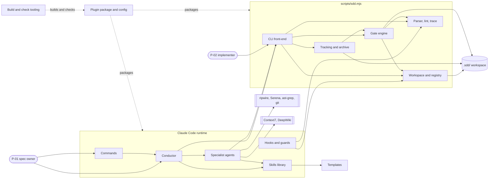
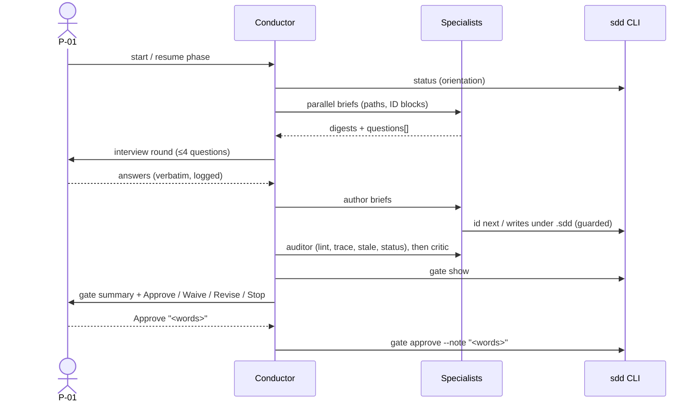
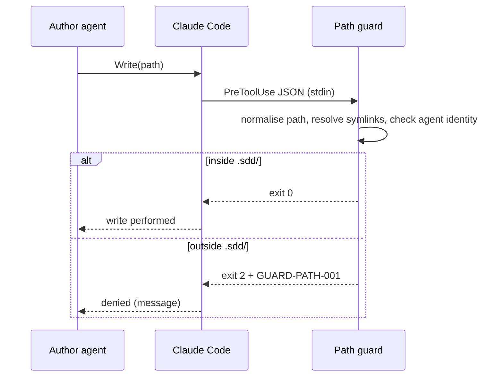
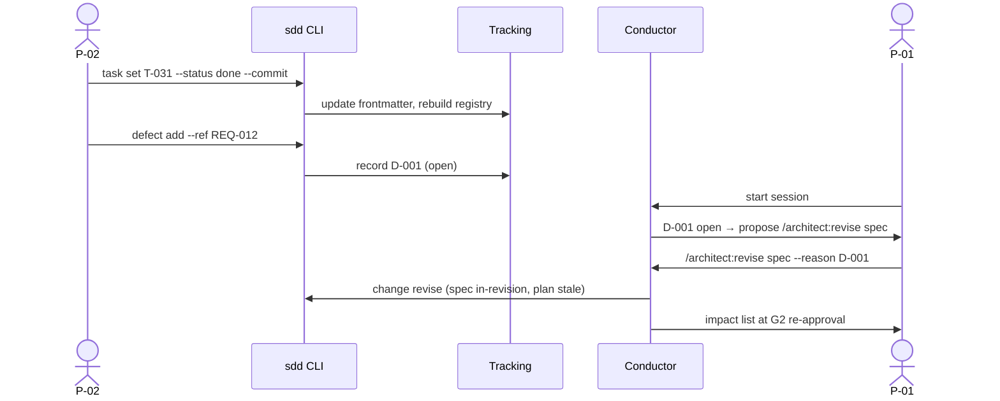
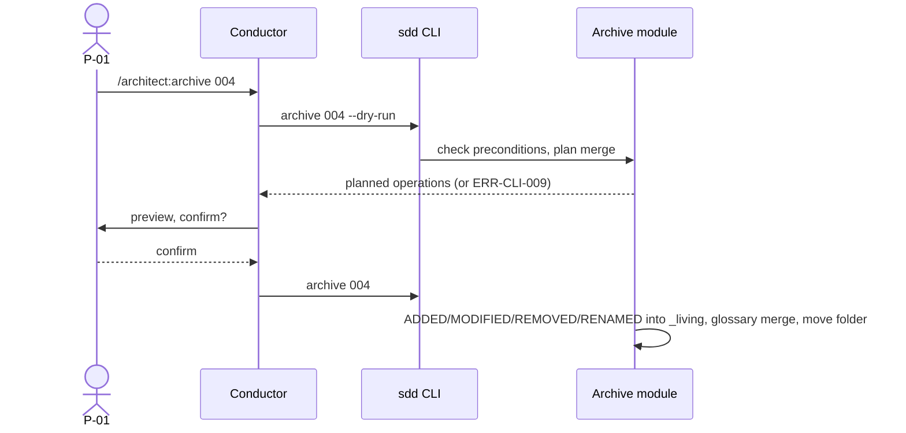

# C001 — Architecture

## 1. Context and scope

Architect runs **inside Claude Code** on the user's machine. It has no server component.
Its runtime parts are markdown agent and skill definitions interpreted by Claude Code, a
bundled Node.js CLI invoked by agents and hooks, and configuration for three MCP servers.
All persistent state is files in the target repository's `.sdd/` folder.

**System boundary:** the `architect` plugin (agents, skills, commands, hooks, MCP config,
CLI, templates) plus the `.sdd/` workspace format.

**External actors and systems:**

| Actor / system | Interaction | Trust |
|---|---|---|
| P-01 spec owner | Interviews, gate decisions (Claude Code UI) | trusted (sole approver) |
| P-02 implementer | Reads hand-off; runs `sdd task set`, `sdd defect add` | trusted for reporting |
| Claude Code runtime | Loads plugin, runs agents, enforces tool grants, calls hooks | platform |
| Anthropic models (Opus 5.5, Sonnet 5, Haiku 4.5) | Agent reasoning | platform |
| Target repository source code | Read by cartographer/architect | **untrusted content** (may contain injected instructions, C001-NFR-205) |
| Web and remote MCPs (Context7, DeepWiki) | Research | **untrusted content** |
| ripwire, Serena, ast-grep, git | Local tools | trusted binaries, untrusted output content |

**Trust boundaries:** (1) agent ↔ repository content and web content (data, never
instructions); (2) agent ↔ filesystem (path guard, bash guard); (3) agent ↔ gate (only P-01
approves).

## 2. Component catalogue

### C001-COMP-01 — Conductor
- **Name:** `sdd-conductor` agent with phase skills
- **Responsibility:** orientation, phase orchestration, interviews, delegation, gate presentation, recording P-01's decisions
- **Owned data:** questions logs, ideation document, DEC records, gate-log entries (via CLI)
- **Interfaces:** C001-IF-05, C001-IF-10, C001-IF-13; uses C001-IF-01
- **Depends on:** C001-COMP-02, C001-COMP-07, C001-COMP-10
- **Realizes:** CAP-02 (C001-REQ-201 … 220), C001-REQ-114, 116, 127, 312, 313, 315, 316, 802 … 804, 811, 813, 909, 1110, 1111; C001-NFR-701
- **Status:** new

### C001-COMP-02 — Specialist agents
- **Name:** `sdd-researcher`, `sdd-cartographer`, `sdd-options-analyst`, `sdd-spec-writer`, `sdd-test-designer`, `sdd-architect`, `sdd-planner`, `sdd-critic`, `sdd-auditor`
- **Responsibility:** research, code evidence, option analyses, authoring of spec and plan artifacts, critique, bookkeeping
- **Owned data:** research notes, evidence files, OA files, spec and plan artifacts, critic reports
- **Interfaces:** C001-IF-03, C001-IF-05, C001-IF-11, C001-IF-14
- **Depends on:** C001-COMP-07 (via Bash allowlist), C001-COMP-10, external tools
- **Realizes:** CAP-03, CAP-04, CAP-05, CAP-06 (authoring requirements), C001-REQ-710 … 715, CAP-10; C001-NFR-205
- **Status:** new

### C001-COMP-03 — Workspace and registry module
- **Name:** `src/workspace/` (init, change, id ledger, status, registry, SDD.md block)
- **Responsibility:** create and evolve the workspace; derive the registry; allocate IDs; atomic writes
- **Owned data:** `SDD.md`, `registry.json`, `change.md` frontmatter, `ids.json`
- **Interfaces:** C001-IF-01, C001-IF-02, C001-IF-06
- **Depends on:** C001-COMP-04 (parser)
- **Realizes:** C001-REQ-101 … 113, 117 … 120, 123 … 126, 905; C001-NFR-301, 302, 404
- **Status:** new

### C001-COMP-04 — Parser, lint and trace engine
- **Name:** `src/model/` (markdown + frontmatter parser, ID extraction, graph) and `src/lint/` (rule catalogue, one module per rule)
- **Responsibility:** parse artifacts into a typed graph; evaluate lint rules; build matrices, `trace.json` and open items
- **Owned data:** generated `80-traceability.md`, `85-open-items.md`, `trace.json`
- **Interfaces:** C001-IF-04, C001-IF-11 §1, C001-IF-12
- **Depends on:** none (pure functions over files)
- **Realizes:** CAP-07 (C001-REQ-701 … 709, 716 … 719), lint rules of C001-REQ-106, 122, 302, 307, 310, 403 … 408, 410, 412, 413, 415, 420, 503, 509, 512, 603 … 607, 612, 906, 1002; C001-NFR-101, 102, 203, 303, 503
- **Status:** new

### C001-COMP-05 — Gate engine
- **Name:** `src/gate/` (show, approve, record, stale, hash, approvals store)
- **Responsibility:** gate summaries, approval checks and records, hashing, stale propagation, revise/stop transitions
- **Owned data:** phase statuses and approval fields in `change.md`, `approvals.json`, gate log, waivers
- **Interfaces:** C001-IF-13, C001-IF-01
- **Depends on:** C001-COMP-03, C001-COMP-04
- **Realizes:** C001-REQ-720, 801, 805 … 810, 812, 814, 815
- **Status:** new

### C001-COMP-06 — Tracking and archive module
- **Name:** `src/tracking/` (task set, defects) and `src/archive/`
- **Responsibility:** implementer progress and defects; merge of deltas into `_living/`; folder move
- **Owned data:** task frontmatter `status`/`report`, defects, `_living/*.md`, `_archive/`
- **Interfaces:** C001-IF-01, C001-IF-03 §3 and §10
- **Depends on:** C001-COMP-03, C001-COMP-04, C001-COMP-05
- **Realizes:** C001-REQ-901 … 904, 907, 908, 910, 913 … 923
- **Status:** new

### C001-COMP-07 — CLI front-end
- **Name:** `src/cli.ts` → bundled `scripts/sdd.mjs`
- **Responsibility:** argument parsing, command dispatch, human and JSON output, exit codes, error catalogue, debug traces
- **Owned data:** none
- **Interfaces:** C001-IF-01
- **Depends on:** C001-COMP-03, 04, 05, 06, 08
- **Realizes:** C001-REQ-702 … 705 (output side); C001-NFR-202, 601, 702
- **Status:** new

### C001-COMP-08 — Hooks and guards
- **Name:** `src/hooks/` (guard-path, guard-bash, session-start, post-write) and `hooks/hooks.json`
- **Responsibility:** enforce the write and shell boundaries; emit session briefs; quick lint after writes
- **Owned data:** none
- **Interfaces:** C001-IF-07
- **Depends on:** C001-COMP-03, C001-COMP-04
- **Realizes:** C001-REQ-911, 912, 1103 … 1107, 1121; C001-NFR-103, 104, 201
- **Status:** new

### C001-COMP-09 — Commands
- **Name:** `commands/*.md` (`/architect:*`)
- **Responsibility:** thin entry points that load phase skills and handle arguments
- **Owned data:** none
- **Interfaces:** C001-IF-10
- **Depends on:** C001-COMP-01, C001-COMP-10
- **Realizes:** C001-REQ-204, 315, 316, 1110
- **Status:** new

### C001-COMP-10 — Skills library
- **Name:** `skills/*/SKILL.md` (sdd-conventions, interview-protocol, options-analysis, gate-protocol, phase-ideation, phase-spec, phase-plan, research-protocol, code-discovery, ears-requirements, user-stories, nfr-catalogue, acceptance-scenarios, dod-catalogue, diagramming, architecture-decisions, planning, critique-rubrics)
- **Responsibility:** reusable methodology, procedures, rubrics, templates references
- **Owned data:** none
- **Interfaces:** C001-IF-09 (`skills` field)
- **Depends on:** C001-COMP-13
- **Realizes:** C001-REQ-711, 1118; C001-NFR-105
- **Status:** new

### C001-COMP-11 — Plugin package and configuration
- **Name:** `plugins/architect/` manifests, `agents/`, `.mcp.json`, README, LICENSE, notices; repository marketplace manifest
- **Responsibility:** installable unit; agent definitions with least-privilege tools; MCP server declarations
- **Owned data:** plugin files
- **Interfaces:** C001-IF-08, C001-IF-09
- **Depends on:** all runtime components
- **Realizes:** C001-REQ-217, 218, 1005 … 1008, 1101, 1102, 1108, 1109, 1112, 1113, 1115, 1120; C001-NFR-204, 401, 501, 801
- **Status:** new

### C001-COMP-12 — Build and check tooling
- **Name:** `package.json` scripts, esbuild bundling, license check, structure checks, tests, fixtures, evals, benchmarks, dormant CI
- **Responsibility:** produce `scripts/sdd.mjs`; verify everything before release
- **Owned data:** `tests/`, `evals/`, `bench/`, `.github/workflows/`
- **Interfaces:** C001-IF-08 §3
- **Depends on:** C001-COMP-03 … 08, C001-COMP-11
- **Realizes:** C001-REQ-1114, 1116, 1117, 1119, 1122; C001-NFR-105, 106, 303, 304, 402, 403, 502, 602
- **Status:** new

### C001-COMP-13 — Templates
- **Name:** `templates/full/`, `templates/lite/`
- **Responsibility:** starting content for every artifact type, consumed by `sdd change new` and by author agents; overridable per repo in `.sdd/_templates/`
- **Owned data:** template files
- **Interfaces:** C001-IF-03, C001-IF-06
- **Depends on:** none
- **Realizes:** C001-REQ-108, 117, 301, 309, 402, 404, 501, 602, 616
- **Status:** new

## 3. Runtime flows

| Flow | Description | Scenarios realized |
|---|---|---|
| F1 | End-to-end phase run with fan-out, interview, lint, critic and gate | C001-TS-202, 206, 216, 218, 802, 805 |
| F2 | Guarded write by an author agent | C001-TS-1103, 1105 |
| F3 | Implementer reports progress and a defect, then revision | C001-TS-901, 908, 910, 814, 815 |
| F4 | Archive into living specs | C001-TS-914, 915, 916, 921 |

## 4. Data view

All data lives in files under `.sdd/` (entities in `../40-domain/domain-model.md`).
Sensitive data: none expected. Secret-like strings are rejected by C001-NFR-203. Retention:
files are versioned by the repository's git history. Generated files can be rebuilt from
sources at any time (C001-NFR-302).

## 5. Deployment view

Single deployment unit: the plugin folder installed by Claude Code from the local
marketplace into the user's plugin cache. Remote dependencies at runtime: Context7 and
DeepWiki HTTP endpoints (optional). Local processes: Serena (stdio, started by Claude Code
when an agent with Serena tools runs); `node` processes for each CLI and hook invocation
(short-lived).

## 6. Cross-cutting concerns

| Concern | Approach |
|---|---|
| Authorization | Claude Code tool grants (least privilege, C001-IF-09) + guards (C001-COMP-08) + human-only approvals (C001-REQ-804) |
| Untrusted content | Agents treat repository and web content as data (C001-NFR-205); skills state this rule explicitly |
| Error handling | Stable codes with fixes (errors.md); refusals never partially write (atomic writes) |
| Idempotency | `init`, `status --write`, `trace --write` are idempotent; deterministic outputs (C001-NFR-302) |
| Configuration | Constitution (per repo), `_templates` overrides, environment `SDD_DEBUG` |
| Observability | `SDD_DEBUG` traces; gate-log usage cells; NFR benchmarks |
| Portability | Node built-ins only at runtime; path normalisation module; LF artifacts |
| Concurrency | One conductor session writes a change at a time (C001-CON-11); the CLI does not lock files |

## 7. Constraints

See `constraints.md` (C001-CON-11 … C001-CON-16) and the scope constraints C001-CON-01 … 10.

## 8. Diagrams

Mermaid diagrams (Spec-Q3; Archify is deferred to a later change, spike S-03). Node and participant
IDs below are the component IDs with `-` replaced by `_`.

### 8.1 Component view

### 8.2 F1 — Phase run (realizes C001-TS-202, 206, 216, 218, 802, 805)

### 8.3 F2 — Guarded write (realizes C001-TS-1103, 1105)

### 8.4 F3 — Reporting and revision (realizes C001-TS-901, 908, 910, 814, 815)

### 8.5 F4 — Archive (realizes C001-TS-914, 915, 916, 921)

