# CHG-001 — Work breakdown

Generated from the task files by the plan renderer (precursor of the planner agent); edges are `depends_on`.

```mermaid
flowchart TB
  subgraph M1["C001-M-1 Verification spikes and scaffolding"]
    T001["T-001 Repository scaffolding and toolchain"]
    T002["T-002 Spike S-01: ripwire on Windows"]
    T003["T-003 Spike S-02: Serena read-only on Windows"]
    T004["T-004 Spike S-03: Archify validate, deliver and compare"]
    T005["T-005 Spike S-04: hook input and agent identity"]
    T006["T-006 Spike S-05: plugin agent as main session with AskUserQuestion"]
    T007["T-007 Spike S-06: preloaded skill cost and MCP tool names"]
  end
  subgraph M2["C001-M-2 Deterministic CLI core, dogfooded"]
    T010["T-010 Markdown/frontmatter parser and workspace model"]
    T011["T-011 Atomic writes and path normalisation"]
    T012["T-012 CLI front-end, output formats and error catalogue"]
    T013["T-013 init, SDD.md generation and bootstrap adoption"]
    T014["T-014 change new, profile, stop: numbering, slugs and scaffolds"]
    T015["T-015 Artifact templates (full and lite)"]
    T016["T-016 ID ledger: id next, tombstone, type validation"]
    T017["T-017 status: registry rebuild, SDD.md block, implementation derivation"]
    T018["T-018 Lint engine framework and generic rules"]
    T019["T-019 Lint rules: stories and EARS requirements"]
    T020["T-020 Lint rules: acceptance, coverage, NFR, DoD, delta evidence"]
    T021["T-021 Lint rules: ideation, architecture and interfaces"]
    T022["T-022 Lint rules: plan phase"]
    T023["T-023 Trace engine: matrices, trace.json, coverage, open items"]
    T024["T-024 Approval hashing, approvals store and stale detection"]
    T025["T-025 Gate commands: show, approve, record; refusals and waivers"]
    T026["T-026 Tracking commands: task set, defect add/close/reopen"]
    T027["T-027 Fixture generator, determinism tests and CLI benchmarks"]
    T028["T-028 Dogfood the CLI core on CHG-001"]
  end
  subgraph M3["C001-M-3 Conductor and ideation/spec agents"]
    T029["T-029 Agent eval harness and tiered runs"]
    T030["T-030 Conductor agent: definition, orientation, allowlist"]
    T031["T-031 Interview protocol and questions contract"]
    T032["T-032 Phase skills (ideation, spec), delegation briefs, unattended mode"]
    T033["T-033 Commands: init, new, ideate, specify, plan, status, lint, decide, research"]
    T034["T-034 Gate protocol skill and gate presentation"]
    T035["T-035 Researcher agent and research-protocol skill"]
    T036["T-036 Options-analyst agent"]
    T037["T-037 Spec-writer agent and authoring skills"]
    T038["T-038 Test-designer agent (acceptance and DoD)"]
    T039["T-039 Critic and auditor agents"]
  end
  subgraph M4["C001-M-4 Code intelligence, architecture and planning agents"]
    T041["T-041 Cartographer agent and code-discovery skill"]
    T042["T-042 Architect agent, diagramming and architecture-decisions skills"]
    T043["T-043 Planner agent, planning and phase-plan skills, test plan"]
    T044["T-044 Revise, stop and doctor commands"]
  end
  subgraph M5["C001-M-5 Hooks, guards and archive"]
    T050["T-050 Path guard (PreToolUse) with normalisation and fallback"]
    T051["T-051 Bash guard with allowlist and compound-command parsing"]
    T052["T-052 Session-start, post-write, SubagentStop hooks and hooks.json"]
    T053["T-053 Archive engine and /architect:archive"]
    T054["T-054 Security test corpus: secrets, network, injection, tool grants"]
  end
  subgraph M6["C001-M-6 Packaging and quality gates"]
    T060["T-060 Plugin manifests, marketplace, .mcp.json and agent tool contract"]
    T061["T-061 Plugin structure checks, license check, npm run check"]
    T062["T-062 README and user documentation"]
    T063["T-063 Delegation eval suite (claude plugin eval)"]
    T064["T-064 Dormant cross-platform CI workflows"]
    T065["T-065 NFR measurements: performance, coverage, compatibility"]
  end
  subgraph M7["C001-M-7 Release and dogfood"]
    T070["T-070 Constitution for this repository via /architect:init"]
    T071["T-071 Archify architecture outputs for CHG-001"]
    T072["T-072 Release gate v0.1.0"]
    T073["T-073 Dogfood: greenfield change CHG-002 through G1–G3"]
    T074["T-074 Dogfood: brownfield change CHG-003 and Superpowers execution"]
    T075["T-075 Archive CHG-001 into living specs"]
  end
  T001 --> T002
  T001 --> T003
  T001 --> T004
  T001 --> T005
  T001 --> T006
  T001 --> T007
  T001 --> T010
  T001 --> T011
  T010 --> T012
  T011 --> T012
  T012 --> T013
  T013 --> T014
  T015 --> T014
  T016 --> T014
  T001 --> T015
  T012 --> T016
  T013 --> T017
  T010 --> T018
  T012 --> T018
  T018 --> T019
  T018 --> T020
  T018 --> T021
  T018 --> T022
  T018 --> T023
  T017 --> T024
  T024 --> T025
  T018 --> T025
  T023 --> T025
  T017 --> T026
  T019 --> T027
  T020 --> T027
  T021 --> T027
  T022 --> T027
  T023 --> T027
  T025 --> T028
  T026 --> T028
  T027 --> T028
  T014 --> T028
  T006 --> T029
  T001 --> T029
  T006 --> T030
  T028 --> T030
  T029 --> T030
  T030 --> T031
  T031 --> T032
  T032 --> T033
  T032 --> T034
  T025 --> T034
  T030 --> T035
  T021 --> T035
  T007 --> T035
  T030 --> T036
  T021 --> T036
  T032 --> T037
  T019 --> T037
  T020 --> T037
  T037 --> T038
  T030 --> T039
  T023 --> T039
  T002 --> T041
  T003 --> T041
  T030 --> T041
  T029 --> T041
  T004 --> T042
  T041 --> T042
  T021 --> T042
  T042 --> T043
  T022 --> T043
  T038 --> T043
  T034 --> T044
  T041 --> T044
  T005 --> T050
  T012 --> T050
  T011 --> T050
  T050 --> T051
  T050 --> T052
  T017 --> T052
  T018 --> T052
  T025 --> T053
  T026 --> T053
  T050 --> T054
  T051 --> T054
  T039 --> T054
  T041 --> T060
  T042 --> T060
  T043 --> T060
  T035 --> T060
  T036 --> T060
  T039 --> T060
  T052 --> T060
  T060 --> T061
  T060 --> T062
  T060 --> T063
  T029 --> T063
  T061 --> T064
  T061 --> T065
  T052 --> T065
  T027 --> T065
  T044 --> T070
  T060 --> T070
  T042 --> T071
  T004 --> T071
  T061 --> T072
  T062 --> T072
  T063 --> T072
  T064 --> T072
  T065 --> T072
  T054 --> T072
  T053 --> T072
  T070 --> T072
  T071 --> T072
  T072 --> T073
  T072 --> T074
  T073 --> T075
  T074 --> T075
  T053 --> T075
```

## Tasks by milestone

| Milestone | Task | Title | Estimate | Depends on |
|---|---|---|---|---|
| C001-M-1 | C001-T-001 | Repository scaffolding and toolchain | M | — |
| C001-M-1 | C001-T-002 | Spike S-01: ripwire on Windows | S | T-001 |
| C001-M-1 | C001-T-003 | Spike S-02: Serena read-only on Windows | S | T-001 |
| C001-M-1 | C001-T-004 | Spike S-03: Archify validate, deliver and compare | S | T-001 |
| C001-M-1 | C001-T-005 | Spike S-04: hook input and agent identity | S | T-001 |
| C001-M-1 | C001-T-006 | Spike S-05: plugin agent as main session with AskUserQuestion | S | T-001 |
| C001-M-1 | C001-T-007 | Spike S-06: preloaded skill cost and MCP tool names | S | T-001 |
| C001-M-2 | C001-T-010 | Markdown/frontmatter parser and workspace model | L | T-001 |
| C001-M-2 | C001-T-011 | Atomic writes and path normalisation | S | T-001 |
| C001-M-2 | C001-T-012 | CLI front-end, output formats and error catalogue | M | T-010, T-011 |
| C001-M-2 | C001-T-013 | init, SDD.md generation and bootstrap adoption | M | T-012 |
| C001-M-2 | C001-T-014 | change new, profile, stop: numbering, slugs and scaffolds | M | T-013, T-015, T-016 |
| C001-M-2 | C001-T-015 | Artifact templates (full and lite) | M | T-001 |
| C001-M-2 | C001-T-016 | ID ledger: id next, tombstone, type validation | S | T-012 |
| C001-M-2 | C001-T-017 | status: registry rebuild, SDD.md block, implementation derivation | M | T-013 |
| C001-M-2 | C001-T-018 | Lint engine framework and generic rules | L | T-010, T-012 |
| C001-M-2 | C001-T-019 | Lint rules: stories and EARS requirements | M | T-018 |
| C001-M-2 | C001-T-020 | Lint rules: acceptance, coverage, NFR, DoD, delta evidence | M | T-018 |
| C001-M-2 | C001-T-021 | Lint rules: ideation, architecture and interfaces | M | T-018 |
| C001-M-2 | C001-T-022 | Lint rules: plan phase | M | T-018 |
| C001-M-2 | C001-T-023 | Trace engine: matrices, trace.json, coverage, open items | M | T-018 |
| C001-M-2 | C001-T-024 | Approval hashing, approvals store and stale detection | M | T-017 |
| C001-M-2 | C001-T-025 | Gate commands: show, approve, record; refusals and waivers | M | T-024, T-018, T-023 |
| C001-M-2 | C001-T-026 | Tracking commands: task set, defect add/close/reopen | M | T-017 |
| C001-M-2 | C001-T-027 | Fixture generator, determinism tests and CLI benchmarks | M | T-019, T-020, T-021, T-022, T-023 |
| C001-M-2 | C001-T-028 | Dogfood the CLI core on CHG-001 | S | T-025, T-026, T-027, T-014 |
| C001-M-3 | C001-T-029 | Agent eval harness and tiered runs | L | T-006, T-001 |
| C001-M-3 | C001-T-030 | Conductor agent: definition, orientation, allowlist | M | T-006, T-028, T-029 |
| C001-M-3 | C001-T-031 | Interview protocol and questions contract | M | T-030 |
| C001-M-3 | C001-T-032 | Phase skills (ideation, spec), delegation briefs, unattended mode | L | T-031 |
| C001-M-3 | C001-T-033 | Commands: init, new, ideate, specify, plan, status, lint, decide, research | M | T-032 |
| C001-M-3 | C001-T-034 | Gate protocol skill and gate presentation | S | T-032, T-025 |
| C001-M-3 | C001-T-035 | Researcher agent and research-protocol skill | M | T-030, T-021, T-007 |
| C001-M-3 | C001-T-036 | Options-analyst agent | S | T-030, T-021 |
| C001-M-3 | C001-T-037 | Spec-writer agent and authoring skills | L | T-032, T-019, T-020 |
| C001-M-3 | C001-T-038 | Test-designer agent (acceptance and DoD) | M | T-037 |
| C001-M-3 | C001-T-039 | Critic and auditor agents | M | T-030, T-023 |
| C001-M-4 | C001-T-041 | Cartographer agent and code-discovery skill | L | T-002, T-003, T-030, T-029 |
| C001-M-4 | C001-T-042 | Architect agent, diagramming and architecture-decisions skills | L | T-004, T-041, T-021 |
| C001-M-4 | C001-T-043 | Planner agent, planning and phase-plan skills, test plan | L | T-042, T-022, T-038 |
| C001-M-4 | C001-T-044 | Revise, stop and doctor commands | M | T-034, T-041 |
| C001-M-5 | C001-T-050 | Path guard (PreToolUse) with normalisation and fallback | M | T-005, T-012, T-011 |
| C001-M-5 | C001-T-051 | Bash guard with allowlist and compound-command parsing | M | T-050 |
| C001-M-5 | C001-T-052 | Session-start, post-write, SubagentStop hooks and hooks.json | M | T-050, T-017, T-018 |
| C001-M-5 | C001-T-053 | Archive engine and /architect:archive | L | T-025, T-026 |
| C001-M-5 | C001-T-054 | Security test corpus: secrets, network, injection, tool grants | M | T-050, T-051, T-039 |
| C001-M-6 | C001-T-060 | Plugin manifests, marketplace, .mcp.json and agent tool contract | M | T-041, T-042, T-043, T-035, T-036, T-039, T-052 |
| C001-M-6 | C001-T-061 | Plugin structure checks, license check, npm run check | M | T-060 |
| C001-M-6 | C001-T-062 | README and user documentation | M | T-060 |
| C001-M-6 | C001-T-063 | Delegation eval suite (claude plugin eval) | M | T-060, T-029 |
| C001-M-6 | C001-T-064 | Dormant cross-platform CI workflows | S | T-061 |
| C001-M-6 | C001-T-065 | NFR measurements: performance, coverage, compatibility | M | T-061, T-052, T-027 |
| C001-M-7 | C001-T-070 | Constitution for this repository via /architect:init | S | T-044, T-060 |
| C001-M-7 | C001-T-071 | Archify architecture outputs for CHG-001 | S | T-042, T-004 |
| C001-M-7 | C001-T-072 | Release gate v0.1.0 | M | T-061, T-062, T-063, T-064, T-065, T-054, T-053, T-070, T-071 |
| C001-M-7 | C001-T-073 | Dogfood: greenfield change CHG-002 through G1–G3 | M | T-072 |
| C001-M-7 | C001-T-074 | Dogfood: brownfield change CHG-003 and Superpowers execution | L | T-072 |
| C001-M-7 | C001-T-075 | Archive CHG-001 into living specs | S | T-073, T-074, T-053 |

## Critical path

Weights S = 1, M = 2, L = 3; total weight 43.

1. C001-T-001 — Repository scaffolding and toolchain
2. C001-T-010 — Markdown/frontmatter parser and workspace model
3. C001-T-012 — CLI front-end, output formats and error catalogue
4. C001-T-013 — init, SDD.md generation and bootstrap adoption
5. C001-T-017 — status: registry rebuild, SDD.md block, implementation derivation
6. C001-T-024 — Approval hashing, approvals store and stale detection
7. C001-T-025 — Gate commands: show, approve, record; refusals and waivers
8. C001-T-028 — Dogfood the CLI core on CHG-001
9. C001-T-030 — Conductor agent: definition, orientation, allowlist
10. C001-T-031 — Interview protocol and questions contract
11. C001-T-032 — Phase skills (ideation, spec), delegation briefs, unattended mode
12. C001-T-037 — Spec-writer agent and authoring skills
13. C001-T-038 — Test-designer agent (acceptance and DoD)
14. C001-T-043 — Planner agent, planning and phase-plan skills, test plan
15. C001-T-060 — Plugin manifests, marketplace, .mcp.json and agent tool contract
16. C001-T-061 — Plugin structure checks, license check, npm run check
17. C001-T-065 — NFR measurements: performance, coverage, compatibility
18. C001-T-072 — Release gate v0.1.0
19. C001-T-074 — Dogfood: brownfield change CHG-003 and Superpowers execution
20. C001-T-075 — Archive CHG-001 into living specs
