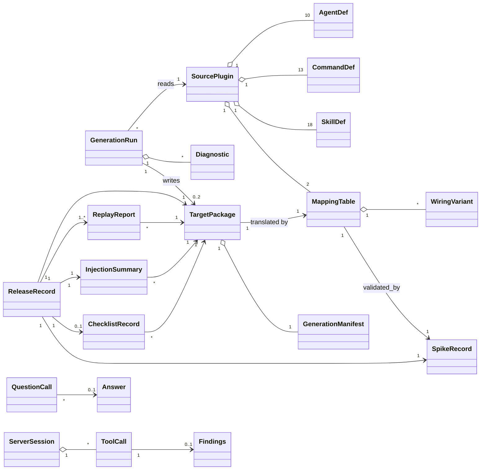

# C002 — Domain model

CHG-002 does not change the SDD workspace domain of CHG-001
(`.sdd/001-architect-agent-suite/10-spec/40-domain/domain-model.md`, C002-NG-03). It adds a build-time
domain (the source plugin translated into target packages), a run-time domain (calls to the sdd MCP
server and host question results) and a release domain (evidence and release records). Terms:
`glossary-delta.md`; owning components: `../60-architecture/architecture.md`; lifecycles:
`state-machines.md`.

## 1. Entity overview

## 2. Entities

### 2.1 SourcePlugin and its definitions
- **Attributes:** `root` (`plugins/architect`), `version` (from `.claude-plugin/plugin.json`). AgentDef: `name`, `description`, `model` (tier), `effort`, `color`, `memory`, `tools[]`, `skills[]`, `body`. CommandDef: `name`, `description`, `argument_hint`, `body`. SkillDef: `name`, `description`, `body`, `references[]`, wiring sections. Hook and MCP server definitions of `hooks/hooks.json` and `.mcp.json`
- **Relationships:** the neutral model of the generator is built from it once per generation run; it holds the two mapping tables and their variants under `targets/`
- **Owning component:** C002-COMP-017 (plugin files), C002-COMP-002 (`targets/`); read by C002-COMP-001
- **Invariants:** C002-INV-03

### 2.2 MappingTable and WiringVariant
- **Attributes:** MappingTable: `target` (opencode, copilot), `enforcement_mode`, `host` {`name`, `tested_versions`, `validated_by`}, `placement`, `models`, `agent_fields`, `tools`, `agent_start`, `mcp_tool_names`, `mcp_servers`, `variables`, `references`, `constructs[]`, `variants[]`, `permissions` (OpenCode), `hook_tool_classes` (Copilot hooks fallback). WiringVariant: `id`, `file`, `anchor` (section or line block), `text_file`, tokens
- **Relationships:** one table per generated target; each table cites the spike record that fixed its mode and tested versions
- **Owning component:** C002-COMP-002 (contract C002-IF-001)
- **Invariants:**
  - **C002-INV-04** A mapping table names exactly one enforcement mode: `native-permissions` or `sdd-mcp-server` for OpenCode, `sdd-mcp-server` or `copilot-hooks` for Copilot; a package proposed for release was generated with the table's mode.

### 2.3 GenerationRun and Diagnostic
- **Attributes:** GenerationRun: `targets[]`, `source_digest`, `mode` and `mode_source` (table, override) per target, `outcome` (succeeded, failed). Diagnostic: `severity`, `code` (ERR-GEN-*), `file`, `line`, `target`, `construct`, `message`, `fix`
- **Relationships:** reads the source plugin and the tables; writes zero target packages (failed) or one per selected target (succeeded)
- **Owning component:** C002-COMP-001 (contract C002-IF-004)
- **Invariants:**
  - **C002-INV-02** After a generation run, the output folder of each selected target holds exactly the files of that run, or does not exist when the run found an error.
  - **C002-INV-03** A generation run creates, modifies or deletes no file under the source plugin folder.
  - **C002-INV-12** No Claude Code construct reaches a target package untranslated outside the contexts its detector accepts; a run that cannot translate one fails.

### 2.4 TargetPackage and GenerationManifest
- **Attributes:** TargetPackage: `target`, `root` (`dist/opencode/`, `dist/copilot/`), agents, commands or prompt files, skills, MCP configuration, permission blocks (OpenCode), hooks and CLI copy (Copilot), install notes. GenerationManifest (`architect-target.json`): `target`, `package_version`, `enforcement_mode`, `mode_source`, `table_schema_version`, `tested_versions`, `source_digest`, `files[{path, sha256}]`
- **Relationships:** written by one generation run; evidence and release records refer to it by target and `package_version`
- **Owning component:** C002-COMP-003 (OpenCode), C002-COMP-004 (Copilot); contract C002-IF-005
- **Invariants:**
  - **C002-INV-01** Every file of a target package was written by one generation run from one source plugin state (`source_digest`); no file is added or edited by hand.
  - **C002-INV-05** In a target package generated for sdd MCP server enforcement, no Architect agent, command or prompt file is granted a generic edit or terminal tool.
  - **C002-INV-06** In every target package only the conductor holds an agent-start grant, and the grant admits exactly the nine specialists.
  - **C002-INV-11** In one packaging run, the source plugin version, the `package_version` of both target packages and the version of `architect-sdd` are equal.

### 2.5 ServerSession and ToolCall (sdd MCP server)
- **Attributes:** ServerSession: `profile` (files, shell), `root` (repository folder fixed at initialisation), `state`. ToolCall: `tool` (write_file, replace_text, run_command), `arguments`, `decision` (allow, or deny with GUARD-PATH-001, GUARD-BASH-001 or GUARD-BASH-002), `outcome` (written, refused, failed, completed, timed_out), `exit_code`, `stdout`, `stderr`, `findings` or `findings_unavailable`
- **Relationships:** one session per declared server and host session; calls are handled one at a time
- **Owning component:** C002-COMP-005 (contract C002-IF-002)
- **Invariants:**
  - **C002-INV-07** A write call changes at most one file, which lies under `.sdd/` of the session's repository; afterwards the file holds either the new content or its previous content.
  - **C002-INV-08** A command call starts a process only after the bash guard core allowed the whole command, and never through a shell.

### 2.6 ReplayReport, InjectionSummary, SpikeRecord, ChecklistRecord
- **Attributes:** as in C002-IF-009 (`release-record.schema.json` `$defs`, `verification-records.md` §3–§4)
- **Relationships:** each refers to one target and package version; the spike record fixes the enforcement mode and tested versions copied into the mapping table
- **Owning component:** C002-COMP-008 (replay), C002-COMP-009 (injection summary), C002-COMP-011 (checklist and records); spike records are written by the plan's spike tasks

### 2.7 ReleaseRecord
- **Attributes:** `target`, `package_version`, `decided_on`, `outcome` (released, refused), `enforcement_mode`, `exception`, `tested_versions`, `evidence`, `refusals[{code, message}]`
- **Owning component:** C002-COMP-010 (contract C002-IF-009)
- **Invariants:**
  - **C002-INV-10** A release record with outcome `released` cites, at the tested versions, a corpus replay with 0 differing decisions for every mechanism of the package's mode and an injection summary with no case acted upon; for Copilot VS Code also a checklist record with every step passed, and under the Copilot hooks fallback the exception of C002-DEC-005.

### 2.8 QuestionCall and Answer
- **Attributes:** QuestionCall: `host tool` (AskUserQuestion, `question`, `vscode/askQuestions`), `questions[1..4]`, `result` (choices, skipped, dismissed, empty). Answer: the verbatim choice or text per question (C001-INV-23 applies)
- **Owning component:** C002-COMP-014 (conductor)
- **Invariants:**
  - **C002-INV-09** A question-tool result without a choice of P-01 creates no answer in a questions log and no gate approval.

### 2.9 DoctorRow
- **Attributes:** `tool`, `status` (ok, missing, unreachable, error, untested), `version`, `fallback`, `fix`; host rows and the sdd CLI row per C002-IF-006
- **Owning component:** C002-COMP-015 (doctor command), C002-COMP-016 (toolchain record)
