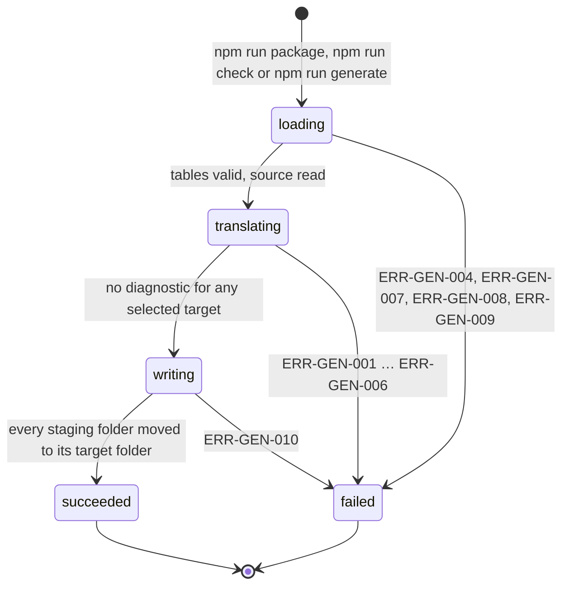
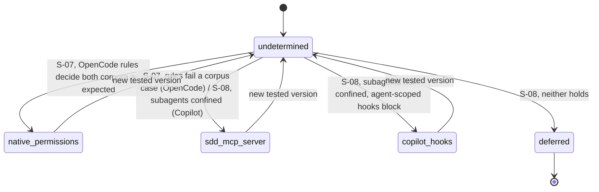
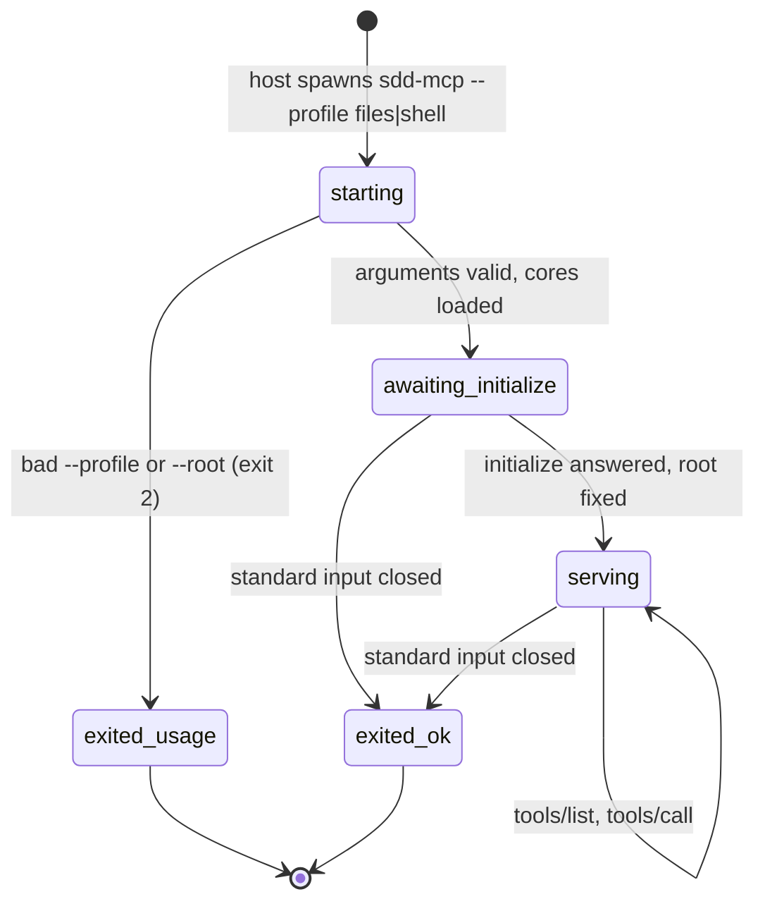
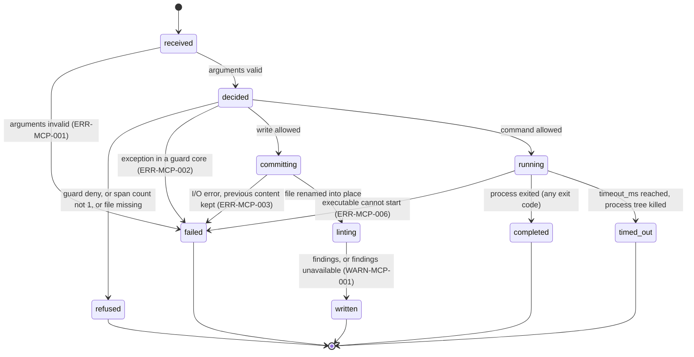
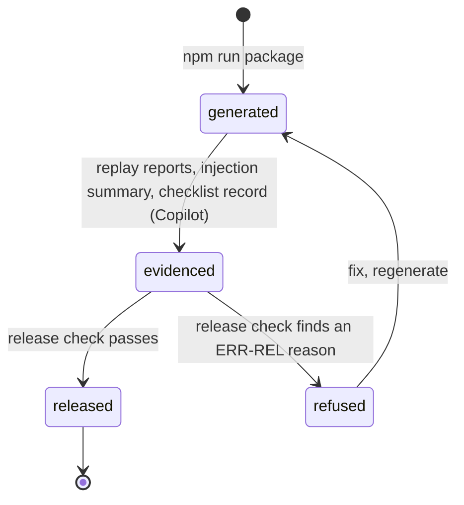
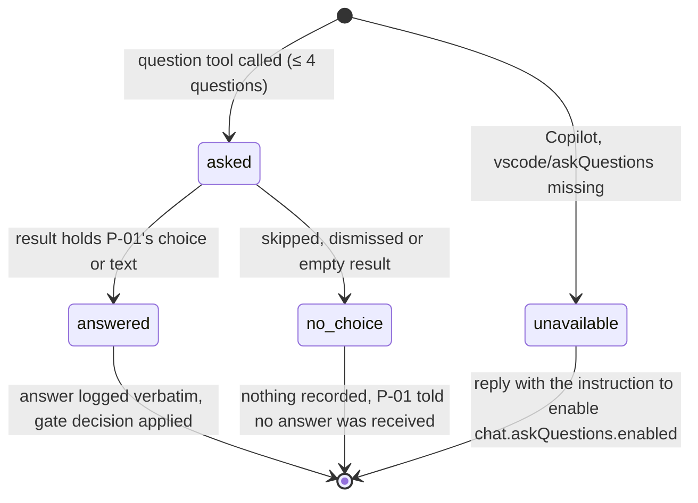

# C002 — State machines

The CHG-001 state machines (phase, change, task, defect, implementation status) are unchanged. CHG-002
adds the lifecycles below. Entities: `domain-model.md`.

## 1. Generation run

| From | Event | Guard | To | Effect |
|---|---|---|---|---|
| (none) | generator started | — | loading | tables validated against C002-IF-001; neutral model built from the source plugin |
| loading | load complete | every table valid, every source file readable, output outside the source plugin | translating | — |
| translating | all targets translated | no diagnostic | writing | each target written to `<out>/.staging-<target>/` with its manifest |
| translating | a diagnostic found | — | failed | all diagnostics printed; selected target folders removed (C002-INV-02) |
| writing | all moves done | — | succeeded | exit 0 |
| writing | I/O error | — | failed | staging and target folders removed; exit 3 |
| any | — | — | — | the source plugin is never written (C002-INV-03) |

## 2. Enforcement mode of a target

The mode is a fact of the mapping table, fixed from a spike record (C002-INV-04); a new tested version
needs a new or updated spike record.

| From | Event | Guard | To | Effect |
|---|---|---|---|---|
| undetermined | S-07 record | OpenCode `edit` and `bash` rules decide the path and shell corpora as expected (C002-AS-01, C002-AS-02) | native_permissions | table mode `native-permissions` |
| undetermined | S-07 record | any corpus case decided otherwise | sdd_mcp_server | OpenCode table mode `sdd-mcp-server` (C002-REQ-209) |
| undetermined | S-08 record | Copilot subagents confined to their tool list (C002-AS-03) | sdd_mcp_server | Copilot table mode `sdd-mcp-server` |
| undetermined | S-08 record | not confined; agent-scoped hooks block a subagent's tool calls | copilot_hooks | Copilot table mode `copilot-hooks`; release flagged (C002-REQ-622) |
| undetermined | S-08 record | not confined; hooks do not block | deferred | Copilot release refused (C002-REQ-620, ERR-REL-005); OpenCode unaffected (C002-REQ-619) |
| any determined mode | tested version changes | — | undetermined | spike re-run before the next release (C002-REQ-621) |

## 3. sdd MCP server process

| From | Event | Guard | To | Effect |
|---|---|---|---|---|
| starting | arguments read | profile is `files` or `shell`; `--root` usable if given | awaiting_initialize | rules and guard cores loaded once |
| starting | arguments read | otherwise | exited_usage | ERR-MCP-007 on standard error; exit 2 |
| awaiting_initialize | `initialize` | — | serving | repository root fixed (C002-IF-002 §3) |
| awaiting_initialize, serving | standard input closed | — | exited_ok | exit 0 (C002-REQ-411) |

## 4. Tool call of the sdd MCP server

| From | Event | Guard | To | Effect |
|---|---|---|---|---|
| received | validation | input schema of the tool | decided / failed | — |
| decided | path or bash guard core | allow | committing (write) / running (command) | — |
| decided | path or bash guard core | deny | refused | error result with the core's rule and message; nothing changed (C002-INV-07, C002-INV-08) |
| decided | span count (`replace_text`) | count ≠ 1 | refused | ERR-MCP-004 with the count |
| committing | rename | — | linting | file holds the new content |
| linting | quick lint | runs or throws | written | result with findings or WARN-MCP-001; the write stands (C002-REQ-409) |
| running | process exit | — | completed | exit code, standard output and standard error returned; non-zero is not an error result |

## 5. Release of a generated target

| From | Event | Guard | To | Effect |
|---|---|---|---|---|
| evidenced | release check | every check of C002-IF-009 §5 passes | released | release record with outcome `released` (C002-INV-10); P-01 publishes the package |
| evidenced | release check | any check fails | refused | release record with outcome `refused` and its ERR-REL codes |

Each target runs this machine on its own (C002-REQ-619).

## 6. Question-tool result (conductor on a generated target)

| From | Event | Guard | To | Effect |
|---|---|---|---|---|
| asked | tool result | holds at least one choice or text answer | answered | questions log and, at a gate, `sdd gate approve` or `gate record` with the verbatim words |
| asked | tool result | `{"skipped": true}`, dismissed or empty | no_choice | no log entry, no approval (C002-REQ-311, C002-INV-09) |
| (none) | conductor would ask | VS Code reports no `vscode/askQuestions` tool | unavailable | no question asked (C002-REQ-312) |
