# C002 — Architecture

Brownfield delta on the CHG-001 architecture (`.sdd/001-architect-agent-suite/10-spec/60-architecture/architecture.md`).
CHG-001 components that CHG-002 changes appear here under a new C002 ID with Status `modified`, the
CHG-001 component they modify and the cartographer's evidence (`../10-context/current-state.md`,
"current-state E-n"; `../../00-ideation/evidence/baseline-survey.md`, "baseline E-n"). Components
of CHG-001 that CHG-002 does not change (workspace, parser/lint/trace, gate, tracking and archive,
templates, specialist agents) keep their C001 IDs and are not repeated. Decisions are those of
C002-DEC-001 … C002-DEC-009; this step adds no ADR (§6.2 lists the design choices it fixes).

## 1. Context and scope

Architect stays a set of files and a Node.js CLI that runs inside the host's own process tree; it
has no server of its own. CHG-002 adds two hosts. One repository build (`npm run package`) produces
the Claude Code plugin as today, an OpenCode package, a Copilot VS Code package and the npm package
`architect-sdd` (C002-DEC-004, C002-DEC-006, C002-DEC-007).

**System boundary:** the source plugin (`plugins/architect/`, now including `targets/`), the
generator and the checks of the repository, the generated packages under `dist/`, the `architect-sdd`
package (sdd CLI and sdd MCP server) and the verification records under `docs/`.

| Actor / system | Interaction | Trust |
|---|---|---|
| P-01 spec owner | Runs packaging, checks, the manual VS Code checklist and the release check; publishes `architect-sdd`; answers interviews and gates on any host | trusted (sole approver) |
| P-03 adopter | Installs a package and `architect-sdd`, runs the conductor on Claude Code, OpenCode or VS Code | trusted user; its own agents and settings are outside Architect |
| Claude Code | Source target, unchanged except the allowlist rows (C002-REQ-503), the Serena-command confinement (C002-REQ-517) and the `--cwd` confinement of the writing `sdd` subcommands (C002-REQ-521) of the bash guard | platform |
| OpenCode (tested version) | Loads the OpenCode package; enforces `permission` rules under native permission enforcement; starts the sdd MCP server under sdd MCP server enforcement | platform; permission engine verified by corpus replay (C002-AS-01, C002-AS-02) |
| VS Code with GitHub Copilot Chat (tested versions) | Loads the Copilot package as a plugin; confines agents to their tool lists (C002-AS-03); starts MCP servers; runs hooks | platform; tool-list confinement verified by spike S-08 |
| Copilot CLI | Eval runner host only (C002-NG-01) | tool |
| npm registry | Receives `architect-sdd` from P-01; serves it to P-03 | service |
| Repository source, web, MCP results | Read by agents | **untrusted content** (C002-NFR-203) |

**Trust boundaries:** (1) agent ↔ content (data, never instructions); (2) agent ↔ file system and
shell — enforced per target by the enforcement mechanism of its mode, never by instructions alone
(C002-CON-03); (3) agent ↔ gate — only P-01's choice through the host question tool approves
(C002-INV-09); (4) Architect ↔ the adopter's own agents — the OpenCode package sets no permission for
other agents (C002-REQ-208) and the Copilot package declares no plugin-level PreToolUse hook
(C002-REQ-302).

## 2. Component catalogue

### C002-COMP-001 — Target generator
- **Name:** Target generator (`scripts/generate.mjs` and `scripts/generate/`: source reader, translator, OpenCode emitter, Copilot emitter, writer)
- **Status:** new
- **Responsibility:** read the source plugin once into the neutral model, translate it with each target's mapping table and variants, write every selected target package with its generation manifest, or none on any error
- **Realizes:** C002-REQ-101, C002-REQ-102, C002-REQ-103, C002-REQ-104, C002-REQ-105, C002-REQ-106, C002-REQ-107, C002-REQ-108, C002-REQ-109, C002-REQ-111, C002-REQ-112, C002-REQ-114, C002-REQ-115, C002-REQ-116, C002-REQ-117, C002-REQ-118, C002-REQ-216, C002-REQ-317; C002-NFR-103, C002-NFR-301
- **Interfaces:** provides C002-IF-004; reads C002-IF-001; writes C002-IF-005
- **Depends on:** C002-COMP-002, C002-COMP-017
- **Owned data:** generation run, diagnostics, generation manifests, staging folders under `dist/`

### C002-COMP-002 — Mapping tables and wiring variants
- **Name:** `plugins/architect/targets/` (`opencode.json`, `copilot.json`, `<target>/wiring/*.md`)
- **Status:** new
- **Responsibility:** hold, per generated target, the enforcement mode, tested versions, model tiers, tool grants, MCP servers, construct detectors and wiring variants that the generator, the target structure checks and the release check read
- **Realizes:** C002-REQ-103, C002-REQ-105, C002-REQ-111, C002-REQ-113, C002-REQ-114, C002-REQ-116, C002-REQ-117, C002-REQ-118, C002-REQ-508
- **Interfaces:** C002-IF-001
- **Depends on:** spike records S-07 and S-08 (C002-IF-009 §3)
- **Owned data:** mapping tables, wiring variants, install-notes sources

### C002-COMP-003 — OpenCode target package
- **Name:** `dist/opencode/` (`.opencode/agents`, `.opencode/commands`, `.opencode/skills`, `opencode.json`, optional quick-lint plugin, `INSTALL.md`, manifest)
- **Status:** new
- **Responsibility:** run the Architect agents in OpenCode with the boundary of its enforcement mode: per-agent `permission` rules (native) or the sdd MCP server (server), each Architect agent with a closed tool set (catch-all off, derived tools on); commands named `architect-<name>`; Serena read-only with per-user data; interviews and gates through `question`
- **Realizes:** C002-REQ-114, C002-REQ-201, C002-REQ-202, C002-REQ-203, C002-REQ-204, C002-REQ-206, C002-REQ-207, C002-REQ-208, C002-REQ-209, C002-REQ-210, C002-REQ-215, C002-REQ-216
- **Interfaces:** C002-IF-005 §2; declares C002-IF-002
- **Depends on:** C002-COMP-006 (`sdd`, `sdd-mcp` on PATH), C002-COMP-005 (server mode)
- **Owned data:** generated files only

### C002-COMP-004 — Copilot target package
- **Name:** `dist/copilot/` (`agents/*.agent.md`, `prompts/*.prompt.md`, `skills/`, `.mcp.json`, `hooks/hooks.json`, `hooks/tool-classes.json`, `scripts/sdd.mjs` copy, `INSTALL.md`, manifest)
- **Status:** new
- **Responsibility:** run the Architect agents in VS Code with no generic edit or terminal tool (server mode) or with agent-scoped guard hooks and the tool classes file (hooks fallback); prompt files named `<name>.prompt.md`; Serena read-only with per-user data; session-start brief and trace refresh hooks; interviews and gates through `vscode/askQuestions`
- **Realizes:** C002-REQ-114, C002-REQ-301, C002-REQ-302, C002-REQ-303, C002-REQ-304, C002-REQ-306, C002-REQ-307, C002-REQ-308, C002-REQ-313, C002-REQ-314, C002-REQ-315, C002-REQ-316, C002-REQ-317, C002-REQ-318
- **Interfaces:** C002-IF-005 §3; declares C002-IF-002; hook commands of C002-IF-008 §2–§4
- **Depends on:** C002-COMP-006, C002-COMP-005 (server mode), C002-COMP-012 (through the CLI copy)
- **Owned data:** generated files only

### C002-COMP-005 — sdd MCP server
- **Name:** `src/mcp/` bundled to `scripts/sdd-mcp.mjs` of `architect-sdd`; profiles `files` and `shell`
- **Status:** new
- **Responsibility:** write and edit files under `.sdd/` (profile `files`) and run allowlisted commands (profile `shell`) for agents without generic tools, listing only the tools of its profile, deciding every call with the guard cores, failing closed, and returning quick-lint findings with each write
- **Realizes:** C002-REQ-401, C002-REQ-402, C002-REQ-403, C002-REQ-404, C002-REQ-405, C002-REQ-406, C002-REQ-407, C002-REQ-408, C002-REQ-409, C002-REQ-410, C002-REQ-411, C002-REQ-415; C002-NFR-101, C002-NFR-102, C002-NFR-204, C002-NFR-205
- **Interfaces:** C002-IF-002
- **Depends on:** C002-COMP-012 (guard cores, tokeniser), C002-COMP-018 (its own `sdd` entry), C001-COMP-04 (quick lint), C001-COMP-03 (workspace lookup)
- **Owned data:** none persistent; the session's repository root

### C002-COMP-006 — `architect-sdd` npm package
- **Name:** staging folder `dist/npm/architect-sdd/` and tarball `dist/architect-sdd-<version>.tgz`
- **Status:** new
- **Responsibility:** carry the `sdd` and `sdd-mcp` executables, the templates (CLI lines written as `sdd`) and the Serena read-only mode file to the generated targets, with license and notices, without runtime dependencies
- **Realizes:** C002-REQ-412, C002-REQ-414, C002-REQ-501, C002-REQ-502, C002-REQ-512; C002-NFR-401, C002-NFR-402, C002-NFR-801
- **Interfaces:** C002-IF-003
- **Depends on:** C002-COMP-013 (build and staging), C002-COMP-005, C002-COMP-018
- **Owned data:** manifest, bundled entries, copies of templates and notices

### C002-COMP-007 — Target structure checks
- **Name:** `scripts/check/targets/*.mjs`, a new step of `scripts/check.mjs`
- **Status:** new
- **Responsibility:** generate the packages into a temporary folder and check them against the target package contracts (TGT-* codes, including the Serena declaration and the tool classes file), check the tarball, and check the agent, command and skill files of the source plugin for variant leaks (PLG-VAR-001)
- **Realizes:** C002-REQ-110, C002-REQ-113, C002-REQ-114, C002-REQ-318, C002-REQ-601, C002-REQ-602, C002-REQ-603, C002-REQ-604, C002-REQ-605; C002-NFR-104
- **Interfaces:** C002-IF-005 §6
- **Depends on:** C002-COMP-001, C002-COMP-002
- **Owned data:** none (findings printed)

### C002-COMP-008 — Corpus replay suite
- **Name:** `tests/replay/` with one adapter per mechanism (OpenCode permission rules, sdd MCP server, agent-scoped guard hooks)
- **Status:** new
- **Responsibility:** feed every applicable case of the path and shell corpora to each enforcement mechanism in use, as the input C002-IF-009 §2.2 maps it to (a case with a `cwd` other than the repository root through its own `cwd`), with the expectation of that mechanism (cases without a `cwd` or a tool name, or needing a capability the replay host lacks, fed as malformed calls and `deny`; unknown `architect:sdd-*` callers `allow` on OpenCode; memory cases `deny`; identity cases on OpenCode only), report the decisions that differ, record the replay host, and list the cases not replayed
- **Realizes:** C002-REQ-606, C002-REQ-625, C002-REQ-626, C002-REQ-627, C002-REQ-630, C002-REQ-632; C002-NFR-201, C002-NFR-202
- **Interfaces:** C002-IF-009 §2 (replay report)
- **Depends on:** C002-COMP-013 (corpora), C002-COMP-005, C002-COMP-012, C002-COMP-003, C002-COMP-004, C002-COMP-006
- **Owned data:** replay reports

### C002-COMP-009 — Eval runners for the generated targets
- **Name:** `evals/harness/runners/opencode.mjs`, `evals/harness/runners/copilot-cli.mjs`, stub runner; host selection in `runSession`
- **Status:** new
- **Responsibility:** run the existing eval cases on OpenCode and Copilot CLI through the unchanged case API, within the turn and spend caps, and produce the injection summaries
- **Realizes:** C002-REQ-608, C002-REQ-609, C002-REQ-610, C002-REQ-611, C002-REQ-612; C002-NFR-105, C002-NFR-203
- **Interfaces:** C002-IF-010; C002-IF-009 (injection summary)
- **Depends on:** C002-COMP-003, C002-COMP-004, C002-COMP-002 (name mapping), C002-COMP-013 (existing harness)
- **Owned data:** eval results per target, injection summaries

### C002-COMP-010 — Release check
- **Name:** `scripts/release-check.mjs` and release records under `docs/releases/`
- **Status:** new
- **Responsibility:** decide, per generated target and independently of the other, whether a package may be released, from regeneration, replay (completeness of the not-applicable list and the expected decision of every case included), injection, checklist (hooks state and injection steps under the hooks fallback) and spike evidence at the tested versions (a closed OpenCode tool set included, ERR-REL-013), and write the release record
- **Realizes:** C002-REQ-617, C002-REQ-618, C002-REQ-619, C002-REQ-620, C002-REQ-621, C002-REQ-622, C002-REQ-629; C002-NFR-501
- **Interfaces:** C002-IF-009 §5
- **Depends on:** C002-COMP-001, C002-COMP-002, C002-COMP-008, C002-COMP-009, C002-COMP-011
- **Owned data:** release records

### C002-COMP-011 — Manual VS Code checklist
- **Name:** `docs/checklists/vscode-copilot.md` and records under `docs/checklists/records/`
- **Status:** new
- **Responsibility:** verify by hand what no script can drive in VS Code (boundary, interview, gate with a skipped answer, toy change to G1, Revise at G1 and the revise prompt, hooks state, injection cases when Copilot CLI cannot load the package and always under the hooks fallback) and keep one record per run, with the hooks state under the hooks fallback
- **Realizes:** C002-REQ-613, C002-REQ-614, C002-REQ-615, C002-REQ-616, C002-REQ-628; C002-NFR-601
- **Interfaces:** C002-IF-009 §4
- **Depends on:** C002-COMP-004
- **Owned data:** checklist, checklist records

### C002-COMP-012 — Hooks and guards (modified)
- **Name:** `src/hooks/` (guard-path, guard-bash, session-start, post-write, new host adapter) and `hooks/hooks.json`
- **Status:** modified
- **Modifies:** C001-COMP-08
- **Responsibility:** as in CHG-001, plus: the bash guard accepts a bare `sdd …` and `node --version`, confines `sdd serena-config` and `sdd serena-launch` to `--user-data` or a data folder outside the repository on every host (C002-IF-008 §1.1), and allows `--cwd` on a writing `sdd` subcommand only with a folder at or under the repository root on every host (C002-IF-008 §1.2); the path guard core takes a memory-folder option (off for the generated targets); a Copilot host adapter turns Copilot hook input into guard decisions (read-only tools allowed, unclassed tools denied), briefs and trace refreshes, failing closed
- **Realizes:** C002-REQ-503, C002-REQ-517, C002-REQ-521, C002-REQ-308, C002-REQ-309, C002-REQ-313, C002-REQ-314, C002-REQ-315, C002-REQ-319; C002-NFR-201, C002-NFR-202, C002-NFR-204
- **Interfaces:** C002-IF-008; C001-IF-07
- **Depends on:** C001-COMP-03, C001-COMP-04
- **Owned data:** none
- **Evidence:** current-state E-5 (`src/hooks/guard-bash.ts:119` › `sddCli()`, layer: serena: a bare `sdd` is denied with GUARD-BASH-001, and any subcommand after `node <path>/sdd.mjs` passes); current-state E-22 (`src/cli/commands.ts:420` › `serenaConfig()`, layer: serena: the data folder is written as given, so `sdd serena-config src` writes into the repository); current-state E-6 (`src/hooks/guard-bash.ts:133` › `VERSION_PROBES`, layer: grep: `node -v` only); current-state E-4 (`src/hooks/guard-path.ts:18` › `WRITE_TOOLS`, layer: serena: memory folder at l.56); baseline E-13 (`src/cli/commands.ts:427` › `guardPath()`, layer: serena: the four hook entry points); critic CR-25 evidence, re-read for C002-REQ-521 (`src/cli/run.ts:133` › `execute()`, layer: read: the global `--cwd` of every subcommand is resolved against the CLI's working folder; `src/cli/run.ts:33` › `findCommand()`: the subcommand is the first word, or the first two for a group)

### C002-COMP-013 — Build and check tooling (modified)
- **Name:** `package.json` scripts, `scripts/build.mjs`, `scripts/package.mjs`, `scripts/check.mjs` and `scripts/check/`, `tests/` (including the guard corpora), `evals/`, `bench/`
- **Status:** modified
- **Modifies:** C001-COMP-12
- **Responsibility:** as in CHG-001, plus: bundle the two `architect-sdd` entries with the license check over both; run the generator in `npm run package` and in `npm run check`; stage and pack `architect-sdd`, translating the CLI lines of the staged templates and failing on a plugin path left in them (ERR-BLD-002); leave `targets/` out of the Claude Code staging; extend the corpora with the cases of the new risks and one case per writing sdd subcommand (C002-IF-008 §1.2); keep the regression set green
- **Realizes:** C002-REQ-101, C002-REQ-413, C002-REQ-502, C002-REQ-518, C002-REQ-519, C002-REQ-601, C002-REQ-607, C002-REQ-623; C002-NFR-801
- **Interfaces:** C001-IF-08 §3 (plus PLG-VAR-001); calls C002-IF-004
- **Depends on:** C002-COMP-001, C002-COMP-007, C002-COMP-017, C002-COMP-018, C002-COMP-005
- **Owned data:** `tests/` (guard corpora included), `evals/`, `bench/`, `dist/` staging
- **Evidence:** current-state E-8 (`scripts/check/lib.mjs:10` › `context()`, layer: grep: checks read only `plugins/architect/` and two CHG-001 folders; six steps in `check.mjs`); current-state E-1 (`scripts/package.mjs:33`, layer: grep: Claude-only staging and INSTALL.md); current-state E-2 (`scripts/build.mjs:15`, layer: grep: one bundle, `scripts/` emptied); current-state E-3 (`package.json:4`, layer: grep: private, no `bin`)

### C002-COMP-014 — Conductor (modified)
- **Name:** `sdd-conductor` agent with its phase skills, on every host
- **Status:** modified
- **Modifies:** C001-COMP-01
- **Responsibility:** as in CHG-001, plus: ask through the host's question tool in rounds of at most four, with OpenCode's header and description rules; treat a result without a choice as no answer; refuse to ask when VS Code lacks `vscode/askQuestions`; run the doctor with the host rows of C002-IF-006
- **Realizes:** C002-REQ-211, C002-REQ-212, C002-REQ-213, C002-REQ-214, C002-REQ-311, C002-REQ-312, C002-REQ-504, C002-REQ-505, C002-REQ-506, C002-REQ-508, C002-REQ-509, C002-REQ-510
- **Interfaces:** C001-IF-05, C001-IF-13, C002-IF-006
- **Depends on:** C002-COMP-016, C002-COMP-018
- **Owned data:** questions logs, gate-log entries (through the CLI), as in CHG-001
- **Evidence:** current-state E-24 (`plugins/architect/agents/sdd-conductor.md:7` › `tools`, layer: grep: AskUserQuestion granted); current-state E-25 (`plugins/architect/agents/sdd-conductor.md:61` › `Hard rules`, layer: grep: approval only after the AskUserQuestion answer)

### C002-COMP-015 — Commands (modified)
- **Name:** `commands/*.md` (`/architect:*` on Claude Code; `architect-<command>` on OpenCode; prompt files on Copilot)
- **Status:** modified
- **Modifies:** C001-COMP-09
- **Responsibility:** as in CHG-001; the doctor command gains host-dependent rows, probes and outcome through wiring variants; command bodies keep their Claude Code text, translated per target by the generator
- **Realizes:** C002-REQ-213, C002-REQ-504, C002-REQ-505, C002-REQ-506, C002-REQ-507, C002-REQ-508, C002-REQ-509, C002-REQ-510
- **Interfaces:** C001-IF-10, C002-IF-006
- **Depends on:** C002-COMP-014, C002-COMP-016
- **Owned data:** none
- **Evidence:** current-state E-14 (`plugins/architect/commands/doctor.md:17` › `Report`, layer: grep: eight rows, no host or sdd CLI row); current-state E-16 (`plugins/architect/commands/doctor.md:24` › `Outcome`, layer: grep); current-state E-28 (`plugins/architect/commands/new.md:14` › `step 3`, layer: grep: profile round; `archive.md:15` names AskUserQuestion)

### C002-COMP-016 — Skills library (modified)
- **Name:** `skills/*/SKILL.md`
- **Status:** modified
- **Modifies:** C001-COMP-10
- **Responsibility:** as in CHG-001; the toolchain record of code-discovery becomes host-dependent through a wiring variant; the "Claude Code wiring" sections stay the Claude Code text, their variants live in `targets/` (C002-CON-10)
- **Realizes:** C002-REQ-507, C002-REQ-111, C002-REQ-113
- **Interfaces:** C001-IF-09 (`skills` field); anchors of C002-IF-001
- **Depends on:** C001-COMP-13
- **Owned data:** none
- **Evidence:** current-state E-21 (`plugins/architect/skills/code-discovery/SKILL.md:94` › `Toolchain record`, layer: grep); current-state E-26 (`plugins/architect/skills/interview-protocol/SKILL.md:119` › `Claude Code wiring`, layer: grep); current-state E-27 (`plugins/architect/skills/gate-protocol/SKILL.md:87` › `Claude Code wiring`, layer: grep)

### C002-COMP-017 — Plugin package and configuration (modified)
- **Name:** `plugins/architect/` manifests, `agents/`, `.mcp.json`, README, LICENSE, notices, and the new `targets/` folder
- **Status:** modified
- **Modifies:** C001-COMP-11
- **Responsibility:** as in CHG-001; hosts `targets/` (C002-COMP-002); the README gains the OpenCode and Copilot VS Code sections with the enforcement mode and, under the hooks fallback, the warning
- **Realizes:** C002-REQ-205, C002-REQ-305, C002-REQ-310
- **Interfaces:** C001-IF-08, C001-IF-09
- **Depends on:** C002-COMP-002
- **Owned data:** plugin files
- **Evidence:** current-state E-10 (`plugins/architect/.mcp.json:11` › `serena`, layer: grep: Claude spelling of the Serena launch); current-state E-13 (`scripts/check/layout.mjs:6` › `PATHS`, layer: grep: layout pinned, 10 `sdd-*.md` agents)

### C002-COMP-018 — CLI front-end (modified)
- **Name:** `src/cli.ts`, `src/cli/commands.ts` → bundled `scripts/sdd.mjs` (plugin) and `scripts/sdd.mjs` of `architect-sdd`
- **Status:** modified
- **Modifies:** C001-COMP-07
- **Responsibility:** as in CHG-001, plus `--version`, `host-version`, `template show|list` (confined to the profile's template folder, listed in code-point order), `--user-data` (refused when not determinable, relative or inside the repository) and `--read-only` for the Serena commands, and the `--host copilot` hook commands; one source for the plugin bundle and the npm executable
- **Realizes:** C002-REQ-114, C002-REQ-407, C002-REQ-501, C002-REQ-508, C002-REQ-509, C002-REQ-511, C002-REQ-513, C002-REQ-514, C002-REQ-515, C002-REQ-516, C002-REQ-520
- **Interfaces:** C001-IF-01, C002-IF-007
- **Depends on:** C001-COMP-03, C001-COMP-04, C001-COMP-05, C001-COMP-06, C002-COMP-012
- **Owned data:** none
- **Evidence:** current-state E-22 (`src/cli/commands.ts:420` › `serenaConfig()`, layer: serena: data folder taken as an argument); baseline E-14 (`src/workspace/templates.ts:32` › `defaultPluginRoot()`, layer: grep: templates resolved beside the bundle when `CLAUDE_PLUGIN_ROOT` is unset)

## 3. Runtime flows

| Flow | Steps | Realizes |
|---|---|---|
| F1 | Generation and packaging: build, Claude Code staging, generation of both targets, npm staging with the template CLI-line translation and scan, and pack | C002-REQ-101, C002-REQ-102, C002-REQ-104, C002-REQ-112, C002-REQ-412, C002-REQ-502, C002-REQ-512, C002-REQ-518, C002-REQ-519; C002-TS-101, C002-TS-102, C002-TS-103, C002-TS-104, C002-TS-106, C002-TS-108, C002-TS-119, C002-TS-417, C002-TS-503, C002-TS-519, C002-TS-529, C002-TS-530 |
| F2 | OpenCode write and command through the native permission rules, with the optional quick-lint feedback | C002-REQ-206, C002-REQ-207, C002-REQ-215; C002-TS-207, C002-TS-209, C002-TS-222, C002-TS-223 |
| F3 | Copilot write through the sdd MCP server (`sdd-files`), including the server's start and end | C002-REQ-401 … C002-REQ-404, C002-REQ-408 … C002-REQ-411; C002-TS-401, C002-TS-402, C002-TS-404, C002-TS-405, C002-TS-410, C002-TS-413, C002-TS-414, C002-TS-415 |
| F4 | Copilot command through the sdd MCP server (`sdd-shell`) | C002-REQ-405, C002-REQ-406, C002-REQ-407; C002-TS-406, C002-TS-407, C002-TS-408, C002-TS-409 |
| F5 | Copilot hooks fallback: an agent-scoped guard hook decides an edit or terminal call | C002-REQ-308, C002-REQ-309; C002-TS-311, C002-TS-312, C002-TS-313, C002-TS-314 |
| F6 | Copilot session-start brief and SubagentStop trace refresh | C002-REQ-313, C002-REQ-314, C002-REQ-315, C002-REQ-316; C002-TS-320, C002-TS-322, C002-TS-323, C002-TS-324, C002-TS-325 |
| F7 | Gate through the host question tool on a generated target | C002-REQ-211, C002-REQ-212, C002-REQ-311, C002-REQ-312; C002-TS-217, C002-TS-218, C002-TS-316, C002-TS-318, C002-TS-319 |
| F8 | Doctor on a generated target | C002-REQ-504, C002-REQ-505, C002-REQ-508, C002-REQ-509, C002-REQ-510; C002-TS-506, C002-TS-509, C002-TS-513, C002-TS-515, C002-TS-516 |
| F9 | Release check of one generated target | C002-REQ-617 … C002-REQ-622, C002-REQ-629; C002-TS-620, C002-TS-621, C002-TS-622, C002-TS-623, C002-TS-624, C002-TS-625, C002-TS-633 |
| F10 | `npm run check` with the target structure checks | C002-REQ-601 … C002-REQ-605; C002-TS-601, C002-TS-602, C002-TS-603, C002-TS-604, C002-TS-605 |
| F11 | Corpus replay of one enforcement mechanism, with per-mechanism expectations (malformed calls, unknown `architect:sdd-*` callers on OpenCode, memory cases), the case's own `cwd` and the not-applicable list | C002-REQ-606, C002-REQ-625, C002-REQ-626, C002-REQ-627, C002-REQ-630, C002-REQ-632; C002-TS-608, C002-TS-609, C002-TS-628, C002-TS-629, C002-TS-630, C002-TS-631, C002-TS-643, C002-TS-644, C002-TS-645, C002-TS-646, C002-TS-647 |
| F12 | Serena command, or writing `sdd` subcommand with `--cwd`, decided by the bash guard core on every host, then run by the sdd CLI | C002-REQ-517, C002-REQ-521, C002-REQ-515, C002-REQ-516; C002-TS-525, C002-TS-527, C002-TS-528, C002-TS-536, C002-TS-537 |

## 4. Data view

Entities: `../40-domain/domain-model.md`. No new data enters `.sdd/` (C002-NG-03).

| Data | Owner | Store | Retention |
|---|---|---|---|
| Mapping tables, wiring variants, install-notes sources | C002-COMP-002 | `plugins/architect/targets/` (git) | versioned with the source plugin |
| Generation manifests and target packages | C002-COMP-001, C002-COMP-003, C002-COMP-004 | `dist/opencode/`, `dist/copilot/` | rebuilt by every packaging run; never edited (C002-INV-01) |
| `architect-sdd` tarball | C002-COMP-006 | `dist/architect-sdd-<version>.tgz`; npm registry after P-01 publishes | rebuilt per run; published versions are immutable on npm |
| Guard corpora | C002-COMP-013 | `tests/guards/*.json` (git) | versioned; new cases of C002-REQ-607 |
| Replay reports, injection summaries, release records | C002-COMP-008, C002-COMP-009, C002-COMP-010 | `docs/releases/<target>/<version>/` (git) | kept for every proposed release |
| Spike records, checklist and checklist records | implementer in the plan's spike tasks (C002-IF-009 §1), C002-COMP-011 | `docs/spikes/`, `docs/checklists/` (git) | kept |
| Serena data on the generated targets | Serena (external) | per-user data folder of `architect-sdd` (C002-IF-007) | user-managed, never in the repository |

Sensitive data: none expected; eval transcripts may contain model output and are kept out of the
packages. Generated files are rebuildable at any commit (C002-NFR-301).

## 5. Deployment view

| Node | Runs | Started by | Lifetime |
|---|---|---|---|
| Maintainer machine (REF-WIN) | build, generator, structure and target checks, corpus replay, eval runners, release check | P-01 (`npm run …`) | per command |
| Adopter machine, Claude Code | plugin as today; hooks call `node <plugin-root>/scripts/sdd.mjs` | Claude Code | per session; per hook call |
| Adopter machine, OpenCode | `.opencode/` and `opencode.json` of the OpenCode package (project or global placement); `sdd` from `architect-sdd`; under server mode one `sdd-mcp --profile files` and one `--profile shell` process per session; `sdd serena-launch` for Serena | OpenCode | per session (C002-CON-04) |
| Adopter machine, VS Code | the Copilot package as a local plugin (`chat.pluginLocations`); `sdd-mcp` processes under server mode; hook commands `node <plugin>/scripts/sdd.mjs …` | VS Code | per chat session; per hook call |
| npm registry | `architect-sdd` | P-01 publishes by hand | per version |
| Remote | Context7 and DeepWiki endpoints; Claude models through each host's provider | hosts | — |

## 6. Cross-cutting concerns

### 6.1 Concerns

| Concern | Approach |
|---|---|
| Authorization and boundary | Per target, the enforcement mechanism of its mode (C002-CON-03): Claude Code hooks; OpenCode `permission` rules generated from the allowlist, or the sdd MCP server; on Copilot no generic tool and the sdd MCP server, or agent-scoped guard hooks (flagged exception). One decision point: the guard cores and the one allowlist (C002-CON-06), which also confines the Serena commands to a data folder outside the repository on every host (C002-IF-008 §1.1). Closed tool sets: Copilot `tools` lists are allowlists, and OpenCode agents start from a catch-all that turns every tool off (C002-IF-001 §6.1). Identity: the server needs none (only Architect agents are granted it); Copilot guard hooks take it from where they are declared (C002-IF-008 §2) |
| Fail closed | Server faults refuse and change nothing; guard-hook faults exit 2 (C002-CON-08); a generator error leaves no package (C002-INV-02); a missing `sdd-mcp` leaves agents without write tools, never with generic ones |
| Shell surface | The server never starts a shell (C002-CON-07); compound commands are refused by the core before any process starts |
| Untrusted content | Unchanged rule (C001-NFR-205); injection evals per target (C002-NFR-203) |
| Error handling | Stable codes with fixes: ERR-GEN, ERR-MCP, WARN-MCP, ERR-REL (001 … 012), ERR-BLD (001, 002), ERR-CLI-019/020, GUARD-HOOK-001, and the TGT-* and PLG-VAR-001 check codes (`../50-interfaces/errors.md`, C002-IF-005 §6) |
| Configuration | Mapping tables (mode, tested versions, models, tools) are the only per-target configuration; P-03 sets host settings named by the install notes |
| Observability | `SDD_DEBUG=1` decision logs of the server on standard error; generator diagnostics; replay reports and release records as evidence |
| Determinism and versioning | Byte-identical generation (C002-CON-09); one version per packaging run (C002-CON-16); manifests carry `source_digest` and file hashes |
| Portability | Windows first: no shell in the server, so `.cmd`/`.bat` shims are not run (ERR-MCP-006) and the doctor reports such a tool as `error` with a native-install fix (C002-IF-006 §2); the `host-version` probes may use the platform shell for fixed command lines only; PowerShell and Git Bash cases in the corpora (C002-REQ-607), replayed in their own dialect (C002-IF-009 §2.2) |
| Performance and cost | Server budgets of C002-NFR-101 and C002-NFR-102 (rules loaded once per process); eval caps of C002-NFR-105 |

### 6.2 Design choices of this step

None of these needs P-01: each follows from a decision or requirement and can be reversed in the plan
without changing a requirement. The plan may record any of them as an ADR if the critic asks.

| Choice | Follows from | Alternative kept open |
|---|---|---|
| Two server profiles (`sdd-files`, `sdd-shell`) of one program | C002-REQ-108 with only `<server>/*` grants documented on Copilot (C002-OA-001) | one server with per-tool grants, if spike S-08 confirms them |
| No shell in the server; pipe-only filters in-process | C002-NFR-202, C002-NFR-204 | none safer was found |
| Mapping tables and variants as data under `plugins/architect/targets/`, anchors by section or exact lines | C002-REQ-111, C002-REQ-113, C002-CON-01 | markers inside the source files (would change Claude Code prompt text) |
| Host versions read by `sdd host-version` | C002-REQ-508 open item (no allowlist widening) | version probes added to the allowlist (rejected: widens C002-REQ-503) |
| Templates through `sdd template show`, Serena data through `--user-data` | `${CLAUDE_PLUGIN_ROOT}` and `${CLAUDE_PLUGIN_DATA}` have no counterpart in OpenCode and VS Code bodies (C002-R-001 A-09) | a templates copy per package with a host-specific path |
| Copilot hook commands use a CLI copy in the package | C002-NFR-204 (a PATH miss would exit with a non-blocking code) | the npm `sdd` on PATH |
| Generator runs every target; the release check decides publication; a `deferred` S-08 record leads to the spec revision of scope §1.1, not to a table mode | C002-REQ-101, C002-REQ-619, Q-defer-01 | skip a refused target at generation |
| Serena commands confined in the bash guard core from the resolved data folder; the literal `${CLAUDE_PLUGIN_DATA}` resolved from the guard's own environment, an assumption checked on the real host by C002-TS-537 (C002-IF-008 §1.1) | C002-REQ-517 (Q-guards-04), C002-REQ-623 (the Claude Code doctor keeps its Serena step) | a dedicated allowlist entry per Serena form |
| Writing commands recognised by their first words (the rows of C002-IF-008 §1.2, `status` and `trace` with `--write`, `archive` without `--dry-run`); every `--cwd` of such a command resolved like a write target and compared with the repository root | C002-REQ-521 (Q-guards-05); the CLI reads its subcommand from the first words only (`src/cli/run.ts:33`) | deny `--cwd` on every subcommand (rejected by P-01: breaks read-only uses such as BG-019) |
| Replay expectations by ordered rules (applicability, then C002-REQ-630, C002-REQ-632, C002-REQ-625, corpus), each case recording its `expected_source`; the report records its replay host so that the release check recomputes them (C002-IF-009 §2.1) | C002-REQ-630, C002-REQ-632 (Q-safety-04), C002-REQ-617 | let the report state expectations unchecked (the implementer would choose them, critic CR-23) |
| An S-07 record with `agent_tools_closed: false` refuses the OpenCode release (ERR-REL-013) and triggers a spec revision with P-01, as a `deferred` S-08 record does | C002-REQ-108; Q-defer-01 as precedent | release under the sdd MCP server mode alone (rejected: the catch-all decides in both modes) |
| `run_command` takes an optional `dialect` (`bash` default, `powershell`) that selects the guard's syntax rules; the command still runs without a shell | C002-REQ-606 with C002-REQ-626: PowerShell corpus cases are applicable to the server and must be decided in their own dialect | decide PowerShell cases in the Bash dialect (gives false allows such as `git log` and false denies such as backslash paths) |
| Replay input mapping and decision reading per mechanism, fixed in C002-IF-009 §2.2–§2.3 | C002-REQ-606, C002-NFR-201, C002-NFR-202 | leave the mapping to the implementer (rejected: it is the safety measurement P-01 decided, Q-safety-02) |
| OpenCode `bash` rules no wider than the forms the generated agents send need; a guard rule a glob cannot follow is a replay difference, so the S-07 replay selects `sdd-mcp-server` when any remains (C002-IF-001 §6.3; Q-safety-03) | C002-CON-06, C002-NFR-202 | wider glob rules (false allows) |
| Templates of `architect-sdd` get their CLI lines translated at packaging and scanned (ERR-BLD-002) | C002-REQ-518, C002-REQ-519 | rewriting at `sdd template show` time (would need the host at run time) |
| Under the sdd MCP server, `.cmd` shims are not run; the doctor reports `error` with a native-install fix | C002-CON-07 | run shims through `cmd.exe` (a shell, and `%`/`^` expansion of agent text) |

## 7. Constraints

See `constraints.md` (C002-CON-06 … C002-CON-16), the scope constraints C002-CON-01 … C002-CON-05 in
`../10-context/scope.md` §4, and CHG-001's constraints as reviewed by C002-CON-12 and C002-CON-13.

## 8. Diagrams

Mermaid. Node and participant IDs are component IDs with `-` replaced by `_`. Unchanged CHG-001
components appear as plain nodes in the component views and by their C001 IDs in sequence diagrams.

### 8.1 Component view (to-be)

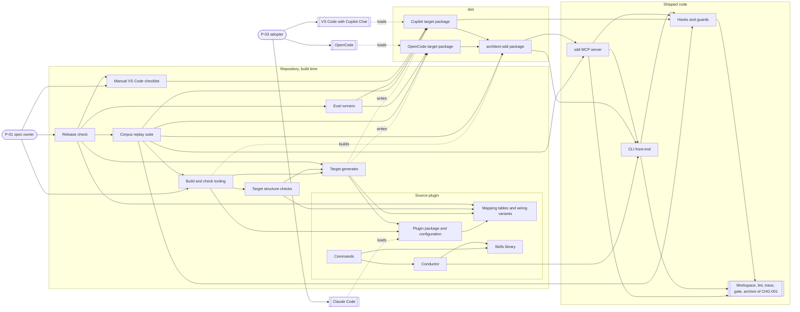

### 8.2 F1 — Generation and packaging (realizes C002-TS-101, C002-TS-102, C002-TS-103, C002-TS-104, C002-TS-106, C002-TS-108, C002-TS-119, C002-TS-417, C002-TS-503, C002-TS-519, C002-TS-529, C002-TS-530)

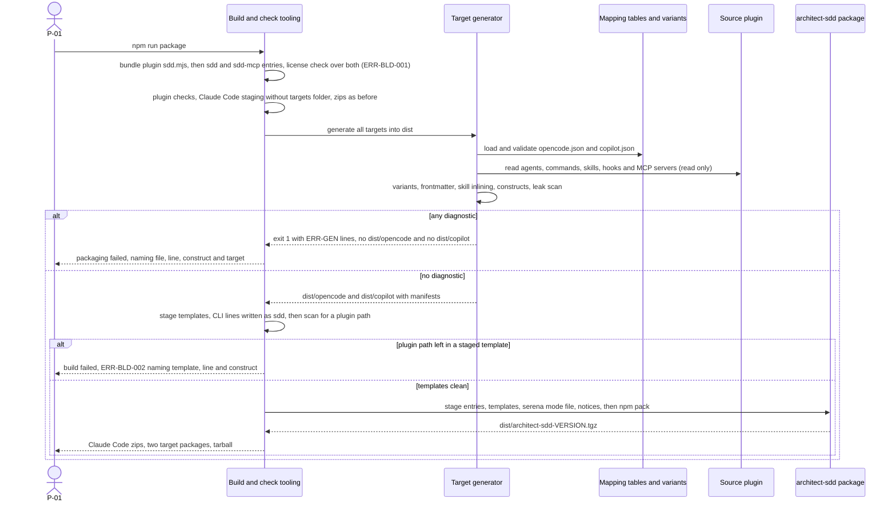

### 8.3 F2 — OpenCode write and command through the native permission rules (realizes C002-TS-207, C002-TS-209, C002-TS-222, C002-TS-223)

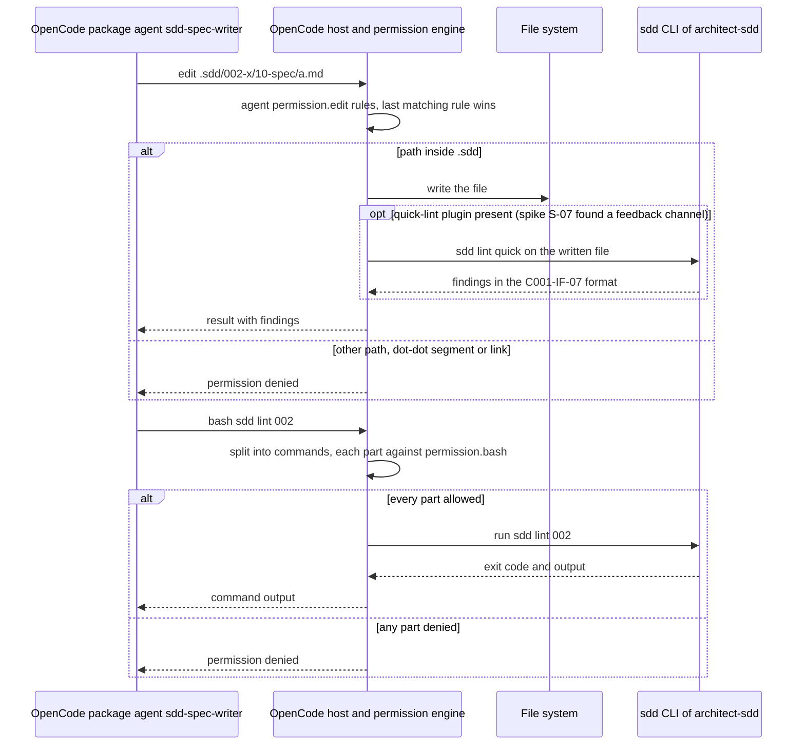

### 8.4 F3 — Copilot write through the sdd MCP server (realizes C002-TS-401, C002-TS-402, C002-TS-404, C002-TS-405, C002-TS-410, C002-TS-413, C002-TS-414, C002-TS-415)

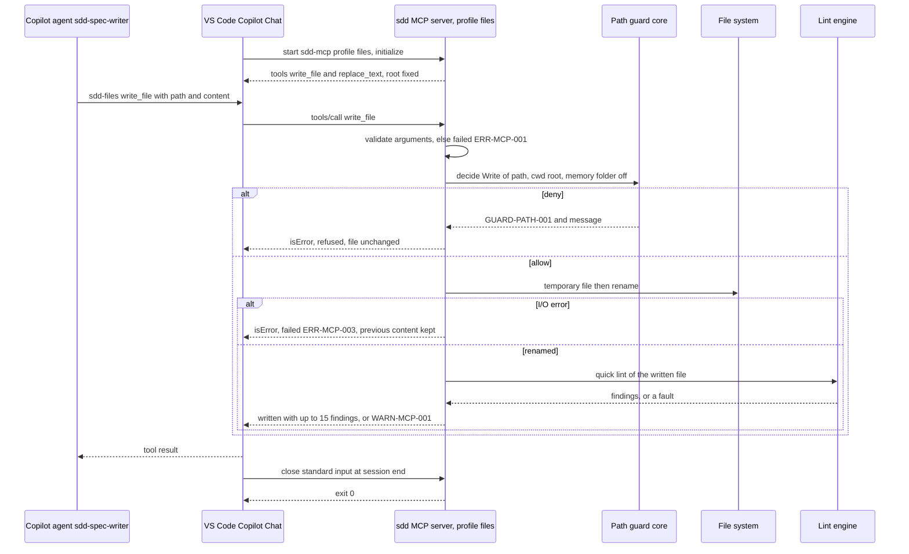

### 8.5 F4 — Copilot command through the sdd MCP server (realizes C002-TS-406, C002-TS-407, C002-TS-408, C002-TS-409)

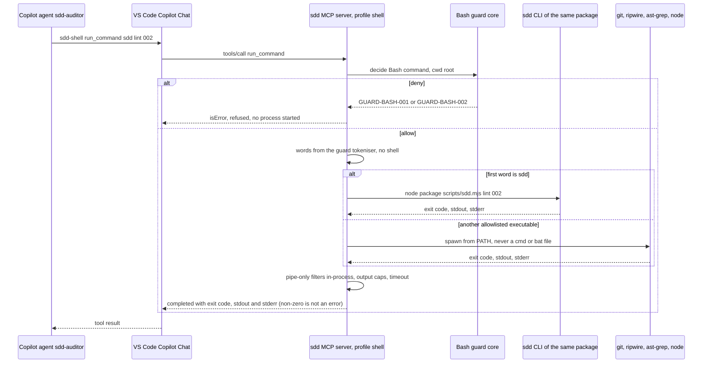

### 8.6 F5 — Copilot hooks fallback (realizes C002-TS-311, C002-TS-312, C002-TS-313, C002-TS-314)

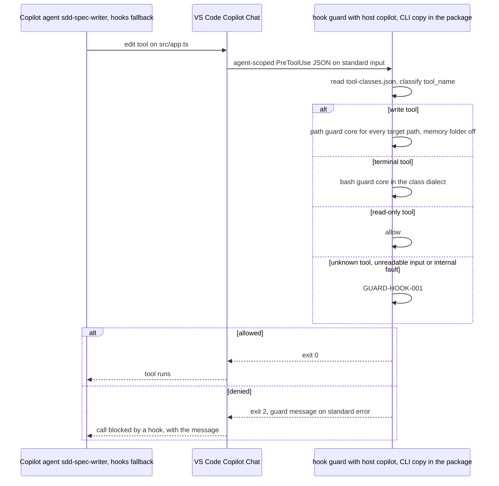

### 8.7 F6 — Copilot session-start and SubagentStop hooks (realizes C002-TS-320, C002-TS-322, C002-TS-323, C002-TS-324, C002-TS-325)

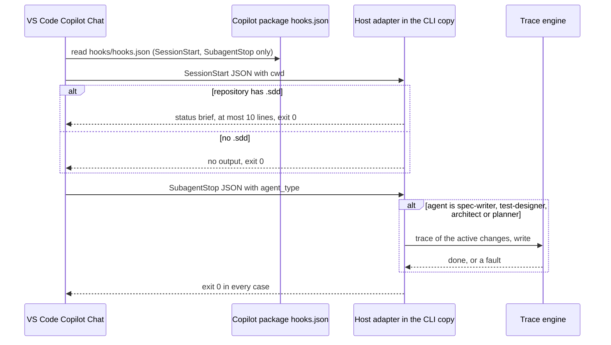

### 8.8 F7 — Gate through the host question tool (realizes C002-TS-217, C002-TS-218, C002-TS-316, C002-TS-318, C002-TS-319)

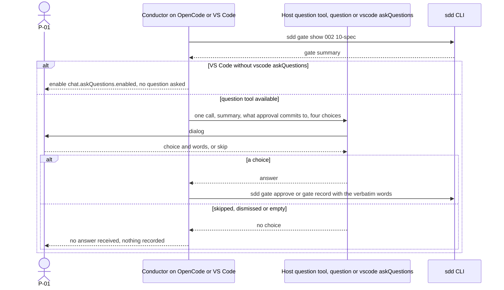

### 8.9 F8 — Doctor on a generated target (realizes C002-TS-506, C002-TS-509, C002-TS-513, C002-TS-515, C002-TS-516)

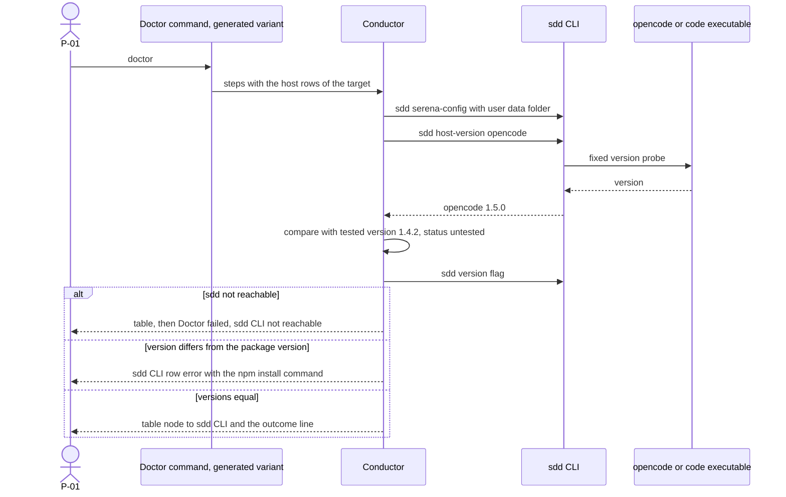

### 8.10 F9 — Release check of one target (realizes C002-TS-620, C002-TS-621, C002-TS-622, C002-TS-623, C002-TS-624, C002-TS-625, C002-TS-633)

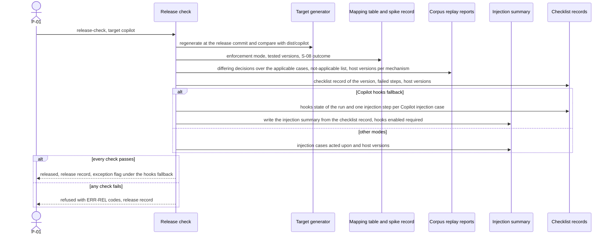

### 8.11 F10 — npm run check with the target structure checks (realizes C002-TS-601, C002-TS-602, C002-TS-603, C002-TS-604, C002-TS-605)

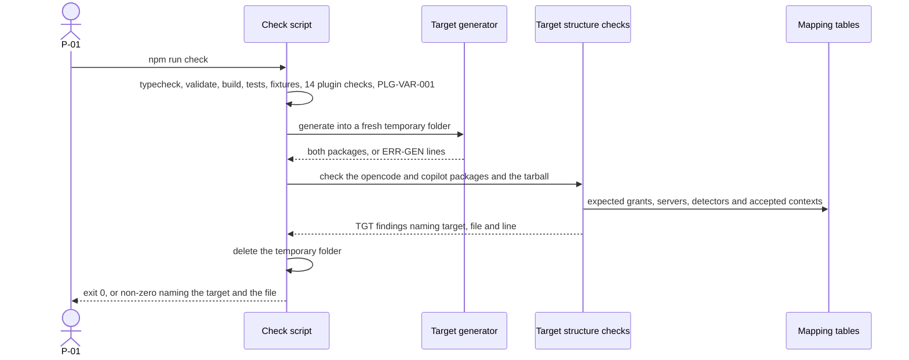

### 8.12 F11 — Corpus replay of one enforcement mechanism (realizes C002-TS-608, C002-TS-609, C002-TS-628, C002-TS-629, C002-TS-630, C002-TS-631, C002-TS-643, C002-TS-644, C002-TS-645, C002-TS-646, C002-TS-647)

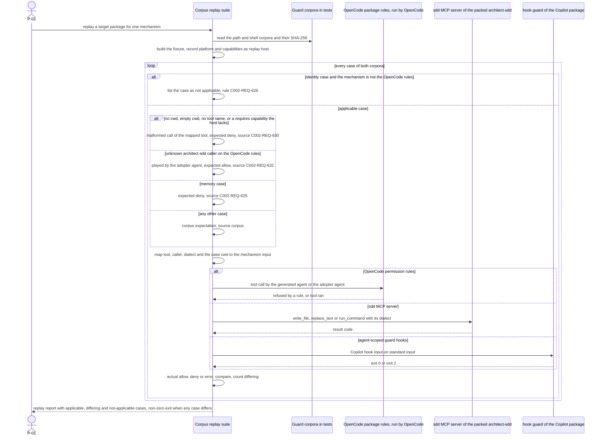

### 8.13 F12 — Serena command or writing command with `--cwd` decided by the bash guard core (realizes C002-TS-525, C002-TS-527, C002-TS-528, C002-TS-536, C002-TS-537)

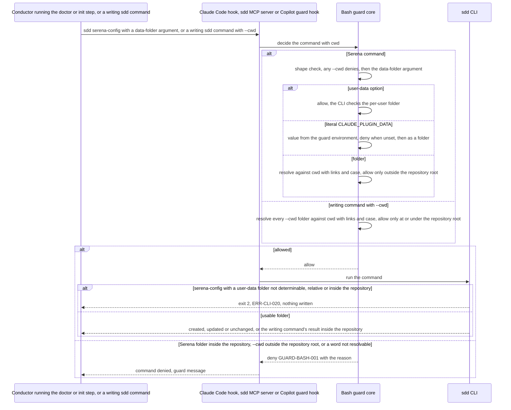

## 9. As-is to to-be delta

### 9.1 As-is component view

Today's components that CHG-002 touches, shown under the C002 IDs of their modified entries (§2
names the CHG-001 component each one modifies).

### 9.2 What exists and what changes

| Component | As-is (CHG-001) | To-be (CHG-002) | Evidence |
|---|---|---|---|
| C002-COMP-012 (C001-COMP-08) | Bash allowlist accepts only `node <path>/sdd.mjs`, with any subcommand, any Serena data folder and any `--cwd`; probes lack `node --version`; path guard allows the memory folder; Claude hook input only | Bare `sdd …` and `node --version` accepted (C002-REQ-503); `serena-config` and `serena-launch` only with `--user-data` or a data folder outside the repository, on every host (C002-REQ-517); `--cwd` of a writing subcommand only at or under the repository root, on every host (C002-REQ-521); `memoryFolder` option; Copilot host adapter (`hook guard`, `session-start`, `subagent-stop`); cores otherwise unchanged | current-state E-4, E-5, E-6, E-22; baseline E-13 |
| C002-COMP-013 (C001-COMP-12) | One bundle; Claude-only staging and INSTALL.md; six check steps over `plugins/architect/` | Two more bundles with license check; generator in package and check; npm staging with the template CLI-line translation and scan, and pack; target checks step; corpora extended (one case per writing sdd subcommand, and one per writing subcommand with an outside `--cwd`); `targets/` excluded from the Claude Code staging | current-state E-1, E-2, E-3, E-8 |
| C002-COMP-014 (C001-COMP-01) | AskUserQuestion only; doctor rows fixed to Claude Code | Host question tool per wiring variant; no-choice handling; doctor host rows (Claude Code text unchanged) | current-state E-24, E-25 |
| C002-COMP-015 (C001-COMP-09) | Doctor with eight rows and Claude Code probe; commands name `claude --agent` | Doctor host rows and sdd CLI row through variants; guard line and `$ARGUMENTS` translated per target | current-state E-14, E-16, E-17, E-28 |
| C002-COMP-016 (C001-COMP-10) | Four "Claude Code wiring" sections; toolchain record of eight rows | Same Claude Code text; variants kept in `targets/`; toolchain record host rows through a variant | current-state E-21, E-26, E-27 |
| C002-COMP-017 (C001-COMP-11) | Claude Code plugin with `.mcp.json` in Claude spelling | Adds `targets/`; README sections for OpenCode and Copilot VS Code | current-state E-10, E-13 |
| C002-COMP-018 (C001-COMP-07) | Bundled in the plugin only; templates beside the bundle or from `CLAUDE_PLUGIN_ROOT`; `sdd version` only | Same source also shipped as `architect-sdd` `sdd`; `--version` (bare), `host-version`, `template show` (confined to the profile folder) and `template list`, `--user-data` (ERR-CLI-020 when not determinable, relative or inside the repository), `--read-only`, `--host copilot` | current-state E-22; baseline E-14 |
| New | — | C002-COMP-001 … C002-COMP-011 | — |
| Unchanged | C001-COMP-02 … C001-COMP-06, C001-COMP-13 | used as they are; the sdd MCP server calls C001-COMP-03 and C001-COMP-04 in-process | baseline survey §4 note 1 |
