# CHG-002 — Work breakdown

Edges are `depends_on` (dependency → dependent). Node IDs are task IDs with `-` replaced by `_`.

```mermaid
flowchart TB
  subgraph M01["C002-M-01 Spikes and P-01 prerequisites"]
    C002_T_001["T-001 Spike S-07: OpenCode (P-01 OpenRouter check first)"]
    C002_T_002["T-002 Spike S-08: Copilot in VS Code"]
    C002_T_003["T-003 P-01: npm account and name"]
    C002_T_060["T-060 Eval auth switch (built)"]
  end
  subgraph M02["C002-M-02 Shared guard and CLI deltas"]
    C002_T_053["T-053 Lint loop honours waivers"]
    C002_T_004["T-004 Version source, --version, first line"]
    C002_T_005["T-005 Repository-root helper"]
    C002_T_006["T-006 Spec locator, schema-copy test, coupled tests"]
    C002_T_007["T-007 Corpus format for replay"]
    C002_T_008["T-008 Bare sdd and node --version (D-011)"]
    C002_T_009["T-009 Writing-command table and --cwd"]
    C002_T_010["T-010 Serena-command confinement"]
    C002_T_011["T-011 Path guard memory option"]
    C002_T_012["T-012 template show and list"]
    C002_T_013["T-013 Serena --user-data and --read-only"]
    C002_T_014["T-014 host-version"]
    C002_T_015["T-015 Claude staging leaves out targets"]
    C002_T_059["T-059 sdd install denied in every form"]
  end
  subgraph M03["C002-M-03 sdd MCP server and architect-sdd"]
    C002_T_016["T-016 MCP binding and profiles"]
    C002_T_017["T-017 MCP write tools"]
    C002_T_018["T-018 MCP quick-lint findings"]
    C002_T_019["T-019 MCP run_command"]
    C002_T_020["T-020 MCP faults and benchmarks"]
    C002_T_021["T-021 Two bundles and licence check"]
    C002_T_022["T-022 npm staging and pack"]
    C002_T_023["T-023 Install smoke and manifest check"]
    C002_T_061["T-061 Catch-up D-004…D-009: print forms, ERR-MCP-006 cases, npm README, own templates"]
  end
  subgraph M04["C002-M-04 Target generator and packages"]
    C002_T_024["T-024 Mapping tables"]
    C002_T_025["T-025 Generator frame"]
    C002_T_026["T-026 Translator: frontmatter"]
    C002_T_027["T-027 Translator: body constructs"]
    C002_T_028["T-028 Wiring variants and inlining"]
    C002_T_029["T-029 OpenCode emitter"]
    C002_T_030["T-030 OpenCode permissions"]
    C002_T_031["T-031 Copilot emitter"]
    C002_T_032["T-032 Copilot hook adapter (agent_type, mode, subagent guard)"]
    C002_T_033["T-033 Copilot hook template (both modes) and tool classes"]
    C002_T_034["T-034 Packaging runs the generator, target zips"]
    C002_T_035["T-035 Target structure checks"]
    C002_T_036["T-036 Determinism and benchmark"]
    C002_T_058["T-058 sdd install copilot"]
    C002_T_062["T-062 Catch-up D-007: hook guard faults and duplicate classes"]
  end
  subgraph M05["C002-M-05 Workflow on every host"]
    C002_T_037["T-037 Question-tool variants"]
    C002_T_038["T-038 Doctor host rows"]
    C002_T_039["T-039 README target sections"]
  end
  subgraph M06["C002-M-06 Verification tooling"]
    C002_T_040["T-040 Replay framework"]
    C002_T_041["T-041 Replay adapters: server, hooks"]
    C002_T_042["T-042 OpenCode driver and replay adapter"]
    C002_T_043["T-043 S-07 final replay and mode"]
    C002_T_044["T-044 OpenCode eval runner"]
    C002_T_045["T-045 Copilot CLI eval runner"]
    C002_T_046["T-046 VS Code checklist"]
    C002_T_047["T-047 Release check"]
    C002_T_056["T-056 OpenCode carried eval runs"]
    C002_T_063["T-063 Catch-up D-010…D-014: install sources, detector, doctor, replay expectations"]
    C002_T_064["T-064 Catch-up D-015…D-017: text-only MCP errors, package version, release-check rows, runner rules"]
    C002_T_065["T-065 Catch-up D-018…D-020: file-inspection variant, cap exceptions, PATH lead, Copilot CLI model, platform rule, executable lookup"]
    C002_T_066["T-066 Catch-up D-026, D-027: Copilot CLI model substitution, injection-summary merge, install-notes fallback, models_used"]
    C002_T_067["T-067 Fix D-023(2), D-024, D-028: ripwire map rule, deny summary, spend reconciliation, key redaction"]
    C002_T_068["T-068 Fix D-030: cap exceptions for the CHG-001 release cases"]
    C002_T_069["T-069 Fix D-031: Claude Code spend cap applied by the runner, budget hidden"]
  end
  subgraph M07["C002-M-07 Release evidence and release"]
    C002_T_048["T-048 Claude Code regression run"]
    C002_T_049["T-049 OpenCode release evidence"]
    C002_T_051["T-051 OpenCode clean-profile run"]
    C002_T_052["T-052 P-01 publish and OpenCode release"]
    C002_T_054["T-054 Copilot release evidence"]
    C002_T_050["T-050 P-01 checklist run"]
    C002_T_057["T-057 Copilot clean-profile run"]
    C002_T_055["T-055 P-01 Copilot release"]
  end
  C002_T_053 --> C002_T_006
  C002_T_007 --> C002_T_008
  C002_T_005 --> C002_T_009
  C002_T_006 --> C002_T_009
  C002_T_008 --> C002_T_009
  C002_T_005 --> C002_T_010
  C002_T_009 --> C002_T_010
  C002_T_060 --> C002_T_010
  C002_T_006 --> C002_T_012
  C002_T_005 --> C002_T_013
  C002_T_006 --> C002_T_013
  C002_T_006 --> C002_T_014
  C002_T_004 --> C002_T_016
  C002_T_006 --> C002_T_016
  C002_T_011 --> C002_T_017
  C002_T_016 --> C002_T_017
  C002_T_017 --> C002_T_018
  C002_T_008 --> C002_T_019
  C002_T_010 --> C002_T_019
  C002_T_016 --> C002_T_019
  C002_T_059 --> C002_T_019
  C002_T_009 --> C002_T_059
  C002_T_010 --> C002_T_059
  C002_T_018 --> C002_T_020
  C002_T_019 --> C002_T_020
  C002_T_004 --> C002_T_021
  C002_T_016 --> C002_T_021
  C002_T_003 --> C002_T_022
  C002_T_012 --> C002_T_022
  C002_T_013 --> C002_T_022
  C002_T_021 --> C002_T_022
  C002_T_022 --> C002_T_023
  C002_T_061 --> C002_T_023
  C002_T_016 --> C002_T_061
  C002_T_019 --> C002_T_061
  C002_T_021 --> C002_T_061
  C002_T_022 --> C002_T_061
  C002_T_001 --> C002_T_024
  C002_T_002 --> C002_T_024
  C002_T_006 --> C002_T_024
  C002_T_015 --> C002_T_024
  C002_T_004 --> C002_T_025
  C002_T_024 --> C002_T_025
  C002_T_025 --> C002_T_026
  C002_T_040 --> C002_T_026
  C002_T_025 --> C002_T_027
  C002_T_027 --> C002_T_028
  C002_T_022 --> C002_T_029
  C002_T_026 --> C002_T_029
  C002_T_028 --> C002_T_029
  C002_T_009 --> C002_T_030
  C002_T_010 --> C002_T_030
  C002_T_029 --> C002_T_030
  C002_T_021 --> C002_T_031
  C002_T_026 --> C002_T_031
  C002_T_028 --> C002_T_031
  C002_T_002 --> C002_T_032
  C002_T_006 --> C002_T_032
  C002_T_010 --> C002_T_032
  C002_T_011 --> C002_T_032
  C002_T_059 --> C002_T_032
  C002_T_031 --> C002_T_033
  C002_T_032 --> C002_T_033
  C002_T_005 --> C002_T_058
  C002_T_009 --> C002_T_058
  C002_T_031 --> C002_T_058
  C002_T_033 --> C002_T_058
  C002_T_062 --> C002_T_058
  C002_T_032 --> C002_T_062
  C002_T_022 --> C002_T_034
  C002_T_029 --> C002_T_034
  C002_T_031 --> C002_T_034
  C002_T_022 --> C002_T_035
  C002_T_030 --> C002_T_035
  C002_T_033 --> C002_T_035
  C002_T_034 --> C002_T_036
  C002_T_028 --> C002_T_037
  C002_T_060 --> C002_T_037
  C002_T_013 --> C002_T_038
  C002_T_014 --> C002_T_038
  C002_T_028 --> C002_T_038
  C002_T_060 --> C002_T_038
  C002_T_030 --> C002_T_039
  C002_T_033 --> C002_T_039
  C002_T_006 --> C002_T_040
  C002_T_007 --> C002_T_040
  C002_T_020 --> C002_T_041
  C002_T_022 --> C002_T_041
  C002_T_033 --> C002_T_041
  C002_T_040 --> C002_T_041
  C002_T_063 --> C002_T_041
  C002_T_019 --> C002_T_063
  C002_T_027 --> C002_T_063
  C002_T_029 --> C002_T_063
  C002_T_035 --> C002_T_063
  C002_T_038 --> C002_T_063
  C002_T_040 --> C002_T_063
  C002_T_042 --> C002_T_063
  C002_T_058 --> C002_T_063
  C002_T_061 --> C002_T_063
  C002_T_001 --> C002_T_042
  C002_T_030 --> C002_T_042
  C002_T_040 --> C002_T_042
  C002_T_042 --> C002_T_043
  C002_T_037 --> C002_T_044
  C002_T_042 --> C002_T_044
  C002_T_002 --> C002_T_045
  C002_T_044 --> C002_T_045
  C002_T_058 --> C002_T_045
  C002_T_063 --> C002_T_045
  C002_T_064 --> C002_T_045
  C002_T_033 --> C002_T_046
  C002_T_037 --> C002_T_046
  C002_T_038 --> C002_T_046
  C002_T_058 --> C002_T_046
  C002_T_063 --> C002_T_046
  C002_T_034 --> C002_T_047
  C002_T_040 --> C002_T_047
  C002_T_046 --> C002_T_047
  C002_T_063 --> C002_T_047
  C002_T_019 --> C002_T_064
  C002_T_020 --> C002_T_064
  C002_T_025 --> C002_T_064
  C002_T_038 --> C002_T_064
  C002_T_041 --> C002_T_064
  C002_T_044 --> C002_T_064
  C002_T_046 --> C002_T_064
  C002_T_047 --> C002_T_064
  C002_T_063 --> C002_T_064
  C002_T_028 --> C002_T_065
  C002_T_038 --> C002_T_065
  C002_T_044 --> C002_T_065
  C002_T_045 --> C002_T_065
  C002_T_047 --> C002_T_065
  C002_T_064 --> C002_T_065
  C002_T_045 --> C002_T_066
  C002_T_046 --> C002_T_066
  C002_T_047 --> C002_T_066
  C002_T_065 --> C002_T_066
  C002_T_030 --> C002_T_067
  C002_T_043 --> C002_T_067
  C002_T_056 --> C002_T_067
  C002_T_066 --> C002_T_067
  C002_T_048 --> C002_T_068
  C002_T_048 --> C002_T_069
  C002_T_068 --> C002_T_069
  C002_T_038 --> C002_T_056
  C002_T_044 --> C002_T_056
  C002_T_063 --> C002_T_056
  C002_T_064 --> C002_T_056
  C002_T_065 --> C002_T_056
  C002_T_022 --> C002_T_048
  C002_T_035 --> C002_T_048
  C002_T_037 --> C002_T_048
  C002_T_038 --> C002_T_048
  C002_T_042 --> C002_T_048
  C002_T_044 --> C002_T_048
  C002_T_045 --> C002_T_048
  C002_T_047 --> C002_T_048
  C002_T_060 --> C002_T_048
  C002_T_064 --> C002_T_048
  C002_T_065 --> C002_T_048
  C002_T_023 --> C002_T_049
  C002_T_036 --> C002_T_049
  C002_T_041 --> C002_T_049
  C002_T_043 --> C002_T_049
  C002_T_044 --> C002_T_049
  C002_T_048 --> C002_T_049
  C002_T_056 --> C002_T_049
  C002_T_064 --> C002_T_049
  C002_T_023 --> C002_T_051
  C002_T_034 --> C002_T_051
  C002_T_039 --> C002_T_051
  C002_T_043 --> C002_T_051
  C002_T_003 --> C002_T_052
  C002_T_023 --> C002_T_052
  C002_T_047 --> C002_T_052
  C002_T_048 --> C002_T_052
  C002_T_049 --> C002_T_052
  C002_T_051 --> C002_T_052
  C002_T_066 --> C002_T_052
  C002_T_036 --> C002_T_054
  C002_T_041 --> C002_T_054
  C002_T_045 --> C002_T_054
  C002_T_048 --> C002_T_054
  C002_T_064 --> C002_T_054
  C002_T_065 --> C002_T_054
  C002_T_066 --> C002_T_054
  C002_T_046 --> C002_T_050
  C002_T_054 --> C002_T_050
  C002_T_023 --> C002_T_057
  C002_T_034 --> C002_T_057
  C002_T_039 --> C002_T_057
  C002_T_058 --> C002_T_057
  C002_T_003 --> C002_T_055
  C002_T_023 --> C002_T_055
  C002_T_047 --> C002_T_055
  C002_T_048 --> C002_T_055
  C002_T_050 --> C002_T_055
  C002_T_054 --> C002_T_055
  C002_T_057 --> C002_T_055
```

## Critical path

Weights S = 1, M = 2, L = 3. The 69 tasks weigh 142 in total (20 S, 25 M, 24 L). The longest chain
weighs 45 and ends with the Copilot release. **The D-031 plan update does not change it**: the fix
task C002-T-069 (M) starts after C002-T-068 (finishing at 41) and finishes at 43, and no CHG-002
task depends on it; CHG-001's C001-T-082 and C001-T-072 wait for it (`handoff.md`), outside this
graph. **The D-030 plan update does not change it either**: the fix
task C002-T-068 (S) starts after C002-T-048 (finishing at 40) and finishes at 41, and no CHG-002
task depends on it; CHG-001's C001-T-082 and C001-T-072 wait for it (`handoff.md`), outside this
graph. **The D-023 item 2, D-024, D-028 plan update does not
change it**: the fix task C002-T-067 (L) starts after C002-T-056 and C002-T-066 (both finishing at
41), its latest dependencies, and finishes at 44. No task depends on it: C002-T-052 and C002-T-055
do not wait for it (`10-strategy.md` §2; P-01 answer to Q-t067-order-01), so it has one unit of
slack against the end of the longest chain (45). The critic fixes of that revision (spec CR-85 …
CR-97) widen the task within its L estimate and add no task or edge. Because the releases do not
wait for it, C002-M-06 may close after C002-M-07 (`10-strategy.md` §3, Milestone order; plan critic
CR-60). Before that, **the D-026, D-027 plan update
lengthened it by 1**: the
catch-up task C002-T-066 (L) starts after C002-T-065 (finishing at 38), its latest dependency, and
finishes at 41; C002-T-054 now waits for it and for C002-T-048 (finishing at 40), so it finishes at
43, C002-T-050 at 44 and C002-T-055 at 45. C002-T-048 moves off the critical path with one unit of
slack. The OpenCode release (C002-T-052) now also waits for C002-T-066 (plan critic CR-52: the
backfill of `result` and `models` into the OpenCode injection summary, C002-DOD-009, and the moved
release-candidate commit); C002-T-066 finishes at 41, before C002-T-049 at 43, so C002-T-052 still
starts at 43 and ends at 44, and C002-T-066 has two units of slack on the OpenCode chain. Before
that, **the D-018 … D-020 plan update lengthened it by 3**: the
catch-up task C002-T-065 (L) starts after C002-T-045 (finishing at 35), its latest dependency, and
finishes at 38. C002-T-048 now waits for it (last source change before the release-candidate commit)
and finishes at 40, C002-T-054 (which also waits for it, `--model`) at 42, C002-T-050 at 43 and
C002-T-055 at 44. The C002-T-056 reruns wait for it too, so C002-T-056 finishes at 41, after
C002-T-048; C002-T-049 then starts at 41 and finishes at 43, and the OpenCode release (C002-T-052)
at 44, the same as the Copilot release. Before that, **the D-015 … D-017 plan update lengthened it by 5**: the
catch-up task C002-T-064 (L) starts after C002-T-047 (finishing at 30) and finishes at 33; C002-T-045
now waits for it (shared doctor case file, and its Copilot CLI sessions need the text-only error
results) and finishes at 35, so C002-T-048 finishes at 37 (before: 32), C002-T-054 at 39, C002-T-050
at 40 and C002-T-055 at 41. C002-T-056 resumes after C002-T-064 and finishes at 36, one unit before
C002-T-048; C002-T-049 finishes at 39 and the OpenCode release (C002-T-052) at 40. Before that,
**the D-010 … D-014 plan update lengthened it by 3**: the
catch-up task C002-T-063 (L) starts after C002-T-035 and C002-T-042 (both finishing at 22) and
finishes at 25; C002-T-046 now waits for it and finishes at 27, C002-T-047 at 30, so C002-T-048
finishes at 32 (before: 29, when it waited for C002-T-045 at 27). C002-T-041 finishes at 27 and
C002-T-045 at 27, both off the critical path. Most of these tasks are done, so the weights model the
order, not the remaining calendar. The `--spdx` scan of the generated folders (C002-DOD-020) is run
by C002-T-049 at the release-candidate commit, so C002-T-023 waits only for C002-T-022 and C002-T-061
and finishes at 15 (plan critic CR-33); C002-T-049 now also waits for it, with no effect on the chain
(C002-T-049 starts at 32). The D-004 … D-009 plan update
did not change the chain: the
catch-up task C002-T-061 (M) finishes at 13 after C002-T-022 (11), before C002-T-023; C002-T-062 (S) finishes
at 12 after C002-T-032 (11), before C002-T-058 starts at 18; C002-REQ-217 adds no task. Nor did the
D-003 plan updates change it: C002-T-032, now L
for the subagent guard, finishes at 11, before C002-T-031 at 16, so C002-T-033 still finishes at 18
and C002-T-058 at 21, four units before C002-T-044, and C002-T-045 still starts at 25; C002-T-060,
the eval auth switch, is already built and finishes at 1, before C002-T-010, C002-T-037, C002-T-038
and C002-T-048 need it. The OpenCode release ends one unit earlier, at 35, and
no longer waits for any Copilot release task (C002-T-050, C002-T-054, C002-T-055, C002-T-057).

**Overall (to C002-T-055, weight 45):**

1. C002-T-001 — Spike S-07: OpenCode at its tested version (L)
2. C002-T-024 — Mapping tables, their schema copy and loader (M)
3. C002-T-025 — Generator: entry, source reader, writer and manifest (L)
4. C002-T-027 — Translator: body constructs, templates, plugin data and question tool (M)
5. C002-T-028 — Wiring variants, anchors and skill inlining (L)
6. C002-T-029 — OpenCode emitter: layout, agents, commands, MCP servers and install notes (L)
7. C002-T-030 — OpenCode permission rules for both modes and the quick-lint plugin (L)
8. C002-T-042 — OpenCode session driver and the opencode-permissions replay adapter (L; C002-T-035, L, finishes at the same 22)
9. C002-T-063 — Catch-up for revision D-010 … D-014: install sources, plugin-root detector, doctor description and hooks row, replay expectations (L)
10. C002-T-046 — Manual VS Code checklist and its record template (M)
11. C002-T-047 — Release check per target and release records (L)
12. C002-T-064 — Catch-up for revision D-015 … D-017: text-only MCP error results, generator package version, release-check rows, eval-runner rules (L)
13. C002-T-045 — Copilot CLI eval runner (M)
14. C002-T-065 — Catch-up for revision D-018 … D-020: file-inspection variant and glob-prose construct, spend-cap exceptions, PATH lead, Copilot CLI model, platform rule, PATH-only executable lookup (L)
15. C002-T-066 — Catch-up for revision D-026, D-027: Copilot CLI model substitution, session_model and agent_models, fail-closed injection-summary merge, install-notes fallback, checklist models_used (L; C002-T-048, M, finishes at 40 with one unit of slack)
16. C002-T-054 — Release evidence for Copilot: corpus replay and Copilot CLI dev-tier evals (M)
17. C002-T-050 — P-01: run the manual VS Code checklist and record it (S)
18. C002-T-055 — P-01: release the Copilot target (S)

**OpenCode release (to C002-T-052, weight 44):** items 1 to 14 above, then C002-T-056 — OpenCode
dev-tier runs of the carried eval rows (L; its rerun plan after C002-T-065, finishing at 41),
C002-T-049 — Release evidence for OpenCode (M, 43) and C002-T-052 — P-01: publish architect-sdd and
release the OpenCode target (S, 44). C002-T-048 (finishing at 40) has one unit of slack against
C002-T-056, and C002-T-066 (finishing at 41, item 15 above) two units against C002-T-049. The fix
task C002-T-067 (finishing at 44) is on neither release chain. Before the D-018 … D-020 update the carried OpenCode eval runs (resumed after
C002-T-064 at 33, finishing at 36) had one unit of slack against C002-T-048 (then finishing at 37).

The remaining Copilot coupling of the OpenCode chain is shared tooling, not a release decision:
C002-T-048 waits for C002-T-045 (shared `evals/harness/session.mjs`, critic CR-7, finishing at 35
after C002-T-064) and for C002-T-047, which waits for the checklist template of C002-T-046 (finishing
at 27 after C002-T-063; C002-T-047 at 30); C002-T-064 also waits for C002-T-046 (checklist rows of
C002-TC-617); C002-T-039 and C002-T-041 wait for C002-T-033; C002-T-052 waits for C002-T-066,
which holds the backfill of the OpenCode injection summary beside its Copilot parts (plan critic
CR-52). The Copilot defer branch is not taken
(signed-off S-08 record, `10-strategy.md` §4); only a later record would remove these dependencies
(`75-rollout.md` §5), and the OpenCode chain would then end at 36 (through C002-T-063, C002-T-047,
C002-T-064, C002-T-048, C002-T-049 and C002-T-052; 33 before the D-015 … D-017 update, 31 before the
D-010 … D-014 update).

C002-T-002 (S-08) has the same weight as C002-T-001 and is equally critical: C002-T-024 waits for both
spike records. C002-T-053 (finishing at 1) and C002-T-006 (at 3) finish together with the spikes.
C002-T-026 (C002-M-04) also waits for C002-T-040 (C002-M-06), so that `scripts/test.mjs` leaves out
`tests/replay/` before the first replay test file lands (critic CR-17); C002-T-040 finishes at 6,
before C002-T-025 at 8, so the critical path does not move.
Slack: C002-T-021 finishes at 8 and C002-T-031 starts at 13; C002-T-022 finishes at 11 and C002-T-029
starts at 13 (C002-T-034 at 16); C002-T-059 finishes at 8, so C002-T-019 finishes at 11 and
C002-T-020 at 13, and C002-T-041 starts at 25 (after C002-T-063). The guard, CLI and MCP work of
C002-M-02 and C002-M-03 can therefore slip by at least 2 units without moving the end date.

## Tasks by milestone

| Milestone | Task | Title | Estimate | Depends on |
|---|---|---|---|---|
| C002-M-01 | C002-T-001 | Spike S-07: OpenCode at its tested version | L | — |
| C002-M-01 | C002-T-002 | Spike S-08: GitHub Copilot in VS Code and Copilot CLI | L | — |
| C002-M-01 | C002-T-003 | P-01: npm account and availability of the name architect-sdd | S | — |
| C002-M-01 | C002-T-060 | Eval harness: auth switch between the prepaid API key and P-01's Claude subscription | S | — |
| C002-M-02 | C002-T-053 | Approved-phase lint loop of frontend.test.ts excludes waived findings | S | — |
| C002-M-02 | C002-T-004 | Single version source, bare sdd --version and the executable first line | M | — |
| C002-M-02 | C002-T-005 | Shared repository-root helper | S | — |
| C002-M-02 | C002-T-006 | Spec-contract locator, schema-copy equality test and CHG-001-coupled CLI tests | M | T-053 |
| C002-M-02 | C002-T-007 | Guard corpora format for per-case cwd, environment and replay fields | M | — |
| C002-M-02 | C002-T-008 | Bash guard: bare sdd and node --version (closes CHG-001 defect D-011) | S | T-007 |
| C002-M-02 | C002-T-009 | Writing-command table as a single source and the --cwd confinement | M | T-005, T-006, T-008 |
| C002-M-02 | C002-T-010 | Bash guard: Serena commands confined to a data folder outside the repository | M | T-005, T-009, T-060 |
| C002-M-02 | C002-T-011 | Path guard core: memory-folder option | S | — |
| C002-M-02 | C002-T-012 | CLI: template show and template list, confined to the profile folder | M | T-006 |
| C002-M-02 | C002-T-013 | CLI: --user-data and --read-only for the Serena commands | M | T-005, T-006 |
| C002-M-02 | C002-T-014 | CLI: host-version command | S | T-006 |
| C002-M-02 | C002-T-015 | Claude Code staging leaves out plugins/architect/targets/ | S | — |
| C002-M-02 | C002-T-059 | Bash guard: sdd install denied in every form | S | T-009, T-010 |
| C002-M-03 | C002-T-016 | sdd MCP server: protocol binding, profiles and standard-output discipline | L | T-004, T-006 |
| C002-M-03 | C002-T-017 | sdd MCP server: write_file and replace_text | M | T-011, T-016 |
| C002-M-03 | C002-T-018 | sdd MCP server: quick-lint findings with each write | S | T-017 |
| C002-M-03 | C002-T-019 | sdd MCP server: run_command without a shell | L | T-008, T-010, T-016, T-059 |
| C002-M-03 | C002-T-020 | sdd MCP server: fault injection and benchmarks | M | T-018, T-019 |
| C002-M-03 | C002-T-021 | Build: two bundles and the licence check over both | M | T-004, T-016 |
| C002-M-03 | C002-T-022 | architect-sdd: staging, template CLI lines and npm pack | L | T-003, T-012, T-013, T-021 |
| C002-M-03 | C002-T-061 | Catch-up for revision D-004 … D-009: build and server print forms, ERR-MCP-006 cases, npm README and own templates | M | T-016, T-019, T-021, T-022 |
| C002-M-03 | C002-T-023 | architect-sdd: install smoke test and manifest check | M | T-022, T-061 |
| C002-M-04 | C002-T-024 | Mapping tables, their schema copy and loader | M | T-001, T-002, T-006, T-015 |
| C002-M-04 | C002-T-025 | Generator: entry, source reader, writer and manifest | L | T-004, T-024 |
| C002-M-04 | C002-T-026 | Translator: agent frontmatter | M | T-025, T-040 |
| C002-M-04 | C002-T-027 | Translator: body constructs, templates, plugin data and question tool | M | T-025 |
| C002-M-04 | C002-T-028 | Wiring variants, anchors and skill inlining | L | T-027 |
| C002-M-04 | C002-T-029 | OpenCode emitter: layout, agents, commands, MCP servers and install notes | L | T-022, T-026, T-028 |
| C002-M-04 | C002-T-030 | OpenCode permission rules for both modes and the quick-lint plugin | L | T-009, T-010, T-029 |
| C002-M-04 | C002-T-031 | Copilot emitter: plugin part, agents, prompt files, skills, workspace MCP configuration and install notes | L | T-021, T-026, T-028 |
| C002-M-04 | C002-T-032 | CLI: Copilot hook adapter (hook guard by agent_type and mode, subagent guard, session start, subagent stop) | L | T-002, T-006, T-010, T-011, T-059 |
| C002-M-04 | C002-T-033 | Copilot package: hook template, Copilot guard and subagent guard hook, tool classes | M | T-031, T-032 |
| C002-M-04 | C002-T-034 | npm run package runs the generator and zips each target | S | T-022, T-029, T-031 |
| C002-M-04 | C002-T-035 | Target structure checks and the npm run check step | L | T-022, T-030, T-033 |
| C002-M-04 | C002-T-036 | Generation determinism test and generation benchmark | S | T-034 |
| C002-M-04 | C002-T-062 | Catch-up for revision D-007: Copilot hook guard faults, --host usage fault and duplicate tool classes | S | T-032 |
| C002-M-04 | C002-T-058 | CLI: Copilot install command (sdd install copilot) | L | T-005, T-009, T-031, T-033, T-062 |
| C002-M-05 | C002-T-037 | Conductor: interview and gate variants for the host question tools | M | T-028, T-060 |
| C002-M-05 | C002-T-038 | Doctor host rows, version checks and the toolchain record per host | L | T-013, T-014, T-028, T-060 |
| C002-M-05 | C002-T-039 | README sections for OpenCode and Copilot VS Code | S | T-030, T-033 |
| C002-M-06 | C002-T-040 | Corpus replay suite: framework, expectations, report and its own command | L | T-006, T-007 |
| C002-M-06 | C002-T-063 | Catch-up for revision D-010 … D-014: install sources, plugin-root detector, doctor description and hooks row, replay expectations | L | T-019, T-027, T-029, T-035, T-038, T-040, T-042, T-058, T-061 |
| C002-M-06 | C002-T-041 | Replay adapters: sdd MCP server and Copilot guard hooks | M | T-020, T-022, T-033, T-040, T-063 |
| C002-M-06 | C002-T-042 | OpenCode session driver and the opencode-permissions replay adapter | L | T-001, T-030, T-040 |
| C002-M-06 | C002-T-043 | S-07 record: final replay outcomes and the OpenCode enforcement mode | S | T-042 |
| C002-M-06 | C002-T-044 | OpenCode eval runner behind the existing case API | L | T-037, T-042 |
| C002-M-06 | C002-T-046 | Manual VS Code checklist and its record template | M | T-033, T-037, T-038, T-058, T-063 |
| C002-M-06 | C002-T-047 | Release check per target and release records | L | T-034, T-040, T-046, T-063 |
| C002-M-06 | C002-T-064 | Catch-up for revision D-015 … D-017: text-only MCP error results, generator package version, release-check rows, eval-runner rules | L | T-019, T-020, T-025, T-038, T-041, T-044, T-046, T-047, T-063 |
| C002-M-06 | C002-T-045 | Copilot CLI eval runner | M | T-002, T-044, T-058, T-063, T-064 |
| C002-M-06 | C002-T-065 | Catch-up for revision D-018 … D-020: file-inspection variant and glob-prose construct, spend-cap exceptions, PATH lead, Copilot CLI model, platform rule, PATH-only executable lookup | L | T-028, T-038, T-044, T-045, T-047, T-064 |
| C002-M-06 | C002-T-056 | OpenCode dev-tier runs of the carried eval rows | L | T-038, T-044, T-063, T-064, T-065 |
| C002-M-06 | C002-T-066 | Catch-up for revision D-026, D-027: Copilot CLI model substitution, session_model and agent_models, fail-closed injection-summary merge, install-notes fallback, checklist models_used | L | T-045, T-046, T-047, T-065 |
| C002-M-06 | C002-T-067 | Fix for revision D-023 item 2, D-024, D-028: OpenCode ripwire map rule and deny summary, partial-spend reconciliation from the OpenRouter key usage, key redaction | L | T-030, T-043, T-056, T-066 |
| C002-M-06 | C002-T-068 | Fix for revision D-030: cap exceptions for the CHG-001 release eval cases and the rules for sessions of CHG-001 tasks | S | T-048 |
| C002-M-06 | C002-T-069 | Fix for revision D-031: the Claude Code eval runner applies the spend cap itself and shows the model no budget | M | T-048, T-068 |
| C002-M-07 | C002-T-048 | Claude Code regression set run | M | T-022, T-035, T-037, T-038, T-042, T-044, T-045, T-047, T-060, T-064, T-065 |
| C002-M-07 | C002-T-049 | Release evidence for OpenCode: corpus replay and dev-tier evals on the tested host | M | T-023, T-036, T-041, T-043, T-044, T-048, T-056, T-064 |
| C002-M-07 | C002-T-051 | Timed clean-profile run for OpenCode and the OpenCode toy change to G1 | M | T-023, T-034, T-039, T-043 |
| C002-M-07 | C002-T-052 | P-01: publish architect-sdd and release the OpenCode target | S | T-003, T-023, T-047, T-048, T-049, T-051, T-066 |
| C002-M-07 | C002-T-054 | Release evidence for Copilot: corpus replay and Copilot CLI dev-tier evals | M | T-036, T-041, T-045, T-048, T-064, T-065, T-066 |
| C002-M-07 | C002-T-050 | P-01: run the manual VS Code checklist and record it | S | T-046, T-054 |
| C002-M-07 | C002-T-057 | Timed clean-profile run for the Copilot target | S | T-023, T-034, T-039, T-058 |
| C002-M-07 | C002-T-055 | P-01: release the Copilot target | S | T-003, T-023, T-047, T-048, T-050, T-054, T-057 |
