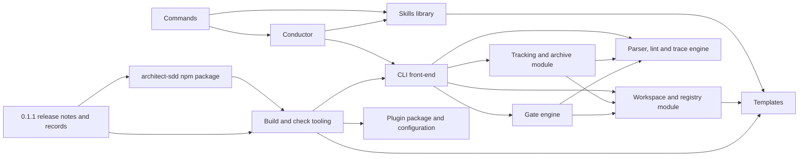
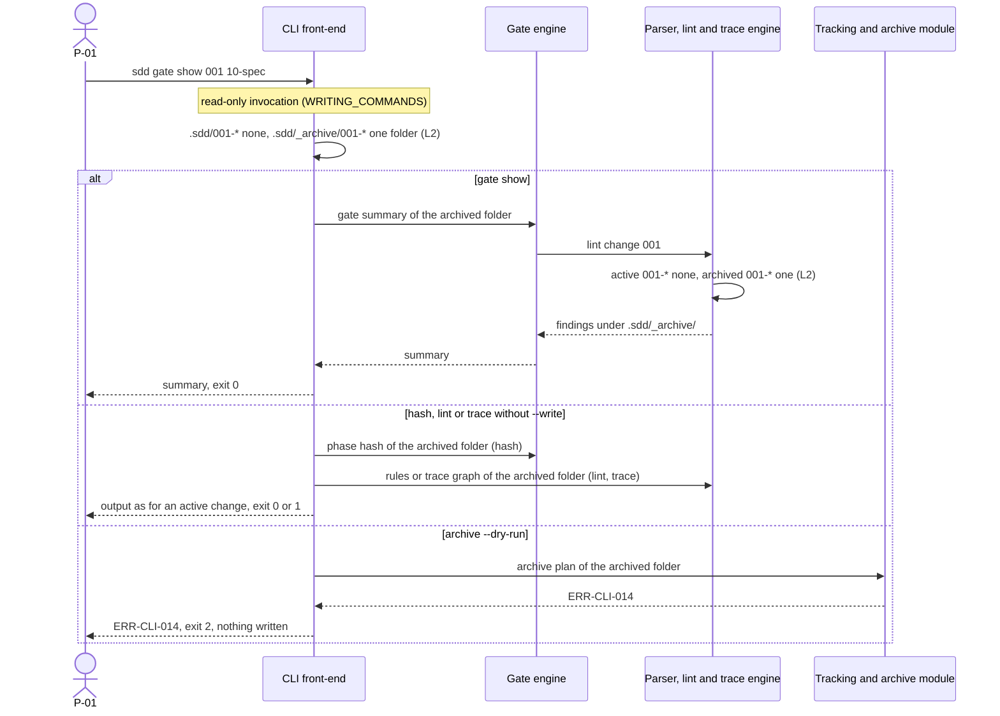
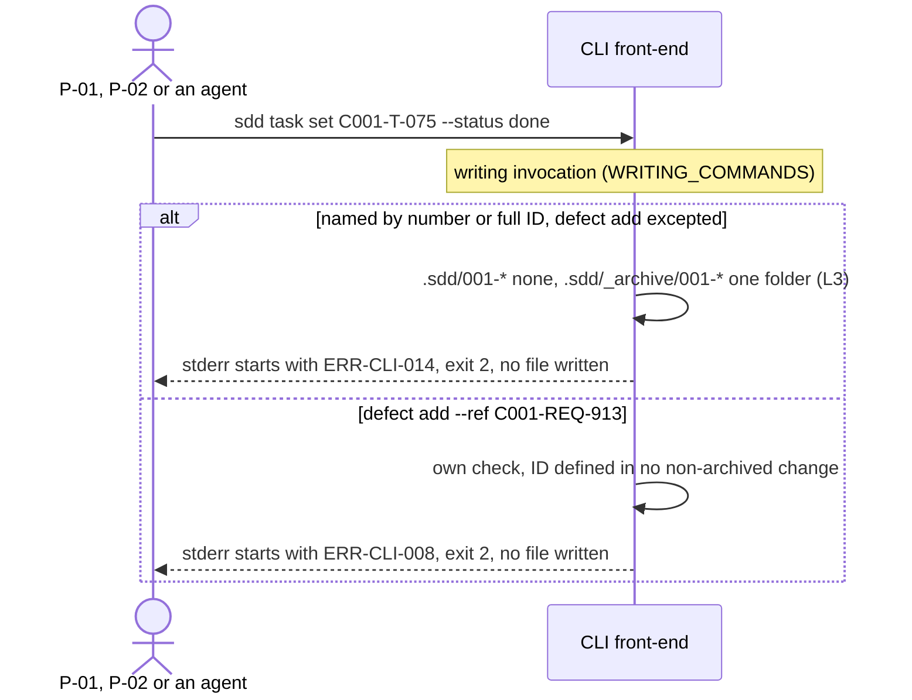
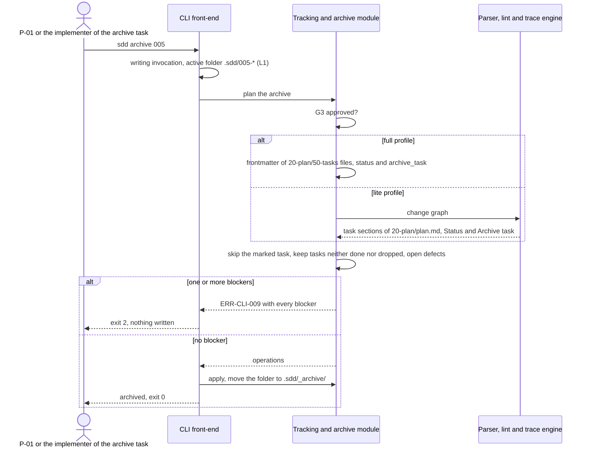
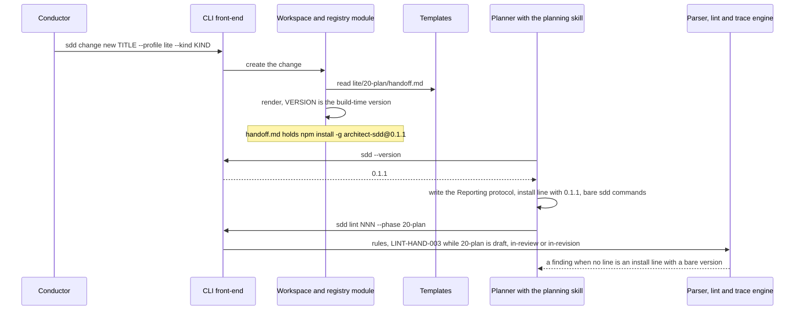
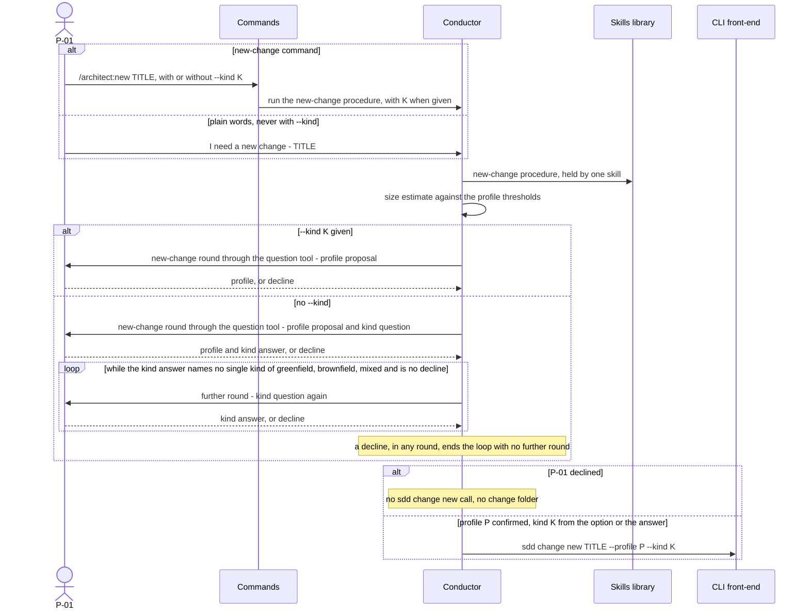
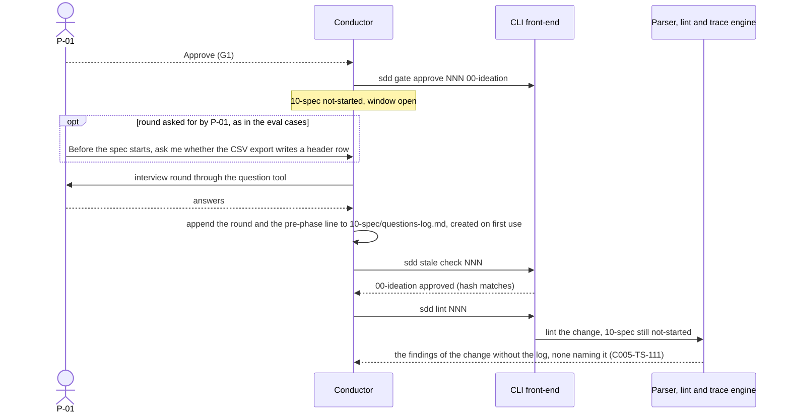
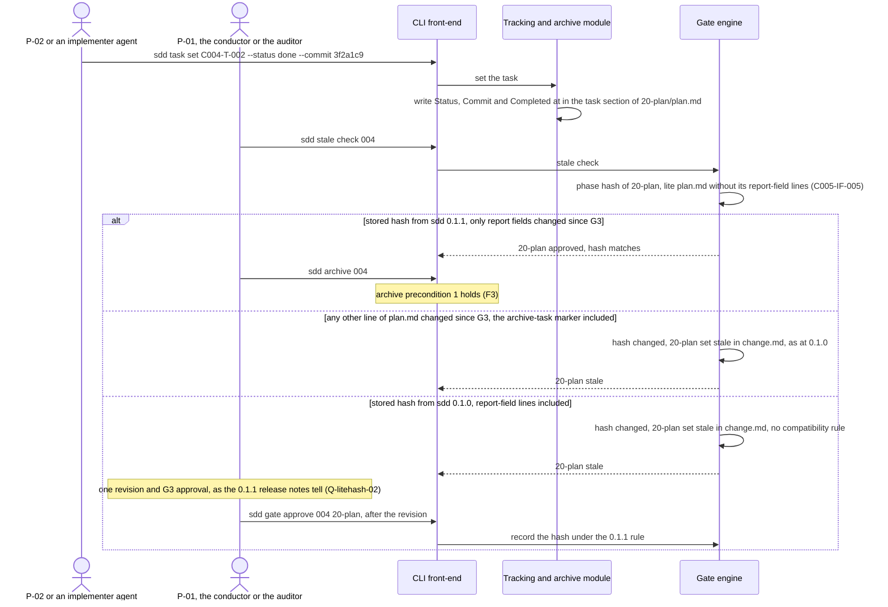

# CHG-005 — Specification (lite)

<!-- Guidance: a lite change covers exactly one capability; IDs follow the same scheme as a full change. -->

## Context

**Conventions** (as in ideation §1, with one correction). "D-032", "D-034" and "D-035" are defects of CHG-001
(registry, CHG-001 defects), not the CHG-002 defects with the same numbers. "Both hosts" are the two released targets
of 0.1.0: the Claude Code plugin and the Copilot VS Code target package; OpenCode is not released (CHG-003).
Correction to ideation §1, which counts Copilot CLI in the GitHub Copilot package: Copilot CLI is not a target
(`../../_constitution/glossary.md`, entry "Copilot VS Code"; C002-NG-01), and this change does not use it: agent
behaviour in Copilot VS Code is checked by recorded manual runs (Q-vscode-01). "E-n" is an evidence entry of `../00-ideation/evidence/baseline-survey.md` (E-1…E-53,
commit `215e36d`) or of `evidence/spec-addendum.md` (E-54…E-103, commit `fef82eb`); "G-n" is a goal of ideation §4.1.

### C005-CAP-01 — 0.1.1 fixes
The only capability of this lite change: the five faults of 0.1.0 listed in ideation §2 and the 0.1.1 release
(Q-release-01). Scope boundary: ideation §5; non-goals: ideation §4.2. ID block 01: stories C005-US-101 to
C005-US-106, one per goal G-1 to G-6; requirements from C005-REQ-101; scenarios from C005-TS-101.
At archive, the ADDED requirements land in a new living file `../../_living/CAP-0-1-1-fixes.md`, named after the
change folder because a lite spec names no capability (Q-livingcap-01; `src/archive/plan.ts:121`). Each MODIFIED
requirement replaces the living entry it cites, in that entry's file: C005-REQ-101 in `CAP-workspace.md`,
C005-REQ-112 in `CAP-tracking-archive.md`, C005-REQ-121 in `CAP-gates.md`.

### Personas and actors
Persona numbers keep their CHG-001 meaning
(`../../_archive/001-architect-agent-suite/10-spec/10-context/stakeholders-and-personas.md`); CHG-002 added the
maintainer role of P-01 (`../../_archive/002-multi-platform-targets/10-spec/10-context/stakeholders-and-personas.md`).
Only the personas named by the stories of this change are listed.

#### P-01 — Spec owner and maintainer
- **Role in CHG-005:** asks for new changes, in plain words or with `/architect:new`; answers interview rounds, also between a gate approval and the next phase; approves gates; archives changes; publishes `architect-sdd` on npm and releases the plugin on both hosts.
- **Base:** CHG-001 P-01; maintainer role from CHG-002 P-01.

#### P-02 — Implementer
- **Role in CHG-005:** executes the hand-off of a change on any host or runtime, possibly without the Architect plugin (E-34), and reports task progress with `sdd` commands or the frontmatter fallback.
- **Base:** CHG-001 P-02.

The conductor and the sdd CLI are system actors, not personas (constitution glossary, system names). Stories about
their behaviour name the persona who benefits from it.

### Current state
| Item | Behaviour at `215e36d` | Evidence | Living-spec requirement |
|---|---|---|---|
| D-032: create request in plain words (G-1) | The new-change procedure (size estimate, profile and kind round) exists only in `commands/new.md`, which runs only through `/architect:new`; the conductor text has no create-change step; `sdd change new` without options creates a `full`, `greenfield` change | E-10, E-11, E-13, E-14, E-16 | C002-REQ-213, which supersedes C001-REQ-116 and binds only when the new-change command runs (E-15) |
| D-034: answer between a gate approval and the next phase (G-2) | interview-protocol §5 logs a round in "the phase's" `questions-log.md`, which names no file while no phase is open; an approved phase's log is part of its approval hash; there is no `10-spec/` or `20-plan/` log template, and the lite scaffold holds only the ideation log | E-19, E-20, E-21, E-22, E-23, E-25 | C001-REQ-210 (E-24) |
| D-035: progress reporting without the plugin (G-3) | Both hand-off templates give `node <plugin-root>/scripts/sdd.mjs …`, which no text resolves; the `SDD.md` text written by the sdd CLI and the plugin README give plugin-path forms too (ideation G-3, critic CR-1); npm packaging rewrites only the template lines to bare `sdd` | E-27, E-28, E-30, E-34 | C001-REQ-616 (E-35), C001-REQ-103, C002-REQ-518 and C002-REQ-519 (E-31) |
| Archive precondition (G-4) | `sdd archive` refuses with ERR-CLI-009 while a `20-plan/50-tasks/` file is not done or dropped, the archive task included; no field identifies an archive task; task sections of a lite `plan.md` are not read, so open lite tasks never block | E-37, E-38, E-39, E-40, E-42, E-43 | C001-REQ-913 (E-41) |
| Lite plan hash (G-4) | `sdd task set` writes the Status, Commit, Notes and Completed at fields into the task section, in the body of a lite `20-plan/plan.md`; the approval hash removes only YAML frontmatter, so the first task report after G3 changes the 20-plan hash, the next `sdd stale check` sets 20-plan `stale`, and `sdd archive` then refuses (G3 not approved). In a full change these fields are task-file frontmatter, outside the hash | `src/tracking/task.ts:118-122`, `src/model/frontmatter.ts:48-53`, `src/gate/stale.ts:35-36` (`90-critic-report.md` CR-10) | C001-REQ-806, C001-REQ-810 |
| Archived lookup (G-5) | Every command that resolves a change by number searches `.sdd/NNN-*` only and fails with ERR-CLI-002 on a change under `.sdd/_archive/`, `hash` and `gate show` included; the phase hash itself works on an archived folder | E-46, E-47, E-48, E-49, E-51 | C001-REQ-806 (E-52) |
| Release (G-6) | The version is 0.1.0 in `plugin.json`, its single source; `npm run check` builds and checks; the packaging writes the target packages and the `architect-sdd` tarball, which is built, not tracked | E-3, E-4, E-5, E-32 | C002-REQ-502 |

Cross-cutting facts: shared plugin text reaches both hosts with no mapping change (E-8; ideation §10 assumption);
tests pin line numbers of the shared text and of the hand-off templates (E-9, E-36); a `src/` fix needs a rebuild of
the tracked bundle (E-4).

## Stories

### C005-US-101 — Any create-change request runs the new-change procedure
- **As a** P-01 spec owner and maintainer
- **I want** every request I make to create a change, in plain words or with `/architect:new`, on both hosts, to go through the new-change procedure (size estimate, profile and kind round) before the change is created
- **So that** the profile and kind of every change are my answers, never the defaults of the sdd CLI
- **Value / outcome:** closes D-032 (ideation §2); goal G-1, checked by a plain-words eval case on Claude Code and a recorded manual run in Copilot VS Code (Q-vscode-01)
- **Priority:** Must · **Size hint:** M · **Capability:** C005-CAP-01
- **Context & notes:** The procedure lives only in `commands/new.md` (E-10, E-11), and C002-REQ-213 binds only when that command runs (E-15). The conductor runs the procedure; the sdd CLI and its defaults stay unchanged (Q-newchange-01; ideation §4.2 item 1). Design direction: ideation §8. The kind is asked in the same round unless the new-change command gives `--kind`; today's condition "the repository has code" (`commands/new.md:17-18`) is dropped, so the conductor derives no kind itself (critic CR-12). Moving the procedure text shifts pinned test lines (E-9); no test sends a plain-words create request today (E-18). The eval budget for the cases is open until 20-plan (ideation §11).
- **Out of scope:** required `--profile` or `--kind` options of `sdd change new` (ideation §4.2 item 1).
- **Requirements:** C005-REQ-101, C005-REQ-102, C005-REQ-123, C005-REQ-124
- **Traces to:** ideation §2, §4.1 G-1, §8; Q-newchange-01; D-032; critic CR-12

### C005-US-102 — An answer between a gate approval and the next phase is logged
- **As a** P-01 spec owner and maintainer
- **I want** every answer I give after a gate approval and before the next phase starts to be logged verbatim in the next phase's `questions-log.md`, marked as given before that phase started
- **So that** no answer of mine is lost, and the approved phase keeps its approval hash and does not become stale
- **Value / outcome:** closes D-034 (ideation §2); goal G-2
- **Priority:** Must · **Size hint:** S · **Capability:** C005-CAP-01
- **Context & notes:** Q-postgate-01 chose the next phase's log, created on first use. The windows are after G1 (next phase `10-spec`) and after G2 (next phase `20-plan`). Today no rule names a log for these windows (E-19, E-20, E-21), and writing into the approved phase's log would change its hash (E-22). A `10-spec/` or `20-plan/` log has no template and is not in the lite scaffold (E-25); ideation §9 records the lint risk on a lite change, and Q-prelog-lint-01 made the lint result a requirement of this story (critic CR-13). Requirement touched: C001-REQ-210 (E-24).
- **Out of scope:** answers given after the G3 approval or after a Stop (Q-scope-04; ideation §4.2 item 3).
- **Requirements:** C005-REQ-103, C005-REQ-104, C005-REQ-126
- **Traces to:** ideation §2, §4.1 G-2, §8, §9; Q-postgate-01, Q-scope-04, Q-prelog-lint-01; D-034

### C005-US-103 — Reporting commands that run without the plugin
- **As a** P-02 implementer, possibly without the Architect plugin
- **I want** every text that tells me how to report progress (both hand-off templates, the `SDD.md` text written by the sdd CLI, the plugin README) to give bare `sdd …` commands preceded by a one-time `npm install -g architect-sdd@<version>`, where `<version>` is the actual plugin version
- **So that** I can set task status and report defects through the sdd CLI, and tasks no longer stay `todo` when the plugin is absent
- **Value / outcome:** closes D-035 (ideation §2); goal G-3
- **Priority:** Must · **Size hint:** M · **Capability:** C005-CAP-01
- **Context & notes:** Q-handoff-01 chose bare `sdd` plus the install line; R-001 confirms that `architect-sdd` installs `sdd`. Current texts: E-27, E-28; `src/workspace/sddmd.ts:33` and `plugins/architect/README.md:114` (critic CR-1). Recorded failure: E-34. The rule that fills `<version>` deterministically is open and is set by the requirements of this story (ideation §11; critic CR-2). With bare `sdd` in the source templates, the npm rewrite of C002-REQ-518 finds nothing to rewrite (ideation §8), and its pinned tests change (E-30, E-36). Requirements touched: C001-REQ-616 (E-35), C001-REQ-103, C002-REQ-518, C002-REQ-519 (E-31). The install line names a version that npm serves only once C005-US-106 publishes it.
- **Out of scope:** rework of the frontmatter fallback, which stays (ideation §4.2 item 5, §10). Known limitation kept by that non-goal: the lite hand-off template gives the same fallback paragraph as the full one, which names a task file's frontmatter (`plugins/architect/templates/lite/20-plan/handoff.md:26`), while a lite task is a section of `20-plan/plan.md` with report fields (glossary delta, "Frontmatter fallback"; critic CR-17).
- **Requirements:** C005-REQ-105, C005-REQ-106, C005-REQ-107, C005-REQ-108, C005-REQ-109, C005-REQ-110, C005-REQ-111
- **Traces to:** ideation §2, §4.1 G-3, §8; Q-handoff-01; R-001; critic CR-1, CR-2; D-035

### C005-US-104 — Archive precondition without self-blocking, for both profiles
- **As a** P-01 spec owner and maintainer
- **I want** `sdd archive` not to count its own archive task as an open task, to count the open task sections of a lite `plan.md` as it counts the `50-tasks/` files of a full change, and task reports in a lite `plan.md` to leave the approved plan's hash unchanged, as task-file reports do in a full change
- **So that** I can archive a change without marking the archive task done before the archive runs, no change of either profile is archived with open tasks, and reporting lite tasks does not make an approved plan stale
- **Value / outcome:** goal G-4; the task precondition of C001-REQ-913 holds for both profiles
- **Priority:** Must · **Size hint:** M · **Capability:** C005-CAP-01
- **Context & notes:** Q-scope-01 added the item; Q-scope-03 included lite tasks. Today the archive task itself must be done before `sdd archive` runs (E-37, E-38), so C001-T-075 was set done before its archive (E-40). No field or rule identifies an archive task (E-39); Q-archive-01 chose the marker. `task set` and the status block read lite task sections; the precondition does not (E-42, E-43). `commands/archive.md` names the precondition (E-44). Requirement touched: C001-REQ-913 (E-41); tests reaching it: E-45. `task set` writes the report fields of a lite task into the body of `plan.md`, which the approval hash covers, so with C005-REQ-113 every lite archive would need a G3 re-approval; Q-litehash-01 chose to leave those fields out of the hash (critic CR-10). Requirement touched: C001-REQ-806. Defect D-001, found when C005-T-001 was reported: `task set` put the missing report fields of a lite task between its Done when field and the checkboxes of that field (E-99); Q-d001-01 chose to fix it in this change (C005-REQ-127). Seven requirements, all for goal G-4, each testable on its own.
- **Out of scope:** repair by the sdd CLI of task sections in which the sdd CLI 0.1.0 already wrote report-field lines between a field line and that field's indented lines, such as the checkboxes of Done when; P-01 moves those lines by hand, as the 0.1.1 release notes state (C005-REQ-125). Q-placement-01 ("Hand move in notes (Recommended)", `questions-log.md` of this phase, round 7) chose this hand move; critic CR-46.
- **Requirements:** C005-REQ-112, C005-REQ-113, C005-REQ-114, C005-REQ-115, C005-REQ-121, C005-REQ-122, C005-REQ-127
- **Traces to:** ideation §2, §4.1 G-4, §8; Q-scope-01, Q-scope-03, Q-archive-01, Q-litehash-01, Q-d001-01, Q-placement-01; D-001

### C005-US-105 — Read-only commands find archived changes
- **As a** P-01 spec owner and maintainer
- **I want** the `sdd` subcommands that write no file (`hash`, `gate show` and the others listed by the requirements of this story) to find a change under `.sdd/_archive/`, and every writing `sdd` subcommand to keep refusing an archived change
- **So that** I can check the phase hashes and gate records of an archived change where it lies, and no archived change is modified through the sdd CLI
- **Value / outcome:** goal G-5
- **Priority:** Must · **Size hint:** M · **Capability:** C005-CAP-01
- **Context & notes:** Q-scope-01 added the item; Q-scope-02 chose read-only lookups. Today the twelve callers of the change resolver fail with ERR-CLI-002 on an archived change (E-46, E-47, E-48, E-51), while the phase hash works on an archived folder (E-49). Status and number allocation already search `.sdd/_archive/` (E-50); `lint <NNN>` does not (E-57, E-66). The exact command list is open and is set from E-46 to E-53 by the requirements of this story (ideation §11). Requirement touched: C001-REQ-806 (E-52). Tests that must stay green: E-53.
- **Out of scope:** editing archived changes through the sdd CLI (ideation §4.2 item 2); new CLI commands (ideation §5); a writing `sdd` subcommand that names no change (a short task ID, `id next` without `--change`), run from inside `.sdd/_archive/<NNN>-<slug>/`. Such a subcommand resolves among the active changes as at 0.1.0 (E-62): it fails with a usage error (exit 2) unless exactly one change is active, and then acts on that active change (`src/cli/commands.ts:340-343`; critic CR-15). It writes no file of the archived change.
- **Requirements:** C005-REQ-116, C005-REQ-117
- **Traces to:** ideation §2, §4.1 G-5, §8; Q-scope-01, Q-scope-02

### C005-US-106 — Release 0.1.1 on both hosts
- **As a** P-01 spec owner and maintainer
- **I want** Architect 0.1.1 released on both hosts, with `architect-sdd` 0.1.1 published on npm before or with the plugin release
- **So that** the fixes of C005-US-101 to C005-US-105 reach users, and the install line of C005-US-103 names a version that npm serves
- **Value / outcome:** goal G-6
- **Priority:** Must · **Size hint:** S · **Capability:** C005-CAP-01
- **Context & notes:** Q-release-01 put the release in this change. The version has one source, `plugin.json`, now 0.1.0 (E-5); `npm run check` builds and checks (E-3, E-4); the packaging writes the `architect-sdd` tarball at the plugin version (E-32; C002-REQ-502). P-01 publishes on npm (ideation §5). Publish ordering risk: ideation §9.
- **Out of scope:** an OpenCode release (CHG-003); cost and token work (CHG-004) (ideation §4.2 item 4).
- **Requirements:** C005-REQ-118, C005-REQ-119, C005-REQ-120, C005-REQ-125
- **Traces to:** ideation §4.1 G-6, §5, §8; Q-release-01; critic CR-5

## Requirements

Delta base: the living specs in `../../_living/` at commit `fef82eb`. System names and new terms: Domain notes.

### C005-REQ-101 — Profile round on every create-change request
- **Delta:** MODIFIED C002-REQ-213
- **Pattern:** event-driven
- **Statement:** WHEN P-01 makes a create-change request, THE conductor SHALL propose a profile (`lite` or `full`) with its size estimate (expected user stories, requirements and touched modules, compared with the constitution's profile thresholds) and obtain P-01's confirmation through the question tool of its host before creating the change.
- **Rationale:** Q-newchange-01 ("Always run new procedure"); ideation §4.1 G-1. Only the trigger changes: C002-REQ-213 binds when the new-change command runs (E-15), so a request in plain words reached `sdd change new` with its defaults (D-032; E-13, E-16). A create-change request covers the new-change command and a request in plain words (Domain notes). The sdd CLI and its defaults stay unchanged (ideation §4.2 item 1). The conductor text is shared plugin text and reaches both hosts with no mapping change (E-8).
- **Stories:** C005-US-101
- **Priority:** Must
- **Acceptance:** C005-AC-101.1
- **Evidence:** E-10 — `plugins/architect/commands/new.md:6-21` › `steps 2-4` (the procedure exists only in the command file; layer: grep); E-11 — `plugins/architect/agents/sdd-conductor.md:21-42` › `Operating loop` (no create-change step in the conductor; layer: grep); E-13 — `src/cli/commands.ts:368` › `changeNew()` (defaults `full` and `greenfield`; layer: serena); E-15 — `.sdd/_living/CAP-workspace.md:375-383` › `C002-REQ-213` (live statement, trigger "the new-change command runs"; layer: grep)

### C005-REQ-102 — Change created with the profile and kind P-01 gave
- **Delta:** ADDED
- **Pattern:** event-driven
- **Statement:** WHEN the conductor creates a change on a create-change request, THE conductor SHALL run `sdd change new` with `--profile` set to the profile that P-01 confirmed and `--kind` set to the kind that the option `--kind` of the new-change command gave or, without that option, to the kind that P-01 answered in the new-change round or in a further round of C005-REQ-124.
- **Rationale:** ideation §4.1 G-1 (check: 0 creations with unasked defaults); the new-change procedure includes the kind (ideation §4.1 G-1). The sdd CLI applies `--profile full` and `--kind greenfield` when an option is missing (E-13, E-14) and keeps doing so (Q-newchange-01); with both options always given, its defaults never decide a change. Where the kind comes from: C005-REQ-123; a kind answer that names no kind, and the further rounds that follow it: C005-REQ-124 (critic CR-12, CR-22). An answer that declines the change, in the new-change round or in a further round, gives no kind, so no run of `sdd change new` can meet this requirement and no change is created.
- **Stories:** C005-US-101
- **Priority:** Must
- **Acceptance:** C005-AC-102.1

### C005-REQ-123 — Kind asked in the new-change round
- **Delta:** ADDED
- **Pattern:** event-driven
- **Statement:** WHEN P-01 makes a create-change request that does not give the option `--kind`, THE conductor SHALL ask for the change kind (`greenfield`, `brownfield` or `mixed`) in the interview round that proposes the profile.
- **Rationale:** ideation §4.1 G-1 ("profile and kind round"; check: 0 creations with unasked defaults); critic CR-12. Today the procedure asks the kind only when `--kind` was not given and the repository has code (`plugins/architect/commands/new.md:17-18`, E-10), so in a repository without code the kind comes from no answer, and "has code" is left to the conductor's judgement. This requirement drops that condition. A request in plain words never gives `--kind`. The conductor may recommend a kind, such as `greenfield` in a repository without code, but P-01 answers. The option `--kind` of the new-change command is P-01's own answer and is not asked again (C005-REQ-102). The question belongs to the round of C005-REQ-101, so asking it adds no round; a further round follows only an answer that names no single kind (C005-REQ-124).
- **Stories:** C005-US-101
- **Priority:** Must
- **Acceptance:** C005-AC-123.1

### C005-REQ-124 — Kind answer that names no kind
- **Delta:** ADDED
- **Pattern:** unwanted-behaviour
- **Statement:** IF P-01 answers the kind question of the new-change round, or of a further round of this requirement, with text that does not name exactly one of the kinds `greenfield`, `brownfield` and `mixed` and does not decline the change, THEN THE conductor SHALL ask for the kind again in a further interview round before it runs `sdd change new`.
- **Rationale:** critic CR-12, CR-22. The question tool always accepts free text (`plugins/architect/skills/interview-protocol/SKILL.md:48`: no "Other" option, P-01 can always answer in free text), so an answer such as "it changes existing code" is a real case. C005-REQ-102 needs one kind to pass, and the interview protocol asks about an ambiguous answer in the next round instead of guessing (`interview-protocol/SKILL.md:106-107`). The rule holds in every further round too: a second answer that names no single kind gets one more round, and the conductor derives no kind from it. An answer that declines the change, such as "Stop, do not create it", gets no further round; it gives no kind, so no change is created (C005-REQ-102), as a declined profile round creates none (C005-REQ-101).
- **Stories:** C005-US-101
- **Priority:** Must
- **Acceptance:** C005-AC-124.1

### C005-REQ-103 — Pre-phase round logged in the next phase's questions log
- **Delta:** ADDED
- **Pattern:** complex
- **Statement:** WHILE an active change has its last approved gate at G1 or G2 and the next phase (`10-spec` after G1, `20-plan` after G2) is `not-started`, WHEN P-01 answers an interview round, THE conductor SHALL append the round, with the round number, the date, each question with its options and recommendation, and P-01's answer verbatim, to `questions-log.md` in the folder of that next phase, creating the file on first use.
- **Rationale:** Q-postgate-01 ("Next phase's log"); ideation §4.1 G-2. C001-REQ-210 stays the rule inside an open phase and is not restated; between a gate approval and the next phase no phase is open, so "the phase's" log names no file (E-19, E-20, E-21). The approved phase's log is part of its approval hash (E-22), whereas the next phase's folder is covered by no approved hash; the round becomes part of the next phase and of its approval. Answers after G3 or after a Stop are a non-goal (Q-scope-04; ideation §4.2 item 3): no phase follows G3, and a stopped change is not active. The requirement holds whatever starts the round in the window: a question the conductor raises itself, or one that P-01 asks it to put, such as "G1 is approved. Before the spec starts, ask me whether the CSV export writes a header row"; an eval case starts the round with such a P-01 message (critic CR-21). The lint result on the log that this rule creates: C005-REQ-126.
- **Stories:** C005-US-102
- **Priority:** Must
- **Acceptance:** C005-AC-103.1

### C005-REQ-104 — Pre-phase round marked in the log
- **Delta:** ADDED
- **Pattern:** event-driven
- **Statement:** WHEN the conductor appends a pre-phase round to a questions log, THE conductor SHALL state in that round's entry that the round was given before the phase started, after the approval of the gate it names (G1 or G2).
- **Rationale:** Q-postgate-01 ("marked as given before the phase started"); a reader of the phase's log, P-01 or the critic, can tell which answers predate the phase's start.
- **Stories:** C005-US-102
- **Priority:** Must
- **Acceptance:** C005-AC-104.1

### C005-REQ-126 — Pre-phase questions log accepted by the lint
- **Delta:** ADDED
- **Pattern:** state-driven
- **Statement:** WHILE the `10-spec` or `20-plan` phase of a change of either profile is `not-started` and the folder of that phase holds a `questions-log.md` in the form of C005-IF-004 whose ID references all resolve, THE lint SHALL report for that change exactly the findings that it reports for the same change without that file.
- **Rationale:** Q-prelog-lint-01 ("Requirement: lint accepts it", `questions-log.md` of this phase, round 5); critic CR-13; ideation §9 (lint risk of the next phase's log on a lite change). C005-REQ-103 creates the log in the folder of a phase that has not started. Whether the lint accepts it there was not run (E-25), and no sdd subcommand writes or checks the log (C005-IF-004). With this requirement, a lint change is in scope if its acceptance fails. One comparison with the same change without the file decides the outcome: then no finding names the log, and the log adds or removes no finding on another file, such as a file scaffolded in a not-started phase of a lite change. An ID reference of the log that does not resolve keeps its finding, hence the condition on references. Once the phase starts, the log is the questions log of an open phase (C001-REQ-210).
- **Stories:** C005-US-102
- **Priority:** Must
- **Acceptance:** C005-AC-126.1

### C005-REQ-105 — Reporting commands that run without the plugin
- **Delta:** ADDED
- **Pattern:** ubiquitous
- **Statement:** THE Reporting protocol section of `handoff.md` SHALL give each of its CLI commands as a bare `sdd` command, after the install line.
- **Rationale:** Q-handoff-01 ("Bare sdd + install line"); R-001 (`architect-sdd` installs the executable `sdd`); ideation §4.1 G-3. Both hand-off templates give `node <plugin-root>/scripts/sdd.mjs …`, which no text resolves (E-27, E-28, E-72), and an implementer without the plugin left tasks `todo` (E-34). C001-REQ-616 (sections, CLI commands and the frontmatter fallback) stays as stated, and so does the frontmatter fallback (ideation §4.2 item 5). With no plugin-path line left in the source templates, the rewrite of C002-REQ-518 changes no hand-off line and C002-REQ-519 finds nothing to report (E-75); both stay as stated, while the tests that pin the plugin-path form change (E-36, E-76).
- **Stories:** C005-US-103
- **Priority:** Must
- **Acceptance:** C005-AC-105.1

### C005-REQ-106 — Version in a hand-off written by the sdd CLI
- **Delta:** ADDED
- **Pattern:** event-driven
- **Statement:** WHEN the sdd CLI writes `20-plan/handoff.md` from its template, THE sdd CLI SHALL write the install line with its own version, as `sdd --version` prints it.
- **Rationale:** ideation §4.1 G-3 ("filled in deterministically", rule set in this phase) and §11; critic CR-2. The sdd CLI writes the hand-off of a lite change at `sdd change new --profile lite` (E-68) and renders full-profile templates at `sdd change profile <NNN> full` (E-69). It knows its version at run time (E-74; C002-REQ-511), and the npm `sdd` is built from the same version (C002-REQ-501, C002-REQ-502), so a hand-off scaffolded on either host names the plugin version. Templates are filled only for the keys passed, and none is a version today (E-67, E-68, E-71). `sdd template show` keeps printing the template bytes unchanged (E-70; C002-REQ-513).
- **Stories:** C005-US-103
- **Priority:** Must
- **Acceptance:** C005-AC-106.1

### C005-REQ-107 — Version in a hand-off written by the planner
- **Delta:** ADDED
- **Pattern:** event-driven
- **Statement:** WHEN the planner writes the Reporting protocol section of `handoff.md`, THE planner SHALL write the install line with the version that `sdd --version` prints in the planner's session.
- **Rationale:** the sdd CLI scaffolds no full-profile hand-off (E-68); the planner writes it from the planning skill (E-73), and a template read through `sdd template show` holds the template bytes unchanged (E-70, E-78), so the planner writes the version itself. `sdd --version` prints the bare version (C002-REQ-511). The same rule holds when the planner rewrites the section of a scaffolded lite hand-off.
- **Stories:** C005-US-103
- **Priority:** Must
- **Acceptance:** C005-AC-107.1

### C005-REQ-108 — Hand-off without a versioned install line reported
- **Delta:** ADDED
- **Pattern:** complex
- **Statement:** WHILE the `20-plan` phase of a change is `draft`, `in-review` or `in-revision`, IF the Reporting protocol section of its `handoff.md` holds no install line that names a bare semantic version (`<major>.<minor>.<patch>`), THEN THE lint SHALL report an error-severity finding naming the file.
- **Rationale:** constitution principle 2 (exact things are done by the sdd CLI, never by a model) and ideation §9 (risk "`<version>` left unfilled", impact high; critic CR-2): C005-REQ-107 is model behaviour, and the lint reports no leftover placeholder today (E-77); LINT-HAND-001 checks only the words `task set`, `defect add` and `frontmatter` (E-77; C001-REQ-616). The check applies only while a plan is written or reviewed, so the hand-offs of approved plans and of archived changes, which predate the install line (E-29), raise no new finding (DOD-G-03).
- **Stories:** C005-US-103
- **Priority:** Should
- **Acceptance:** C005-AC-108.1

### C005-REQ-109 — Reporting sentence of `SDD.md`
- **Delta:** ADDED
- **Pattern:** event-driven
- **Statement:** WHEN `sdd init` writes `SDD.md` (in a workspace without `SDD.md`, or with the option `--force`), THE sdd CLI SHALL give in the section "If you are implementing a change" the install line with its own version, followed by the bare command `sdd task set <task-id> --status <status>`.
- **Rationale:** ideation §4.1 G-3; critic CR-1. The sentence of `src/workspace/sddmd.ts:33` gives `node <plugin-root>/scripts/sdd.mjs task set …` (E-79, E-83); C001-REQ-103 fixes the section names, not this sentence, and stays as stated. An existing `SDD.md` is re-rendered only by `sdd init --force` (E-80); existing workspaces are reached through the release notes (Q-sddmd-01; C005-REQ-120). The bundled copy of the sentence changes only on `npm run build` (E-79).
- **Stories:** C005-US-103
- **Priority:** Must
- **Acceptance:** C005-AC-109.1

### C005-REQ-110 — Reporting step of the README
- **Delta:** ADDED
- **Pattern:** ubiquitous
- **Statement:** THE plugin README SHALL give, in its step that hands a change to an implementer, the install line with the version of the source plugin, followed by the bare command `sdd task set <task-ID> --status done --commit <sha>`.
- **Rationale:** ideation §4.1 G-3; critic CR-1. `plugins/architect/README.md:114` gives `node <plugin>/scripts/sdd.mjs task set …` (E-81), and no test pins the line (E-86). The plugin README is that file, not the repository's root `README.md`, which the constitution's system name "README" denotes and which holds neither form (critic CR-17). The README is static text, so the version it names is the version of `plugin.json`, the single version source (E-5); the acceptance compares the two.
- **Stories:** C005-US-103
- **Priority:** Must
- **Acceptance:** C005-AC-110.1

### C005-REQ-111 — No plugin-path invocation in the source plugin
- **Delta:** ADDED
- **Pattern:** ubiquitous
- **Statement:** THE source plugin SHALL NOT contain the text `<plugin-root>` or `<plugin>/scripts/sdd.mjs` in any of its files.
- **Rationale:** ideation §4.1 G-3 (check: no shipped text contains either form). The source plugin's files include the bundled CLI, which carries the `SDD.md` text (E-79). Today the forms occur only in the two hand-off templates, README line 114 and the `SDD.md` sentence (E-72, E-81, E-82, E-83). The CLI invocation lines with `${CLAUDE_PLUGIN_ROOT}` address agents inside the plugin, not implementers, and stay (E-82).
- **Stories:** C005-US-103
- **Priority:** Must
- **Acceptance:** C005-AC-111.1

### C005-REQ-112 — Archive preconditions without the archive task
- **Delta:** MODIFIED C001-REQ-913
- **Pattern:** unwanted-behaviour
- **Statement:** IF `sdd archive <change>` is requested while gate G3 is not approved, a task without the archive-task marker has a status other than `done` or `dropped`, or a defect is open, THEN THE sdd CLI SHALL refuse with error `ERR-CLI-009` listing every unmet precondition.
- **Rationale:** Q-archive-01 ("Marker in the task", `questions-log.md` of this phase); ideation §4.1 G-4. Today the archive task blocks its own archive until it is done, so it is set done before the archive it performs (E-37, E-38, E-40). The status of a task with the archive-task marker is no precondition, whatever it is; a change without a marked task keeps the rule of C001-REQ-913, every task counted (Q-archive-01: no marker fails safe). The tasks of a lite change: C005-REQ-113 (Q-scope-03).
- **Stories:** C005-US-104
- **Priority:** Must
- **Acceptance:** C005-AC-112.1
- **Evidence:** E-37 — `src/archive/plan.ts:94-108` › `archiveBlockers()` (every file of `20-plan/50-tasks/` done or dropped, the archive task included; layer: serena); E-39 — `src/archive/plan.ts:94-108` › `archiveBlockers()` (no field or rule identifies an archive task; layer: grep); E-41 — `.sdd/_living/CAP-tracking-archive.md:274-281` › `C001-REQ-913` (live statement; layer: grep); E-89 — `.sdd/_archive/001-architect-agent-suite/20-plan/50-tasks/T-075-archive-chg001.md:1-17` › `C001-T-075` (set done before `sdd archive 001`, E-40; layer: grep)
- **Open items:** after the archive, the archive task keeps the status it had when `sdd archive` ran, since no task can be set on an archived change (E-93; C005-REQ-117).

### C005-REQ-113 — Tasks of a lite change in the archive preconditions
- **Delta:** ADDED
- **Pattern:** optional-feature
- **Statement:** WHERE a change has the lite profile, THE sdd CLI SHALL take the tasks of the archive preconditions of C005-REQ-112 from the task sections of `20-plan/plan.md`, each with the status in its Status field.
- **Rationale:** Q-scope-03 ("Include lite tasks"). C001-REQ-913 counts every task, but the preconditions read only `20-plan/50-tasks/`, which a lite change does not have, so open lite tasks never block (E-42, E-43, E-94); `task set` and the status block already read the lite task sections (E-42). A full change keeps its task files.
- **Stories:** C005-US-104
- **Priority:** Must
- **Acceptance:** C005-AC-113.1

### C005-REQ-114 — Archive task marked by the planner
- **Delta:** ADDED
- **Pattern:** event-driven
- **Statement:** WHEN the planner writes a task that runs `sdd archive` for its own change, THE planner SHALL give that task the archive-task marker.
- **Rationale:** Q-archive-01: the marker is an optional key of a full task file and a field of a lite task section; extra keys and fields are accepted today (E-87, E-88). Without the marker the archive task blocks its own archive (C005-REQ-112). Not every change has an archive task (CHG-002 had none, E-90).
- **Stories:** C005-US-104
- **Priority:** Must
- **Acceptance:** C005-AC-114.1

### C005-REQ-115 — More than one archive task reported
- **Delta:** ADDED
- **Pattern:** unwanted-behaviour
- **Statement:** IF more than one task of a change carries the archive-task marker, THEN THE lint SHALL report an error-severity finding naming each marked task.
- **Rationale:** the status of a marked task never blocks the archive (C005-REQ-112), so a second marked task would leave open work unchecked; the error stops such a plan before G3 (constitution, quality bar: no lint error before a gate). A change has one task that runs its archive or none (E-89, E-90).
- **Stories:** C005-US-104
- **Priority:** Should
- **Acceptance:** C005-AC-115.1

### C005-REQ-121 — Report fields of lite task sections outside the approval hash
- **Delta:** MODIFIED C001-REQ-806
- **Pattern:** ubiquitous
- **Statement:** THE sdd CLI SHALL compute a phase approval hash with the algorithm of C001-IF-13 §2, which normalises each file (YAML frontmatter removed; in the `20-plan/plan.md` of a lite change, the report-field lines of every task section removed; line endings LF; trailing whitespace stripped), excludes generated files, and for a phase consisting of a single file yields the SHA-256 of that normalised file.
- **Rationale:** Q-litehash-01 ("Exclude report fields", `questions-log.md` of this phase); critic CR-10. Only the normalisation changes. In a full change, a task's status and report are task-file frontmatter, which the hash already removes. In a lite change, `sdd task set` writes the report fields (glossary delta) into the body of `plan.md`, which the hash covers. The first lite task report after G3 therefore changes the 20-plan hash; `sdd stale check`, which the auditor runs routinely, then sets 20-plan `stale` (C001-REQ-810), and `sdd archive` refuses with "G3 not approved (20-plan stale)" (C001-REQ-913 as modified by C005-REQ-112). C005-REQ-113 makes this hit every lite archive. The rest of `plan.md`, the archive-task marker field included (C005-IF-002), stays inside the hash. Files of the other phases and of full changes hash as at 0.1.0, so the G1 bootstrap hash of C001-AC-806.1 does not change. Plans approved with the sdd CLI 0.1.0: C005-REQ-122.
- **Stories:** C005-US-104
- **Priority:** Must
- **Acceptance:** C005-AC-121.1
- **Evidence:** `.sdd/_living/CAP-gates.md:157-164` › `C001-REQ-806` (live statement: only YAML frontmatter removed; layer: grep); `evidence/spec-addendum.md` Topic 5: E-97 (normalisation), E-95 (file and phase hash), E-99 (lite report fields written into `plan.md`), E-98 (a changed hash sets the phase stale), E-100 (a stale 20-plan blocks the archive), E-96 (approval record and per-ID hashes), E-101 (tests that pin the hash), E-102 (archive line that applies this MODIFIED delta), E-103 (the `sdd hash` command)
- **Open items:** the per-ID content hashes of C001-REQ-814 (E-96), which the revision impact list of C001-REQ-813 compares, are outside this requirement.

### C005-REQ-122 — Lite plans approved with the sdd CLI 0.1.0
- **Delta:** ADDED
- **Pattern:** event-driven
- **Statement:** WHEN `sdd stale check` runs on a lite change whose `20-plan` phase is `approved` with an approval hash computed with the report-field lines of its task sections included, as the sdd CLI 0.1.0 computes it, THE sdd CLI SHALL set that `20-plan` phase `stale`, with no rule that accepts the hash of the 0.1.0 normalisation.
- **Rationale:** Q-litehash-02 ("Re-approve G3 once", `questions-log.md` of this phase, round 4): no compatibility code. P-01 revises the plan and re-approves G3 once with the sdd CLI 0.1.1, after which the stored hash follows C005-REQ-121; the 0.1.1 release notes tell P-01 of that one re-approval and of the sdd CLI it needs (C005-REQ-125). If the sdd CLI 0.1.0 reported tasks of the plan, a task section may hold report-field lines between `- **Done when:**` and its checkboxes (E-99; D-001), which C005-REQ-127 does not move; LINT-TASK-001 then reads Done when as empty, and that G3 approval refuses with ERR-CLI-010 (`src/gate/gate.ts:138-139`) until P-01 moves the lines by hand, as the release notes also state (C005-REQ-125; Q-placement-01, "Hand move in notes (Recommended)", round 7; critic CR-46). The approval holds only while every later `sdd stale check` of the change runs the sdd CLI 0.1.1: the sdd CLI 0.1.0 computes the hash with the report-field lines included, so it sets the phase `stale` again whenever the plan holds such a line (critic CR-25). Under C005-REQ-121 the recomputed hash of such a plan leaves out the report-field lines that its stored hash includes. The two hashes therefore differ even when nothing changed since the approval, and C001-REQ-810 sets the phase `stale`. A stored approval records no version of the hash rule (E-96). Full changes and the other phases are not affected (C005-REQ-121). At `fef82eb` no lite change of this repository has an approved `20-plan` (registry: CHG-003, CHG-004 and CHG-005 at `not-started`); CHG-005 becomes such a change if its G3 approval is made with the sdd CLI 0.1.0.
- **Stories:** C005-US-104
- **Priority:** Must
- **Acceptance:** C005-AC-122.1

### C005-REQ-127 — Place of a report-field line in a lite task section
- **Delta:** ADDED
- **Pattern:** event-driven
- **Statement:** WHEN `sdd task set` writes a report field into a lite task section of `20-plan/plan.md`, THE sdd CLI SHALL write the field's line in place of the section's first field line of that field, or, when the section holds no field line of that field, directly after the section's last field line and its continuation lines, or, when the section holds no field line, directly after the section's heading line.
- **Rationale:** defect D-001 of this change, found when C005-T-001 was reported on 2026-11-17; P-01's answer to Q-d001-01 ("Fix in CHG-005 (Recommended)": one requirement and one task, `questions-log.md` of this phase, round 6). Field line and continuation line: glossary delta; the continuation lines of a field line are the lines that LINT-TASK-001 reads as that field's value (`src/lint/spec.ts:180`), so a blank line or an unindented line ends them (critic CR-42). The sdd CLI 0.1.0 replaces the first line of the section that begins with `- **<name>:**` and otherwise inserts the field after the last line of the section that begins with `- **` (E-99), or after the heading line when there is none (`src/tracking/task.ts:95` at `9eae3b2`). In a task section whose last field is `- **Done when:**` with its checkbox lines, the Commit, Notes and Completed at lines therefore land between that field and its checkboxes. The checkboxes then belong to Completed at, LINT-TASK-001 reports an empty Done when, and `sdd gate approve` refuses a lite `20-plan` until the lines are moved by hand. Only the place of a missing field changes: it now follows the continuation lines of the last field line. The replacement in place and the place after the heading line are 0.1.0 behaviour, stated here because no living requirement places a field line of a lite task: C001-REQ-901 writes the frontmatter of a task file only (`../../_living/CAP-tracking-archive.md:58`), and C001-REQ-618 names the fields of a lite task section, not where `sdd task set` writes them (`../../_living/CAP-planning.md:405`; critic CR-44). The statement has one outcome, the place of the written line, and its three cases exclude each other. Lines that the sdd CLI 0.1.0 already wrote keep their place, since a field that the section holds is replaced in place; P-01 moves them by hand, as P-01's answer to Q-placement-01 decided ("Hand move in notes (Recommended)", `questions-log.md` of this phase, round 7; C005-REQ-125; C005-US-104, Out of scope). Where the lines stand does not change the approval hash: step 2a of C005-IF-005 removes them wherever they are in the task section.
- **Stories:** C005-US-104
- **Priority:** Must
- **Acceptance:** C005-AC-127.1
- **Open items:** the values that `sdd task set` writes into the report-field lines (E-99) stay as at 0.1.0; no living requirement states them for a lite task section (C001-REQ-901 covers task-file frontmatter), and this requirement states only where the lines go.

### C005-REQ-116 — Read-only subcommands on an archived change
- **Delta:** ADDED
- **Pattern:** event-driven
- **Statement:** WHEN a read-only `sdd` subcommand names a change number that only a change folder under `.sdd/_archive/` carries, THE sdd CLI SHALL run that subcommand on that folder.
- **Rationale:** Q-scope-02 ("Read-only lookups"); ideation §4.1 G-5. Read-only `sdd` subcommands are the complement of the writing `sdd` subcommands (E-54, E-55; Domain notes). Today each of them fails with ERR-CLI-002 on an archived change (E-46, E-51, E-66), while the phase hash works on an archived folder (E-49). Those that name a change are `gate show`, `hash`, `lint`, `trace` without `--write` and `archive --dry-run` (`evidence/spec-addendum.md` §1); `status` without `--write` names none and already reads archived changes (E-50, E-66). `gate show` and `lint` select the change a second time in the lint engine (E-57, E-66), so the outcome holds only when that selection finds the folder as well. On an archived change, `archive --dry-run` reaches the archive plan's existing refusal of an archived change, ERR-CLI-014 (E-65), instead of ERR-CLI-002. C001-REQ-801 and C001-REQ-806 do not exclude archived changes (E-52); C001-REQ-801 stays as stated, and C001-REQ-806 changes only by C005-REQ-121, which keeps that point (critic CR-24).
- **Stories:** C005-US-105
- **Priority:** Must
- **Acceptance:** C005-AC-116.1

### C005-REQ-117 — Writing subcommands refuse an archived change
- **Delta:** ADDED
- **Pattern:** unwanted-behaviour
- **Statement:** IF a writing `sdd` subcommand names an archived change, by its number or by an ID of that change, THEN THE sdd CLI SHALL refuse with exit code 2 and write no file.
- **Rationale:** Q-scope-02 (writing commands keep refusing); ideation §4.2 item 2 and §9 risk "archived resolver lets a writing command touch a closed change". The writing subcommands that name a change, and the files each one writes: `evidence/spec-addendum.md` §1 (E-59 … E-65). Today they refuse with ERR-CLI-002 (E-46, E-48, E-51); the tests of E-53 (ERR-CLI-002 on a missing change) stay green. The error code is ERR-CLI-014, which gate approval and the archive plan already give an archived change (E-61, E-65); C005-IF-001 sets it (Decision: error code of a writing invocation on an archived change). A writing subcommand that names no change names no archived change, so it is outside this requirement, also when run from inside `.sdd/_archive/` (C005-US-105, Out of scope; critic CR-15).
- **Stories:** C005-US-105
- **Priority:** Must
- **Acceptance:** C005-AC-117.1

### C005-REQ-118 — 0.1.1 packages for both hosts
- **Delta:** ADDED
- **Pattern:** ubiquitous
- **Statement:** THE 0.1.1 release SHALL contain the Claude Code plugin package and the Copilot target package, each at version 0.1.1.
- **Rationale:** Q-release-01 ("Release 0.1.1 here"); ideation §4.1 G-6 and §5; both hosts as in Context, Conventions. The version has one source, `plugin.json` (E-5), from which the build takes the version of every package (C002-REQ-502; E-32). The Copilot target package is released only when the release check allows it (C002-REQ-617, C002-REQ-618), and its release record names version 0.1.1. Package set as for 0.1.0 (`docs/releases/github-release-notes-0.1.0.md`).
- **Stories:** C005-US-106
- **Priority:** Must
- **Acceptance:** C005-AC-118.1

### C005-REQ-119 — `architect-sdd` 0.1.1 on npm no later than the release
- **Delta:** ADDED
- **Pattern:** ubiquitous
- **Statement:** THE `architect-sdd` package SHALL be published on the npm registry at version 0.1.1 no later than the 0.1.1 release.
- **Rationale:** Q-release-01; the install line of a 0.1.1 hand-off names `architect-sdd@0.1.1` (C005-REQ-106, C005-REQ-107), and the Copilot target package needs the `sdd` of its own version (C002-REQ-509); ideation §9 risk "a 0.1.1 hand-off names a version not yet on npm". P-01 publishes (ideation §5; C002-REQ-502, Open items).
- **Stories:** C005-US-106
- **Priority:** Must
- **Acceptance:** C005-AC-119.1

### C005-REQ-120 — Release notes for existing workspaces
- **Delta:** ADDED
- **Pattern:** ubiquitous
- **Statement:** THE 0.1.1 release notes SHALL quote the reporting sentence that the sdd CLI 0.1.0 wrote in the section "If you are implementing a change" of `SDD.md` and give the sentence that replaces it.
- **Rationale:** Q-sddmd-01 ("Release note only", `questions-log.md` of this phase): an existing `SDD.md` keeps the old sentence, since only `sdd init --force` re-renders it (E-80); the new sentence: C005-REQ-109. The release-notes statement on the one G3 re-approval of a lite plan is a separate outcome: C005-REQ-125.
- **Stories:** C005-US-106
- **Priority:** Must
- **Acceptance:** C005-AC-120.1

### C005-REQ-125 — Release notes on the one G3 re-approval of a lite plan
- **Delta:** ADDED
- **Pattern:** ubiquitous
- **Statement:** THE 0.1.1 release notes SHALL state, for a lite change whose `20-plan` phase was approved with the sdd CLI 0.1.0, that the first `sdd stale check` of the sdd CLI 0.1.1 sets that phase `stale`, that one revision of the phase and one G3 approval with the sdd CLI 0.1.1 make it `approved` again, that before that G3 approval P-01 moves each report-field line that stands between a field line, such as `- **Done when:**`, and that field's indented lines, such as its checkbox lines, to directly after those indented lines, and that the approval holds only while every later `sdd stale check` of the change runs the sdd CLI 0.1.1.
- **Rationale:** Q-litehash-02 ("Re-approve G3 once", `questions-log.md` of this phase, round 4): no compatibility code, so P-01 learns of the one re-approval from the release notes. The stale result: C005-REQ-122; the hash rule after the re-approval: C005-REQ-121. The two CLI versions give a lite plan different hashes in both directions (critic CR-25): a G3 approval made with the sdd CLI 0.1.0 is undone by the first stale check of the sdd CLI 0.1.1, and an approval made with the sdd CLI 0.1.1 is undone by a later stale check of the sdd CLI 0.1.0 (C005-REQ-122), so "one re-approval" holds only with the sdd CLI 0.1.1 at the approval and at every later stale check. The hand move: if the sdd CLI 0.1.0 reported tasks of such a plan, it may have written report-field lines between a field and its indented lines (E-99; D-001). C005-REQ-127 changes only where a missing field goes and replaces a field that the section holds in place, so those lines stay where they are; LINT-TASK-001 then reads the field, such as Done when, as empty, and the G3 approval refuses with ERR-CLI-010 until they are moved (C005-REQ-122; critic CR-46). The sdd CLI repairs no such section, and the release notes tell P-01 to move the lines by hand: P-01's answer to Q-placement-01 ("Hand move in notes (Recommended)", `questions-log.md` of this phase, round 7; C005-US-104, Out of scope). The fix of D-001 for later reports is C005-REQ-127 (Q-d001-01, round 6). The four parts are one outcome, the one-time procedure, checked together by one review (C005-AC-125.1). Separate from C005-REQ-120, since the procedure and the `SDD.md` sentence can each be present or missing on its own.
- **Stories:** C005-US-106
- **Priority:** Must
- **Acceptance:** C005-AC-125.1

## Acceptance

**Verification levels.** `@eval`: scripted eval case of agent behaviour at the dev tier (C001-ADR-003), graded on the
transcript and the files of the case workspace, with the pass floor of DOD-G-01. Every `@eval` case runs the Claude Code
plugin through the Claude Code eval runner, except C005-TS-156, which runs the OpenCode target package through the
OpenCode eval runner. `@manual-vscode`: one recorded manual run in Copilot VS Code with the Copilot target package
0.1.1 installed, P-01 answering through the `askQuestions` dialog, as for C002-TS-220 (Q-vscode-01); Copilot CLI is
not used (Context, Conventions). The main cases of C005-REQ-101 to C005-REQ-104 have such a run; the other agent
behaviour is shared plugin text that reaches both hosts with no mapping change (E-8). The eval budget is set in
20-plan (ideation §11). No tag: unit or integration test (`node:test`) run by `npm run check`. `@review`: release
evidence reviewed by P-01 and recorded (`dod.md`). Fixture change numbers and IDs inside the scenarios are examples of
the case workspace.

**Restated living scenarios.** A MODIFIED requirement replaces the living entry with its ACs and scenarios at archive
(`src/archive/plan.ts:2`, `:295`). So that the living checks survive: C005-TS-102 (Claude Code row) and C005-TS-156
(OpenCode row) restate C002-TS-219, and C005-TS-155 restates C002-TS-220, replaced with C002-REQ-213 by C005-REQ-101;
C005-TS-169 restates C001-TS-806 and C005-TS-168 restates the rows of C001-TS-807, replaced with C001-REQ-806 by
C005-REQ-121. C005-TS-156 is carried to the OpenCode release (CHG-003), where C002-DOD-002 moved the OpenCode `@eval`
scenarios of CHG-002 (Q-opencode-01; its DOD-G-01 waiver in CHG-005: C005-DOD-001).

#### C005-AC-101.1 — Profile round before the change exists, on every create-change request
```gherkin
@eval
Scenario: C005-TS-101 — plain-words create request on Claude Code
  Given a case workspace with an initialised ".sdd/" holding 1 archived change and no active change, on Claude Code
  When P-01 writes to the conductor "I need a new change: export the order list to CSV"
  Then the transcript shows one "AskUserQuestion" call that proposes "lite" or "full" with the expected user stories, requirements and touched modules compared with the constitution's profile thresholds
  And that call comes before any "sdd change new" call in the transcript
  And no folder ".sdd/002-*" exists before P-01 answers that call
```

```gherkin
@manual-vscode
Scenario Outline: C005-TS-155 — create request in Copilot VS Code
  Given a fresh repository with an initialised ".sdd/" and no change, open in VS Code with the Copilot target package 0.1.1 installed
  When P-01 sends the conductor <request>
  Then an "askQuestions" dialog proposes "lite" or "full" with its size estimate
  And no change folder exists until P-01 answers that dialog
  Examples:
    | request                                                           |
    | the message "I need a new change: export the order list to CSV"   |
    | the new-change prompt with the title "Toy change"                 |
```

```gherkin
@eval
Scenario: C005-TS-102 — new-change command keeps the profile round after the procedure moves
  Given the case workspace of C005-TS-101 on Claude Code
  When P-01 runs "/architect:new Export the order list to CSV"
  Then the transcript shows one "AskUserQuestion" call that offers a profile first, labelled "(Recommended)", with its size estimate, before any "sdd change new" call
  And no folder ".sdd/002-*" exists before P-01 answers that call
```

```gherkin
@eval
Scenario: C005-TS-156 — new-change command on OpenCode
  Given "fx-bootstrap" with 1 change on OpenCode
  When P-01 runs the new-change command with the title "Export to CSV"
  Then one "question" call offers a profile first, labelled "(Recommended)", with the expected user stories, requirements and touched modules compared with the constitution's thresholds
  And no folder ".sdd/002-*" exists before the answer
```

```gherkin
@eval
Scenario: C005-TS-103 — a request that creates no change starts no profile round
  Given the case workspace of C005-TS-101 on Claude Code
  When P-01 writes to the conductor "What is the status of change 001?"
  Then the transcript shows no question call that proposes a profile
  And the transcript shows no "sdd change new" call
  And no folder ".sdd/002-*" exists after the turn
```

```gherkin
@eval
Scenario: C005-TS-104 — profile round declined, no change created
  Given the case workspace of C005-TS-101 on Claude Code
  And P-01 has written "I need a new change: export the order list to CSV"
  When P-01 answers the profile question with the free text "Stop, do not create it"
  Then the transcript shows no "sdd change new" call
  And no folder ".sdd/002-*" exists after the turn
```

```gherkin
@eval
Scenario: C005-TS-105 — request to skip the questions still gets the profile round
  Given the case workspace of C005-TS-101 on Claude Code
  When P-01 writes to the conductor "Create a change for CSV export of the order list with the default settings, do not ask me anything"
  Then the transcript shows one "AskUserQuestion" call that proposes "lite" or "full" with its size estimate before any "sdd change new" call
  And no folder ".sdd/002-*" exists before P-01 answers that call
```

#### C005-AC-102.1 — Change created with both options from P-01's answers
```gherkin
@eval
Scenario: C005-TS-106 — profile and kind passed to sdd change new on Claude Code
  Given the case workspace of C005-TS-101 on Claude Code
  And P-01 has written "I need a new change: export the order list to CSV", a request that gives no option "--kind"
  When P-01 answers the new-change round with the profile "lite" and the kind "brownfield"
  Then the transcript shows exactly one "sdd change new" call, with the options "--profile lite" and "--kind brownfield"
  And the file ".sdd/002-*/change.md" gives "profile: lite" and "kind: brownfield"
```

```gherkin
@manual-vscode
Scenario: C005-TS-157 — profile and kind passed to sdd change new in Copilot VS Code
  Given the repository of C005-TS-155, open in VS Code with the Copilot target package 0.1.1 installed
  And P-01 has sent the conductor the message "I need a new change: export the order list to CSV"
  When P-01 answers the "askQuestions" dialog of the new-change round with the profile "lite" and the kind "brownfield"
  Then the chat shows exactly one "sdd change new" run, with the options "--profile lite" and "--kind brownfield"
  And the file ".sdd/001-*/change.md" gives "profile: lite" and "kind: brownfield"
```

```gherkin
@eval
Scenario: C005-TS-107 — answers equal to the CLI defaults are passed as options
  Given the case workspace of C005-TS-101 on Claude Code
  And the conductor has proposed the profile "lite (Recommended)" for "I need a new change: export the order list to CSV", a request that gives no option "--kind"
  When P-01 answers the new-change round with the profile "full" and the kind "greenfield"
  Then the transcript shows exactly one "sdd change new" call, with the options "--profile full" and "--kind greenfield"
  And the file ".sdd/002-*/change.md" gives "profile: full" and "kind: greenfield"
```

#### C005-AC-123.1 — Kind asked in the profile round unless the command gave it
```gherkin
@eval
Scenario: C005-TS-158 — kind asked in the round that proposes the profile
  Given the case workspace of C005-TS-101 on Claude Code
  When P-01 writes to the conductor "I need a new change: export the order list to CSV"
  Then the "AskUserQuestion" call that proposes "lite" or "full" also asks for the kind with the options "greenfield", "brownfield" and "mixed"
  And the transcript shows no other question call before any "sdd change new" call
```

```gherkin
@eval
Scenario: C005-TS-159 — kind given by the new-change command is not asked again
  Given the case workspace of C005-TS-101 on Claude Code
  And P-01 has run "/architect:new Export the order list to CSV --kind brownfield"
  When P-01 answers the profile question of the new-change round with "lite"
  Then the transcript shows no question that asks for the kind
  And the transcript shows exactly one "sdd change new" call, with the options "--profile lite" and "--kind brownfield"
```

```gherkin
@eval
Scenario: C005-TS-160 — kind asked in a repository without code
  Given a case workspace on Claude Code whose repository holds no file outside ".sdd/" and ".git/", with an initialised ".sdd/" and no change
  When P-01 writes to the conductor "I need a new change: a CSV export tool"
  Then the "AskUserQuestion" call that proposes "lite" or "full" also asks for the kind with the options "greenfield", "brownfield" and "mixed"
  And no folder ".sdd/001-*" exists before P-01 answers that call
```

#### C005-AC-124.1 — Kind asked again when the answer names no kind
```gherkin
@eval
Scenario Outline: C005-TS-161 — kind answer that names no kind or more than one
  Given the case workspace of C005-TS-101 on Claude Code
  And P-01 has written "I need a new change: export the order list to CSV"
  When P-01 answers the new-change round with the profile "lite" and, to the kind question, the free text "<answer>"
  Then the transcript shows a further "AskUserQuestion" call that asks for the kind with the options "greenfield", "brownfield" and "mixed"
  And that call comes before any "sdd change new" call
  And no folder ".sdd/002-*" exists before P-01 answers that call
  Examples:
    | answer                                |
    | it changes existing code              |
    | brownfield or mixed, you decide       |
    | legacy                                |
```

```gherkin
@eval
Scenario: C005-TS-162 — kind answered in the further round
  Given the case workspace of C005-TS-161 with the answer "it changes existing code", after the further "AskUserQuestion" call for the kind
  When P-01 answers that call with "mixed"
  Then the transcript shows exactly one "sdd change new" call, with the options "--profile lite" and "--kind mixed"
  And the file ".sdd/002-*/change.md" gives "profile: lite" and "kind: mixed"
```

```gherkin
@eval
Scenario: C005-TS-163 — free text that names exactly one kind is not asked again
  Given the case workspace of C005-TS-101 on Claude Code
  And P-01 has written "I need a new change: export the order list to CSV"
  When P-01 answers the new-change round with the profile "lite" and, to the kind question, the free text "brownfield, it changes the existing order module"
  Then the transcript shows no further question that asks for the kind
  And the transcript shows exactly one "sdd change new" call, with the options "--profile lite" and "--kind brownfield"
```

```gherkin
@eval
Scenario: C005-TS-173 — further-round answer that again names no kind gets one more round
  Given the case workspace of C005-TS-161 with the answer "it changes existing code", after the further "AskUserQuestion" call for the kind
  When P-01 answers that call with the free text "you decide"
  Then the transcript shows one more "AskUserQuestion" call that asks for the kind with the options "greenfield", "brownfield" and "mixed"
  And the transcript shows no "sdd change new" call before P-01 answers that call
  And no folder ".sdd/002-*" exists before P-01 answers that call
```

```gherkin
@eval
Scenario: C005-TS-174 — change declined in the further round, no change created
  Given the case workspace of C005-TS-161 with the answer "it changes existing code", after the further "AskUserQuestion" call for the kind
  When P-01 answers that call with the free text "Stop, do not create it"
  Then the transcript shows no later question call that asks for the kind
  And the transcript shows no "sdd change new" call
  And no folder ".sdd/002-*" exists after the turn
```

#### C005-AC-103.1 — Pre-phase round appended to the next phase's questions log, approved phase untouched
```gherkin
@eval
Scenario: C005-TS-108 — answer after the G1 approval on Claude Code
  Given a case workspace on Claude Code with the active full-profile change 002 "Export to CSV", gate G1 approved, phase "10-spec" "not-started" and no file "002-export-to-csv/10-spec/questions-log.md"
  And P-01 has written "G1 is approved. Before the spec starts, ask me whether the CSV export writes a header row"
  When P-01 answers the conductor's question on the header row with "Yes, and use a semicolon separator"
  Then the file "002-export-to-csv/10-spec/questions-log.md" exists and holds one round with the round number 1, the date of the run, the question with the options and the recommendation that the question call of the transcript shows, and the answer "Yes, and use a semicolon separator" verbatim
  And "002-export-to-csv/00-ideation/questions-log.md" is byte-identical to its content before the turn
  And "sdd hash 002 00-ideation" prints the hash that "approvals.json" records for "00-ideation"
  And "sdd stale check 002" reports no stale phase
```

```gherkin
@manual-vscode
Scenario: C005-TS-164 — answer after the G1 approval in Copilot VS Code
  Given a repository open in VS Code with the Copilot target package 0.1.1 installed and the active full-profile change 001 "Export to CSV", gate G1 approved, phase "10-spec" "not-started" and no file "001-export-to-csv/10-spec/questions-log.md"
  And P-01 has sent the conductor the message "G1 is approved. Before the spec starts, ask me whether the CSV export writes a header row"
  When P-01 answers the "askQuestions" dialog on the header row with "Yes, and use a semicolon separator"
  Then the file "001-export-to-csv/10-spec/questions-log.md" exists and holds one round with the answer "Yes, and use a semicolon separator" verbatim
  And "001-export-to-csv/00-ideation/questions-log.md" is byte-identical to its content before the turn
  And "sdd stale check 001", run by P-01 in the terminal, reports no stale phase
```

```gherkin
@eval
Scenario: C005-TS-109 — answer after the G2 approval goes to the 20-plan log
  Given a case workspace on Claude Code with the active full-profile change 002 "Export to CSV", gate G2 approved, phase "20-plan" "not-started" and no file "002-export-to-csv/20-plan/questions-log.md"
  And P-01 has written "G2 is approved. Before the plan starts, ask me whether the export task comes before the import task"
  When P-01 answers the conductor's question on the task order with "No, import first"
  Then the file "002-export-to-csv/20-plan/questions-log.md" exists and holds one round with the answer "No, import first" verbatim
  And "002-export-to-csv/10-spec/questions-log.md" is byte-identical to its content before the turn
  And "sdd stale check 002" reports no stale phase
```

```gherkin
@eval
Scenario: C005-TS-110 — second pre-phase round appended after the first
  Given the case workspace of C005-TS-108 on Claude Code after its turn, with round 1 in "002-export-to-csv/10-spec/questions-log.md"
  And P-01 has written "Also ask me whether empty orders are exported"
  When P-01 answers the conductor's question on empty orders with "No"
  Then "002-export-to-csv/10-spec/questions-log.md" holds round 1 unchanged followed by round 2 with the answer "No" verbatim
  And the file holds exactly 2 rounds
```

#### C005-AC-104.1 — Pre-phase round states the gate after which it was given
```gherkin
@eval
Scenario Outline: C005-TS-112 — pre-phase round marked with its gate
  Given a case workspace on Claude Code with the active full-profile change 002, gate <gate> approved and phase "<phase>" "not-started"
  And P-01 has written "<message>"
  When P-01 answers the conductor's question on the header row with "Yes"
  Then the round entry in "002-*/<phase>/questions-log.md" states that the round was given before "<phase>" started, after the approval of gate <gate>
  Examples:
    | gate | phase   | message                                                                              |
    | G1   | 10-spec | G1 is approved. Before the spec starts, ask me whether the CSV export writes a header row |
    | G2   | 20-plan | G2 is approved. Before the plan starts, ask me whether the CSV export writes a header row |
```

```gherkin
@manual-vscode
Scenario: C005-TS-165 — pre-phase round marked with its gate in Copilot VS Code
  Given the repository of C005-TS-164 after its run
  When P-01 opens "001-export-to-csv/10-spec/questions-log.md"
  Then its round entry states that the round was given before "10-spec" started, after the approval of gate G1
```

```gherkin
@eval
Scenario: C005-TS-113 — round answered after the phase started carries no pre-phase mark
  Given a case workspace on Claude Code with the active full-profile change 002, gate G1 approved and phase "10-spec" "draft"
  And P-01 has written "Ask me whether the CSV export writes a header row"
  When P-01 answers the conductor's question on the header row with "Yes"
  Then the new round entry in "002-*/10-spec/questions-log.md" holds the answer "Yes" verbatim
  And that entry does not state that the round was given before "10-spec" started
```

#### C005-AC-126.1 — Lint reports the same findings with and without a pre-phase questions log
```gherkin
Scenario Outline: C005-TS-111 — pre-phase log in a not-started phase adds or removes no lint finding
  Given a workspace with the active <profile> change 003 and its scaffolded files, gate <gate> approved and phase "<phase>" "not-started"
  And the file "003-*/<phase>/questions-log.md" holds one round in the form of C005-IF-004, marked as given before "<phase>" started, after the approval of gate <gate>, and every ID reference of the file resolves
  When "sdd lint 003" runs
  Then no finding of the output names "003-*/<phase>/questions-log.md"
  And the findings of the output are those that "sdd lint 003" prints for the same workspace without that file
  And "sdd stale check 003" reports no stale phase
  Examples:
    | profile | gate | phase   |
    | lite    | G1   | 10-spec |
    | lite    | G2   | 20-plan |
    | full    | G1   | 10-spec |
```

```gherkin
Scenario: C005-TS-175 — unresolved ID reference in a pre-phase log keeps its finding
  Given a workspace with the active lite change 003 and its scaffolded files, gate G1 approved and phase "10-spec" "not-started"
  And the file "003-*/10-spec/questions-log.md" holds one round in the form of C005-IF-004 with a question whose Sources line names "C003-REQ-999", an ID that is neither defined in the workspace nor tombstoned
  When "sdd lint 003" runs
  Then the output holds the error "TR-12" of C001-REQ-717 with its location in "003-*/10-spec/questions-log.md", naming "C003-REQ-999"
```

#### C005-AC-105.1 — Reporting protocol gives bare sdd commands after the install line
```gherkin
Scenario: C005-TS-114 — Reporting protocol of a scaffolded lite hand-off
  Given an initialised repository and the sdd CLI of the source plugin
  When "sdd change new "Export to CSV" --profile lite --kind brownfield" runs
  Then the Reporting protocol section of ".sdd/001-*/20-plan/handoff.md" gives the install line before its first CLI command
  And each of its CLI commands ("task set" with "in-progress", "done" and "blocked"; "defect add") starts with "sdd "
  And no line of the section contains "node " or "scripts/sdd.mjs"
  And the frontmatter fallback paragraph follows the CLI commands
```

```gherkin
Scenario Outline: C005-TS-115 — Reporting protocol of each source hand-off template
  Given the source template "plugins/architect/templates/<profile>/20-plan/handoff.md"
  When the template test reads its Reporting protocol section
  Then the section gives the install line before its first CLI command
  And each of its 4 CLI commands starts with "sdd "
  And no line of the section contains "node " or "scripts/sdd.mjs"
  Examples:
    | profile |
    | full    |
    | lite    |
```

```gherkin
Scenario: C005-TS-116 — npm packaging leaves the Reporting protocol of the hand-off templates unchanged
  Given the source plugin
  When the packaging stages the "architect-sdd" package
  Then the Reporting protocol section of each staged "templates/full/20-plan/handoff.md" and "templates/lite/20-plan/handoff.md" is byte-identical to that section of its source template
  And the packaging reports no ERR-BLD-002
```

#### C005-AC-106.1 — Hand-off scaffolded by the sdd CLI names the CLI's own version
```gherkin
Scenario: C005-TS-117 — lite hand-off scaffolded by the plugin's sdd CLI
  Given an initialised repository and the sdd CLI of the source plugin built from "plugin.json" version "0.1.1", so that "sdd --version" prints "0.1.1"
  When "sdd change new "Export to CSV" --profile lite --kind brownfield" runs
  Then ".sdd/001-*/20-plan/handoff.md" holds the line "npm install -g architect-sdd@0.1.1"
  And the file holds no "{{" placeholder and no "<version>"
```

```gherkin
Scenario: C005-TS-118 — lite hand-off scaffolded by the npm-installed sdd
  Given the "architect-sdd" tarball built by the packaging from the same "plugin.json", installed with npm into an empty global prefix
  And an initialised repository
  When the installed "sdd" runs "change new "Export to CSV" --profile lite --kind brownfield"
  Then the install line of ".sdd/001-*/20-plan/handoff.md" names the version that the installed "sdd --version" prints
  And that version equals the "version" of "plugins/architect/.claude-plugin/plugin.json"
```

```gherkin
Scenario: C005-TS-119 — template show prints the hand-off template unfilled
  Given the sdd CLI of the source plugin
  When "sdd template show lite/20-plan/handoff.md" runs
  Then standard output is byte-identical to "plugins/architect/templates/lite/20-plan/handoff.md"
```

#### C005-AC-107.1 — Hand-off written by the planner names the version of the session's sdd
```gherkin
@eval
Scenario: C005-TS-120 — planner writes the hand-off of a full plan
  Given a case workspace on Claude Code where "sdd --version" prints "0.1.1", with the active full-profile change 002, phase "10-spec" approved, phase "20-plan" "draft" and no file "002-*/20-plan/handoff.md"
  When the conductor runs the plan step of change 002 to the hand-off
  Then the Reporting protocol section of "002-*/20-plan/handoff.md" holds the line "npm install -g architect-sdd@0.1.1"
  And the file holds no "<version>" and no "{{" placeholder
```

```gherkin
@eval
Scenario: C005-TS-121 — planner rewrites the Reporting protocol of a scaffolded lite hand-off
  Given a case workspace on Claude Code where "sdd --version" prints "0.1.1", with the active lite change 003, phase "10-spec" approved and the scaffolded "003-*/20-plan/handoff.md"
  When the planner writes the plan and the hand-off of change 003, its Reporting protocol section included
  Then the Reporting protocol section of "003-*/20-plan/handoff.md" holds the line "npm install -g architect-sdd@0.1.1"
  And the file holds no "<version>" and no "{{" placeholder
```

#### C005-AC-108.1 — Lint reports a hand-off without a versioned install line while the plan is open
```gherkin
Scenario Outline: C005-TS-122 — versioned install line accepted
  Given an active change 002 whose phase "20-plan" is "draft" and whose Reporting protocol section of "20-plan/handoff.md" holds the line "<line>"
  When "sdd lint 002" runs
  Then the output holds no LINT-HAND-003 finding for "002-*/20-plan/handoff.md"
  Examples:
    | line                                     |
    | npm install -g architect-sdd@0.1.1       |
    | npm install -g architect-sdd@10.20.300   |
```

```gherkin
Scenario Outline: C005-TS-123 — missing or unversioned install line reported
  Given an active change 002 whose phase "20-plan" is "draft" and whose Reporting protocol section of "20-plan/handoff.md" holds <install line>
  When "sdd lint 002" runs
  Then the output holds an error-severity LINT-HAND-003 finding that names "002-*/20-plan/handoff.md"
  And the exit code is not 0
  Examples:
    | install line                                       |
    | the line "npm install -g architect-sdd@<version>"   |
    | the line "npm install -g architect-sdd@{{VERSION}}" |
    | the line "npm install -g architect-sdd@latest"      |
    | the line "npm install -g architect-sdd@0.1"         |
    | the line "npm install -g architect-sdd@0.1.1-rc.1"  |
    | no install line                                     |
```

```gherkin
Scenario Outline: C005-TS-124 — install-line check only while the plan is open
  Given a change 002 whose phase "20-plan" is "<status>" and whose Reporting protocol section of "20-plan/handoff.md" holds no install line<where>
  When "sdd lint" runs on the workspace
  Then the output holds <count> finding(s) of LINT-HAND-003
  Examples:
    | status      | where                              | count |
    | draft       |                                    | 1     |
    | in-review   |                                    | 1     |
    | in-revision |                                    | 1     |
    | approved    |                                    | 0     |
    | stale       |                                    | 0     |
    | approved    | , in a change under ".sdd/_archive/" | 0   |
```

```gherkin
Scenario: C005-TS-125 — install line outside the Reporting protocol section reported
  Given an active change 002 whose phase "20-plan" is "draft"
  And "20-plan/handoff.md" holds the line "npm install -g architect-sdd@0.1.1" in its section "Ordered task list" and no install line in its Reporting protocol section
  When "sdd lint 002" runs
  Then the output holds an error-severity LINT-HAND-003 finding that names "002-*/20-plan/handoff.md"
```

#### C005-AC-109.1 — SDD.md written by sdd init gives the install line and the bare task command
```gherkin
Scenario: C005-TS-126 — SDD.md of a new workspace
  Given an empty git repository and the sdd CLI of the source plugin, whose "sdd --version" prints "0.1.1"
  When "sdd init" runs
  Then the section "If you are implementing a change" of ".sdd/SDD.md" holds "npm install -g architect-sdd@0.1.1" followed by "sdd task set <task-id> --status <status>"
  And ".sdd/SDD.md" contains no "<plugin-root>" and no "scripts/sdd.mjs task set"
```

```gherkin
Scenario: C005-TS-127 — sdd init --force replaces the 0.1.0 sentence
  Given a workspace whose ".sdd/SDD.md" holds, in the section "If you are implementing a change", the sentence that the sdd CLI 0.1.0 wrote (E-79), and a status block
  When "sdd init --force" runs with the sdd CLI whose "sdd --version" prints "0.1.1"
  Then that section holds "npm install -g architect-sdd@0.1.1" followed by "sdd task set <task-id> --status <status>"
  And the section contains no "node <plugin-root>/scripts/sdd.mjs"
  And the status block is still present
```

```gherkin
Scenario: C005-TS-128 — sdd init without --force keeps an existing SDD.md sentence
  Given a workspace whose ".sdd/SDD.md" holds the 0.1.0 sentence in the section "If you are implementing a change"
  When "sdd init" runs without "--force"
  Then the section "If you are implementing a change" of ".sdd/SDD.md" is byte-identical to its content before the run
```

#### C005-AC-110.1 — Plugin README hand-off step names the version of plugin.json
```gherkin
Scenario: C005-TS-129 — README step matches the plugin version
  Given the source plugin
  When the README test reads the step of "plugins/architect/README.md" that hands a change to an implementer
  Then the step holds "npm install -g architect-sdd@<V>", where <V> is the "version" of "plugins/architect/.claude-plugin/plugin.json"
  And it is followed by "sdd task set <task-ID> --status done --commit <sha>"
```

```gherkin
Scenario: C005-TS-130 — README version that differs from plugin.json fails the test
  Given a temporary copy of the source plugin whose "plugin.json" gives version "0.1.2" and whose README step names "architect-sdd@0.1.1"
  When the README test runs on that copy
  Then the test fails with a message naming "README.md", "0.1.1" and "0.1.2"
```

#### C005-AC-111.1 — No plugin-path invocation in any file of the source plugin
```gherkin
Scenario: C005-TS-131 — source plugin free of plugin-path forms
  Given the source plugin "plugins/architect/", the bundle "scripts/sdd.mjs" included
  When the source-text test scans every file of it
  Then it finds 0 occurrences of "<plugin-root>"
  And it finds 0 occurrences of "<plugin>/scripts/sdd.mjs"
```

```gherkin
Scenario Outline: C005-TS-132 — planted plugin-path form reported
  Given a temporary copy of the source plugin whose file "<file>" holds "<text>" at line 5
  When the source-text test scans that copy
  Then the test fails with a message naming "<file>" and line 5
  Examples:
    | file                               | text                                                      |
    | templates/full/20-plan/handoff.md  | node <plugin-root>/scripts/sdd.mjs task set T-001 --status done |
    | README.md                          | node <plugin>/scripts/sdd.mjs task set T-001 --status done      |
    | scripts/sdd.mjs                    | report progress with node <plugin-root>/scripts/sdd.mjs         |
```

```gherkin
Scenario: C005-TS-133 — CLAUDE_PLUGIN_ROOT invocation lines are not reported
  Given the source plugin, whose "agents/sdd-conductor.md" holds a CLI invocation line with "${CLAUDE_PLUGIN_ROOT}/scripts/sdd.mjs" (E-82)
  When the source-text test scans every file of it
  Then the test reports no occurrence for that line
```

#### C005-AC-112.1 — Archive refused on unmet preconditions, the marked archive task excepted
```gherkin
Scenario Outline: C005-TS-134 — marked archive task does not block, whatever its status
  Given an active full-profile change 003 with gate G3 approved and no open defect
  And the task files "C003-T-001" and "C003-T-002" with status "done"
  And the task file "C003-T-003" "Archive CHG-003 into living specs" with the archive-task marker and status "<status>"
  When "sdd archive 003" runs
  Then the exit code is 0
  And the folder ".sdd/_archive/003-*" exists and no folder ".sdd/003-*" exists
  And "C003-T-003" keeps the status "<status>"
  Examples:
    | status      |
    | todo        |
    | in-progress |
    | blocked     |
```

```gherkin
Scenario: C005-TS-135 — without a marked task the archive task still blocks
  Given an active full-profile change 003 with gate G3 approved and no open defect
  And the task files "C003-T-001" and "C003-T-002" with status "done"
  And the task file "C003-T-003" "Archive CHG-003 into living specs" without the archive-task marker and with status "in-progress"
  When "sdd archive 003" runs
  Then the command fails with ERR-CLI-009 naming "C003-T-003"
  And the folder ".sdd/003-*" is still in place and no folder ".sdd/_archive/003-*" exists
```

```gherkin
Scenario: C005-TS-136 — every unmet precondition listed
  Given an active full-profile change 003 whose gate G3 is not approved and whose defect "D-001" is open
  And the task file "C003-T-002" without the archive-task marker and with status "in-progress"
  And the task file "C003-T-003" with the archive-task marker and status "todo"
  When "sdd archive 003" runs
  Then the command fails with ERR-CLI-009
  And the message names gate G3, "C003-T-002" and "D-001"
  And the message does not name "C003-T-003"
  And no file under ".sdd/" differs from its content before the run
```

```gherkin
Scenario Outline: C005-TS-137 — statuses of an unmarked task
  Given an active full-profile change 003 with gate G3 approved and no open defect
  And the task file "C003-T-002" without the archive-task marker and with status "<status>", every other task "done"
  When "sdd archive 003" runs
  Then <outcome>
  Examples:
    | status      | outcome                                              |
    | done        | the exit code is 0 and the change is archived        |
    | dropped     | the exit code is 0 and the change is archived        |
    | todo        | the command fails with ERR-CLI-009 naming "C003-T-002" |
    | blocked     | the command fails with ERR-CLI-009 naming "C003-T-002" |
```

#### C005-AC-113.1 — Task sections of a lite plan counted in the archive preconditions
```gherkin
Scenario: C005-TS-138 — open lite task blocks the archive
  Given an active lite change 004 with gate G3 approved and no open defect
  And the task sections "C004-T-001" and "C004-T-003" of "20-plan/plan.md" with Status "done"
  And the task section "C004-T-002" without the archive-task marker and with Status "in-progress"
  When "sdd archive 004" runs
  Then the command fails with ERR-CLI-009 naming "C004-T-002"
  And the folder ".sdd/004-*" is still in place
```

```gherkin
Scenario: C005-TS-139 — lite change whose only open task is the marked archive task
  Given an active lite change 004 with gate G3 approved and no open defect
  And the task sections "C004-T-001" and "C004-T-002" of "20-plan/plan.md" with Status "done"
  And the task section "C004-T-003" with the archive-task marker and Status "todo"
  When "sdd archive 004" runs
  Then the exit code is 0
  And the folder ".sdd/_archive/004-*" exists
```

```gherkin
Scenario Outline: C005-TS-140 — Status values of an unmarked lite task
  Given an active lite change 004 with gate G3 approved and no open defect
  And the task section "C004-T-002" of "20-plan/plan.md" without the archive-task marker and with Status "<status>", every other task section "done"
  When "sdd archive 004" runs
  Then <outcome>
  Examples:
    | status      | outcome                                              |
    | done        | the exit code is 0 and the change is archived        |
    | dropped     | the exit code is 0 and the change is archived        |
    | todo        | the command fails with ERR-CLI-009 naming "C004-T-002" |
    | blocked     | the command fails with ERR-CLI-009 naming "C004-T-002" |
```

#### C005-AC-114.1 — Planner marks the task that runs the change's own archive
```gherkin
@eval
Scenario: C005-TS-141 — archive task of a full plan marked
  Given a case workspace on Claude Code with the active full-profile change 002, phase "10-spec" approved, whose ideation states that the change ends with its archive into the living specs
  When the planner writes the tasks of change 002
  Then exactly one task file under "002-*/20-plan/50-tasks/" has steps that run "sdd archive 002"
  And that task file carries the archive-task marker
  And no other task file of change 002 carries the archive-task marker
```

```gherkin
@eval
Scenario: C005-TS-142 — archive task of a lite plan marked
  Given a case workspace on Claude Code with the active lite change 003, phase "10-spec" approved, whose ideation states that the change ends with its archive into the living specs
  When the planner writes the task sections of "003-*/20-plan/plan.md"
  Then the task section whose steps run "sdd archive 003" carries the archive-task marker field
  And no other task section carries the archive-task marker field
```

```gherkin
@eval
Scenario: C005-TS-143 — task that works on archive features is not marked
  Given a case workspace on Claude Code with the active full-profile change 002, phase "10-spec" approved, whose requirements include a cleanup job titled "Archive old CSV exports" and whose ideation states that the change ends with its archive into the living specs
  When the planner writes the tasks of change 002
  Then the task that implements "Archive old CSV exports" carries no archive-task marker
  And only the task whose steps run "sdd archive 002" carries the archive-task marker
```

#### C005-AC-115.1 — Lint reports more than one marked archive task
```gherkin
Scenario Outline: C005-TS-144 — two marked tasks reported
  Given an active <profile> change 002 whose tasks "C002-T-003" and "C002-T-005" both carry the archive-task marker
  When "sdd lint 002" runs
  Then the output holds an error-severity LINT-TASK-005 finding that names "C002-T-003" and "C002-T-005"
  And the exit code is not 0
  Examples:
    | profile      |
    | full-profile |
    | lite         |
```

```gherkin
Scenario Outline: C005-TS-145 — zero or one marked task accepted
  Given an active full-profile change 002 with <count> task(s) carrying the archive-task marker
  When "sdd lint 002" runs
  Then the output holds no LINT-TASK-005 finding
  Examples:
    | count |
    | 0     |
    | 1     |
```

#### C005-AC-121.1 — Lite task reports leave the approval hash unchanged; other hashes as at 0.1.0
```gherkin
Scenario: C005-TS-167 — task reported in a lite plan after G3 leaves the plan approved
  Given an active lite change 004 whose phase "20-plan" was approved with the sdd CLI 0.1.1, with the task section "C004-T-001" of "20-plan/plan.md" at Status "in-progress"
  When "sdd task set C004-T-001 --status done --commit a1b2c3d --note "CSV export done"" runs
  Then the task section "C004-T-001" gives Status "done", Commit "a1b2c3d", Notes "CSV export done" and a Completed at date
  And "sdd hash 004 20-plan" prints the hash that "approvals.json" records for "20-plan"
  And "sdd stale check 004" reports no stale phase
  And "change.md" gives phase "20-plan" the status "approved"
```

```gherkin
Scenario Outline: C005-TS-168 — hash invariance
  Given an approved phase "<phase>" of a <profile> change
  When "<edit>" is applied to one of its files
  Then the recomputed hash is "<same>" as the approved hash
  Examples:
    | profile | phase   | edit                                                                                   | same      |
    | full    | 10-spec | convert LF to CRLF                                                                     | identical |
    | full    | 10-spec | add trailing spaces to 3 lines                                                         | identical |
    | full    | 10-spec | change frontmatter "status" field                                                      | identical |
    | full    | 10-spec | regenerate 80-traceability.md                                                          | identical |
    | full    | 10-spec | change one word in a requirement statement                                             | different |
    | full    | 20-plan | change the "status" key and add the "report" key in the frontmatter of a task file     | identical |
    | lite    | 20-plan | change the Status field of a task section of "plan.md" from "todo" to "done"           | identical |
    | lite    | 20-plan | add the Commit, Notes and Completed at fields to a task section of "plan.md"           | identical |
    | lite    | 20-plan | change one word in the steps of a task section of "plan.md"                            | different |
    | lite    | 20-plan | change the Archive task field of a task section of "plan.md" from "true" to "false"    | different |
    | lite    | 20-plan | change a "- **Status:**" bullet in a section of "plan.md" that is no task section      | different |
    | lite    | 10-spec | add the line "- **Status:** done" under a requirement of "spec.md"                     | different |
```

```gherkin
Scenario: C005-TS-169 — single-file phase hash
  Given "fx-bootstrap" (this repository at G1)
  When the sdd CLI computes the hash of phase "00-ideation" of CHG-001
  Then it equals "sha256:c9c7849fb7b87d1bbaca40bbdb5bc3be569788948de38b879c650621b0187401"
```

#### C005-AC-122.1 — Lite plan approved with the sdd CLI 0.1.0 reported stale once, re-approved once
```gherkin
Scenario Outline: C005-TS-170 — first 0.1.1 stale check on a plan approved with the sdd CLI 0.1.0
  Given a <profile> change 004 whose phase "20-plan" is "approved" with the hash that the sdd CLI 0.1.0 computed, recorded in "approvals.json", with <tasks>
  And no file of "20-plan" has changed since that approval
  When "sdd stale check 004" runs with the sdd CLI 0.1.1
  Then <result>
  Examples:
    | profile | tasks                                                            | result                                                                                         |
    | lite    | the task sections of "20-plan/plan.md" at Status "todo"          | the output reports phase "20-plan" stale and "change.md" gives "20-plan" the status "stale"    |
    | full    | the task files of "20-plan/50-tasks/" at status "todo"           | the output reports no stale phase and "change.md" gives "20-plan" the status "approved"        |
```

```gherkin
Scenario: C005-TS-171 — after one re-approval, task reports leave the plan approved
  Given the lite change 004 of C005-TS-170 after its stale check, then one revision of phase "20-plan" and its G3 approval with the sdd CLI 0.1.1
  When "sdd task set C004-T-001 --status in-progress" runs
  Then "sdd stale check 004" reports no stale phase
  And "change.md" gives "20-plan" the status "approved"
```

#### C005-AC-127.1 — A report-field line of a lite task replaces that field's line, or directly follows the last field line and its continuation lines, or directly follows the heading line
```gherkin
Scenario Outline: C005-TS-176 — missing report fields written directly after the two indented checkbox lines of Done when
  Given an active lite change 004 whose "20-plan/plan.md" holds the task section "C004-T-001" that begins with exactly these lines, in this order:
    """
    ### C004-T-001 — CSV export
    - **Status:** in-progress
    - **Targets:**
      - add src/export/csv.ts
    - **Verification:**
      - npm test
    - **Done when:**
      - [ ] CSV header written
      - [ ] CSV rows written
    """
  And <next>
  When "sdd task set C004-T-001 --status done --commit a1b2c3d --note "CSV export done"" runs
  Then the lines "  - [ ] CSV header written" and "  - [ ] CSV rows written" directly follow the line "- **Done when:**", in this order
  And the lines "- **Commit:** a1b2c3d", "- **Notes:** CSV export done" and "- **Completed at:** " followed by today's date directly follow the line "  - [ ] CSV rows written", in this order
  And the line directly after the line "- **Completed at:** " followed by today's date is <after>
  And the line "- **Status:** done" stands where "- **Status:** in-progress" stood
  And "sdd lint 004" reports no LINT-TASK-001 finding for "C004-T-001"
  Examples:
    | next                                                                                                                                                        | after                                                                     |
    | the section ends with the line "  - [ ] CSV rows written", and the line directly after the section is the heading line "### C004-T-002 — CSV download"     | the heading line "### C004-T-002 — CSV download"                          |
    | the section ends with a blank line after "  - [ ] CSV rows written", and the line directly after the section is the heading line "## Test mapping"         | the blank line that ends the section                                      |
    | the section ends with the line "  - [ ] CSV rows written", which is the last line of the file, ended by a line break                                       | none: the line "- **Completed at:** " with today's date ends the file, ended by a line break |
```

```gherkin
Scenario Outline: C005-TS-177 — place of a missing report field after the last field line, by the form of the lines that follow it
  Given an active lite change 004 whose "20-plan/plan.md" holds the task section "C004-T-001" with exactly these lines, in this order: "### C004-T-001 — CSV export", "- **Status:** todo", "- **Done when:**", then <tail>, where "" stands for a blank line
  And the line directly after the section is the heading line "## Test mapping"
  When "sdd task set C004-T-001 --status in-progress" runs
  Then the line "- **Status:** in-progress" stands where "- **Status:** todo" stood
  And the line "- **Completed at:** —" stands directly after the line <before> and directly before <after>
  And every other line of the file keeps its content and its order
  Examples:
    | tail                                                                 | before                           | after                              |
    | "  - [ ] CSV header written", "- **Archive task:** true", ""         | "- **Archive task:** true"       | a blank line                       |
    | "  - [ ] CSV header written", "", "  - [ ] CSV rows written", ""     | "  - [ ] CSV header written"     | a blank line                       |
    | "  - [ ] CSV header written", "- [ ] CSV rows written", ""           | "  - [ ] CSV header written"     | the line "- [ ] CSV rows written"  |
    | "- [ ] CSV header written", ""                                       | "- **Done when:**"               | the line "- [ ] CSV header written" |
```

Readings of the insertion point listed by critic CR-42 (`90-critic-report.md`) that each row of C005-TS-177 rules out:
row 1 (a last field with no continuation line) rules out "every line up to the next field or the end of the section"
(c), which also takes the trailing blank line; row 2 (a blank line, then an indented line) rules out the Markdown list
item (b), reading (c) and the 0.1.0 place (directly after `- **Done when:**`); row 3 (an unindented `- [ ]` line after
an indented one) rules out reading (c) and the 0.1.0 place; row 4 (an unindented `- [ ]` line directly after the field
line) rules out reading (c). Rows 1 and 4 keep the 0.1.0 result.

```gherkin
Scenario: C005-TS-178 — report fields of a task section with no field line written directly after its heading line
  Given an active lite change 004 whose "20-plan/plan.md" holds the task section "C004-T-001" with exactly these lines, in this order: "### C004-T-001 — CSV export", "Write the CSV export.", ""
  And the line directly after the section is the heading line "## Test mapping"
  When "sdd task set C004-T-001 --status in-progress" runs
  Then the line "- **Status:** in-progress" directly follows the line "### C004-T-001 — CSV export"
  And the line "- **Completed at:** —" directly follows the line "- **Status:** in-progress"
  And the line "Write the CSV export." directly follows the line "- **Completed at:** —"
```

```gherkin
Scenario Outline: C005-TS-179 — report field that the section holds replaced where its first field line stands
  Given an active lite change 004 whose "20-plan/plan.md" holds the task section "C004-T-001" with exactly these lines, in this order: "### C004-T-001 — CSV export", "- **Status:** in-progress", "- **Done when:**", then <lines>, where "" stands for a blank line
  And the line directly after the section is the heading line "## Test mapping"
  When "sdd task set C004-T-001 --status done --commit a1b2c3d" runs
  Then the line "- **Status:** done" stands where "- **Status:** in-progress" stood
  And the line "- **Commit:** a1b2c3d" stands where the line "- **Commit:** 0a0a0a0" stood
  And the line "- **Completed at:** " followed by today's date stands where the line "- **Completed at:** —" stood
  And the file has as many lines as before, and every other line keeps its content and its place
  Examples:
    | lines                                                                                                 |
    | "  - [ ] CSV header written", "- **Commit:** 0a0a0a0", "- **Completed at:** —", ""                    |
    | "- **Commit:** 0a0a0a0", "- **Completed at:** —", "  - [ ] CSV header written", ""                    |
    | "- **Commit:** 0a0a0a0", "  - [ ] CSV header written", "- **Commit:** 0b0b0b0", "- **Completed at:** —", "" |
```

#### C005-AC-116.1 — Read-only subcommands run on an archived change
```gherkin
Scenario Outline: C005-TS-146 — read-only subcommand on an archived change
  Given a workspace whose change 001 lies under ".sdd/_archive/001-coupon-codes/", with no folder ".sdd/001-*"
  And "sdd hash 001 10-spec" printed the hash H before the archive
  When "<command>" runs
  Then the output contains no "ERR-CLI-002"
  And <result>
  And no file under ".sdd/" differs from its content before the run
  Examples:
    | command                   | result                                                        |
    | sdd hash 001 10-spec      | standard output is the hash H                                 |
    | sdd gate show 001 10-spec | standard output is the gate summary of phase "10-spec" of change 001 |
    | sdd lint 001              | the findings printed all name files of ".sdd/_archive/001-coupon-codes/" |
    | sdd trace 001             | standard output is the trace result of change 001             |
```

```gherkin
Scenario: C005-TS-147 — archive --dry-run on an archived change reaches the archive plan's refusal
  Given the workspace of C005-TS-146
  When "sdd archive 001 --dry-run" runs
  Then the command fails with ERR-CLI-014, not ERR-CLI-002
  And no file under ".sdd/" differs from its content before the run
```

```gherkin
Scenario: C005-TS-148 — number carried by no change folder
  Given the workspace of C005-TS-146, where no folder in ".sdd/" or ".sdd/_archive/" carries the number 009
  When "sdd hash 009 10-spec" runs
  Then the command fails with ERR-CLI-002 and exit code 2
```

#### C005-AC-117.1 — Writing subcommands refuse an archived change and write nothing
```gherkin
Scenario Outline: C005-TS-149 — writing subcommand naming an archived change by number
  Given the workspace of C005-TS-146, whose archived change 001 has the closed defect "D-001"
  When "<command>" runs
  Then the exit code is 2
  And standard error starts with "ERR-CLI-014"
  And no file under ".sdd/" differs from its content before the run
  Examples:
    | command                                                   |
    | sdd trace 001 --write                                     |
    | sdd stale check 001                                       |
    | sdd gate approve 001 20-plan --note "again"               |
    | sdd gate record 001 20-plan --decision revise --note "redo" |
    | sdd change revise 001 10-spec --reason "edit"             |
    | sdd change stop 001 --reason "stop"                       |
    | sdd defect reopen D-001 --change 001                      |
    | sdd defect close D-001 --change 001 --resolution "again"  |
    | sdd id next TS --change 001                               |
    | sdd change profile 001 full                               |
    | sdd archive 001                                           |
```

```gherkin
Scenario Outline: C005-TS-150 — writing subcommand naming an archived change by an ID
  Given the workspace of C005-TS-146, whose archived change 001 holds the task "C001-T-075" and the requirement "C001-REQ-913"
  When "<command>" runs
  Then the exit code is 2
  And standard error starts with "<code>"
  And no file under ".sdd/" differs from its content before the run
  Examples:
    | command                                                          | code        |
    | sdd task set C001-T-075 --status done                            | ERR-CLI-014 |
    | sdd defect add --ref C001-REQ-913 --summary "late finding"       | ERR-CLI-008 |
    | sdd id tombstone C001-REQ-913 --reason "retire"                  | ERR-CLI-014 |
```

```gherkin
Scenario: C005-TS-166 — refusal line of a writing subcommand on an archived change
  Given the workspace of C005-TS-146
  When "sdd stale check 001" runs
  Then standard error is the single line "ERR-CLI-014: Change `001` is `archived`. Fix: Create a new change"
  And the exit code is 2
```

#### C005-AC-118.1 — 0.1.1 release holds both host packages at version 0.1.1
```gherkin
@review
Scenario: C005-TS-152 — packages of the 0.1.1 release
  Given the 0.1.1 release is published on GitHub
  When P-01 reviews the release and its assets
  Then the release holds the Claude Code plugin package, whose "plugin.json" gives version "0.1.1"
  And it holds the Copilot target package with its checksum, whose package manifest gives version "0.1.1"
  And the Copilot release record names version "0.1.1" and the release check result that allows the release
```

#### C005-AC-119.1 — architect-sdd 0.1.1 on npm no later than the release
```gherkin
@review
Scenario: C005-TS-153 — npm publication before or with the release
  Given the 0.1.1 release is published on GitHub
  When P-01 runs "npm view architect-sdd@0.1.1 version" and "npm view architect-sdd time --json"
  Then the first command prints "0.1.1"
  And the publish time of "0.1.1" in the second output is no later than the publish time of the 0.1.1 release on GitHub
```

#### C005-AC-120.1 — Release notes give the old and the new SDD.md sentence
```gherkin
@review
Scenario: C005-TS-154 — SDD.md sentence in the 0.1.1 release notes
  Given the 0.1.1 release notes
  When P-01 reviews them
  Then they quote the sentence "Read `NNN-slug/20-plan/handoff.md` and report progress with `node <plugin-root>/scripts/sdd.mjs task set <task-id> --status <status>` as described there."
  And they give, as its replacement, the text that "sdd init" 0.1.1 writes in the section "If you are implementing a change" in C005-TS-126
```

#### C005-AC-125.1 — Release notes state the one G3 re-approval of a lite plan approved with the sdd CLI 0.1.0 and the hand move before it
```gherkin
@review
Scenario: C005-TS-172 — G3 re-approval and hand move stated in the 0.1.1 release notes
  Given the 0.1.1 release notes
  When P-01 reviews them
  Then they state that the first "sdd stale check" of the sdd CLI 0.1.1 reports stale the "20-plan" phase of a lite change approved with the sdd CLI 0.1.0
  And they state that one revision of that phase and one G3 approval with the sdd CLI 0.1.1 make it approved again
  And they state that, before that G3 approval, P-01 moves each report-field line that stands between a field line, such as "- **Done when:**", and that field's indented lines, such as its checkbox lines, to directly after those indented lines
  And they state that this approval holds only while every later "sdd stale check" of the change runs the sdd CLI 0.1.1
```

| REQ | happy | alternate | boundary | error | authorization | concurrency/idempotency | abuse |
|---|---|---|---|---|---|---|---|
| C005-REQ-101 | TS-101, TS-155 | TS-102, TS-156 | TS-103 | TS-104 | n/a | n/a | TS-105 |
| C005-REQ-102 | TS-106, TS-157 | TS-107, TS-159 | TS-107 | TS-161, TS-162, TS-174 (C005-AC-124.1) | n/a | TS-106 | TS-161, TS-163 (C005-AC-124.1) |
| C005-REQ-123 | TS-158 | TS-159 | TS-160 | n/a: a kind answer that names no kind is C005-REQ-124 (TS-161) | n/a | n/a | n/a: a request to skip the questions still gets the round (TS-105, C005-REQ-101), which holds the kind question (TS-158) |
| C005-REQ-124 | TS-161 | TS-162, TS-174 (decline in the further round: no further round, no change) | TS-163 | TS-161, TS-173 (the further answer again names no kind: one more round, no "sdd change new") | n/a | n/a | TS-161, TS-173 ("you decide": the conductor derives no kind) |
| C005-REQ-103 | TS-108, TS-164 | TS-109 | TS-110 | n/a: the rule appends to one file in a folder that no approved hash covers; a failed write is a host tool error outside this requirement | n/a | TS-110 | n/a: the only writer is the conductor, logging P-01's own answer verbatim (TS-108) |
| C005-REQ-104 | TS-112, TS-165 | TS-112 | TS-113 | n/a: the mark is text in the entry that C005-REQ-103 writes; no input can make it fail | n/a | n/a | n/a: no input of P-01 selects the mark; the conductor writes it from the gate state |
| C005-REQ-126 | TS-111 (lite, G1) | TS-111 (lite, G2; full, G1) | TS-111 (lite rows: the scaffolded files of the not-started phase keep exactly their findings) | TS-175 | n/a | n/a | TS-175 (a lint that skipped the not-started folder would hide the unresolved reference) |
| C005-REQ-105 | TS-114 | TS-115, TS-116 | n/a: the section has a fixed set of 5 command lines and no range or limit | n/a: a hand-off without the install line is reported by C005-REQ-108 (TS-123) | n/a | n/a | n/a: static text in shipped templates; tampering is caught by TS-115 and TS-131 |
| C005-REQ-106 | TS-117 | TS-118 | TS-119 | n/a: the version is compiled into the CLI at build time (E-74); no run-time input can be missing or malformed | n/a | n/a | n/a: the version takes no user input |
| C005-REQ-107 | TS-120 | TS-121 | n/a: one install line per hand-off; no range or limit | n/a: a hand-off with no or an unversioned install line is reported by C005-REQ-108 (TS-123) | n/a | n/a | n/a: a wrong version form written by the planner is reported deterministically by C005-REQ-108 (TS-123) |
| C005-REQ-108 | TS-122 | TS-122 | TS-122, TS-124 | TS-123 | n/a | n/a | TS-125 |
| C005-REQ-109 | TS-126 | TS-127 | TS-128 | n/a: the sentence takes no input; the version is compiled into the CLI (E-74) | n/a | n/a: a repeated "sdd init" keeps the workspace (C001-TS-103); TS-128 shows the sentence unchanged | n/a: no user input reaches the sentence |
| C005-REQ-110 | TS-129 | n/a: one README step | n/a: one README step, no range | TS-130 | n/a | n/a | n/a: static text checked against "plugin.json" (TS-130) |
| C005-REQ-111 | TS-131 | n/a: one scan over every file of the source plugin | TS-133 | TS-132 | n/a | n/a | n/a: static text checked by TS-131 and TS-132 |
| C005-REQ-112 | TS-134 | TS-135 | TS-137 | TS-136 | n/a | TS-149 | n/a: a marker on a second task is reported by C005-REQ-115 (TS-144); a single mismarked task cannot be told apart by the sdd CLI (Q-archive-01) |
| C005-REQ-113 | TS-138 | TS-139 | TS-140 | TS-138 | n/a | n/a | n/a: as for C005-REQ-112; a second marked lite task is reported by TS-144 |
| C005-REQ-114 | TS-141 | TS-142 | TS-143 | n/a: when the planner omits the marker, the archive task blocks its own archive (TS-135), the fail-safe of Q-archive-01 | n/a | n/a | n/a: a marker on a second task is reported by C005-REQ-115 (TS-144) |
| C005-REQ-115 | TS-145 | TS-144 | TS-145 | TS-144 | n/a | n/a | n/a: the misuse this rule guards against, a second marked task, is its error case TS-144 |
| C005-REQ-121 | TS-167 | TS-169 | TS-168 | TS-168 (the rows "different": a plan edit outside the report fields still changes the hash) | n/a | n/a | n/a: text written into a report field stays outside the hash, as text in the report key of a task file does (C001-REQ-806); the steps, title and marker of a task stay inside (TS-168) |
| C005-REQ-122 | TS-170 | TS-171 | TS-170 | n/a: the rule reports a state and refuses nothing; the refusal that follows from a stale 20-plan is that of C005-REQ-112 (G3 not approved) | n/a | n/a: a repeated stale check compares the same stored hash and sets the same status (C001-REQ-810) | n/a: the stored hash is written only by "sdd gate approve" (C001-CON-14), not by a user input |
| C005-REQ-127 | TS-176 (row 1) | TS-176 (row 2: a blank line ends the section, before another section); TS-178 (no field line: directly after the heading line) | TS-177 (row 1: last field with no continuation line; row 2: a blank line, then an indented line; rows 3, 4: an unindented "- [ ]" line); TS-176 (row 3: the section ends the file); TS-179 (row 2: a field line that stands before the checkbox lines is replaced there, not moved) | n/a: the rule places a line and refuses nothing; a malformed status is refused by C001-REQ-902, unchanged | n/a | TS-179 (a field that the section holds is replaced in place of its first field line, C005-REQ-127, so a repeated "sdd task set" adds no line; row 3: two field lines of one field) | n/a: the field values are P-01's own options of "sdd task set" |
| C005-REQ-116 | TS-146 | TS-147 | n/a: a change number matches an archived folder or no folder; the no-folder case is TS-148 | TS-148 | n/a | n/a | n/a: the change number is the only input, and the resolver refuses malformed numbers as today (C001-IF-01) |
| C005-REQ-117 | TS-149 | TS-150 | TS-147, TS-149 (the same subcommand refused only in its writing form: "archive 001" without "--dry-run", "trace 001 --write") | TS-149, TS-150, TS-166 | n/a | TS-149 | TS-150 (an ID of the archived change in place of its number); a writing subcommand that names no change is outside the requirement (C005-US-105, Out of scope) |
| C005-REQ-118 | TS-152 | n/a: one release with a fixed package set | n/a: one version value, 0.1.1 | n/a: a refused Copilot release check is C002-REQ-617, unchanged | n/a | n/a | n/a: release by P-01 only |
| C005-REQ-119 | TS-153 | n/a: one package and one registry | TS-153 | n/a: a publish failure leaves the release unpublished by the ordering of TS-153 | n/a | n/a | n/a: publish by P-01 only |
| C005-REQ-120 | TS-154 | n/a: one release notes text | n/a: one sentence pair | n/a: static text | n/a | n/a | n/a: static text |
| C005-REQ-125 | TS-172 | n/a: one release-notes text | n/a: one statement, no range or limit | n/a: static text | n/a | n/a | n/a: static text |

- **authorization:** neither the sdd CLI nor the conductor has roles or permissions in this version: one maintainer,
  P-01, works on a local repository (constitution glossary, P-01). The write confinement of the agents is unchanged by
  this change.
- **concurrency/idempotency (bare `n/a`):** the sdd CLI runs one process per call (C001-CON-12) and the conductor one
  session per workspace; the requirements in these rows write no shared state twice, or write nothing.

## NFRs

**Inherited, unchanged.** The NFR defaults of `../../_constitution/constitution.md` apply with their thresholds,
among them the size limits of a skill body and of an agent for the new-change procedure text (C005-REQ-101,
C005-REQ-102, C005-REQ-123, C005-REQ-124) and 0 network connections from the CLI (the install line is text for the
implementer; the sdd CLI runs no npm command). C001-NFR-502 (line and branch coverage of the CLI source, checked by
`npm run check`) applies to the CLI changes of C005-REQ-106, C005-REQ-108, C005-REQ-109, C005-REQ-112, C005-REQ-113,
C005-REQ-115, C005-REQ-116, C005-REQ-117, C005-REQ-121, C005-REQ-122 and, where it needs a lint change,
C005-REQ-126. The eval floor of the global DoD item
DOD-G-01 applies to the agent behaviour of C005-REQ-101 to C005-REQ-104, C005-REQ-107, C005-REQ-114, C005-REQ-123 and
C005-REQ-124 on Claude Code; their Copilot VS Code cases are recorded manual runs (Q-vscode-01). `npm run check` green on REF-WIN, the G-6 check, is the global DoD item
DOD-G-02, not an NFR of this change. None of these needs a different threshold here.

**Added.** One NFR, for the reporting commands that implementers now run outside the plugin.

### C005-NFR-001 — Reporting commands on the reference machine
- **Category:** Portability / installability
- **Statement:** WHEN an implementer runs the install line and then the CLI commands of the Reporting protocol section of a hand-off scaffolded by the sdd CLI 0.1.1, THE `architect-sdd` package SHALL complete the commands at the threshold.
- **Metric:** number of commands, out of the install line and the four CLI commands of the Reporting protocol (`task set` with `in-progress`, `done` and `blocked`; `defect add`), that exit with code 0 and make the change they report, per shell
- **Threshold:** 5 of 5 in each of PowerShell 7, Command Prompt (`cmd.exe`) and Git Bash
- **Method:** manual check with a recorded result, after `architect-sdd` 0.1.1 is published (C005-REQ-119). In each shell: set the npm global prefix to a new empty folder (environment variable `NPM_CONFIG_PREFIX`) and put that folder at the front of PATH in the same shell; run the install line; then, on a new copy of a lite fixture change scaffolded by the sdd CLI 0.1.1 with task A at `todo`, task B at `in-progress` and one requirement R, run the four commands pasted from its Reporting protocol section with only the placeholders filled, in this order: `task set` A `in-progress`, `task set` A `done`, `task set` B `blocked`, `defect add --ref` R. Each command passes when it exits with code 0 and the task status or the open defect it reports shows in `plan.md` or `change.md` (critic CR-20).
- **Environment:** REF-WIN (Windows 11), Node 20 or later, npm registry reachable
- **Rationale:** constitution principle 6 (Windows first); ideation §9 risks "PowerShell execution policy blocks npm shims on Windows" (R-001, low confidence; mitigation: manual check on REF-WIN) and "implementer lacks registry access or global-install rights" (mitigation: the frontmatter fallback stays). Git Bash is the shell of agent implementers on Windows, such as the Superpowers session of E-34. Windows PowerShell 5.1 is not covered: with its default execution policy it may refuse npm's `.ps1` shim while the `.cmd` shim runs (R-001, low confidence).
- **DoD:** C005-DOD-008

## Domain notes

### Glossary delta

The terms and system names that this change adds to `../../_constitution/glossary.md`, among them the system names
allowed after `THE` in the statements above, are in `40-domain/glossary-delta.md`. A lite spec keeps them in that
file because `sdd archive` reads the glossary delta of any change from that path only (C001-REQ-919;
`src/archive/plan.ts:360`; critic CR-14); the lint reads system names from every file of `10-spec/`.

## Interfaces

Deltas to the contracts in force: CHG-001 (`../../_archive/001-architect-agent-suite/10-spec/50-interfaces/`) and
CHG-002 (`../../_archive/002-multi-platform-targets/10-spec/50-interfaces/`). What this section does not state keeps
its contract. Components: Architecture notes.

### Interface registry

| Interface | Kind | Delta to | Provider | Consumers | Realizes |
|---|---|---|---|---|---|
| C005-IF-001 | CLI | C001-IF-01, C002-IF-007 | C005-COMP-004, with C005-COMP-006, C005-COMP-007, C005-COMP-009 | P-01, the conductor and the auditor (agents), P-02 | C005-REQ-112, C005-REQ-113, C005-REQ-116, C005-REQ-117 |
| C005-IF-002 | Markdown conventions (task entry) | task frontmatter of C001-IF-03 §3; lite task section (C001-IF-06) | C005-COMP-002 (the planner writes the marker) | C005-COMP-007, C005-COMP-006 | C005-REQ-112, C005-REQ-113, C005-REQ-114, C005-REQ-115 |
| C005-IF-003 | Template key and text contracts | template placeholders; Reporting protocol of C001-REQ-616; `SDD.md` text; plugin README; C002-IF-003 | C005-COMP-008, C005-COMP-005, C005-COMP-002, C005-COMP-010 | P-02, C005-COMP-006, C005-COMP-012 | C005-REQ-105, C005-REQ-106, C005-REQ-107, C005-REQ-108, C005-REQ-109, C005-REQ-110, C005-REQ-111 |
| C005-IF-004 | Markdown conventions (questions log) | C001-IF-05 | C005-COMP-001, with C005-COMP-002 | P-01, the critic, C005-COMP-006 (lint) | C005-REQ-103, C005-REQ-104, C005-REQ-126 |
| C005-IF-005 | Conventions (approval hash) | C001-IF-13 §2 | C005-COMP-009 | P-01 (`sdd hash`, `sdd gate show`), the conductor and the auditor (`sdd gate approve`, `sdd stale check`), C005-COMP-007 (archive precondition 1) | C005-REQ-121, C005-REQ-122 |

Error and rule codes: Error and rule catalogue, at the end of this section.

### C005-IF-001 — sdd CLI: archived changes and archive preconditions
- **Kind:** CLI contract, delta to C001-IF-01 and C002-IF-007
- **Provider:** C005-COMP-004 (lookup and refusal), C005-COMP-006 (lint selection), C005-COMP-007 (archive preconditions), C005-COMP-009 (gate summary, phase hash)
- **Consumers:** P-01, the conductor and the auditor (agents), P-02
- **Realizes:** C005-REQ-112, C005-REQ-113, C005-REQ-116, C005-REQ-117

#### Synopsis

Unchanged: no new subcommand, option or environment variable (C005-CON-02). The command lines are those of
C001-IF-01 and C002-IF-007; this delta changes how a named change is found and which tasks the archive preconditions
count.

#### Commands

**Invocation class.** An invocation is *writing* when its subcommand is in `WRITING_COMMANDS` (the table of C002-IF-008
§1.2; E-54) with `when` `always`; or `with-write` and `--write` is among its words before the first `--`; or
`unless-dry-run` and `--dry-run` is not among those words. Every other invocation is *read-only*. The class comes from
that list only (C005-CON-01); the C002-IF-008 §1.2 table and the bash guard do not change.

**Change lookup.** For a change named by number (`<NNN>`, `--change <NNN>`) or by a full ID (`C<NNN>-…`, whose number
is used), the first rule that applies decides:

| Rule | Invocation | Folders `.sdd/<NNN>-*` | Folders `.sdd/_archive/<NNN>-*` | Outcome |
|---|---|---|---|---|
| L1 | any | exactly one | not searched | that folder, as at 0.1.0 |
| L2 | read-only | none | exactly one | that folder (C005-REQ-116) |
| L3 | writing | none | exactly one | ERR-CLI-014, exit 2, no file written (C005-REQ-117) |
| L4 | any | any other case: none in either place, or more than one at the step that decides | | ERR-CLI-002, exit 2 |

- `defect add --ref <ID>` is the one writing invocation that L3 does not decide: its `--ref` names the ID that the
  defect is about, and its own check (`src/cli/commands.ts:231-235`), whose lookup keeps to `.sdd/<NNN>-*` as at
  0.1.0, gives ERR-CLI-008 for an ID of an archived change, the code that C001-REQ-908 assigns to a `--ref` that no
  non-archived change defines (exit 2, nothing written).
- A change named by neither (the change of the working folder, else the only change; E-62) is searched among
  `.sdd/<NNN>-*` only, as at 0.1.0.
- The lint engine applies L1, L2 and L4 to the change of `lint <NNN>` and to the lint step of `gate show` (E-57,
  E-66); `lint` is read-only in every form. Without `<NNN>`, `lint` and `trace --active` keep to non-archived
  changes, and `lint --file` is unchanged.
- An interrupted archive (`change.md` says `archived`, the folder is still under `.sdd/`) is found by L1, so
  `sdd archive` resumes it as C001-REQ-924 states.

**Invocations that name an archived change.** One row per invocation; `<NNN>` is the number of a change whose only
folder is under `.sdd/_archive/`. The last column is what a test asserts on standard error (Output).

| Invocation | 0.1.0 | 0.1.1 outcome | Exit | Standard error starts with |
|---|---|---|---|---|
| `hash <NNN> <phase> [--json]` | ERR-CLI-002 | the phase hash of the archived folder (E-49) | 0 | no `ERR-CLI-` line |
| `gate show <NNN> <phase>` | ERR-CLI-002 | the gate summary, its lint step run on the archived folder | 0 | no `ERR-CLI-` line |
| `lint <NNN> [--phase <phase>] [--json]` | ERR-CLI-002 | the rules run on the archived folder | 0 or 1, as for an active change | no `ERR-CLI-` line |
| `trace <NNN> [--json]` | ERR-CLI-002 | the coverage or the trace graph, nothing written | 0 or 1 | no `ERR-CLI-` line |
| `archive <NNN> --dry-run` | ERR-CLI-002 | refused by the archive plan (E-65), nothing written | 2 | `ERR-CLI-014:` |
| `trace <NNN> --write` | ERR-CLI-002 | refused at lookup (L3), no file written | 2 | `ERR-CLI-014:` |
| `stale check <NNN>` | ERR-CLI-002 | refused at lookup (L3), no file written | 2 | `ERR-CLI-014:` |
| `gate approve <NNN> <phase>` | ERR-CLI-002 | refused at lookup (L3), no file written | 2 | `ERR-CLI-014:` |
| `gate record <NNN> <phase> --decision <d> --note <t>` | ERR-CLI-002 | refused at lookup (L3), no file written | 2 | `ERR-CLI-014:` |
| `change revise <NNN> <phase> --reason <t>` | ERR-CLI-002 | refused at lookup (L3), no file written | 2 | `ERR-CLI-014:` |
| `change stop <NNN> --reason <t>` | ERR-CLI-002 | refused at lookup (L3), no file written | 2 | `ERR-CLI-014:` |
| `change profile <NNN> full` | ERR-CLI-002 | refused at lookup (L3), no file written | 2 | `ERR-CLI-014:` |
| `id next <TYPE> --change <NNN>` | ERR-CLI-002 | refused at lookup (L3), no file written | 2 | `ERR-CLI-014:` |
| `id tombstone C<NNN>-<TYPE>-<seq> --reason <t>` | ERR-CLI-002 | refused at lookup (L3), no file written | 2 | `ERR-CLI-014:` |
| `task set C<NNN>-T-<seq> --status <s>` | ERR-CLI-002 | refused at lookup (L3), no file written | 2 | `ERR-CLI-014:` |
| `defect close <D-id> --change <NNN> --resolution <t>` | ERR-CLI-002 | refused at lookup (L3), no file written | 2 | `ERR-CLI-014:` |
| `defect reopen <D-id> --change <NNN>` | ERR-CLI-002 | refused at lookup (L3), no file written | 2 | `ERR-CLI-014:` |
| `archive <NNN>` | ERR-CLI-002 | refused at lookup (L3), no file written | 2 | `ERR-CLI-014:` |
| `defect add --ref C<NNN>-<TYPE>-<seq> --summary <t>` | ERR-CLI-008 | unchanged: its own check refuses an ID of an archived change (C001-REQ-908), nothing written | 2 | `ERR-CLI-008:` |

`status` without `--write` already lists archived changes (E-50). `extract-features` has no handler (C002-IF-008 §1.2)
and is unchanged.

**Archive preconditions** (`archive <NNN>`, with and without `--dry-run`; C001-REQ-913 as modified by C005-REQ-112 and
C005-REQ-113). Checked in this order; each unmet precondition adds items to the ERR-CLI-009 list, in the item forms of
0.1.0:

1. `20-plan` approved; else `G3 not approved (20-plan <status>)`. In a lite change, task reports after G3 leave the
   `20-plan` hash unchanged (C005-IF-005), so reporting tasks does not make this precondition fail; a lite plan
   approved with the sdd CLI 0.1.0 fails it once, until G3 is approved again (C005-REQ-122).
2. Tasks. Full profile: every file of `20-plan/50-tasks/`, with its frontmatter `status`. Lite profile (`profile:
   lite` in `change.md`): every task section `### <T-ID> — <title>` of `20-plan/plan.md`, with its Status field, read
   as `task set` and the status block read it (E-42, E-94). A task without a status counts as `todo`. A task that
   carries the archive-task marker (C005-IF-002) is skipped, whatever its status; every other task that is neither
   `done` nor `dropped` adds `<T-ID> <status>`.
3. No open defect; else `<D-id> open` for each open defect.

The ERR-CLI-009 message and fix do not change. A change without a marked task counts every task, as at 0.1.0
(Q-archive-01: a missing marker fails safe).

#### Exit codes

Unchanged (C001-IF-01): 0 success; 1 for `lint` and `trace` with an error-severity finding or a coverage gap; 2 for a
refusal (ERR-CLI-002, ERR-CLI-008, ERR-CLI-009, ERR-CLI-014); 3 for an internal error.

#### Output

- A read-only invocation on an archived change prints what it prints for an active change; lint findings name paths
  under `.sdd/_archive/<NNN>-<slug>/`.
- A refusal prints one line on standard error in the C001-IF-01 form `<code>: <message>. Fix: <fix>`
  (`src/cli/errors.ts:78-80`), with the catalogue text unchanged, so the line starts with the code and a colon: the
  last column of the table "Invocations that name an archived change". For archived change `001`:

```text
ERR-CLI-014: Change `001` is `archived`. Fix: Create a new change
ERR-CLI-008: `C001-REQ-913` is not defined in an active change. Fix: Reference an existing REQ/AC/TS/T ID
```

- The phase hash that `hash`, `gate show`, `gate approve` and `stale check` compute for the `20-plan` phase of a lite
  change follows C005-IF-005; every other phase hash is computed as at 0.1.0.

#### Decision: error code of a writing invocation on an archived change

The open item of C005-REQ-117 is settled as **ERR-CLI-014** (rule L3). Candidates considered:

1. **ERR-CLI-014** `Change <NNN> is archived` (chosen). It is the catalogue entry of C001-INV-06 ("a stopped or
   archived change accepts no phase start, gate or task update"), already given to an archived change by
   `gate approve` (E-61) and by the archive plan (E-65). By C005-REQ-116, `archive <NNN> --dry-run` reaches it, so
   `archive <NNN>` gives the same code with and without `--dry-run`. Its fix, "Create a new change", fits, and no
   catalogue text, `src/cli/errors.ts` entry or catalogue comparison test changes.
2. ERR-CLI-002 as at 0.1.0. Rejected: once read-only subcommands find the change, "Change `001` not found" is false
   for a number that `sdd hash 001` resolves, and `archive 001` would give ERR-CLI-002 while `archive 001 --dry-run`
   gives ERR-CLI-014.
3. A new code for "archived, read-only". Rejected: it repeats the condition of ERR-CLI-014 and adds a catalogue row,
   its mirror entry and test expectations (C005-CON-02).
4. Per-command codes (ERR-CLI-014 where a command checks the status today, ERR-CLI-002 elsewhere). Rejected: two codes
   for one condition, and the refusal tests of C005-REQ-117 would need one expectation per command.

The tests that assert ERR-CLI-002 on a missing change (E-53) are not affected. No ADR: the choice reuses the
catalogue entry defined for this invariant, adds no surface, and is reversed in one branch of the lookup.

### C005-IF-002 — Archive-task marker
- **Kind:** Markdown conventions, delta to the task frontmatter of C001-IF-03 §3 and to the lite task section (planning skill; E-88)
- **Provider:** C005-COMP-002 (the planner writes it; C005-REQ-114)
- **Consumers:** C005-COMP-007 (archive preconditions), C005-COMP-006 (LINT-TASK-005)
- **Realizes:** C005-REQ-112, C005-REQ-113, C005-REQ-114, C005-REQ-115

| Task form | Marked | Not marked |
|---|---|---|
| Full: task file `20-plan/50-tasks/T-<seq>-<slug>.md` | frontmatter key `archive_task` with the YAML boolean `true` | key absent, or any other value |
| Lite: task section of `20-plan/plan.md` | bullet field `- **Archive task:** true` among the task's fields, in any position | field absent, or a value other than `true` (compared trimmed, without emphasis or backticks, in any letter case) |

```yaml
archive_task: true
```

```markdown
### <T-ID> — Archive CHG-<NNN> into living specs
- **Status:** todo
- **Archive task:** true
```

1. The marker is optional. Only the task that runs `sdd archive` for its own change carries it (C005-REQ-114); a change
   has one marked task or none (C005-REQ-115, LINT-TASK-005).
2. The sdd CLI reads it only in the archive preconditions (C005-IF-001). `task set`, the status block and the trace
   ignore it: the marked task keeps the task state machine and counts in "Tasks done" as any task.
3. Any value other than `true` counts as no marker; the task then blocks its own archive, as at 0.1.0.
4. LINT-TASK-004 accepts the key, since it reports no extra key (E-87), and the lite field reader accepts any bullet
   name (E-88). The twelve required keys and the six required lite fields do not change; the planning skill lists the
   marker as optional.
5. After the archive, the marked task keeps the status it had when `sdd archive` ran (open item of C005-REQ-112).
6. The lite field is not a report field: it stays inside the approval hash of `20-plan` (C005-IF-005), so adding,
   removing or changing it after G3 makes `20-plan` stale, and the archive then refuses (`G3 not approved`). The full
   key sits in the frontmatter, outside the hash, as `status` does (Cross-cutting concerns, Archive-task exemption).

**Name.** `archive_task` and `Archive task`: one boolean with one meaning, named after the glossary term "Archive
task". Frontmatter keys are snake case and lite fields are the same words with a capital (`depends_on` and "Depends
on", E-88), so the two forms pair like the existing fields. A general key such as `kind: archive` or `role: archive`
would open a list of values with no second member and need a rule for unknown values. The value `true` is the same in
both forms, so one rule reads both, and the word `archive` keeps the marker findable by a text search.

### C005-IF-003 — Version key and reporting lines
- **Kind:** template key and text contracts; deltas to the placeholders of `plugins/architect/templates/README.md` (E-71), the Reporting protocol of C001-REQ-616, the `SDD.md` text written by `sdd init` (C001-REQ-103) and the plugin README
- **Provider:** C005-COMP-008 (templates), C005-COMP-005 (rendering and `SDD.md`), C005-COMP-002 (planning skill), C005-COMP-010 (README)
- **Consumers:** P-02 (implementers, with or without the plugin), C005-COMP-006 (LINT-HAND-003), C005-COMP-012 (templates of `architect-sdd`)
- **Realizes:** C005-REQ-105, C005-REQ-106, C005-REQ-107, C005-REQ-108, C005-REQ-109, C005-REQ-110, C005-REQ-111

**§1 Install line.** The text `npm install -g architect-sdd@<version>`, where `<version>` is a bare semantic version
`<major>.<minor>.<patch>`, three groups of decimal digits. A written hand-off, `SDD.md` or README holds the version
itself, never `<version>` or `{{VERSION}}`. LINT-HAND-003 recognises the install line as a line of the Reporting
protocol section, inside or outside a fenced block and outside HTML comments, that equals this text once leading and
trailing white space is removed. The lint does not compare the version with its own, so a plan written with one CLI
version passes the lint of a later one.

**§2 Template key `{{VERSION}}`.**

- Syntax of the renderer: `{{KEY}}`, the key in capital letters (E-67). Value: the version of the running sdd CLI, as
  `sdd --version` prints it (C002-REQ-511), set at build time from `plugin.json` (E-74). The CLI asks no registry
  (C005-CON-05).
- Replaced wherever the CLI renders a template into a change folder: `change new` for both profiles (the lite scaffold
  holds `20-plan/handoff.md`, E-68) and `change profile <NNN> full` (E-69), for shipped templates and
  `.sdd/_templates/` overrides alike. One point of substitution: the renderer supplies `VERSION` itself, beside the
  keys each caller passes, so that no present or later caller leaves it out.
- Not replaced by `template show`, which prints the template bytes unchanged (C002-REQ-513, C005-CON-04). An agent
  that writes a file from a template read that way replaces `{{VERSION}}` with what `sdd --version` prints in its
  session (C005-REQ-107).
- Listed in the Placeholders table of `templates/README.md`: `{{VERSION}}`, example `0.1.1`, the version of the sdd
  CLI that renders the template.
- Packaging: the npm build copies the key unchanged (E-75), so the npm `sdd` fills it with its own version, which is
  the plugin version (C002-REQ-502). The rewrite of C002-REQ-518 changes no line of the new hand-off templates and
  ERR-BLD-002 finds no plugin path in them; C002-REQ-518 and C002-REQ-519 stay as stated.

**§3 Reporting protocol of `handoff.md`.** Both templates (`full/20-plan/handoff.md`, `lite/20-plan/handoff.md`) and
every hand-off the planner writes or rewrites (C005-REQ-107) give, in the section `## Reporting protocol`, one
sentence that names the first command as a one-time install (Node.js 20 or later), then this block, its five lines in
this order:

```bash
npm install -g architect-sdd@{{VERSION}}
sdd task set <task-id> --status in-progress
sdd task set <task-id> --status done --commit <sha> --note "<summary>"
sdd task set <task-id> --status blocked --reason "<why>"
sdd defect add --ref <ID> --summary "<what is wrong>"
```

In a written hand-off the first line holds the version (§1, §2). The four `sdd` lines are the 0.1.0 lines (E-72) with
the plugin-path prefix replaced by `sdd`. The block holds no comment line, so each line can be pasted into PowerShell 7,
Command Prompt or Git Bash (C005-NFR-001). The frontmatter fallback paragraph after the block does not change
(ideation §4.2 item 5), and LINT-HAND-001 still finds `task set`, `defect add` and `frontmatter`. In the lite template
that paragraph names a task file's frontmatter, which a lite change does not have: a known limitation kept by that
non-goal (C005-US-103, Out of scope; glossary delta, "Frontmatter fallback"; critic CR-17). An implementer who edits
the report fields of a lite task section by hand, in the form `sdd task set` writes, leaves the plan's approval hash
unchanged (C005-IF-005).

**§4 `SDD.md`, section "If you are implementing a change"** (written by `sdd init` in a workspace without `SDD.md` or
with `--force`; C005-REQ-109). The section body is these three lines, `<version>` written as the CLI's own version
(for 0.1.1: `npm install -g architect-sdd@0.1.1`):

```markdown
Read `NNN-slug/20-plan/handoff.md`. Install the sdd CLI once with
`npm install -g architect-sdd@<version>`, then report progress with
`sdd task set <task-id> --status <status>` as described there.
```

The 0.1.0 sentence, which the 0.1.1 release notes quote (C005-REQ-120), is E-79. Existing `SDD.md` files keep it:
`status --write` rewrites only the status block (E-80; Q-sddmd-01).

**§5 Plugin README, step 6 of "In your repository"** (`plugins/architect/README.md`, not the root `README.md`;
C005-REQ-110), `<version>` written as the `version` of `plugin.json` at the same commit (static text, C005-CON-08). The
README test of C005-TS-129 and C005-TS-130 runs in `npm run check` and fails at a version bump until step 6 names the
new version, so it keeps the two equal at later bumps; no other check is added (critic CR-18):

```markdown
6. Give `.sdd/001-coupon-codes/20-plan/handoff.md` to whoever implements it. The implementer installs
   the sdd CLI once with `npm install -g architect-sdd@<version>` and reports progress with
   `sdd task set <task-ID> --status done --commit <sha>`.
```

**§6 Plugin-path forms** (C005-REQ-111). After the change no file under `plugins/architect/`, the bundled
`scripts/sdd.mjs` included, holds `<plugin-root>` or `<plugin>/scripts/sdd.mjs`. Today they occur in the two hand-off
templates, README line 114 and the `SDD.md` sentence of the bundle (E-72, E-79, E-81). The
`${CLAUDE_PLUGIN_ROOT}/scripts/sdd.mjs` lines of agents, skills, hooks and `.mcp.json`, which address agents inside the
plugin, stay (E-82).

### C005-IF-004 — Pre-phase round in the questions log
- **Kind:** Markdown conventions, delta to the questions log of C001-IF-05 and to interview-protocol §5 (E-19)
- **Provider:** C005-COMP-001 (writes the log), C005-COMP-002 (interview-protocol text)
- **Consumers:** P-01, the critic, the gate review of the phase, C005-COMP-006 (lint, item 5)
- **Realizes:** C005-REQ-103, C005-REQ-104, C005-REQ-126

1. **Window.** An active change whose last approved gate is G1 (next phase `10-spec`) or G2 (next phase `20-plan`),
   with that next phase `not-started`. The window closes when the conductor sets the next phase `draft`. No rule
   applies after G3 or a Stop (Q-scope-04).
2. **File.** `questions-log.md` in the folder of the next phase; never the log of the approved phase, which its approval
   hash covers (E-22). On first use the conductor creates it with this frontmatter and title, the form of this change's
   own `10-spec/questions-log.md` (after G2: `PLAN-QLOG`, `plan/questions-log`, `20-plan`):

```markdown
---
id: "C<NNN>-SPEC-QLOG"
artifact: spec/questions-log
change: "CHG-<NNN>"
phase: 10-spec
status: draft
---
# CHG-<NNN> — Questions log (10-spec)
```

3. **Mark.** The round has the form of interview-protocol §5, with one fixed line between the round heading and its
   first question; after G2 the line names G2 and `20-plan`:

```markdown
## Round 1 — 2026-11-18

**Pre-phase round:** answered after the approval of G1, before `10-spec` started.
```

4. **Numbering.** Rounds are numbered from 1 per log file. Rounds after the phase starts continue the numbering: at the
   phase start the conductor keeps the log and appends to it.
5. **CLI.** No sdd subcommand writes or checks the log; the lint and the trace read it as a file of its phase, and
   `src/` names `questions-log` only in the lite scaffold list (`src/workspace/templates.ts:19`; critic CR-13). The
   expected lint result is no finding that names the log, beside whatever the scaffolded `spec.md` of a not-started
   lite phase already reports. C005-REQ-126 makes this result binding: the lint reports for the change exactly the
   findings it reports without the log. C005-COMP-006 realizes it, with a lint change if the 0.1.0 lint differs.

### C005-IF-005 — Approval hash of a lite plan
- **Kind:** conventions, delta to C001-IF-13 §2 (approval hash algorithm)
- **Provider:** C005-COMP-009
- **Consumers:** P-01 (`sdd hash`, `sdd gate show`), the conductor and the auditor (`sdd gate approve`, `sdd stale check`), C005-COMP-007 (archive precondition 1 of C005-IF-001, which reads the phase status that the stale check sets, E-100)
- **Realizes:** C005-REQ-121, C005-REQ-122

Steps 1, 3, 4 and 5 of C001-IF-13 §2 do not change. Step 2 gains one sub-step, 2a, for one file.

**§1 Scope.** The file `plan.md` directly in the `20-plan` folder of a change whose `change.md` gives `profile: lite`.
Every other file is normalised as at 0.1.0: `handoff.md` and a pre-phase `questions-log.md` of a lite `20-plan`, every
file of `00-ideation` and `10-spec`, and every file of a full change. A full change has no `20-plan/plan.md`, since
`sdd change profile <NNN> full` removes it (`src/workspace/upgrade.ts:141-143`). The golden hashes of C001-TS-806 and
C001-TS-807 come from full-form changes and keep their values (E-101).

**§2 Step 2a**, after the frontmatter is removed and before trailing white space is stripped: remove every report-field
line of every task section, each line with its line terminator.

- **Task section:** from a heading line of level 2, 3 or 4 whose text starts with a task ID (`C<NNN>-T-<seq>` or
  `T-<seq>`) to the line before the next heading line of level 1 to 4, or to the end of the file. These are the bounds
  within which `sdd task set` writes (`setLiteField()`, E-99).
- **Report-field line:** a line of a task section that begins, at its first character, with one of these four texts,
  compared byte for byte. They are the report fields of the glossary delta, in the form `sdd task set` writes them:

| Report field | Line begins with | Written by `sdd task set` (E-99) |
|---|---|---|
| Status | `- **Status:**` | on every call (`src/tracking/task.ts:119`) |
| Commit | `- **Commit:**` | when a commit is known (`:120`) |
| Notes | `- **Notes:**` | when a note or a blocked reason is known (`:121`) |
| Completed at | `- **Completed at:**` | on every call, `—` while the task is not done (`:122`) |

- **Kept:** every other line. Among them: the task heading; the fields Depends on, Implements, Satisfies AC, Verified
  by, Estimate, Targets, Verification and Done when; the archive-task marker `- **Archive task:** true` (C005-IF-002
  item 6); every line outside task sections (Strategy, Test mapping, Risks). A report field in another form, such as
  `* **Status:**`, `- Status:` or an indented bullet, is kept, so a hand edit in an unexpected form makes the phase
  stale instead of hiding a content change (fail safe).
- Lines are removed, not blanked, so the result does not depend on whether `sdd task set` replaced a field or inserted
  it, nor on where in the section it inserted it: at the place C005-REQ-127 gives, or, with the sdd CLI 0.1.0, after
  the last bullet of the section (E-99).

The task section as approved at G3 and the same section after `sdd task set C004-T-002 --status done --commit 3f2a1c9`
normalise to the same text, the third block:

```markdown
### C004-T-002 — Export endpoint
- **Status:** todo
- **Implements:** C004-REQ-101
- **Estimate:** S
```

```markdown
### C004-T-002 — Export endpoint
- **Status:** done
- **Implements:** C004-REQ-101
- **Estimate:** S
- **Commit:** 3f2a1c9
- **Completed at:** 2026-11-20
```

```markdown
### C004-T-002 — Export endpoint
- **Implements:** C004-REQ-101
- **Estimate:** S
```

**§3 Per-ID content hash** (step 5) unchanged: the content hash of a lite task ID in `approvals.json` still covers its
report-field lines (C005-REQ-121, Open items; E-96), so the impact list of a later revision (C001-REQ-813) can name a
reported lite task as modified.

**§4 Approvals recorded with the sdd CLI 0.1.0** (C005-REQ-122; Q-litehash-02, "Re-approve G3 once"). No
compatibility code: the approval record gains no hash-rule field (`ApprovalRecord`, E-96), and the stale check
compares a stored hash only with the hash of this rule (E-98). Every task section of a lite plan has a Status field
(LINT-TASK-004), so the hash that sdd 0.1.0 stored for a lite `20-plan` differs from the 0.1.1 hash. The first
`sdd stale check` of the 0.1.1 CLI therefore sets that phase `stale` ("hash changed", C001-REQ-810), and `sdd archive`
refuses with `G3 not approved (20-plan stale)` (C005-IF-001, Archive preconditions). P-01 revises the phase and
approves G3 once more, as the 0.1.1 release notes tell; the new hash follows this rule, and later task reports leave
it unchanged.

**§5 One point of computation.** `gate approve` (through `recordApproval()`), `stale check`, `gate show` and `hash`
all take the phase hash from `phaseHash()` (E-95, E-98, E-103), so the four commands agree. `normalizeForHash()`
receives the text without its path (E-97) and keeps its 0.1.0 behaviour, which its unit test pins (E-101); the gate
engine applies step 2a to the one file of §1.

### Error and rule catalogue

Codes that the requirements of this change name, and the lint rules this section adds. CLI errors exit with code 2
and print `<code>: <message>. Fix: <fix>` (C001-IF-01). The Message and Fix texts of the CLI codes are those of the
catalogue in force, unchanged (C005-CON-02), so `src/cli/errors.ts` and its comparison test do not change.

| Code | Condition, as CHG-005 applies it | Message | Fix | Spec |
|---|---|---|---|---|
| ERR-CLI-002 | A subcommand names a change number that no folder under `.sdd/` carries nor, where rules L2 and L3 of C005-IF-001 search it, any folder under `.sdd/_archive/`; or more than one folder carries it at the step that decides (rule L4). An archived change is no longer reported as not found | Change `<NNN>` not found | Check `sdd status` | C005-IF-001; C001-IF-01 |
| ERR-CLI-008 | `sdd defect add --ref <ID>` with an ID that no non-archived change defines, an ID of an archived change included (condition unchanged) | `<ID>` is not defined in an active change | Reference an existing REQ/AC/TS/T ID | C001-REQ-908; C005-REQ-117 |
| ERR-CLI-009 | `sdd archive <NNN>` while G3 is not approved, a task without the archive-task marker (C005-IF-002) is neither `done` nor `dropped` (full profile: files of `20-plan/50-tasks/`; lite profile: task sections of `20-plan/plan.md`), or a defect is open; the list names every unmet precondition (C005-IF-001, Archive preconditions) | Cannot archive `<NNN>`: `<list>` | Finish/drop tasks, close defects, approve G3 | C005-REQ-112, C005-REQ-113; C001-REQ-913 |
| ERR-CLI-014 | Change not active (C001-INV-06), with the exception of C001-REQ-924 unchanged. CHG-005 adds two cases: a writing invocation names, by number or by a full ID, a change whose folder is under `.sdd/_archive/` (rule L3); `sdd archive <NNN> --dry-run` names such a change (archive plan, E-65) | Change `<NNN>` is `<stopped\|archived>` | Create a new change | C005-REQ-116, C005-REQ-117; C001-INV-06 |

Lint rules added, in the rule series of the CHG-001 catalogue (§3):

| Code | Severity | Condition | Message | Fix | Spec |
|---|---|---|---|---|---|
| LINT-HAND-003 | error | The `20-plan` phase is `draft`, `in-review` or `in-revision`, `20-plan/handoff.md` has a section `## Reporting protocol`, and no line of that section is an install line (C005-IF-003 §1). A missing section is the finding of LINT-HAND-001. One finding per hand-off, at the section heading | Reporting protocol has no install line `npm install -g architect-sdd@<major>.<minor>.<patch>` | Add the install line with the version that `sdd --version` prints | C005-REQ-108 |
| LINT-TASK-005 | error | More than one task of a change carries the archive-task marker (C005-IF-002), task files and lite task sections alike, whatever the phase status. One finding per change, at the first marked task in ID order, naming every marked task | `<n>` tasks carry the archive-task marker: `<T-IDs>`; a change has at most one archive task | Keep the marker only on the task that runs `sdd archive` for this change | C005-REQ-115 |

## Architecture notes

### Context and scope

CHG-005 changes three parts of the existing system and adds none: the shared plugin text (conductor, skills, commands,
templates, plugin README), one source for both hosts (C005-CON-07); the sdd CLI in `src/`, shipped as the rebuilt tracked
bundle `plugins/architect/scripts/sdd.mjs` and as `architect-sdd` (E-4; C002-REQ-501); and the 0.1.1 release
artefacts. Actors: P-01 (requests, answers, gates, archive, npm publish), P-02 (installs `architect-sdd` and reports
progress), and the conductor, the planner and the auditor (agents; the auditor runs `sdd stale check`). External system: the npm registry, reached by P-01's publish
and the implementer's install, never by the CLI (C005-CON-05). System boundary and trust boundaries: as in the
CHG-001 architecture (`../../_archive/001-architect-agent-suite/10-spec/60-architecture/architecture.md` §1) and its
CHG-002 delta.

### Component catalogue

Every entry reuses or modifies a component of CHG-001 or CHG-002; "as before" refers to the entry it modifies.

#### C005-COMP-001 — Conductor
- **Name:** `sdd-conductor` agent with its phase skills (`plugins/architect/agents/sdd-conductor.md`), on both hosts
- **Status:** modified
- **Modifies:** C002-COMP-014
- **Responsibility:** as before, plus: on every create-change request, in plain words or through the new-change command, run the new-change procedure before the change exists: the size estimate against the profile thresholds, then the new-change round, which proposes the profile and asks the kind unless the request gave `--kind`, with a further round for the kind while an answer names no single kind and does not decline; then run `sdd change new` with `--profile` from the confirmed profile and `--kind` from the option or the answer, and run nothing when P-01 declines, in the new-change round or in a further round (a decline gets no further round); log a pre-phase round in the next phase's questions log with the pre-phase line (C005-IF-004)
- **Realizes:** C005-REQ-101, C005-REQ-102, C005-REQ-103, C005-REQ-104, C005-REQ-123, C005-REQ-124
- **Interfaces:** C005-IF-004; uses C001-IF-01 (`change new`, unchanged)
- **Depends on:** C005-COMP-002, C005-COMP-004
- **Owned data:** questions logs, the next phase's log included
- **Evidence:** E-11 (`plugins/architect/agents/sdd-conductor.md:21-42` › `Operating loop`, layer: grep: no create-change step); E-21 (`plugins/architect/agents/sdd-conductor.md:38-40` › `Operating loop`, layer: grep: "log every round", no rule between phases)

#### C005-COMP-002 — Skills library
- **Name:** `plugins/architect/skills/*/SKILL.md`: the skill that holds the new-change procedure (C005-CON-06), `interview-protocol`, `planning`
- **Status:** modified
- **Modifies:** C002-COMP-016
- **Responsibility:** as before, plus: hold the new-change procedure once, moved out of `commands/new.md` (C005-CON-06), with the kind rule of C005-REQ-123 and C005-REQ-124 in place of the condition "the repository has code" (`commands/new.md:17-18`, E-10); in interview-protocol §5, name the next phase's log for a pre-phase round and give the pre-phase line (C005-IF-004); in the planning skill, give the Reporting protocol block with the install line filled from `sdd --version` (C005-IF-003 §3) and the archive-task marker on the task that runs `sdd archive` (C005-IF-002)
- **Realizes:** C005-REQ-101, C005-REQ-103, C005-REQ-104, C005-REQ-107, C005-REQ-114, C005-REQ-123, C005-REQ-124
- **Interfaces:** C005-IF-002, C005-IF-003, C005-IF-004
- **Depends on:** C005-COMP-008
- **Owned data:** none
- **Evidence:** E-19 (`plugins/architect/skills/interview-protocol/SKILL.md:69-72` › `5. Log every round`, layer: grep: "the phase's" log only); E-73 (`plugins/architect/skills/planning/SKILL.md:73-85` › `Hand-off (handoff.md)`, layer: grep: bare `sdd` commands, no version rule); E-87 (`plugins/architect/skills/planning/SKILL.md:20-31` › `Tasks`, layer: grep: the twelve task keys)

#### C005-COMP-003 — Commands
- **Name:** `plugins/architect/commands/new.md` and `archive.md`, with their generated prompt files
- **Status:** modified
- **Modifies:** C002-COMP-015
- **Responsibility:** as before; `new.md` runs the new-change procedure by reference to the skill that holds it (C005-CON-06), so the command and a request in plain words run the same text; `archive.md` names the archive-task exemption beside its stop on ERR-CLI-009
- **Realizes:** C005-REQ-101, C005-REQ-112
- **Interfaces:** C001-IF-10
- **Depends on:** C005-COMP-001, C005-COMP-002
- **Owned data:** none
- **Evidence:** E-10 (`plugins/architect/commands/new.md:6-21` › `steps 2-4`, layer: grep: the procedure exists only here); E-44 (`plugins/architect/commands/archive.md:10-12`, layer: grep: stop on ERR-CLI-009, "tasks not done or dropped")

#### C005-COMP-004 — CLI front-end
- **Name:** `src/cli/commands.ts` (`resolveChange()`, `changeOfId()`), bundled into `plugins/architect/scripts/sdd.mjs` and `architect-sdd`
- **Status:** modified
- **Modifies:** C002-COMP-018
- **Responsibility:** as before, plus: derive the invocation class from `WRITING_COMMANDS` (C005-CON-01); find a named change by rules L1 to L4 of C005-IF-001, archived folders for read-only invocations and ERR-CLI-014 for writing invocations, before any file is written
- **Realizes:** C005-REQ-116, C005-REQ-117
- **Interfaces:** C005-IF-001; C001-IF-01, C002-IF-007
- **Depends on:** C005-COMP-005, C005-COMP-006, C005-COMP-007, C005-COMP-009
- **Owned data:** none
- **Evidence:** E-48 (`src/cli/commands.ts:332` › `resolveChange()`, layer: serena: `.sdd/NNN-*` only, ERR-CLI-002); E-51 (`src/cli/commands.ts:332` › `resolveChange()`, layer: serena: the twelve callers); E-54 (`src/cli/writing-commands.ts:25-48` › `WRITING_COMMANDS`, layer: grep); E-55 (`src/cli/commands.ts:549-550` › `COMMANDS`, layer: grep: `writes` taken from the list)

#### C005-COMP-005 — Workspace and registry module
- **Name:** `src/workspace/`: `change.ts` › `createChange()`, `upgrade.ts` › `planUpgrade()`, `templates.ts` › `renderTemplate()`, `sddmd.ts` › `renderSddMd()`
- **Status:** modified
- **Modifies:** C001-COMP-03
- **Responsibility:** as before, plus: replace `{{VERSION}}` with the CLI's version in every template it renders into a change folder (C005-IF-003 §2); write the implementer section of `SDD.md` with the install line and the bare `task set` command (C005-IF-003 §4)
- **Realizes:** C005-REQ-106, C005-REQ-109, C005-REQ-111
- **Interfaces:** C005-IF-003; C001-IF-06
- **Depends on:** C005-COMP-008
- **Owned data:** `SDD.md` (its implementer section), rendered change files
- **Evidence:** E-68 (`src/workspace/change.ts:59-84` › `createChange()`, layer: grep: keys passed, no version); E-69 (`src/workspace/upgrade.ts:108-122` › `planUpgrade()`, layer: grep); E-67 (`src/workspace/templates.ts:151-159` › `renderTemplate()`, layer: grep); E-79 (`src/workspace/sddmd.ts:31-33` › `renderSddMd()`, layer: grep); E-74 (`src/version.ts:1-5` › `VERSION`, layer: grep)

#### C005-COMP-006 — Parser, lint and trace engine
- **Name:** `src/lint/engine.ts` (`lintWorkspace()`) and `src/lint/rules/` (new rules LINT-HAND-003 and LINT-TASK-005)
- **Status:** modified
- **Modifies:** C001-COMP-04
- **Responsibility:** as before, plus: select a named change under `.sdd/_archive/` when no active folder carries its number (rule L2 of C005-IF-001), for `lint <NNN>` and for the lint step of `gate show`; LINT-HAND-003 (install line, C005-IF-003 §1) and LINT-TASK-005 (more than one archive-task marker, C005-IF-002), pure rules over the parsed graph (C001-CON-13); accept a pre-phase questions log in the folder of a not-started phase, with no finding that names the log (C005-IF-004 item 5)
- **Realizes:** C005-REQ-108, C005-REQ-115, C005-REQ-116, C005-REQ-126
- **Interfaces:** C005-IF-001, C005-IF-002, C005-IF-003, C005-IF-004; C001-IF-11 (lint report)
- **Depends on:** none
- **Owned data:** generated `80-traceability.md`, `85-open-items.md` and `trace.json`, as before
- **Evidence:** E-57 (`src/lint/engine.ts:112,123-124` › `lintWorkspace()`, layer: grep: a named change is selected among non-archived folders only); E-66 (`src/lint/engine.ts:112,122-126` › `lintWorkspace()`, layer: grep, with two CLI runs); E-77 (`src/lint/rules/hand-001.ts:26-27` › `hand001`, layer: grep: no version check); E-88 (`src/lint/rules/task-004.ts:10,49-61` › `LITE_FIELDS`, layer: grep)

#### C005-COMP-007 — Tracking and archive module
- **Name:** `src/archive/plan.ts` (`archiveBlockers()`, `planArchive()`); `src/tracking/task.ts` (`setLiteField()`)
- **Status:** modified
- **Modifies:** C001-COMP-06
- **Responsibility:** as before, plus: take the tasks of the archive preconditions per profile (task files; lite task sections of `20-plan/plan.md`) and skip the task with the archive-task marker (C005-IF-001, Archive preconditions); write a report field that a lite task section does not hold yet at the place C005-REQ-127 gives
- **Realizes:** C005-REQ-112, C005-REQ-113, C005-REQ-127
- **Interfaces:** C005-IF-001, C005-IF-002
- **Depends on:** C005-COMP-005, C005-COMP-006
- **Owned data:** `_living/*.md` and `_archive/`, as before
- **Evidence:** E-37 (`src/archive/plan.ts:94` › `archiveBlockers()`, layer: serena: every `50-tasks/` file counted, the archive task included); E-94 (`src/archive/plan.ts:94-108` › `archiveBlockers()`, layer: grep: lite task sections not read); E-42 (`src/tracking/task.ts:48-72` › `findTask()`, layer: serena: how a lite task section is read); E-65 (`src/cli/commands.ts:462-473` › `archiveCmd()`, layer: grep: the archive plan refuses an archived folder with ERR-CLI-014); E-99 (`src/tracking/task.ts:86-100,117-122` › `setLiteField()`, `setTask()`, layer: grep: a lite report field that the section does not hold is inserted after the last `- **` line of the section)

#### C005-COMP-008 — Templates
- **Name:** `plugins/architect/templates/full/20-plan/handoff.md`, `plugins/architect/templates/lite/20-plan/handoff.md`, `plugins/architect/templates/README.md`
- **Status:** modified
- **Modifies:** C001-COMP-13
- **Responsibility:** as before; the Reporting protocol of both hand-off templates holds the install line with `{{VERSION}}` and the bare `sdd` commands (C005-IF-003 §3); the placeholder table lists `{{VERSION}}`
- **Realizes:** C005-REQ-105, C005-REQ-106, C005-REQ-111, C005-NFR-001
- **Interfaces:** C005-IF-003
- **Depends on:** none
- **Owned data:** template files
- **Evidence:** E-72 (`plugins/architect/templates/full/20-plan/handoff.md:19-27` › `Reporting protocol`, layer: grep: four plugin-path lines in each template); E-71 (`plugins/architect/templates/README.md:6-15` › `Placeholders`, layer: grep: no version key)

#### C005-COMP-009 — Gate engine
- **Name:** `src/gate/`: `hash.ts` › `phaseHash()`, `fileHash()`; `gate.ts` › `gateSummary()`, `lintPhase()`; `stale.ts` › `staleCheck()`
- **Status:** modified
- **Modifies:** C001-COMP-05
- **Responsibility:** as before, plus: compute the phase hash of the `20-plan` of a lite change without the report-field lines of its task sections (step 2a of C005-IF-005), in `phaseHash()`, the one function that `gate approve`, `stale check`, `gate show` and `hash` share; compare a stored 0.1.0 hash with this rule only, with no compatibility branch (C005-IF-005 §4). Code paths unchanged otherwise: `gate show` and `hash` reach the engine with an archived folder through C005-COMP-004, its lint step selects the change through C005-COMP-006, and it writes nothing for these read-only invocations
- **Realizes:** C005-REQ-116, C005-REQ-121, C005-REQ-122
- **Interfaces:** C005-IF-005; C001-IF-13
- **Depends on:** C005-COMP-005, C005-COMP-006
- **Owned data:** approval fields of `change.md` and `approvals.json`, as before; the hash rule of C005-IF-005
- **Evidence:** E-57 (`src/gate/gate.ts:45-47` › `lintPhase()`, layer: grep: calls the lint engine with the change number); E-49 (`src/gate/hash.ts:38` › `phaseHash()`, layer: serena: works on any change folder); E-95 (`src/gate/hash.ts:33-44` › `fileHash()`, `phaseHash()`, layer: grep: the only per-file step is `normalizeForHash`); E-96 (`src/gate/hash.ts:54-59` › `ApprovalRecord`, layer: grep: no hash-rule field); E-97 (`src/model/frontmatter.ts:48-53` › `normalizeForHash()`, layer: grep: frontmatter removed, body kept, no path); E-98 (`src/gate/stale.ts:21-48` › `staleCheck()`, layer: grep: a changed hash sets the phase stale; `gate.ts:88` compares the same way); E-103 (`src/cli/commands.ts:262` › `hashCmd()`, layer: grep: `sdd hash` calls `phaseHash`)

#### C005-COMP-010 — Plugin package and configuration
- **Name:** `plugins/architect/README.md`, `plugins/architect/.claude-plugin/plugin.json`
- **Status:** modified
- **Modifies:** C002-COMP-017
- **Responsibility:** as before; README step 6 gives the install line and the bare `task set` command (C005-IF-003 §5); `plugin.json`, the single version source, carries version 0.1.1
- **Realizes:** C005-REQ-110, C005-REQ-111, C005-REQ-118
- **Interfaces:** C005-IF-003; C001-IF-08
- **Depends on:** none
- **Owned data:** plugin files
- **Evidence:** E-81 (`plugins/architect/README.md:113-114` › `step 6`, layer: grep: `node <plugin>/scripts/sdd.mjs`); E-5 (`scripts/build.mjs:14-15`, layer: grep: `plugin.json` is the single version source, 0.1.0)

#### C005-COMP-011 — Build and check tooling
- **Name:** `scripts/build.mjs`, `scripts/package.mjs`, `scripts/template-cli-lines.mjs`, `scripts/check.mjs`, `tests/`
- **Status:** modified
- **Modifies:** C002-COMP-013
- **Responsibility:** as before; rebuild the tracked bundle after the `src/` changes (E-4); build and check the 0.1.1 packages and the `architect-sdd` tarball at the plugin version (C002-REQ-502); hold the tests of this change, among them a test that the source plugin holds no plugin-path form (C005-IF-003 §6), the README test that keeps step 6 of the plugin README equal to `plugin.json` at every version bump (C005-IF-003 §5), and the updated tests that pin the 0.1.0 hand-off lines and the template rendering (E-36, E-76, E-77); the hash tests of C001-TS-806 and C001-TS-807 keep their golden values (E-101); the CLI-line translation stays and changes no line of the new templates (E-75)
- **Realizes:** C005-REQ-110, C005-REQ-111, C005-REQ-118
- **Interfaces:** C001-IF-08 §3; C002-IF-003
- **Depends on:** C005-COMP-004, C005-COMP-008, C005-COMP-010
- **Owned data:** `tests/` and the `dist/` staging, as before
- **Evidence:** E-75 (`scripts/template-cli-lines.mjs:12-17` › `INVOCATION`, layer: grep: only the plugin-path shapes are rewritten); E-76 (`tests/integration/npm-build/npm-staging.test.ts:119-141` › `HANDOFFS`, layer: grep: source lines 20-23 pinned to the plugin-path form); E-77 (`tests/unit/workspace/templates.test.ts:45-60` › `VARS`, layer: grep: no version key)

#### C005-COMP-012 — `architect-sdd` npm package
- **Name:** the `architect-sdd` tarball of `npm run package`, published by P-01
- **Status:** existing
- **Responsibility:** as in CHG-002, at version 0.1.1: carries the `sdd` that the install line installs and the templates with the new Reporting protocol block, copied unchanged; published no later than the 0.1.1 release
- **Realizes:** C005-REQ-119, C005-NFR-001
- **Interfaces:** C002-IF-003
- **Depends on:** C005-COMP-011
- **Owned data:** manifest, bundled entries and template copies, as before
- **Evidence:** E-32 (`scripts/npm-manifest.mjs:6-19` › `npmManifest`, layer: grep: name `architect-sdd`, version from `plugin.json`, executable `sdd`)

#### C005-COMP-013 — 0.1.1 release notes and records
- **Name:** `docs/releases/github-release-notes-0.1.1.md` and the release record of the Copilot target package for version 0.1.1
- **Status:** new
- **Responsibility:** the 0.1.1 release notes, which quote the 0.1.0 `SDD.md` sentence (E-79) and give its replacement (C005-IF-003 §4), and tell owners of a lite change whose `20-plan` was approved with sdd 0.1.0 to revise it and approve G3 once more (C005-IF-005 §4; Q-litehash-02); the release record of version 0.1.1, written by the release check of CHG-002, whose code does not change (C002-IF-009 §5)
- **Realizes:** C005-REQ-118, C005-REQ-120, C005-REQ-125 (its release-notes scenario C005-TS-172)
- **Interfaces:** C002-IF-009
- **Depends on:** C005-COMP-011, C005-COMP-012
- **Owned data:** the 0.1.1 release notes and release record

### Runtime flows

| Flow | Steps | Realizes |
|---|---|---|
| F1 | A read-only subcommand names an archived change: the CLI front-end classes it read-only and finds the folder under `.sdd/_archive/` (L2); the gate engine or the lint engine work on that folder, the lint engine selecting it by the same rule | C005-REQ-116; C005-TS-146, C005-TS-147, C005-TS-148 |
| F2 | A writing subcommand names an archived change by number or by full ID: refused at lookup with ERR-CLI-014 (L3), nothing written; `defect add` keeps ERR-CLI-008 | C005-REQ-117; C005-TS-149, C005-TS-150, C005-TS-166 |
| F3 | `sdd archive` checks G3, the tasks of the profile without the marked task, and the defects; ERR-CLI-009 lists every blocker, else the archive runs | C005-REQ-112, C005-REQ-113; C005-TS-134, C005-TS-135, C005-TS-136, C005-TS-137, C005-TS-138, C005-TS-139, C005-TS-140 |
| F4 | The CLI scaffolds a lite hand-off with its version; the planner writes the Reporting protocol with the version of `sdd --version`; LINT-HAND-003 checks the install line while the plan is open | C005-REQ-105, C005-REQ-106, C005-REQ-107, C005-REQ-108; C005-TS-114, C005-TS-115, C005-TS-116, C005-TS-117, C005-TS-118, C005-TS-119, C005-TS-120, C005-TS-121, C005-TS-122, C005-TS-123, C005-TS-124, C005-TS-125 |
| F5 | A create-change request, in plain words or with the new-change command, runs the new-change procedure: the new-change round proposes the profile and asks the kind unless the request gave `--kind`, a further round asks the kind while an answer names no single kind and does not decline, then `sdd change new` runs with both options, or nothing runs when P-01 declines in any round, with no further round | C005-REQ-101, C005-REQ-102, C005-REQ-123, C005-REQ-124; C005-TS-101, C005-TS-102, C005-TS-103, C005-TS-104, C005-TS-105, C005-TS-106, C005-TS-107, C005-TS-155, C005-TS-156, C005-TS-157, C005-TS-158, C005-TS-159, C005-TS-160, C005-TS-161, C005-TS-162, C005-TS-163 |
| F6 | P-01 answers a round after G1 or G2, raised by the conductor or asked for by P-01: the conductor appends it, with the pre-phase line, to the next phase's log; the approved phase keeps its hash; the lint reports for the change the findings it reports without the log | C005-REQ-103, C005-REQ-104, C005-REQ-126; C005-TS-108, C005-TS-109, C005-TS-110, C005-TS-111, C005-TS-112, C005-TS-113, C005-TS-164, C005-TS-165 |
| F7 | A lite task is reported after G3: `sdd task set` writes the report fields into `20-plan/plan.md`; the next `sdd stale check` hashes the plan without them (C005-IF-005), so 20-plan stays approved and archive precondition 1 holds; a lite plan approved with sdd 0.1.0 goes stale once and is approved again | C005-REQ-121, C005-REQ-122; C005-TS-167, C005-TS-168, C005-TS-169, C005-TS-170, C005-TS-171 |

Each diagram's note names the scenarios (TS IDs) the flow realizes. C005-TS-172 (release notes, `@review`) is no
runtime flow; C005-COMP-013 realizes it.

### Data view

| Entity | Written by | Read by | Store | Change |
|---|---|---|---|---|
| Archive-task marker | C005-COMP-002 (the planner) | C005-COMP-007, C005-COMP-006 | task file frontmatter, or a task section of `20-plan/plan.md` | new optional key and field (C005-IF-002); the lite field stays inside the approval hash |
| Report fields of a lite task section (Status, Commit, Notes, Completed at) | `sdd task set` (C005-COMP-007, tracking part; placement of a missing field changed by C005-REQ-127); P-02 by hand through the fallback | C005-COMP-007 (archive preconditions), C005-COMP-005 (status block) | task sections of a lite `20-plan/plan.md` | now outside the approval hash of `20-plan` (C005-IF-005 §2) |
| Approval hash of a lite `20-plan` | C005-COMP-009 (`gate approve`) | C005-COMP-009 (`stale check`, `gate show`, `hash`) | `approved_hash` in `change.md`, `hash` in `approvals.json` | computed without the report-field lines; a hash stored by sdd 0.1.0 is not converted, the phase is approved once more (C005-IF-005 §4) |
| Pre-phase round | C005-COMP-001 | P-01, the critic | `questions-log.md` of `10-spec/` or `20-plan/` | new placement and fixed line (C005-IF-004) |
| Install line | C005-COMP-005 (lite scaffold), C005-COMP-002 (the planner) | P-02, C005-COMP-006 | `20-plan/handoff.md` | new line before bare commands (C005-IF-003 §3) |
| Implementer section of `SDD.md` | C005-COMP-005 (`sdd init`) | agents, P-02 | `.sdd/SDD.md` | new text in new workspaces; existing files unchanged (Q-sddmd-01) |
| Archived change folder | `sdd archive` only (C005-CON-03) | C005-COMP-004, C005-COMP-006, C005-COMP-007, C005-COMP-009 | `.sdd/_archive/<NNN>-<slug>/` | now read by read-only subcommands |

Retention and sensitivity as before: every entity is a file under `.sdd/`, with no personal or secret data.

### Deployment view

Unchanged. The CLI runs as one Node.js process per call (C001-CON-12): from the plugin bundle on Claude Code, from the
byte copy in the Copilot package for its hooks (C002-CON-12), and from `architect-sdd` wherever an implementer installs
it, all built from one source at one version (C002-CON-16). Agent and skill text reaches the Copilot package through
the generator (C005-CON-07). New on an implementer's machine: the global `architect-sdd` install of the install line,
measured by C005-NFR-001.

### Cross-cutting concerns

- **Integrity of archived changes.** C005-CON-01 and C005-CON-03; the refusal (L3) comes at lookup, before a command
  opens a file to change it.
- **Archive-task exemption.** The full-profile marker sits in the task frontmatter, which the approval hash leaves out
  (C001-IF-13 §2 step 2; E-97), as `status`
  does. It widens no trust boundary: an implementer who can edit that frontmatter can already set `status` through the
  frontmatter fallback. The planner sets the marker, and LINT-TASK-005 stops a second one before G3, where
  `gate approve` refuses unwaived lint errors (ERR-CLI-010). The lite field is body text of `plan.md` and not a report
  field, so it stays inside the plan's approval hash (E-22; C005-IF-002 item 6, C005-IF-005 §2). No archive
  precondition is added for a second marker: C005-REQ-112 names three.
- **Lite report fields.** The report fields of a lite task section (glossary delta) are outside the approval hash of
  `20-plan` (C005-IF-005), as the `status` and `report` keys of a task file are (C001-IF-13 §2 step 2). This widens no
  trust boundary: whoever can edit `plan.md` can now change a lite task's Status without making the plan stale, as
  whoever can edit a task file can change its `status` today, and the archive preconditions read the Status as before.
  Every other line of `plan.md` stays hashed, the archive-task marker included, so a change to the approved scope,
  dependencies or verification of a task after G3 still makes the plan stale. Only the exact line form that
  `sdd task set` writes is left out; a report field written in another form stays hashed (fail safe). The per-ID
  content hashes of `approvals.json` still cover the report fields (C005-IF-005 §3). A lite plan approved with sdd
  0.1.0 is approved once more, with no compatibility code (C005-IF-005 §4; Q-litehash-02).
- **Error handling.** Catalogue texts unchanged (C005-CON-02); the choice of ERR-CLI-014: C005-IF-001, Decision.
- **Determinism.** The version in text the CLI writes comes from the build (C005-CON-05, C005-CON-08); the version the
  planner writes is checked by LINT-HAND-003 (constitution principle 2).
- **Observability.** `SDD_DEBUG=1` traces as before; no new trace event or log.
- **Configuration.** No new option, environment variable or setting.
- **Portability.** The Reporting protocol block has no shell-specific line (C005-IF-003 §3); three Windows shells are
  measured by C005-NFR-001.

### Constraints

#### C005-CON-01 — One list decides writing invocations
- **Statement:** whether an sdd invocation writes is decided only from `WRITING_COMMANDS` (the table of C002-IF-008 §1.2) and the words `--write` and `--dry-run`; the change lookup, the command table and the bash guard read that list, and no list of read-only subcommands exists beside it
- **Source:** Q-scope-02; C002-IF-008 §1.2 (one list, E-55)
- **Affects:** C005-COMP-004, C005-COMP-006

#### C005-CON-02 — No new CLI surface or error code
- **Statement:** CHG-005 adds no sdd subcommand, option, environment variable or ERR-CLI code and changes no Message or Fix text of the catalogue; the archive-task rule reads the task files, not the command line
- **Source:** ideation §5 (new CLI commands out of scope); Q-archive-01 (marker chosen over a `--task` option)
- **Affects:** C005-COMP-004, C005-COMP-007

#### C005-CON-03 — Archived folders are read-only
- **Statement:** no sdd subcommand writes under `.sdd/_archive/<NNN>-<slug>/`; only `sdd archive` places a change there, as its last step
- **Source:** ideation §4.2 item 2; Q-scope-02; C001-INV-06
- **Affects:** C005-COMP-004, C005-COMP-006, C005-COMP-007, C005-COMP-009

#### C005-CON-04 — Template bytes unchanged on `template show`
- **Statement:** `{{VERSION}}` is replaced only when the CLI renders a template into a change folder; `sdd template show` prints it as it is, and an agent that writes a file from such a template replaces it with the output of `sdd --version`
- **Source:** C002-REQ-513; constitution principle 2
- **Affects:** C005-COMP-002, C005-COMP-005, C005-COMP-008

#### C005-CON-05 — No network and no npm from the CLI
- **Statement:** the sdd CLI opens no network connection and starts no npm command; the install line is text for the implementer, and its version comes from the build, never from the registry
- **Source:** constitution, forbidden technologies; C001-NFR-202
- **Affects:** C005-COMP-005, C005-COMP-006

#### C005-CON-06 — The new-change procedure exists once
- **Statement:** the new-change procedure exists once, in one skill that the conductor preloads; `commands/new.md` and the conductor's operating loop reference it and repeat none of its steps; which skill is decided by an ADR in 20-plan
- **Source:** C001-CON-15 (procedures exist once, in skills; commands and the conductor reference them); ideation §8 (D-032)
- **Affects:** C005-COMP-001, C005-COMP-002, C005-COMP-003

#### C005-CON-07 — Shared text without a mapping change
- **Statement:** the text changes of the conductor, the skills, the commands and the templates add no construct that needs a new mapping-table entry or wiring variant, so the generated Copilot package takes them as they are
- **Source:** ideation §10 (assumption on E-8); C002-CON-01
- **Affects:** C005-COMP-001, C005-COMP-002, C005-COMP-003, C005-COMP-008

#### C005-CON-08 — One version source
- **Statement:** every version named by an install line is the `version` of `plugin.json`: through the build for the text the CLI writes, written out for the README
- **Source:** C002-CON-16; C002-REQ-502
- **Affects:** C005-COMP-005, C005-COMP-010, C005-COMP-011

### Diagrams

#### Component view

Edges follow Depends on; components of CHG-001 and CHG-002 that this change does not touch are left out.



#### F1 — Read-only subcommand on an archived change



#### F2 — Writing subcommand naming an archived change



#### F3 — Archive preconditions with the archive-task marker



#### F4 — Install line of a hand-off



#### F5 — Create-change request



#### F6 — Pre-phase round after G1 or G2



#### F7 — Lite task report after G3



### As-is to to-be delta

| Item | As-is (`fef82eb`) | To-be | Components |
|---|---|---|---|
| G-1, D-032 | the new-change procedure runs only through `/architect:new` (E-10, E-11); it asks the kind only when `--kind` is absent and the repository has code (E-10); a request in plain words reaches `sdd change new` with its defaults (E-13, E-16) | every create-change request runs the procedure, held once in a skill; the round asks the kind unless the request gave `--kind`, and asks again while an answer names no single kind; the conductor always passes `--profile` and `--kind`; the CLI defaults stay | C005-COMP-001, C005-COMP-002, C005-COMP-003 |
| G-2, D-034 | no rule names a log between a gate approval and the next phase (E-19, E-20, E-21) | the next phase's `questions-log.md`, created on first use, with the pre-phase line (C005-IF-004); the lint gives no finding that names it | C005-COMP-001, C005-COMP-002, C005-COMP-006 |
| G-3, D-035 | the hand-off templates, the `SDD.md` text and the README give plugin-path forms (E-72, E-79, E-81); the npm build rewrites the template lines (E-75) | the install line with the version, then bare `sdd`, in every place (C005-IF-003); the CLI fills `{{VERSION}}`, the planner uses `sdd --version`, LINT-HAND-003 checks open plans; the npm rewrite finds nothing to change | C005-COMP-002, C005-COMP-005, C005-COMP-006, C005-COMP-008, C005-COMP-010, C005-COMP-011 |
| G-4, archive | every `50-tasks/` file counts, the archive task included; lite tasks are not read (E-37, E-94) | the marked task is skipped and lite task sections count (C005-IF-001, C005-IF-002); LINT-TASK-005 keeps the marker on one task | C005-COMP-002, C005-COMP-003, C005-COMP-006, C005-COMP-007 |
| G-4, lite plan hash | the approval hash removes only frontmatter (E-97), while `sdd task set` writes the report fields into the body of a lite `plan.md` (E-99); the first lite task report after G3 makes `20-plan` stale at the next `sdd stale check` (E-98), and `sdd archive` then refuses (E-100) | the report-field lines of lite task sections are left out of the hash (C005-IF-005); every other line and file hashes as before; a lite plan approved with sdd 0.1.0 goes stale once and is approved again, with no compatibility code | C005-COMP-009 |
| G-4, D-001 | `sdd task set` inserts a report field that a lite task section does not hold yet after the last `- **` line of the section, which in the lite template puts it between Done when and its checkboxes (E-99) | the field goes where C005-REQ-127 places it; the section bounds and the replacement of a field that the section already holds stay as at 0.1.0 (E-99) | C005-COMP-007 |
| G-5, archived lookup | every lookup by number searches `.sdd/NNN-*` only and gives ERR-CLI-002 (E-46, E-48, E-57) | read-only invocations find the folder under `.sdd/_archive/`; writing invocations refuse with ERR-CLI-014 (C005-IF-001) | C005-COMP-004, C005-COMP-006, C005-COMP-009 |
| G-6, release | version 0.1.0 (E-5) | 0.1.1 in `plugin.json`; packages, tarball, npm publish and release notes (C005-REQ-118, C005-REQ-119, C005-REQ-120, C005-REQ-125) | C005-COMP-010, C005-COMP-011, C005-COMP-012, C005-COMP-013 |

**Left to 20-plan.**

- Which skill holds the new-change procedure (C005-CON-06): an ADR, with the skill size limit of the constitution
  (24,000 characters per SKILL.md body) and the conductor's preloaded skills (C001-IF-09) among its forces.
- The test pins that move: shared-text lines (E-9), hand-off lines and template rendering (E-36, E-76, E-77).
- Eval cases and budget for the agent behaviour (ideation §11).
- Where the plan puts CHG-005's own G3 re-approval (C005-IF-005 §4; Q-litehash-02). CHG-005 is lite and its G3 is
  approved with sdd 0.1.0, so its `20-plan` goes stale at the first stale check after a task report or, at the
  latest, at the first stale check of the 0.1.1 CLI; the re-approval comes before the archive task. This workspace
  runs the 0.1.0 CLI until then, and the two CLIs give a lite plan different hashes (C005-IF-005 §4). The plan
  therefore makes the re-approval with the 0.1.1 CLI that this change builds, and runs every later `sdd stale check`,
  `sdd gate approve`, `sdd gate show` and `sdd archive` of CHG-005 with that CLI (or updates the installed plugin to
  0.1.1 first); otherwise CHG-005 goes stale again before its archive.

**Unchanged edge.** A writing subcommand that names no change (a short task ID, `id next` without `--change`) takes the
change of the working folder, else the only change, among active folders (E-62, E-103). Run from inside
`.sdd/_archive/<NNN>-<slug>/`, it finds no active working folder and never takes the archived change. With exactly one
active change it acts on that change: `sdd task set T-075 --status done` sets that change's own `T-075` if it
exists, else fails with a usage error that the task is not found. With no active change, or more than one, it fails
with a usage error (exit 2). It writes no file of the archived change, so C005-CON-03 holds. The write to the only
active change is the 0.1.0 behaviour and stays out of scope: the subcommand names no archived change, so C005-REQ-117
does not apply (C005-US-105, Out of scope; Q-scope-02). It is recorded here and not tested (critic CR-15).
