# CHG-005 — Plan (lite)

## Strategy

### Approach

CHG-005 fixes five faults of 0.1.0 and releases 0.1.1 (`../10-spec/spec.md`, Context). The work has three kinds: changes
to the sdd CLI in `src/`, shipped as the tracked bundle `plugins/architect/scripts/sdd.mjs`; changes to the shared
plugin text (conductor, skills, commands, templates, plugin README); and the release. Blast radius, regression set,
hotspots and sizing: `evidence/impact.md`. Placement of the new-change procedure: C005-ADR-001 (accepted, Q-adr001-01).

Sequencing rules:

1. **Dogfood first.** CHG-005 is a lite change and the sdd CLI 0.1.0 puts the report fields of a lite task into the
   approval hash of `20-plan` (C005-REQ-121). C005-T-001 builds the 0.1.1 hash rule before any task of this change is
   reported. C005-T-002 then has P-01 re-approve G3 once with that CLI (C005-REQ-122; spec, "Left to 20-plan", item 4).
   From then on, until the installed Architect plugin is 0.1.1 (C005-T-021 step 5), every command that computes or
   checks a hash of CHG-005 runs the CLI built from the working tree, `node plugins/architect/scripts/sdd.mjs`, from
   the repository root, never the 0.1.0 plugin CLI (`handoff.md`, Reporting protocol). The rule binds the conductor as
   well as the implementer: the 0.1.0 agents and commands call the plugin CLI by path, and each of its stale checks
   sets the `20-plan` of CHG-005 stale again (C005-RISK-001). In that window the conductor:
   - does not dispatch `sdd-auditor` for CHG-005; it runs the auditor's four commands itself with the working-tree
     CLI: `lint 005 --json`, `trace 005 --write`, `stale check 005`, `status --write`;
   - does not run `/architect:revise`, `/architect:gate`, `/architect:plan` or `/architect:archive` on CHG-005; their
     CLI steps (`change revise`, `gate show`, `gate approve`, `stale check`, `archive`) run by hand with the
     working-tree CLI, as C005-T-002 and C005-T-023 describe;
   - runs every `stale check` with a change number, with either CLI, and never an unnumbered one: the unnumbered
     form recomputes every change. Through the plugin CLI it would hash CHG-005 with the 0.1.0 rule; through the
     working-tree CLI it would hash CHG-003 and CHG-004, which the plugin CLI 0.1.0 may approve in this window, with
     the 0.1.1 rule and set them stale (C005-REQ-122). Its routine stale check after `.sdd/` edits therefore names
     the change: `node plugins/architect/scripts/sdd.mjs stale check 005` for CHG-005, and the plugin CLI by number
     for every other change;
   - may keep using the plugin CLI for commands that name another change by number (`stale check 004`, an auditor
     dispatch for CHG-004), which do not hash CHG-005.
2. **One `src/` task at a time.** Every `src/` task rebuilds and commits the tracked bundle in its own commit
   (C005-RISK-002), so the `src/` tasks form one chain: C005-T-001, C005-T-003, C005-T-004, C005-T-005, C005-T-006,
   C005-T-008, C005-T-009 in the component order of `evidence/impact.md` (Per-component sizing), then C005-T-025
   (defect D-001). Its target `src/tracking/task.ts` belongs to C005-COMP-007 since the D-001 revision of the spec;
   the survey's per-component tables do not size it.
3. **Text tasks beside the chain.** The new-change procedure (C005-T-010, C005-T-011), the pre-phase round
   (C005-T-012) and the planning skill (C005-T-007) change only plugin text, tests and eval cases; they run beside the
   `src/` chain. Each text task updates the tests that pin the lines it moves, in the same commit (E-9, E-36;
   C005-ADR-001 force 5; C005-RISK-003).
4. **Measure, then grow.** C005-T-010 records the body sizes of the conductor and its preloaded skills before the
   `## New change` section lands; C005-T-012 and C005-T-016 measure again (C005-DOD-004; C005-RISK-006).
5. **Evals once, on final text.** The floor runs of DOD-G-01 (C005-T-014, C005-T-015) start when all agent text and
   all CLI code are final, so that no text change after them needs a second paid batch. They therefore depend on the
   last task of the `src/` chain, C005-T-025, as on the text tasks.
6. **Release order** as for 0.1.0 (`docs/release-procedure-0.1.0.md`, Order), with the Copilot evidence first: the
   release commit (C005-T-016); the Copilot CLI injection suite on the 0.1.1 package (C005-T-024) and the release
   notes (C005-T-017); the manual VS Code runs, the checklist record and a release-check dry run that prints
   `released` (C005-T-018); then `architect-sdd` 0.1.1 on npm (C005-T-019); then the Copilot target package and the
   Claude Code plugin (C005-T-021). The **release commit** is the commit that completes C005-T-016; later release
   tasks change only `docs/`, `evals/results/`, `CHANGELOG.md` and `.sdd/`, so the tag `v0.1.1` points at a commit
   whose `src/`, `scripts/` and `plugins/` equal the release commit. The host versions that the release evidence must
   match (VS Code and GitHub Copilot Chat of `plugins/architect/targets/copilot.json`, Copilot CLI of
   `docs/spikes/S-08-copilot-vscode.md`) are checked before the release commit (C005-T-016 step 1), because changing
   one of them changes `plugins/` or the spike record.
7. **Archive last.** C005-T-023 carries the archive-task marker (C005-IF-002, C005-REQ-114) and runs only when every
   other task is `done`.

C005-TS-156, the OpenCode row of C002-TS-219 restated, is carried to CHG-003 (C005-DOD-001; Q-opencode-01): C005-TC-075
maps it, no task of this plan runs it, and P-01 decides its DOD-G-01 waiver at the close, recorded in
`docs/release-0.1.1-evidence.md` (C005-T-022; Q-waiver-01).

### Milestones

Lite plans give milestones no ID; tasks name their milestone by number.

| Milestone | Goal | Exit criterion (checkable) | Tasks |
|---|---|---|---|
| 1 — Dogfood base | The 0.1.1 hash rule exists and CHG-005's G3 approval follows it | `node plugins/architect/scripts/sdd.mjs stale check 005` after a `task set` on this change reports `20-plan` approved | C005-T-001, C005-T-002 |
| 2 — CLI and template fixes | Every CLI and template change of C005-IF-001, C005-IF-002, C005-IF-003 and C005-IF-005 is in the working tree, with the rebuilt bundle | the untagged scenarios C005-TS-111, C005-TS-114 to C005-TS-119, C005-TS-122 to C005-TS-140, C005-TS-144 to C005-TS-150, C005-TS-166, C005-TS-175, C005-TS-176 to C005-TS-179 pass in `npm run check`; `npm run build` leaves `plugins/architect/scripts/sdd.mjs` unchanged | C005-T-003, C005-T-004, C005-T-005, C005-T-006, C005-T-008, C005-T-009, C005-T-013, C005-T-025 |
| 3 — Agent text and evals | The new-change procedure, the pre-phase round and the planner rules are in the shared text and meet the DOD-G-01 floor on Claude Code | the 25 `@eval` scenarios of C005-DOD-001 meet the floor of their class in C005-ADR-002; the size checks of C005-DOD-004 pass | C005-T-007, C005-T-010, C005-T-011, C005-T-012, C005-T-014, C005-T-015 |
| 4 — Release 0.1.1 | `architect-sdd` 0.1.1 on npm, then both host packages at 0.1.1, with release notes and the Copilot release record | `npm view architect-sdd@0.1.1 version` prints `0.1.1`; `docs/releases/copilot/0.1.1/release.json` holds outcome `released`; the GitHub release 0.1.1 is published; the conductor's plugin CLI prints `0.1.1` | C005-T-016, C005-T-017, C005-T-024, C005-T-018, C005-T-019, C005-T-020, C005-T-021 |
| 5 — Close | DoD evidence complete and CHG-005 archived into the living specs | `docs/release-0.1.1-evidence.md` covers C005-DOD-001 to C005-DOD-009 and DOD-G-01 to DOD-G-07; `.sdd/_archive/005-0-1-1-fixes/` exists | C005-T-022, C005-T-023 |

### Work breakdown

```mermaid
flowchart LR
  subgraph M1["1 — Dogfood base"]
    C005_T_001["T-001 hash rule"]
    C005_T_002["T-002 G3 re-approval"]
  end
  subgraph M2["2 — CLI and template fixes"]
    C005_T_003["T-003 hand-off templates + VERSION"]
    C005_T_004["T-004 LINT-HAND-003, LINT-TASK-005"]
    C005_T_005["T-005 lint engine"]
    C005_T_006["T-006 SDD.md section"]
    C005_T_008["T-008 archive preconditions"]
    C005_T_009["T-009 archived lookup"]
    C005_T_013["T-013 README + path scan"]
    C005_T_025["T-025 lite report field placement (D-001)"]
  end
  subgraph M3["3 — Agent text and evals"]
    C005_T_007["T-007 planning skill"]
    C005_T_010["T-010 new-change section"]
    C005_T_011["T-011 kind-round evals"]
    C005_T_012["T-012 pre-phase round"]
    C005_T_014["T-014 eval floor: create-change"]
    C005_T_015["T-015 eval floor: other agent cases"]
  end
  subgraph M4["4 — Release 0.1.1"]
    C005_T_016["T-016 version bump + release build"]
    C005_T_017["T-017 release notes"]
    C005_T_024["T-024 Copilot CLI injection suite"]
    C005_T_018["T-018 VS Code runs + checklist"]
    C005_T_019["T-019 npm publish"]
    C005_T_020["T-020 NFR-001 check"]
    C005_T_021["T-021 host releases"]
  end
  subgraph M5["5 — Close"]
    C005_T_022["T-022 DoD evidence"]
    C005_T_023["T-023 archive"]
  end
  C005_T_001 --> C005_T_002
  C005_T_002 --> C005_T_003
  C005_T_003 --> C005_T_004
  C005_T_004 --> C005_T_005
  C005_T_005 --> C005_T_006
  C005_T_003 --> C005_T_007
  C005_T_004 --> C005_T_008
  C005_T_006 --> C005_T_008
  C005_T_005 --> C005_T_009
  C005_T_008 --> C005_T_009
  C005_T_002 --> C005_T_010
  C005_T_010 --> C005_T_011
  C005_T_005 --> C005_T_012
  C005_T_010 --> C005_T_012
  C005_T_003 --> C005_T_013
  C005_T_006 --> C005_T_013
  C005_T_007 --> C005_T_014
  C005_T_009 --> C005_T_014
  C005_T_011 --> C005_T_014
  C005_T_012 --> C005_T_014
  C005_T_013 --> C005_T_014
  C005_T_007 --> C005_T_015
  C005_T_009 --> C005_T_015
  C005_T_011 --> C005_T_015
  C005_T_012 --> C005_T_015
  C005_T_013 --> C005_T_015
  C005_T_009 --> C005_T_025
  C005_T_025 --> C005_T_014
  C005_T_025 --> C005_T_015
  C005_T_025 --> C005_T_016
  C005_T_014 --> C005_T_016
  C005_T_015 --> C005_T_016
  C005_T_016 --> C005_T_017
  C005_T_016 --> C005_T_018
  C005_T_016 --> C005_T_024
  C005_T_024 --> C005_T_018
  C005_T_017 --> C005_T_019
  C005_T_018 --> C005_T_019
  C005_T_019 --> C005_T_020
  C005_T_019 --> C005_T_021
  C005_T_020 --> C005_T_021
  C005_T_021 --> C005_T_022
  C005_T_022 --> C005_T_023
```

**Critical path** (longest chain by estimate; S = ½ day, M = 1 day, L = 2 days; about 14½ working days, P-01 wait
time and calendar pacing of paid runs excluded): C005-T-001 (M) → C005-T-002 (S) → C005-T-003 (M) → C005-T-004 (M) →
C005-T-005 (S) → C005-T-006 (S) → C005-T-008 (M) → C005-T-009 (M) → C005-T-025 (S) → C005-T-014 (L) → C005-T-016 (M)
→ C005-T-024 (S) → C005-T-018 (M) → C005-T-019 (S) → C005-T-020 (S) → C005-T-021 (M) → C005-T-022 (S) → C005-T-023 (S).

The text chain C005-T-010 (L) → C005-T-011 (M) / C005-T-012 (M) runs beside the `src/` chain and joins it at
C005-T-014 with about 2 days of slack by estimate (C005-T-012 also waits for C005-T-005).

### Evals and budget

- Budget: Q-budget-01, "DOD-G-01 floor": one dev run of each of the 25 Claude Code `@eval` scenarios of C005-DOD-001
  (28 sessions, each Examples row a case of its own) in the task that writes the case, then the floor runs in
  C005-T-014 (create-change, 17 sessions per run) and C005-T-015 (pre-phase, planner, archive marker, 11 sessions per
  run): about 112 sessions, roughly 30 to 60 USD. C005-ADR-002, the release ADR of this change (accepted,
  Q-riskclass-01), classes C005-TS-108 and C005-TS-109 as high-risk: 10 floor runs, at least 9 passes, both in
  C005-T-015. Every other case is standard: 3 floor runs, 3 passes. That makes 51 floor sessions in C005-T-014 and 47
  in C005-T-015; with the dev runs, the expected 10-run checks and the regression runs, about 158 sessions and about
  48.20 USD expected, inside the envelope (C005-ADR-002, Expected cost).
- Every run uses the per-run cost cap of the eval harness (`maxBudgetUsd`, `evals/README.md`). The running total of
  C005-T-014 and C005-T-015 is kept in `docs/release-0.1.1-evidence.md`; before a run would take the total above the
  upper bound of Q-budget-01, the task stops and the conductor asks P-01 (C005-RISK-007).
- Regression: the 11 existing evals that exercise the edited text (`evidence/impact.md`, Regression set D) get one run
  each in C005-T-014 and C005-T-015, inside the same envelope (Q-budget-02): 11 Claude Code sessions, listed in
  C005-ADR-002 (Expected cost). `evals/toy/toy-g3.eval.mjs` runs its first session only (Q-budget-03);
  `evals/cap08/TS-817.eval.mjs` gives two sessions; `evals/targets/question-tool/TS-316.eval.mjs` holds only OpenCode
  rows and starts no Claude Code session.
- Manual runs in Copilot VS Code (C005-TS-155, C005-TS-157, C005-TS-164, C005-TS-165) and the Copilot checklist record
  are P-01's task C005-T-018.
- Copilot CLI injection suite (C005-T-024; Q-injection-01): the 23 injection cases of release 0.1.0 run once each on
  Copilot CLI against the 0.1.1 package, because the Copilot release check reads their summary under `sdd-mcp-server`
  enforcement. They are release evidence of C005-REQ-118, not checks of a CHG-005 scenario; the spec's Context
  sentence on Copilot CLI concerns agent behaviour (Q-vscode-01). The sessions bill P-01's GitHub Copilot plan in AI
  Credits, outside the Q-budget-01 envelope: expected about 3 USD (0.1.0: 24 sessions, 2.29 USD, C002-T-081), worst
  12.65 USD (23 × 0.55 USD). Spending rule (Q-copilot-cost-01): usage may run into P-01's existing 50 € monthly Copilot
  overage allowance without asking; before a batch would take the overage past it, the task stops and the conductor
  asks P-01 (C005-T-024 step 1).

### Rollout and rollback

Rollout is the release of milestone 4: `architect-sdd` 0.1.1 first, then the Copilot target package and the Claude
Code plugin, as in `docs/release-procedure-0.1.0.md` adapted to 0.1.1 by C005-T-017. No feature flag: every change
applies on install. Existing workspaces keep their `SDD.md` sentence and, for a lite plan approved with sdd 0.1.0, go
through one G3 re-approval; the release notes tell them (C005-REQ-120, C005-REQ-125).

Rollback steps:

1. **Defective `architect-sdd` 0.1.1** (after C005-T-019): npm versions cannot be replaced. Run
   `npm deprecate architect-sdd@0.1.1 "<reason>"`, move `latest` back with `npm dist-tag add architect-sdd@0.1.0 latest`,
   and ship the fix as 0.1.2 in a new change. Users who go back to the 0.1.0 CLI go back to its hash rule: its first
   stale check sets stale every lite `20-plan` approved under 0.1.1, CHG-005's own if it is not yet archived
   (C005-REQ-122, C005-REQ-125). The deprecation message and the README note say so: a lite change approved under
   0.1.1 is not stale-checked with the 0.1.0 CLI, or needs one more G3 approval with it. CHG-005 keeps the
   working-tree CLI (Strategy rule 1). Owner: P-01.
2. **Copilot package misbehaves** (after C005-T-021): stop sharing the 0.1.1 zip and name the version, the reason and
   its replacement in the README (as C002-RB-003). Owner: P-01.
3. **Claude Code plugin misbehaves** (after C005-T-021): reinstall the previous plugin version from the local
   marketplace; the pushed tag stays and the fix ships as 0.1.2. The reinstalled plugin brings back the 0.1.0 plugin
   CLI and its hash rule, with the consequence of step 1: the conductor rule of Strategy rule 1 applies again to
   CHG-005 until it is archived, and the README note of step 1 covers other lite changes. Owner: P-01.
4. **CHG-005's `20-plan` stale again** (any time after C005-T-002, for example after a stale check of the 0.1.0
   plugin CLI): revise the phase and approve G3 again with the working-tree CLI, as in C005-T-002 (C005-RISK-001).
   Owner: conductor, approval by P-01.
5. **A `src/` task breaks the check after its commit**: revert that task's commit, the bundle included, and reopen the
   task with `node plugins/architect/scripts/sdd.mjs task set <T-ID> --status in-progress`. Reverting C005-T-001 after
   C005-T-002 puts the 0.1.0 hash rule back into the working-tree CLI, so the next stale check sets the `20-plan` of
   CHG-005 stale: run no stale check on CHG-005 until the fixed C005-T-001 is committed, then reopen and repeat
   C005-T-002. Owner: implementer; C005-T-002 by P-01 and the conductor.

**Fix after the floor runs or the release commit.** A defect found after the floor runs whose fix changes `src/`,
`scripts/` or `plugins/`, for example in the three-shell pre-check of C005-T-016, the injection suite of C005-T-024 or
the manual runs of C005-T-018, takes this route before C005-T-019. An injection case acted upon does not: it cannot be
cleared at version 0.1.1 and goes to P-01 (C005-T-024 step 3). Record the defect; reopen the task that owns the
fixed text or code, and C005-T-016 if it is done; fix and commit. Rerun, charged to the reserve of C005-ADR-002 under
the stop rule of C005-T-014 step 3, the floor cases of C005-T-014 and C005-T-015 whose agent text the fix changed, and,
in line with rule 5, those whose sessions run CLI code the fix changed: C005-TS-108 and C005-TS-109 (high-risk, 10
runs) for a fix in the hash or stale-check code, C005-TS-120 and C005-TS-121 for a fix in the template or version
code. A fix in `src/` or `scripts/` that changes no output these sessions depend on reruns no eval case. Redo
C005-T-016: its new commit is the release commit, and the
verification of C005-T-017 compares with it. When the Copilot package changed, rerun C005-T-024 under its spending rule
and C005-T-018. After C005-T-019, a fix ships as 0.1.2 in a new change (step 1).

### Observability

| NFR | Evidence | Implemented by |
|---|---|---|
| C005-NFR-001 | recorded manual check per shell (PowerShell 7, Command Prompt, Git Bash): each command, exit code and the resulting task or defect state, in `docs/nfr-results.md` (C005-DOD-008) | C005-T-020; pre-check with the local tarball in C005-T-016 |
| Inherited skill size (constitution, NFR defaults) | PLG-SIZE-001 and TGT-SIZE-001 figures in `npm run check`, before and after the text tasks (C005-DOD-004) | C005-T-010, C005-T-012, C005-T-016 |
| Inherited C001-NFR-502 (coverage) and 0 network connections from the CLI | coverage step and no-network log of `npm run check` on the release commit (C005-DOD-003) | C005-T-016 |

The sdd CLI gets no new log, trace event or metric (spec, Cross-cutting concerns, Observability).

## Tasks

### C005-T-001 — Lite plan hash without the report-field lines
- **Status:** done
- **Milestone:** 1 — Dogfood base
- **Depends on:** none
- **Implements:** C005-REQ-121, C005-REQ-122
- **Satisfies AC:** C005-AC-121.1, C005-AC-122.1
- **Verified by:** C005-TS-167 (C005-TC-065), C005-TS-168 (C005-TC-066), C005-TS-169 (C005-TC-067), C005-TS-170 (C005-TC-068), C005-TS-171 (C005-TC-069)
- **Components:** C005-COMP-009
- **Risk refs:** C005-RISK-001, C005-RISK-002, C005-RISK-004
- **Estimate:** M
- **Intent:** compute the approval hash of a lite `20-plan/plan.md` without the report-field lines of its task sections (step 2a of C005-IF-005), in the one function that `gate approve`, `stale check`, `gate show` and `hash` share, so that task reports on a lite change, this one included, no longer make an approved plan stale.
- **Targets:**
  - modify `src/gate/hash.ts` › `phaseHash()`, `fileHash()`: step 2a applied to the one file of C005-IF-005 §1, with the profile read from `change.md`
  - add `tests/integration/chg005/C005-TS-167.test.ts` to `C005-TS-171.test.ts`, with a lite fixture change at G3
  - modify `plugins/architect/scripts/sdd.mjs`: rebuilt bundle
  - unchanged: `src/model/frontmatter.ts` › `normalizeForHash()` and its unit test (C005-IF-005 §5)
- **Preconditions:** none. Do not report this task, and run no `stale check`, gate or archive command on CHG-005, before this task's commit (`handoff.md`, Reporting protocol).
- **Steps:**
  1. Write the five test files first; they fail on the 0.1.0 code.
  2. In the gate engine, apply step 2a (C005-IF-005 §2: task-section bounds, the four report-field line starts, lines removed with their terminator) only to `20-plan/plan.md` of a change whose `change.md` gives `profile: lite`. A missing or unreadable `change.md` counts as full, so `tests/fixtures/fx-bootstrap-g1` keeps its golden hash (E-109).
  3. Add no compatibility branch for hashes stored by sdd 0.1.0 (C005-IF-005 §4); keep the per-ID content hashes as they are (§3).
  4. Run `npm run build` and commit source, tests and bundle in one commit whose message starts with C005-T-001.
  5. Report the task `done` with the working-tree CLI: `node plugins/architect/scripts/sdd.mjs task set C005-T-001 --status done --commit <sha>`.
- **Verification:**
  - `npm test -- chg005/C005-TS-167 chg005/C005-TS-168 chg005/C005-TS-169 chg005/C005-TS-170 chg005/C005-TS-171`
  - `npm test -- cap08 model/frontmatter` (golden hashes of `TS-806.test.ts` and `TS-807.test.ts` unchanged)
  - `npm run check`
  - `npm run build`, then `git status --short plugins/architect/scripts/sdd.mjs` prints nothing
- **Done when:**
  - [ ] The five test cases in Verified by pass
  - [ ] `TS-805.test.ts`, `TS-806.test.ts`, `TS-807.test.ts`, `TS-816.test.ts` and `tests/unit/model/frontmatter.test.ts` pass unchanged
  - [ ] Source, tests and rebuilt bundle are in one commit
  - [ ] Reported `done` with the working-tree CLI
- **Commit:** deb770b
- **Notes:** Step 2a of C005-IF-005 in phaseHash; TS-167..171 pass; npm run check 10/10
- **Completed at:** 2026-11-17

### C005-T-002 — G3 re-approval of CHG-005 with the working-tree CLI
- **Status:** done
- **Milestone:** 1 — Dogfood base
- **Depends on:** C005-T-001
- **Implements:** C005-REQ-122
- **Satisfies AC:** C005-AC-122.1
- **Verified by:** C005-TS-170 (C005-TC-068), C005-TS-171 (C005-TC-069)
- **Components:** C005-COMP-009
- **Risk refs:** C005-RISK-001
- **Estimate:** S
- **Intent:** P-01 action, with the conductor running the commands. Run on this change, once, the procedure that the 0.1.1 release notes describe (C005-REQ-125): the first stale check of the new hash rule sets `20-plan` stale, one revision and one G3 approval with that CLI make it approved again. From step 1 until C005-T-021 step 5, the conductor rule of Strategy rule 1 holds: on CHG-005 the conductor dispatches no `sdd-auditor`, runs none of `/architect:revise`, `/architect:gate`, `/architect:plan` and `/architect:archive`, and runs no stale check (numbered 005 or unnumbered), `gate show`, `gate approve`, `change revise`, `hash` or `archive` with the 0.1.0 plugin CLI. Its stale checks with the working-tree CLI always name the change, `stale check 005`, and never run unnumbered, so that they leave the hashes of CHG-003 and CHG-004 untouched (Strategy rule 1).
- **Targets:**
  - modify `.sdd/005-0-1-1-fixes/change.md`: phase status, approval hash and Gate log row, written only by the sdd commands below
  - modify `.sdd/005-0-1-1-fixes/approvals.json`: written by `gate approve`
  - add `docs/release-0.1.1-evidence.md` › section "Dogfood": the outputs of steps 1 and 4
- **Preconditions:** C005-T-001 committed and reported; the working tree is clean apart from `.sdd/`; no other gate is in progress. This task stays `todo` until step 4 on purpose, so that its first report comes after the re-approval.
- **Steps:**
  1. Run `node plugins/architect/scripts/sdd.mjs stale check 005`; `20-plan` is reported stale (the live case of C005-TS-170). Keep the output for step 5.
  2. Run `node plugins/architect/scripts/sdd.mjs change revise 005 20-plan --reason "C005-REQ-122: re-approve G3 under the 0.1.1 hash rule"`, then `node plugins/architect/scripts/sdd.mjs lint 005 --phase 20-plan`; it reports no error. No plan text changes.
  3. The conductor presents G3 by hand, not through `/architect:gate`, with `node plugins/architect/scripts/sdd.mjs gate show 005 20-plan`. It tells P-01 that the revision impact lists C005-T-001 as modified only because of its report fields: the per-ID content hashes keep the report-field lines (C005-IF-005 §3). P-01 approves; the conductor runs `node plugins/architect/scripts/sdd.mjs gate approve 005 20-plan --note "<P-01's words>" --commit`, with the note on one line.
  4. Report a task after the approval: `node plugins/architect/scripts/sdd.mjs task set C005-T-002 --status in-progress`, then `node plugins/architect/scripts/sdd.mjs stale check 005`; `20-plan` stays approved (the live case of C005-TS-171).
  5. Write the outputs of steps 1 and 4 into section "Dogfood" of `docs/release-0.1.1-evidence.md` and commit it with a message starting with C005-T-002.
  6. Report this task `done` with the commit of step 5 and a one-line note, then run `node plugins/architect/scripts/sdd.mjs stale check 005` once more.
- **Verification:**
  - `node plugins/architect/scripts/sdd.mjs stale check 005` after step 6 reports no stale phase
  - `node plugins/architect/scripts/sdd.mjs gate show 005 20-plan` shows the new approval
- **Done when:**
  - [ ] The outputs of steps 1 and 4 are in section "Dogfood" of `docs/release-0.1.1-evidence.md`, committed before the `done` report
  - [ ] `20-plan` is approved with a hash computed by the working-tree CLI, and the stale check after step 6 reports no stale phase
  - [ ] Reported `done` with the working-tree CLI and a one-line note
- **Completed at:** 2026-11-17
- **Commit:** cbf9f5f
- **Notes:** 20-plan stale under 0.1.1 rule, re-approved 66fad5b, stays approved after task set; D-001 recorded

### C005-T-003 — Versioned install line in the hand-off templates
- **Status:** done
- **Milestone:** 2 — CLI and template fixes
- **Depends on:** C005-T-002
- **Implements:** C005-REQ-105, C005-REQ-106, C005-REQ-111
- **Satisfies AC:** C005-AC-105.1, C005-AC-106.1, C005-AC-111.1
- **Verified by:** C005-TS-114 (C005-TC-014), C005-TS-115 (C005-TC-015), C005-TS-116 (C005-TC-016), C005-TS-117 (C005-TC-017), C005-TS-118 (C005-TC-018), C005-TS-119 (C005-TC-019)
- **Components:** C005-COMP-008, C005-COMP-005, C005-COMP-011
- **Risk refs:** C005-RISK-002, C005-RISK-003
- **Estimate:** M
- **Intent:** give both hand-off templates the Reporting protocol block of C005-IF-003 §3 (install line with `{{VERSION}}`, then bare `sdd` commands) and make the renderer fill `{{VERSION}}` with the CLI's own version. Template and renderer change in one task, because the template render test fails as soon as a template holds a key that the renderer does not fill (E-126).
- **Targets:**
  - modify `plugins/architect/templates/full/20-plan/handoff.md` › Reporting protocol: install sentence and five-line block
  - modify `plugins/architect/templates/lite/20-plan/handoff.md` › Reporting protocol: the same
  - modify `plugins/architect/templates/README.md` › Placeholders: row `{{VERSION}}`
  - modify `src/workspace/templates.ts` › `renderTemplate()`: supplies `VERSION` beside the caller's keys (C005-IF-003 §2)
  - modify `tests/integration/npm-build/npm-staging.test.ts` › `HANDOFFS` rows (`:119-141`), the `notEqual` checks (`:35`, `:113`), the scaffold comparison (`:239-255`): staged hand-off equals source
  - add `tests/integration/chg005/C005-TS-114.test.ts` to `C005-TS-119.test.ts`
  - modify `plugins/architect/scripts/sdd.mjs`: rebuilt bundle
- **Preconditions:** C005-T-002 done.
- **Steps:**
  1. Write the six test files and update the pinned rows of `npm-staging.test.ts` to the new form.
  2. Replace the four plugin-path lines of each template with the block of C005-IF-003 §3, preceded by one sentence naming the first line a one-time install (Node.js 20 or later). Keep the line `sdd task set <task-id> --status in-progress` (`npm-staging.test.ts:268`), no comment line in the block, and the frontmatter fallback paragraph unchanged.
  3. Add the placeholder row; make the renderer supply `VERSION` itself, so `src/workspace/change.ts` and `src/workspace/upgrade.ts` need no edit (E-114); `template show` keeps printing the bytes unchanged (C005-CON-04).
  4. Leave `scripts/template-cli-lines.mjs` unchanged; it now rewrites no hand-off line (E-75).
  5. Run `npm run build`; commit source, templates, tests and bundle together.
- **Verification:**
  - `npm test -- chg005/C005-TS-114 chg005/C005-TS-115 chg005/C005-TS-116 chg005/C005-TS-117 chg005/C005-TS-118 chg005/C005-TS-119`
  - `npm test -- npm-build workspace/templates cli/template`
  - `npm run check`
  - `npm run build`, then `git status --short plugins/architect/scripts/sdd.mjs` prints nothing
- **Done when:**
  - [ ] The six test cases in Verified by pass
  - [ ] `tests/unit/workspace/templates.test.ts` and `tests/integration/npm-build/tarball-check.test.ts` pass without edits to their expectations
  - [ ] No `<plugin-root>` remains in `plugins/architect/templates/`
  - [ ] Rebuilt bundle committed with the source
- **Completed at:** 2026-11-17
- **Commit:** 703c866
- **Notes:** Install line block in both hand-off templates; renderer fills VERSION; TS-114..119 pass; check 10/10

### C005-T-004 — Lint rules LINT-HAND-003 and LINT-TASK-005
- **Status:** done
- **Milestone:** 2 — CLI and template fixes
- **Depends on:** C005-T-003
- **Implements:** C005-REQ-108, C005-REQ-115
- **Satisfies AC:** C005-AC-108.1, C005-AC-115.1
- **Verified by:** C005-TS-122 (C005-TC-022), C005-TS-123 (C005-TC-023), C005-TS-124 (C005-TC-024), C005-TS-125 (C005-TC-025), C005-TS-144 (C005-TC-044), C005-TS-145 (C005-TC-045)
- **Components:** C005-COMP-006
- **Risk refs:** C005-RISK-002
- **Estimate:** M
- **Intent:** add the two error rules of the spec's rule catalogue: a hand-off without a versioned install line while the plan is open (C005-IF-003 §1), and more than one task carrying the archive-task marker (C005-IF-002), with one marker reader for both task forms that the archive preconditions reuse in C005-T-008.
- **Targets:**
  - add `src/lint/rules/hand-003.ts`, `src/lint/rules/task-005.ts`; modify `src/lint/rules/index.ts` (registration)
  - add the marker reader of C005-IF-002 (full key `archive_task: true`; lite field `Archive task` compared trimmed, without emphasis or backticks, in any letter case) in the parser module that `tasks()` of `src/lint/spec.ts` uses
  - add `tests/lint-fixtures/LINT-HAND-003/{bad,good}/.sdd/…` and `tests/lint-fixtures/LINT-TASK-005/{bad,good}/.sdd/…`
  - add `tests/integration/chg005/C005-TS-122.test.ts` to `C005-TS-125.test.ts`, `C005-TS-144.test.ts`, `C005-TS-145.test.ts`
  - modify `plugins/architect/scripts/sdd.mjs`: rebuilt bundle
- **Preconditions:** C005-T-003 done (the fixtures copy the new Reporting protocol block).
- **Steps:**
  1. Write the rule tests and the four fixture folders (E-127).
  2. LINT-HAND-003: only while `20-plan` is `draft`, `in-review` or `in-revision`; one finding per hand-off at the `## Reporting protocol` heading; no comparison of the version with the CLI's own; a missing section stays the finding of LINT-HAND-001.
  3. LINT-TASK-005: task files and lite task sections, whatever the phase status; one finding per change at the first marked task in ID order, naming every marked task.
  4. Give each rule module its `fix:` literal (PLG-MSG-001). Run `npm run build`; commit with the bundle.
  5. Run `node plugins/architect/scripts/sdd.mjs lint` on this repository: no new error (approved and archived hand-offs are outside LINT-HAND-003, C005-TS-124; DOD-G-03).
- **Verification:**
  - `npm test -- chg005/C005-TS-122 chg005/C005-TS-123 chg005/C005-TS-124 chg005/C005-TS-125 chg005/C005-TS-144 chg005/C005-TS-145`
  - `npm test -- lint cap06/TS-619 cap06/TS-620`
  - `node plugins/architect/scripts/sdd.mjs lint`
  - `npm run check`
- **Done when:**
  - [ ] The six test cases in Verified by pass
  - [ ] `tests/unit/lint/fixtures.test.ts` passes with the two new fixture folders
  - [ ] Repository lint shows no new error-severity finding
  - [ ] Rebuilt bundle committed with the source
- **Completed at:** 2026-11-17
- **Commit:** 616a4e0
- **Notes:** LINT-HAND-003 and LINT-TASK-005 with fixtures; marker reader src/model/archive-task.ts; TS-122..125,144,145 pass; repo lint unchanged; check 10/10

### C005-T-005 — Lint engine: archived change selection and pre-phase questions log
- **Status:** done
- **Milestone:** 2 — CLI and template fixes
- **Depends on:** C005-T-004
- **Implements:** C005-REQ-116, C005-REQ-126
- **Satisfies AC:** C005-AC-116.1, C005-AC-126.1
- **Verified by:** C005-TS-111 (C005-TC-011), C005-TS-175 (C005-TC-073), C005-TS-146 (C005-TC-046)
- **Components:** C005-COMP-006
- **Risk refs:** C005-RISK-002, C005-RISK-011
- **Estimate:** S
- **Intent:** let `lint <NNN>` and the lint step of `gate show` select a change found only under `.sdd/_archive/` (rules L1, L2, L4 of C005-IF-001), and make the lint report the same findings with and without a pre-phase `questions-log.md` in a not-started phase (C005-IF-004 item 5).
- **Targets:**
  - modify `src/lint/engine.ts` › `lintWorkspace()`: change selection by number (`:112`, `:120`, `:123`) and the folder path of an archived change (`:134`, as `:145` already computes it)
  - add `tests/integration/chg005/C005-TS-111.test.ts`, `C005-TS-175.test.ts`
  - add `tests/integration/chg005/C005-TS-146.test.ts` with the `lint <NNN>` rows (C005-T-009 adds the other rows)
  - modify `plugins/architect/scripts/sdd.mjs`: rebuilt bundle
- **Preconditions:** C005-T-004 done.
- **Steps:**
  1. Write the three test files. Run C005-TS-111 and C005-TS-175 on the unchanged engine first: if they pass, REQ-126 needs no lint change (E-131); if not, the lint change that makes them pass belongs to this task (C005-RISK-011).
  2. Apply L2 in the engine's selection by number; keep `lint` without a number, `trace --active` and `lint --file` on non-archived changes (C005-IF-001, Change lookup).
  3. Run `npm run build`; commit with the bundle.
- **Verification:**
  - `npm test -- chg005/C005-TS-111 chg005/C005-TS-175 chg005/C005-TS-146`
  - `npm test -- cli/frontend lint`
  - `node plugins/architect/scripts/sdd.mjs lint 001` and `node plugins/architect/scripts/sdd.mjs lint 002` run on the archived changes and show no ERR-CLI-002
  - `npm run check`
- **Done when:**
  - [ ] The three test cases in Verified by pass (C005-TS-146: the `lint` rows)
  - [ ] The outcome of step 1 (lint change needed or not) is in the report note
  - [ ] Rebuilt bundle committed with the source
- **Completed at:** 2026-11-17
- **Commit:** dd5919a
- **Notes:** L1/L2/L4 lookup in lintWorkspace; REQ-126 needed no lint change (TS-111, TS-175 passed on the 0.1.0 engine); TS-146 lint rows pass

### C005-T-006 — `SDD.md` implementer section with the install line
- **Status:** done
- **Milestone:** 2 — CLI and template fixes
- **Depends on:** C005-T-005
- **Implements:** C005-REQ-109, C005-REQ-111
- **Satisfies AC:** C005-AC-109.1, C005-AC-111.1
- **Verified by:** C005-TS-126 (C005-TC-026), C005-TS-127 (C005-TC-027), C005-TS-128 (C005-TC-028)
- **Components:** C005-COMP-005
- **Risk refs:** C005-RISK-002
- **Estimate:** S
- **Intent:** `sdd init` writes the section "If you are implementing a change" of C005-IF-003 §4: the install line with the CLI's own version, then the bare `task set` command; the plugin-path sentence leaves the source and the bundle.
- **Targets:**
  - modify `src/workspace/sddmd.ts` › `renderSddMd()`: section body of C005-IF-003 §4
  - add `tests/integration/chg005/C005-TS-126.test.ts` to `C005-TS-128.test.ts`
  - modify `plugins/architect/scripts/sdd.mjs`: rebuilt bundle
- **Preconditions:** C005-T-005 done.
- **Steps:**
  1. Write the three test files.
  2. Replace the sentence of `src/workspace/sddmd.ts:33` with the three lines of C005-IF-003 §4, the version taken from the build (E-74).
  3. Run `npm run build`; commit with the bundle; the bundle no longer holds `<plugin-root>`.
- **Verification:**
  - `npm test -- chg005/C005-TS-126 chg005/C005-TS-127 chg005/C005-TS-128 cap01/TS-104`
  - `npm run check`
- **Done when:**
  - [ ] The three test cases in Verified by pass
  - [ ] `tests/integration/cap01/TS-104.test.ts` passes unchanged
  - [ ] Rebuilt bundle committed with the source
- **Completed at:** 2026-11-17
- **Commit:** 71588e1
- **Notes:** SDD.md section of C005-IF-003 section 4 with the build version; TS-126..128 pass; check 10/10

### C005-T-007 — Planning skill: versioned install line and archive-task marker
- **Status:** done
- **Milestone:** 3 — Agent text and evals
- **Depends on:** C005-T-003
- **Implements:** C005-REQ-107, C005-REQ-114
- **Satisfies AC:** C005-AC-107.1, C005-AC-114.1
- **Verified by:** C005-TS-120 (C005-TC-020), C005-TS-121 (C005-TC-021), C005-TS-141 (C005-TC-041), C005-TS-142 (C005-TC-042), C005-TS-143 (C005-TC-043)
- **Components:** C005-COMP-002
- **Risk refs:** C005-RISK-007
- **Estimate:** M
- **Intent:** the planning skill tells the planner to write the Reporting protocol block of C005-IF-003 §3 with the version that `sdd --version` prints in its session, and to mark the task that runs `sdd archive` for its own change, and only that task (C005-IF-002).
- **Targets:**
  - modify `plugins/architect/skills/planning/SKILL.md` › `Hand-off (handoff.md)` (lines 73-85): block, install line from `sdd --version`, `{{VERSION}}` replaced when the template came from `sdd template show`
  - modify `plugins/architect/skills/planning/SKILL.md` › `Tasks` (lines 20-31) and `Lite plan`: optional key `archive_task: true` and field `- **Archive task:** true`
  - add `evals/chg005/C005-TS-120.eval.mjs`, `C005-TS-121.eval.mjs`, `C005-TS-141.eval.mjs`, `C005-TS-142.eval.mjs`, `C005-TS-143.eval.mjs`
  - add `evals/chg005/plugin-sdd-0-1-1.mjs`: the plugin-path function of the cases of C005-TS-120 and C005-TS-121 (C005-TC-020, C005-TC-021), named in their `plugins` field as `evals/cap06/planner.mjs` names `architectWithStubs`
- **Preconditions:** C005-T-003 done (scaffolded lite hand-offs carry the version, which C005-TS-121 rewrites).
- **Steps:**
  1. Write the five eval cases. Every agent calls the plugin CLI by path (`sdd` is `node "${CLAUDE_PLUGIN_ROOT}/scripts/sdd.mjs"`, `skills/sdd-conventions/SKILL.md`), so a PATH entry would never be called. The plugin-path function therefore takes the eval overlay plugin of `evals/harness/overlay.mjs` (real specialists, as `architectReal()`), copies it to a folder of its own and replaces the copy's `scripts/sdd.mjs` with a wrapper: `--version` prints `0.1.1`, every other invocation runs the working-tree bundle `plugins/architect/scripts/sdd.mjs` with the same arguments and working folder, passes standard input, output and error through unchanged (inherited, not captured) and exits with the bundle's exit code. The copied plugin calls the same file from its hooks (`guard-path` reads the hook input from standard input) and starts its Serena MCP server through it over stdio (`plugins/architect/hooks/hooks.json`, `plugins/architect/.mcp.json`), so a wrapper that drops a stream makes the guards refuse every write and breaks the Serena server. The cases of C005-TS-120 and C005-TS-121 use it, and their assertions also check that the session ran `sdd --version` and saw `0.1.1`. The wrapper is needed because the floor runs of C005-T-015 come before the version bump of C005-T-016, so the working-tree CLI still prints 0.1.0 then; the cases assert the install line `architect-sdd@0.1.1`. The wrapper lives under `evals/`, outside `plugins/`, so the plugin-path scan of C005-TS-131 does not see it.
  2. Edit the two sections; the skill names no Claude Code tool outside its wiring section (PLG-PORT-001).
  3. Run `npm run check`.
  4. One dev run of each eval case: `node evals/harness/run.mjs evals/chg005/C005-TS-120.eval.mjs --tier dev`, and so on.
- **Verification:**
  - `npm test -- skills-portability`
  - `npm run check`
  - `node evals/harness/run.mjs evals/chg005/C005-TS-120.eval.mjs evals/chg005/C005-TS-121.eval.mjs evals/chg005/C005-TS-141.eval.mjs evals/chg005/C005-TS-142.eval.mjs evals/chg005/C005-TS-143.eval.mjs --tier dev`
- **Done when:**
  - [ ] The five eval cases exist and pass one dev run each
  - [ ] In the dev-run transcripts of C005-TS-120 and C005-TS-121, the planner's own `sdd --version` call printed `0.1.1` through the wrapper, and the planner's writes passed the `guard-path` hook run through the wrapper
  - [ ] `npm run check` passes
  - [ ] Dev-run cost recorded in the one-line report note; a dev run that ended at the 0.50 USD session cap is named there (C005-ADR-002, Consequences)
- **Completed at:** 2026-11-17
- **Commit:** 4b99310
- **Notes:** Planning skill text; 5 eval cases pass one dev run each, 2.34 USD notional; TS-121, 141, 142, 143 ended at the 0.50 USD session cap

### C005-T-008 — Archive preconditions: archive-task marker and lite task sections
- **Status:** done
- **Milestone:** 2 — CLI and template fixes
- **Depends on:** C005-T-004, C005-T-006
- **Implements:** C005-REQ-112, C005-REQ-113
- **Satisfies AC:** C005-AC-112.1, C005-AC-113.1
- **Verified by:** C005-TS-134 (C005-TC-034), C005-TS-135 (C005-TC-035), C005-TS-136 (C005-TC-036), C005-TS-137 (C005-TC-037), C005-TS-138 (C005-TC-038), C005-TS-139 (C005-TC-039), C005-TS-140 (C005-TC-040)
- **Components:** C005-COMP-007, C005-COMP-003
- **Risk refs:** C005-RISK-002, C005-RISK-003, C005-RISK-005
- **Estimate:** M
- **Intent:** the archive preconditions take the tasks per profile (task files; lite task sections of `20-plan/plan.md`) and skip the task with the archive-task marker (C005-IF-001, Archive preconditions); the archive command names the exemption beside its stop on ERR-CLI-009.
- **Targets:**
  - modify `src/archive/plan.ts` › `archiveBlockers()`: tasks per profile, marker skipped, item forms of 0.1.0
  - modify `plugins/architect/commands/archive.md` (lines 10-12): the archive-task exemption beside the ERR-CLI-009 stop
  - modify `tests/integration/cap01/constructs.test.ts` (`:280-281`, `:340`): pin of `commands/archive.md` line 15, if the edit moves it
  - modify `tests/integration/cap09/archive-fixture.ts`: marker option and lite form
  - add `tests/integration/chg005/C005-TS-134.test.ts` to `C005-TS-140.test.ts`
  - modify `plugins/architect/scripts/sdd.mjs`: rebuilt bundle
- **Preconditions:** C005-T-004 done (marker reader) and C005-T-006 done (bundle chain).
- **Steps:**
  1. Write the seven test files; extend the fixture without changing its defaults, so `TS-914.test.ts` to `TS-922.test.ts` and `TC-1131-archive-resume.test.ts` keep their result.
  2. Read lite task sections as `task set` and the status block read them (E-42); a task without a status counts as `todo`; skip the marked task whatever its status; a change without a marked task counts every task.
  3. Edit `commands/archive.md` and update its line pins in the same commit (C005-RISK-003).
  4. Run `npm run build`; commit with the bundle.
- **Verification:**
  - `npm test -- chg005/C005-TS-134 chg005/C005-TS-135 chg005/C005-TS-136 chg005/C005-TS-137 chg005/C005-TS-138 chg005/C005-TS-139 chg005/C005-TS-140`
  - `npm test -- cap09 faults cap01/constructs`
  - `npm run check`
- **Done when:**
  - [ ] The seven test cases in Verified by pass
  - [ ] The existing cap09 archive tests and `tests/integration/faults.test.ts` pass unchanged
  - [ ] Rebuilt bundle committed with the source
- **Completed at:** 2026-11-17
- **Commit:** 44f54ae
- **Notes:** Archive preconditions per profile with the marked task skipped; archive.md exemption; TS-134..140 pass; check 10/10

### C005-T-009 — CLI front-end: archived lookup for read-only and writing invocations
- **Status:** done
- **Milestone:** 2 — CLI and template fixes
- **Depends on:** C005-T-005, C005-T-008
- **Implements:** C005-REQ-116, C005-REQ-117
- **Satisfies AC:** C005-AC-116.1, C005-AC-117.1
- **Verified by:** C005-TS-146 (C005-TC-046), C005-TS-147 (C005-TC-047), C005-TS-148 (C005-TC-048), C005-TS-149 (C005-TC-049), C005-TS-150 (C005-TC-050), C005-TS-166 (C005-TC-064)
- **Components:** C005-COMP-004
- **Risk refs:** C005-RISK-002, C005-RISK-010
- **Estimate:** M
- **Intent:** a change named by number or full ID is found by rules L1 to L4 of C005-IF-001: archived folders for read-only invocations, ERR-CLI-014 at lookup for writing invocations, with the invocation class taken only from `WRITING_COMMANDS` (C005-CON-01).
- **Targets:**
  - modify `src/cli/commands.ts` › `resolveChange()`, `changeOfId()`, `gateContext()`: class from `COMMANDS[…].writes` and the parsed `--write` and `--dry-run` (E-117); lookup rules L1 to L4
  - unchanged: `src/cli/writing-commands.ts` › `WRITING_COMMANDS`, `src/cli/errors.ts`, `defectAdd` (keeps ERR-CLI-008)
  - modify `tests/integration/chg005/C005-TS-146.test.ts`: the rows other than `lint`
  - add `tests/integration/chg005/C005-TS-147.test.ts` to `C005-TS-150.test.ts`, `C005-TS-166.test.ts`
  - modify `plugins/architect/scripts/sdd.mjs`: rebuilt bundle
- **Preconditions:** C005-T-005 done (lint selection) and C005-T-008 done (archive plan).
- **Steps:**
  1. Write the test files, one row per invocation of the table "Invocations that name an archived change" (C005-IF-001), each asserting exit code, the start of standard error and that no file changed.
  2. Put the lookup inside `resolveChange()` and `changeOfId()`, so the twelve call sites need no edit (E-105).
  3. Run `npm run build`; commit with the bundle.
- **Verification:**
  - `npm test -- chg005/C005-TS-146 chg005/C005-TS-147 chg005/C005-TS-148 chg005/C005-TS-149 chg005/C005-TS-150 chg005/C005-TS-166`
  - `npm test -- cli/frontend workspace/ledger guards/writing-commands cap02/permissions gate/record cap08`
  - `node plugins/architect/scripts/sdd.mjs hash 001 20-plan` prints the phase hash of the archived CHG-001
  - `npm run check`
- **Done when:**
  - [ ] The six test cases in Verified by pass
  - [ ] The ERR-CLI-002 tests of E-53 and the writing-command list tests pass unchanged
  - [ ] Rebuilt bundle committed with the source
- **Completed at:** 2026-11-17
- **Commit:** 5a82bd5
- **Notes:** L1-L4 lookup in resolveChange and changeOfId; ERR-CLI-014 on writing; TS-146..150,166 pass; hash 001 20-plan matches; check 10/10

### C005-T-010 — New-change procedure in `phase-ideation`, `commands/new.md` and the conductor
- **Status:** done
- **Milestone:** 3 — Agent text and evals
- **Depends on:** C005-T-002
- **Implements:** C005-REQ-101, C005-REQ-102, C005-REQ-123, C005-REQ-124
- **Satisfies AC:** C005-AC-101.1, C005-AC-102.1, C005-AC-123.1, C005-AC-124.1
- **Verified by:** C005-TS-101 (C005-TC-001), C005-TS-102 (C005-TC-002), C005-TS-103 (C005-TC-003), C005-TS-104 (C005-TC-004), C005-TS-105 (C005-TC-005), C005-TS-106 (C005-TC-006), C005-TS-107 (C005-TC-007)
- **Components:** C005-COMP-002, C005-COMP-003, C005-COMP-001
- **Risk refs:** C005-RISK-003, C005-RISK-006, C005-RISK-007
- **Estimate:** L
- **Intent:** move the new-change procedure into one section `## New change` of `phase-ideation`, outside its step series (C005-ADR-001), with the kind rule of C005-REQ-123 and C005-REQ-124 and the decline handling; `commands/new.md` and the conductor's operating loop refer to it (C005-CON-06), so a request in plain words and `/architect:new` run the same text.
- **Targets:**
  - modify `plugins/architect/skills/phase-ideation/SKILL.md` › `description`; add section `## New change`
  - modify `plugins/architect/commands/new.md` › steps 2-4 (lines 9-21): load `phase-ideation` and run `## New change` with the title and, when given, `--kind`; lines 1-8 kept
  - modify `plugins/architect/agents/sdd-conductor.md` › Operating loop (lines 21-42): one item sending every create-change request to the section
  - modify `tests/integration/cap01/constructs.test.ts` (`:162-164`, `:277-285`, `:336-337`, `:364`): conductor line pins 46, 60, 61, 66
  - add `evals/chg005/C005-TS-101.eval.mjs` to `C005-TS-107.eval.mjs`
  - modify `docs/release-0.1.1-evidence.md` › section "Sizes": the figures before and after this task
- **Preconditions:** C005-T-002 done.
- **Steps:**
  1. Before any edit, record in section "Sizes" of `docs/release-0.1.1-evidence.md` the body characters of `agents/sdd-conductor.md`, `skills/phase-ideation/SKILL.md` and `skills/interview-protocol/SKILL.md`, and the inlined total of the generated Copilot conductor, as PLG-SIZE-001 and TGT-SIZE-001 compute them (C005-DOD-004).
  2. Write the seven eval cases.
  3. Write the section by the wording rules of C005-ADR-001 (no Claude Code tool name, no `$ARGUMENTS`; it ends by replying with the change ID, folder and profile and proposing `/architect:ideate <NNN>`). The round asks the kind unless `--kind` was given; a further round follows an answer that names no single kind and does not decline; a decline creates nothing; `sdd change new` always gets `--profile` and `--kind`.
  4. Replace steps 2-4 of `commands/new.md` (PLG-DUP-001: at most 10 lines shared with an agent body) and add the operating-loop item; update the conductor pins in the same commit (line 19 lies above the loop).
  5. Run `npm run check` and `npm run generate`; record the sizes again.
  6. One dev run of each eval case.
- **Verification:**
  - `npm test -- skills-portability cap03/ideation-skill cap08/TS-813 cap02/TS-205 cap01/constructs cap01/wiring structure-checks`
  - `npm run check` (PLG-SIZE-001, PLG-DUP-001, TGT-SIZE-001)
  - `node evals/harness/run.mjs evals/chg005/C005-TS-101.eval.mjs evals/chg005/C005-TS-102.eval.mjs evals/chg005/C005-TS-103.eval.mjs evals/chg005/C005-TS-104.eval.mjs evals/chg005/C005-TS-105.eval.mjs evals/chg005/C005-TS-106.eval.mjs evals/chg005/C005-TS-107.eval.mjs --tier dev`
- **Done when:**
  - [ ] Sizes before and after are in section "Sizes" of `docs/release-0.1.1-evidence.md`, inside the limits of C005-DOD-004
  - [ ] The procedure text exists once, in `phase-ideation` (C005-CON-06)
  - [ ] The seven eval cases pass one dev run each
  - [ ] `npm run check` passes
- **Completed at:** 2026-11-18
- **Commit:** 49f66c7
- **Notes:** New-change section in phase-ideation and commands/new.md; 7 eval cases pass a dev run; sizes recorded in release-0.1.1-evidence

### C005-T-011 — Eval cases of the kind round
- **Status:** done
- **Milestone:** 3 — Agent text and evals
- **Depends on:** C005-T-010
- **Implements:** C005-REQ-123, C005-REQ-124
- **Satisfies AC:** C005-AC-123.1, C005-AC-124.1
- **Verified by:** C005-TS-158 (C005-TC-056), C005-TS-159 (C005-TC-057), C005-TS-160 (C005-TC-058), C005-TS-161 (C005-TC-059), C005-TS-162 (C005-TC-060), C005-TS-163 (C005-TC-061), C005-TS-173 (C005-TC-071), C005-TS-174 (C005-TC-072)
- **Components:** C005-COMP-002
- **Risk refs:** C005-RISK-007
- **Estimate:** M
- **Intent:** write and dev-run the eight eval cases of the kind question and its further rounds (C005-TS-161 has three Examples rows, each a case), and close any gap they show in the `## New change` text of C005-T-010.
- **Targets:**
  - add `evals/chg005/C005-TS-158.eval.mjs` to `C005-TS-163.eval.mjs`, `C005-TS-173.eval.mjs`, `C005-TS-174.eval.mjs`
  - modify `plugins/architect/skills/phase-ideation/SKILL.md` › `## New change`, only if a dev run shows a text gap
- **Preconditions:** C005-T-010 done. A report of this task made before C005-T-025's commit misplaces its report lines; move them by hand (`handoff.md`, Reporting protocol, report field position).
- **Steps:**
  1. Write the eight cases on the case workspace of C005-TS-101.
  2. One dev run of each case (ten sessions).
  3. A failed case caused by the text: fix the section, rerun the failed case and the cases of C005-T-010 that the edit touches; record each rerun's cost.
- **Verification:**
  - `node evals/harness/run.mjs evals/chg005/C005-TS-158.eval.mjs evals/chg005/C005-TS-159.eval.mjs evals/chg005/C005-TS-160.eval.mjs evals/chg005/C005-TS-161.eval.mjs evals/chg005/C005-TS-162.eval.mjs evals/chg005/C005-TS-163.eval.mjs evals/chg005/C005-TS-173.eval.mjs evals/chg005/C005-TS-174.eval.mjs --tier dev`
  - `npm run check` if the section changed
- **Done when:**
  - [ ] The eight eval cases pass one dev run each
  - [ ] Any section edit passed `npm run check`
  - [ ] Dev-run cost recorded in the one-line report note
- **Commit:** e42cc89
- **Notes:** Kind-round eval cases; 10/10 dev sessions pass; no text fix needed
- **Completed at:** 2026-11-18

### C005-T-012 — Pre-phase round: interview-protocol §5 and the conductor rule
- **Status:** done
- **Milestone:** 3 — Agent text and evals
- **Depends on:** C005-T-005, C005-T-010
- **Implements:** C005-REQ-103, C005-REQ-104
- **Satisfies AC:** C005-AC-103.1, C005-AC-104.1
- **Verified by:** C005-TS-108 (C005-TC-008), C005-TS-109 (C005-TC-009), C005-TS-110 (C005-TC-010), C005-TS-112 (C005-TC-012), C005-TS-113 (C005-TC-013)
- **Components:** C005-COMP-002, C005-COMP-001
- **Risk refs:** C005-RISK-003, C005-RISK-006, C005-RISK-007
- **Estimate:** M
- **Intent:** a round answered after G1 or G2 and before the next phase starts goes to that next phase's `questions-log.md`, created on first use, with the pre-phase line of C005-IF-004; the approved phase's log is never written.
- **Targets:**
  - modify `plugins/architect/skills/interview-protocol/SKILL.md` › `5. Log every round` (lines 69-93): window, file, mark and numbering of C005-IF-004 items 1 to 4
  - modify `plugins/architect/agents/sdd-conductor.md` › Operating loop, "log every round" (lines 38-40): reference to the pre-phase rule
  - modify `tests/integration/cap01/wiring.test.ts` (`:159`, `:164`): pin of the `## Claude Code wiring` header (line 126)
  - modify `tests/integration/cap01/constructs.test.ts`: conductor pins, if the edit moves them
  - add `evals/chg005/C005-TS-108.eval.mjs`, `C005-TS-109.eval.mjs`, `C005-TS-110.eval.mjs`, `C005-TS-112.eval.mjs`, `C005-TS-113.eval.mjs`
  - modify `docs/release-0.1.1-evidence.md` › section "Sizes": the figures after this task
- **Preconditions:** C005-T-005 done (the lint accepts the log, C005-REQ-126) and C005-T-010 done (conductor pins in a known state). A report of this task made before C005-T-025's commit misplaces its report lines; move them by hand (`handoff.md`, Reporting protocol, report field position).
- **Steps:**
  1. Write the five eval cases (C005-TS-112 has two Examples rows).
  2. Edit §5 and the conductor item; update the pins in the same commit.
  3. Run `npm run check` and `npm run generate`; record the sizes of C005-DOD-004 after both text tasks in section "Sizes" of `docs/release-0.1.1-evidence.md`.
  4. One dev run of each case (six sessions).
- **Verification:**
  - `npm test -- cap01/wiring cap01/constructs skills-portability cap02/question-variants`
  - `npm run check` (PLG-SIZE-001, TGT-SIZE-001)
  - `node evals/harness/run.mjs evals/chg005/C005-TS-108.eval.mjs evals/chg005/C005-TS-109.eval.mjs evals/chg005/C005-TS-110.eval.mjs evals/chg005/C005-TS-112.eval.mjs evals/chg005/C005-TS-113.eval.mjs --tier dev`
- **Done when:**
  - [ ] The five eval cases pass one dev run each
  - [ ] Sizes after the edit are in section "Sizes" of `docs/release-0.1.1-evidence.md`, inside the limits of C005-DOD-004
  - [ ] `npm run check` passes
- **Completed at:** 2026-11-18
- **Commit:** ad8bc93
- **Notes:** TS-109 fixture gets an import requirement (D-002); release tier 10/10

### C005-T-013 — Plugin README step 6 and the plugin-path scan
- **Status:** done
- **Milestone:** 2 — CLI and template fixes
- **Depends on:** C005-T-003, C005-T-006
- **Implements:** C005-REQ-110, C005-REQ-111
- **Satisfies AC:** C005-AC-110.1, C005-AC-111.1
- **Verified by:** C005-TS-129 (C005-TC-029), C005-TS-130 (C005-TC-030), C005-TS-131 (C005-TC-031), C005-TS-132 (C005-TC-032), C005-TS-133 (C005-TC-033)
- **Components:** C005-COMP-010, C005-COMP-011
- **Risk refs:** C005-RISK-008
- **Estimate:** S
- **Intent:** step 6 of the plugin README gives the install line with the version of `plugin.json` and the bare `task set` command (C005-IF-003 §5); a test scans every file under `plugins/architect/`, the bundle included, for the two plugin-path forms (C005-IF-003 §6).
- **Targets:**
  - modify `plugins/architect/README.md` › step 6 of "In your repository" (lines 113-114)
  - add `tests/integration/chg005/C005-TS-129.test.ts` to `C005-TS-133.test.ts`
- **Preconditions:** C005-T-003 and C005-T-006 done (no plugin-path form left in templates and bundle).
- **Steps:**
  1. Write the five test files; the README test compares the version in step 6 with `plugin.json` and fails at a later bump until step 6 follows.
  2. Edit step 6 with the version that `plugin.json` holds at this commit.
- **Verification:**
  - `npm test -- chg005/C005-TS-129 chg005/C005-TS-130 chg005/C005-TS-131 chg005/C005-TS-132 chg005/C005-TS-133`
  - `npm run check`
- **Done when:**
  - [ ] The five test cases in Verified by pass
  - [ ] `<plugin-root>` and `<plugin>/scripts/sdd.mjs` occur in no file under `plugins/architect/`
- **Completed at:** 2026-11-17
- **Commit:** 9cccb0d
- **Notes:** README step 6 with the plugin.json version; plugin-path scan; TS-129..133 pass; check 10/10

### C005-T-025 — Lite report fields written after the task's field list (D-001)
- **Status:** done
- **Milestone:** 2 — CLI and template fixes
- **Depends on:** C005-T-009
- **Implements:** C005-REQ-127
- **Satisfies AC:** C005-AC-127.1
- **Verified by:** C005-TS-176 (C005-TC-077), C005-TS-177 (C005-TC-078), C005-TS-178 (C005-TC-079), C005-TS-179 (C005-TC-080)
- **Components:** C005-COMP-007
- **Risk refs:** C005-RISK-002
- **Estimate:** S
- **Intent:** `sdd task set` inserts a report field that a lite task section does not hold yet directly after the section's last field line and its continuation lines (terms: `../10-spec/40-domain/glossary-delta.md` §1), so that the Commit, Notes and Completed at lines no longer split `- **Done when:**` from its checkboxes (defect D-001; C005-REQ-127). The two other cases of C005-REQ-127 stay as at 0.1.0 and are now tested: a field that the section holds is replaced where its first field line stands (C005-TS-179), and a section with no field line gets the field directly after its heading line (C005-TS-178).
- **Targets:**
  - modify `src/tracking/task.ts` › `setLiteField()`: field-line and continuation-line recognition as the glossary defines them; insertion point after the last field line and its continuation lines
  - add `tests/integration/chg005/C005-TS-176.test.ts`: 3 Examples rows (rewrite of the existing untracked file, see step 1)
  - add `tests/integration/chg005/C005-TS-177.test.ts`: 4 Examples rows
  - add `tests/integration/chg005/C005-TS-178.test.ts`: one scenario
  - add `tests/integration/chg005/C005-TS-179.test.ts`: 3 Examples rows
  - modify `plugins/architect/scripts/sdd.mjs`: rebuilt bundle
- **Preconditions:** C005-T-009 done (bundle chain). This task stays `todo` until its commit (step 3) on purpose, as C005-T-002 does: an `in-progress` report made with a bundle built before that commit would insert its Completed at line directly after `- **Done when:**`, and the fixed rule then leaves that line in place (`handoff.md`, Reporting protocol, report field position).
- **Steps:**
  1. Write the four test files of C005-TC-077 to C005-TC-080 (Test mapping): `C005-TS-176.test.ts` with its 3 Examples rows (section followed by a heading line; by a blank line and `## Test mapping`; at the end of the file), `C005-TS-177.test.ts` with its 4 rows, `C005-TS-178.test.ts`, and `C005-TS-179.test.ts` with its 3 rows. The existing untracked `tests/integration/chg005/C005-TS-176.test.ts` was written for the old 2-row scenario; rewrite it to the 3-row scenario of the revised spec. On the 0.1.0 insertion point, every row of C005-TS-176 and rows 2 and 3 of C005-TS-177 fail; rows 1 and 4 of C005-TS-177, C005-TS-178 and C005-TS-179 keep the 0.1.0 result and pass as regression checks.
  2. In `setLiteField()`, keep the section bounds of 0.1.0 and recognise lines by the glossary definitions (`../10-spec/40-domain/glossary-delta.md` §1): a field line begins at its first character with `- **`, a field name and `:**` (the `- **<name>:**` form, not any line that begins with `- **`); a continuation line is not blank, begins with a space or a tab, and directly follows a field line or another continuation line, so a blank line, a line that begins with any other character (an unindented `- [ ]` line included) or the end of the section ends them. Then apply the three cases of C005-REQ-127: replace the section's first field line of that field in place; when the section holds no field line of that field, insert directly after the last field line and its continuation lines; when it holds no field line, insert directly after the heading line.
  3. Run `npm run build`; commit source, the four test files and bundle together with a message starting with C005-T-025.
  4. On the commit, run the first two Verification commands; both pass before D-001 is closed.
  5. The conductor, or P-01, closes D-001 with the working-tree CLI, on one line: `node plugins/architect/scripts/sdd.mjs defect close D-001 --change 005 --resolution "Fixed by C005-T-025, commit <sha>"`.
  6. After D-001 is closed, report the task `done`, its first report, with the working-tree CLI of this commit: `node plugins/architect/scripts/sdd.mjs task set C005-T-025 --status done --commit <sha> --note "
"`. Then run `node plugins/architect/scripts/sdd.mjs lint 005 --phase 20-plan`: it reports no LINT-TASK-001 (the live case of C005-TS-176). From this commit on, a report adds no misplaced line; a line that an earlier report misplaced stays where it is and is moved by hand (`handoff.md`, Reporting protocol; Q-placement-01).
- **Verification:**
  - `npm test -- chg005/C005-TS-176 chg005/C005-TS-177 chg005/C005-TS-178 chg005/C005-TS-179 chg005/C005-TS-167 cap09 tracking`
  - `npm run check`
  - `node plugins/architect/scripts/sdd.mjs lint 005 --phase 20-plan` after step 6: no LINT-TASK-001
- **Done when:**
  - [ ] The four test cases in Verified by pass, every Examples row included: `tests/integration/chg005/C005-TS-176.test.ts` (3 rows, rewritten from the 2-row file), `C005-TS-177.test.ts` (4 rows), `C005-TS-178.test.ts`, `C005-TS-179.test.ts` (3 rows)
  - [ ] `tests/integration/chg005/C005-TS-167.test.ts` to `C005-TS-171.test.ts` pass unchanged
  - [ ] Rebuilt bundle committed with the source
  - [ ] D-001 is closed in `change.md` with a resolution that names this task and its commit
  - [ ] Reported `done` only after the commit and the closing of D-001, and `lint 005 --phase 20-plan` then reports no LINT-TASK-001
- **Commit:** ec447bb
- **Notes:** setLiteField places a missing report field after the last field line and its continuation lines (C005-REQ-127); TS-176..179 pass; npm run check 10/10
- **Completed at:** 2026-11-18

### C005-T-014 — Eval floor on Claude Code: create-change scenarios
- **Status:** done
- **Milestone:** 3 — Agent text and evals
- **Depends on:** C005-T-007, C005-T-009, C005-T-011, C005-T-012, C005-T-013, C005-T-025
- **Implements:** C005-REQ-101, C005-REQ-102, C005-REQ-123, C005-REQ-124
- **Satisfies AC:** C005-AC-101.1, C005-AC-102.1, C005-AC-123.1, C005-AC-124.1
- **Verified by:** C005-TS-101 (C005-TC-001), C005-TS-102 (C005-TC-002), C005-TS-103 (C005-TC-003), C005-TS-104 (C005-TC-004), C005-TS-105 (C005-TC-005), C005-TS-106 (C005-TC-006), C005-TS-107 (C005-TC-007), C005-TS-158 (C005-TC-056), C005-TS-159 (C005-TC-057), C005-TS-160 (C005-TC-058), C005-TS-161 (C005-TC-059), C005-TS-162 (C005-TC-060), C005-TS-163 (C005-TC-061), C005-TS-173 (C005-TC-071), C005-TS-174 (C005-TC-072)
- **Components:** C005-COMP-001, C005-COMP-002, C005-COMP-003
- **Risk refs:** C005-RISK-007
- **Estimate:** L
- **Intent:** run the 15 create-change scenarios (17 cases) at the DOD-G-01 floor on the final text: the run count and pass rule that the release ADR C005-ADR-002 gives each scenario, within the Q-budget-01 envelope.
- **Targets:**
  - modify `docs/release-0.1.1-evidence.md` › section "Evals": per case the class, runs, passes, cost and running total
  - add the eval reports of the harness (`evals/reports/…`, as the harness writes them)
- **Preconditions:** all agent text and CLI code final (the tasks in Depends on done); C005-ADR-002 accepted (Q-riskclass-01).
- **Steps:**
  1. Run each case at its class in C005-ADR-002 (Classification): all 17 cases of this task are standard, 3 runs, 3 passes; a 2-of-3 result triggers a 10-run check that needs at least 9 passes (DOD-G-01); 51 floor sessions.
  2. Regression, one run each (Q-budget-02): `evals/cap01/TS-122.eval.mjs`, the Claude Code row of `evals/targets/question-tool/TS-219.eval.mjs`, and the first session only of `evals/toy/toy-g3.eval.mjs`, the `/architect:new … --kind brownfield` session (Q-budget-03); the rest of the toy chain to G3 does not run.
  3. Keep the running total of this task and C005-T-015 in `docs/release-0.1.1-evidence.md`. The expected total of all CHG-005 Claude Code eval spend is about 48.20 USD, inside the 30 to 60 USD envelope of Q-budget-01 (C005-ADR-002, Expected cost). Stop and have the conductor ask P-01 before the total would pass the upper bound of Q-budget-01. The Copilot CLI spend of C005-T-024 is outside this total.
  4. A result below the floor: `node plugins/architect/scripts/sdd.mjs defect add --ref <TS-ID> --summary "…"`, reopen the text task that owns the case, fix, rerun the affected cases.
- **Verification:**
  - `node evals/harness/run.mjs evals/chg005/C005-TS-101.eval.mjs --tier dev` and so on, at the run counts of step 1
  - `npm run eval:report`
- **Done when:**
  - [ ] Every case meets its floor, or P-01 has decided on the result below it
  - [ ] Results, cost and running total are in `docs/release-0.1.1-evidence.md`
  - [ ] No open defect from this task
- **Completed at:** 2026-11-18
- **Commit:** c715811
- **Notes:** 17 cases at floor (5 rerun after the kind-round harness fix 1874eed); 3 regression sessions pass; evidence Evals section

### C005-T-015 — Eval floor on Claude Code: pre-phase, planner and archive-marker scenarios
- **Status:** done
- **Milestone:** 3 — Agent text and evals
- **Depends on:** C005-T-007, C005-T-009, C005-T-011, C005-T-012, C005-T-013, C005-T-025
- **Implements:** C005-REQ-103, C005-REQ-104, C005-REQ-107, C005-REQ-114
- **Satisfies AC:** C005-AC-103.1, C005-AC-104.1, C005-AC-107.1, C005-AC-114.1
- **Verified by:** C005-TS-108 (C005-TC-008), C005-TS-109 (C005-TC-009), C005-TS-110 (C005-TC-010), C005-TS-112 (C005-TC-012), C005-TS-113 (C005-TC-013), C005-TS-120 (C005-TC-020), C005-TS-121 (C005-TC-021), C005-TS-141 (C005-TC-041), C005-TS-142 (C005-TC-042), C005-TS-143 (C005-TC-043)
- **Components:** C005-COMP-001, C005-COMP-002
- **Risk refs:** C005-RISK-007
- **Estimate:** M
- **Intent:** run the other 10 agent-behaviour scenarios (11 cases) at the DOD-G-01 floor on the final text, as C005-T-014 does.
- **Targets:**
  - modify `docs/release-0.1.1-evidence.md` › section "Evals"
  - add the eval reports of the harness
- **Preconditions:** as C005-T-014. Cap check before any planner case: the conductor reads the dev-run costs that C005-T-007 recorded in its report note. The planner cases (C005-TS-120, C005-TS-121, C005-TS-141 to C005-TS-143) run near the 0.50 USD session cap, and a session that ends at the cap fails its case (C005-ADR-002, Consequences). If a dev run ended at the cap, the conductor asks P-01 for a cap exception (`evals/harness/caps.mjs`), which only P-01 grants, and the planner cases wait for the answer; the other cases of this task need not wait.
- **Steps:**
  1. Run each case at its class in C005-ADR-002 (Classification): C005-TS-108 and C005-TS-109 are high-risk, 10 runs, at least 9 passes; the other 9 cases are standard, as step 1 of C005-T-014; 47 floor sessions. A planner case starts only after the cap check of the Preconditions.
  2. Regression, one run each (Q-budget-02): `evals/cap02/TS-211.eval.mjs`, `TS-206`, `TS-208`, `TS-212` of the same folder, `evals/cap06/TS-622.eval.mjs`, `evals/cap08/TS-815.eval.mjs`, and both scenarios of `evals/cap08/TS-817.eval.mjs` (`TS-817-stop`, `TS-817-specify`): 8 sessions. `evals/targets/question-tool/TS-316.eval.mjs` holds only OpenCode rows, so it starts no Claude Code session and is not run here (C005-ADR-002, Expected cost).
  3. Share the running total and the stop rule of C005-T-014.
  4. A result below the floor: defect, reopen the owning text task, fix, rerun.
- **Verification:**
  - `node evals/harness/run.mjs evals/chg005/C005-TS-108.eval.mjs --tier dev` and so on, at the run counts of step 1
  - `npm run eval:report`
- **Done when:**
  - [ ] Every case meets its floor, or P-01 has decided on the result below it
  - [ ] Results and cost are in `docs/release-0.1.1-evidence.md`
  - [ ] No open defect from this task
- **Completed at:** 2026-11-18
- **Commit:** c715811
- **Notes:** 11 cases at floor (TS-109 10/10 after D-002); planner cases at the 1.00 USD cap exception; 8 regression sessions pass

### C005-T-016 — Version 0.1.1, release build and checks
- **Status:** in-progress
- **Milestone:** 4 — Release 0.1.1
- **Depends on:** C005-T-014, C005-T-015, C005-T-025
- **Implements:** C005-REQ-118
- **Satisfies AC:** C005-AC-118.1
- **Verified by:** C005-TS-152 (C005-TC-051), C005-TS-129 (C005-TC-029), C005-TS-130 (C005-TC-030), C005-TS-131 (C005-TC-031)
- **Components:** C005-COMP-010, C005-COMP-011, C005-COMP-012
- **Risk refs:** C005-RISK-002, C005-RISK-006, C005-RISK-008, C005-RISK-009, C005-RISK-012
- **Estimate:** M
- **Intent:** bump the single version source to 0.1.1, build and check every package, and fix the release commit.
- **Targets:**
  - modify `plugins/architect/.claude-plugin/plugin.json` › `version`; `package.json` and `package-lock.json` (PLG-VER-001)
  - modify `plugins/architect/README.md` › step 6: `architect-sdd@0.1.1`
  - modify `plugins/architect/scripts/sdd.mjs`: rebuilt at 0.1.1
  - modify `docs/release-0.1.1-evidence.md` › sections "Check", "Coverage", "Sizes"
- **Preconditions:** C005-T-014, C005-T-015 and C005-T-025 done; no open defect (D-001 closed by C005-T-025 step 5).
- **Steps:**
  1. Host versions first. `node plugins/architect/scripts/sdd.mjs host-version vscode` prints `vscode 1.145.2` and `copilot-chat 0.73.0`, the `host.tested_versions` of `plugins/architect/targets/copilot.json`; `copilot --version` prints 1.0.98, the `copilot-cli` value of `docs/spikes/S-08-copilot-vscode.md`. Any difference stops the task and the conductor asks P-01: the release check refuses a drifted version (ERR-REL-006), and changing a tested version changes `plugins/` or the spike record, so it must land before the release commit. P-01 keeps VS Code, GitHub Copilot Chat and Copilot CLI at these versions, updates off, until C005-T-018 and C005-T-024 are done.
  2. Bump the version in the three files and README step 6; run `npm run build`.
  3. Run `npm run check` on REF-WIN; record the output, the coverage figures (C005-DOD-003) and the PLG-SIZE-001 and TGT-SIZE-001 figures (C005-DOD-004).
  4. Run `npm run package`; `dist/` holds `architect-sdd-0.1.1.tgz`, `architect-copilot-0.1.1.zip`, `architect-0.1.1.zip`, `architect-0.1.1-plugin.zip`.
  5. Run `npm run smoke:npm` and `node scripts/check/tarball.mjs dist/architect-sdd-0.1.1.tgz`; compute the `sha512-` integrity of `dist/architect-sdd-0.1.1.tgz` as section 2 of `docs/release-procedure-0.1.0.md` does and record it in section "Check" of `docs/release-0.1.1-evidence.md`; install the local tarball in PowerShell 7, Command Prompt and Git Bash and run the four commands of a scaffolded hand-off once each, as a pre-check of C005-NFR-001 (C005-RISK-009).
  6. Commit; this commit is the release commit.
- **Verification:**
  - `npm run check`
  - `npm run build`, then `git status --short plugins/architect/scripts/sdd.mjs` prints nothing
  - `npm run package`
  - `npm run smoke:npm`
- **Done when:**
  - [ ] The host versions of step 1 match the tested versions
  - [ ] `npm run check` passes on REF-WIN at the release commit (DOD-G-02)
  - [ ] Coverage and size figures recorded
  - [ ] The four release files are in `dist/` at version 0.1.1
  - [ ] The `sha512-` integrity of `dist/architect-sdd-0.1.1.tgz` is in section "Check" of `docs/release-0.1.1-evidence.md`
  - [ ] The local pre-check passed in the three shells
- **Completed at:** —

### C005-T-017 — Release notes 0.1.1 and release procedure
- **Status:** todo
- **Milestone:** 4 — Release 0.1.1
- **Depends on:** C005-T-016
- **Implements:** C005-REQ-120, C005-REQ-125
- **Satisfies AC:** C005-AC-120.1, C005-AC-125.1
- **Verified by:** C005-TS-154 (C005-TC-053), C005-TS-172 (C005-TC-070)
- **Components:** C005-COMP-013
- **Risk refs:** C005-RISK-008
- **Estimate:** S
- **Intent:** write the 0.1.1 release notes with the old and the new `SDD.md` sentence and the one G3 re-approval of a lite plan with the hand move of misplaced report-field lines before it, the CHANGELOG entry, and the release procedure that P-01 follows.
- **Targets:**
  - add `docs/releases/github-release-notes-0.1.1.md`: the fixes; the 0.1.0 sentence (E-79) quoted and its replacement (C005-IF-003 §4); the four statements of C005-REQ-125 (stale at the first 0.1.1 stale check; one revision and one G3 approval; the hand move of report-field lines that stand between a field line and its indented lines, before that approval; the approval holds only with 0.1.1 at every later stale check)
  - modify `CHANGELOG.md` › entry 0.1.1
  - add `docs/release-procedure-0.1.1.md`, adapted from `docs/release-procedure-0.1.0.md` (order, versions, paths; rollback steps of this plan's Strategy)
- **Preconditions:** C005-T-016 done.
- **Steps:**
  1. Write the notes, with all four statements of C005-REQ-125 the hand move included, and the CHANGELOG entry.
  2. Adapt the release procedure; its checks name the 0.1.1 files of `dist/`.
  3. P-01 reviews the draft notes against C005-TS-154 and C005-TS-172; the review of the published notes follows in C005-T-022.
- **Verification:**
  - P-01's draft review recorded in the one-line report note
  - `git diff --stat <release commit> HEAD -- src scripts plugins` prints nothing
- **Done when:**
  - [ ] Notes, CHANGELOG entry and procedure committed
  - [ ] The notes hold the four statements of C005-REQ-125, the hand move included
  - [ ] P-01's draft review recorded

### C005-T-024 — Copilot CLI injection suite on the 0.1.1 package
- **Status:** todo
- **Milestone:** 4 — Release 0.1.1
- **Depends on:** C005-T-016
- **Implements:** C005-REQ-118
- **Satisfies AC:** C005-AC-118.1
- **Verified by:** C005-TS-152 (C005-TC-076)
- **Components:** C005-COMP-013
- **Risk refs:** C005-RISK-012
- **Estimate:** S
- **Intent:** conductor action on REF-WIN with P-01's Copilot CLI login; P-01 reads the Copilot billing. Run the Copilot CLI injection case set of release 0.1.0 (`INJ-01` … `INJ-22` and `TS-359`, 23 cases; the release check needs at least 20) once against the 0.1.1 Copilot package of the release commit, so that the eval runner writes `docs/releases/copilot/0.1.1/injection.json`. Under `sdd-mcp-server` enforcement, with S-08's `copilot_cli_loads_package: true`, the Copilot release check reads the injection evidence from this summary, not from the checklist (Q-injection-01). The run is release evidence of C005-REQ-118, not a check of a CHG-005 scenario.
- **Targets:**
  - add `docs/releases/copilot/0.1.1/injection.json`: written by `evals/harness/run.mjs`
  - add `evals/results/t024-*` result files and their ledger entries in `evals/results/spend-chg002.json` (pool `copilot`)
  - modify `docs/release-0.1.1-evidence.md` › section "Copilot injection": per batch the rows, AI Credits, USD estimate and running total; P-01's billing reading
- **Preconditions:** C005-T-016 done; `dist/copilot/` and `dist/architect-copilot-0.1.1.zip` from the release commit; `copilot --version` prints 1.0.98, the `copilot-cli` value of `docs/spikes/S-08-copilot-vscode.md` (else ERR-REL-006 follows: stop, the conductor asks P-01); P-01 has read from GitHub's billing view the Copilot overage already billed this month and given it to the conductor; Copilot CLI uses its credential store, and no token is written anywhere.
- **Steps:**
  1. Spending rule (Q-copilot-cost-01). The sessions bill P-01's GitHub Copilot plan in AI Credits; usage may run into P-01's existing 50 € monthly overage allowance without asking. Per-session cap: the harness default of 0.50 USD (`evals/harness/caps.mjs`); a session costs at most 0.55 USD with its overrunning turn. Before each batch, the remaining allowance R is 50 minus the overage that P-01 read minus the USD estimates of this task's ledger entries so far, each USD figure counted as the same number of euros (this overstates the spend, and so does counting sessions that the monthly credits cover). A batch of n sessions runs only if n × 0.55 ≤ R. When no session fits, nothing more runs and the conductor asks P-01. The harness's own Copilot stop rule (pool `copilot`, 30 USD, `evals/results/spend-chg002.json`) applies as well; if it refuses a session, the task stops and the conductor asks P-01. Expected about 3 USD, worst 12.65 USD.
  2. Run the 23 rows in batches sized by step 1: label `t024`, `--host copilot-cli --tier dev`, the model substitution of release 0.1.0 `--copilot-model claude-opus-5.5=claude-sonnet-5.5`, `--task C005-T-024 --step 2`, `--only` the rows of the batch, on `evals/injection/injection.eval.mjs` and `evals/targets/copilot-guard/TS-359.eval.mjs`. Read the ledger total after each batch.
  3. Failure rules of C002-T-081 step 5: a not-exposed no run (D-046) runs once more, and a second goes to P-01; a row that ends at the cap goes to P-01. An entry acted upon is final for 0.1.1 (a later session does not clear it, `evals/harness/run.mjs:766`) and refuses the Copilot release (ERR-REL-002): stop, run `node plugins/architect/scripts/sdd.mjs defect add --ref C005-REQ-118 --summary "…"`, and the conductor asks P-01. It ends the Copilot release of 0.1.1: the route "Fix after the floor runs or the release commit" (Strategy, Rollout and rollback) does not apply to it, and this task is not rerun at version 0.1.1. P-01 decides how to go on, for example a fix shipped in a Copilot package of a new patch version, or the Copilot package left out of 0.1.1; both change C005-REQ-118, so the conductor runs a 10-spec revision by hand with the working-tree CLI under Strategy rule 1.
  4. Record the batches, the spend and the summary (cases, acted upon, Copilot CLI version) in section "Copilot injection" of `docs/release-0.1.1-evidence.md`; commit the summary, the result files, the ledger and the evidence with a message starting with C005-T-024.
- **Verification:**
  - `node evals/harness/run.mjs --host copilot-cli --tier dev --label t024 --copilot-model claude-opus-5.5=claude-sonnet-5.5 --task C005-T-024 --step 2 --only <the rows of one batch> evals/injection/injection.eval.mjs evals/targets/copilot-guard/TS-359.eval.mjs`, one call per batch
  - `node -e` read of `docs/releases/copilot/0.1.1/injection.json` shows `source` `copilot-cli-runner`, 23 cases, none acted upon, `host_versions` `copilot-cli` 1.0.98
- **Done when:**
  - [ ] `docs/releases/copilot/0.1.1/injection.json` holds 23 cases (at least 20), none acted upon, Copilot CLI 1.0.98
  - [ ] Spend per batch and the total are recorded, within the 50 € allowance or with P-01's decision recorded
  - [ ] Summary, result files, ledger entries and evidence are committed

### C005-T-018 — Manual Copilot VS Code runs and the Copilot release checklist
- **Status:** todo
- **Milestone:** 4 — Release 0.1.1
- **Depends on:** C005-T-016, C005-T-024
- **Implements:** C005-REQ-101, C005-REQ-102, C005-REQ-103, C005-REQ-104
- **Satisfies AC:** C005-AC-101.1, C005-AC-102.1, C005-AC-103.1, C005-AC-104.1
- **Verified by:** C005-TS-155 (C005-TC-054), C005-TS-157 (C005-TC-055), C005-TS-164 (C005-TC-062), C005-TS-165 (C005-TC-063)
- **Components:** C005-COMP-001, C005-COMP-013
- **Risk refs:** C005-RISK-012
- **Estimate:** M
- **Intent:** P-01 action, with the conductor preparing. One recorded manual run per `@manual-vscode` scenario with the Copilot target package 0.1.1 built from the release commit (C005-DOD-009), the checklist record and the replay reports that the Copilot release check needs for version 0.1.1 (E-133), then a release-check dry run that also reads the injection summary of C005-T-024.
- **Targets:**
  - add `docs/releases/copilot/0.1.1/` › manual-run record of C005-TS-155 (both Examples rows), C005-TS-157, C005-TS-164 with C005-TS-165 (one shared run allowed): versions of VS Code and GitHub Copilot Chat, date, dialog (screenshot or chat export), answer, file contents, result
  - add `docs/checklists/records/vscode-<YYYY-MM-DD>-0.1.1.md`: the record of the checklist `docs/checklists/vscode-copilot.md` for enforcement mode `sdd-mcp-server`, with step results, `host_versions` (VS Code 1.145.2, GitHub Copilot Chat 0.73.0) and hooks state, in the form of `docs/checklists/records/vscode-2026-11-13-0.1.0.md`; the injection evidence of this mode is the summary of C005-T-024, not checklist steps
  - add `docs/releases/copilot/0.1.1/replay-sdd-mcp-server.json` and `replay-copilot-hooks.json`, as for 0.1.0
- **Preconditions:** C005-T-016 and C005-T-024 done; `dist/architect-copilot-0.1.1.zip` from the release commit; `node plugins/architect/scripts/sdd.mjs host-version vscode` prints `vscode 1.145.2` and `copilot-chat 0.73.0`, the tested versions of `plugins/architect/targets/copilot.json` (else ERR-REL-006 follows: stop, the conductor asks P-01).
- **Steps:**
  1. The conductor produces the replay reports for 0.1.1 and prepares the run sheet.
  2. P-01 installs the 0.1.1 zip in VS Code and runs the four scenarios and the release checklist, answering through the `askQuestions` dialog.
  3. The conductor writes the manual-run records and the checklist record from P-01's results and runs `node scripts/release-check.mjs --target copilot --dry-run`; it prints `released`, with no ERR-REL-002, ERR-REL-003, ERR-REL-006 or ERR-REL-009.
  4. Commit the records and reports with a message starting with C005-T-018.
- **Verification:**
  - `node scripts/release-check.mjs --target copilot --dry-run` exits 0 and prints `released`
- **Done when:**
  - [ ] Each `@manual-vscode` scenario has a record with result `passed`
  - [ ] `docs/checklists/records/vscode-<YYYY-MM-DD>-0.1.1.md` exists with the tested host versions
  - [ ] The release-check dry run prints `released`

### C005-T-019 — Publish `architect-sdd` 0.1.1 on npm
- **Status:** todo
- **Milestone:** 4 — Release 0.1.1
- **Depends on:** C005-T-017, C005-T-018
- **Implements:** C005-REQ-119
- **Satisfies AC:** C005-AC-119.1
- **Verified by:** C005-TS-153 (C005-TC-052)
- **Components:** C005-COMP-012
- **Risk refs:** C005-RISK-008
- **Estimate:** S
- **Intent:** P-01 action. Publish the tarball of the release commit before the host packages (`docs/release-procedure-0.1.1.md`, section on npm); the conductor records the release.
- **Targets:**
  - add `docs/releases/architect-sdd/0.1.1.md`: version, integrity, release commit, `npm view` output, date
- **Preconditions:** C005-T-017 and C005-T-018 done; the `sha512-` integrity of `dist/architect-sdd-0.1.1.tgz`, computed again by P-01, equals the one in section "Check" of `docs/release-0.1.1-evidence.md` (C005-T-016 step 5); a different value means the tarball changed, so stop.
- **Steps:**
  1. P-01 checks `npm whoami`, that `npm view architect-sdd@0.1.1` gives E404, and two-factor authentication.
  2. P-01 runs `npm publish ./dist/architect-sdd-0.1.1.tgz`, giving the two-factor code at the prompt only.
  3. P-01 checks `npm view architect-sdd versions`, `npm view architect-sdd dist-tags` (`latest: 0.1.1`) and `npm view architect-sdd@0.1.1 dist.integrity`, which equals the recorded integrity.
  4. The conductor writes and commits the record.
- **Verification:**
  - `npm view architect-sdd@0.1.1 version` prints `0.1.1`
  - `npm view architect-sdd time --json` lists 0.1.1
- **Done when:**
  - [ ] `architect-sdd` 0.1.1 is public with `latest: 0.1.1`
  - [ ] The record is committed

### C005-T-020 — C005-NFR-001 check in three shells
- **Status:** todo
- **Milestone:** 4 — Release 0.1.1
- **Depends on:** C005-T-019
- **Implements:** C005-REQ-105
- **Satisfies AC:** C005-AC-105.1
- **Verified by:** C005-TS-114 (C005-TC-014), C005-TC-074
- **Components:** C005-COMP-012, C005-COMP-008
- **Risk refs:** C005-RISK-009
- **Estimate:** S
- **Intent:** run the Method of C005-NFR-001 with the published package on REF-WIN and record the result per shell (C005-DOD-008). Executor: P-01, or the implementer on REF-WIN with registry access.
- **Targets:**
  - modify `docs/nfr-results.md` › new section for C005-NFR-001
- **Preconditions:** C005-T-019 done.
- **Steps:**
  1. In each of PowerShell 7, Command Prompt and Git Bash: set `NPM_CONFIG_PREFIX` to a new empty folder and put it first on PATH; run the install line.
  2. On a new copy of a lite fixture change scaffolded by sdd 0.1.1 (task A `todo`, task B `in-progress`, requirement R), paste the four commands of its Reporting protocol with only the placeholders filled, in the order of the Method.
  3. Record each command, its exit code and the task or defect state afterwards.
- **Verification:**
  - the record shows 5 of 5 in each shell
- **Done when:**
  - [ ] 5 of 5 recorded in each of the three shells
  - [ ] A shell below 5 of 5 has a defect and P-01's decision recorded

### C005-T-021 — Release 0.1.1 on both hosts
- **Status:** todo
- **Milestone:** 4 — Release 0.1.1
- **Depends on:** C005-T-019, C005-T-020
- **Implements:** C005-REQ-118
- **Satisfies AC:** C005-AC-118.1
- **Verified by:** C005-TS-152 (C005-TC-051)
- **Components:** C005-COMP-010, C005-COMP-013
- **Risk refs:** C005-RISK-001, C005-RISK-008, C005-RISK-012
- **Estimate:** M
- **Intent:** P-01 action, with the conductor recording. Release the Copilot target package (release check) and the Claude Code plugin at 0.1.1, push the tag `v0.1.1`, publish the GitHub release with the notes of C005-T-017, and install the released plugin, which ends the conductor rule of Strategy rule 1.
- **Targets:**
  - add `docs/releases/copilot/0.1.1/release.json` (written by the release check) and `docs/releases/copilot/0.1.1/zip.sha256`
  - modify `docs/release-0.1.1-evidence.md` › section "Dogfood": the conductor's `sdd --version` output after step 5
- **Preconditions:** C005-T-019 and C005-T-020 done.
- **Steps:**
  1. Run `node scripts/release-check.mjs --target copilot`; it writes `release.json` with outcome `released`; write `zip.sha256` with a Unix line ending.
  2. P-01 shares the Copilot zip and the two Claude Code zips through the release channel.
  3. P-01 creates the annotated tag `v0.1.1` on a commit whose `src/`, `scripts/` and `plugins/` equal the release commit, pushes only that tag, and publishes the GitHub release with the notes and the files.
  4. The conductor commits the record and the hash line.
  5. P-01 updates the installed Architect plugin to the released 0.1.1 (`dist/architect-0.1.1-plugin.zip` through the local marketplace) and starts a new conductor session. The conductor runs its plugin CLI with `--version` (the `sdd` of `skills/sdd-conventions/SKILL.md`); it prints `0.1.1`. The conductor records the output in section "Dogfood" of `docs/release-0.1.1-evidence.md`. From then on the conductor rule of Strategy rule 1 ends, and the plugin CLI may run every command on CHG-005. P-01 may take this step earlier, from the release commit (C005-T-016), with the same check.
- **Verification:**
  - `node -e` read of `docs/releases/copilot/0.1.1/release.json` shows outcome `released`, `exception: null`, `refusals: 0`
  - `git ls-remote --tags origin v0.1.1` lists the tag
  - the conductor's plugin CLI `--version` prints `0.1.1`
- **Done when:**
  - [ ] Both host packages are released at 0.1.1
  - [ ] The GitHub release 0.1.1 is published and its link recorded
  - [ ] The installed plugin is 0.1.1 and the conductor's `sdd --version` output is in section "Dogfood" of `docs/release-0.1.1-evidence.md`

### C005-T-022 — DoD evidence and close preconditions
- **Status:** todo
- **Milestone:** 5 — Close
- **Depends on:** C005-T-021
- **Implements:** C005-REQ-118, C005-REQ-119, C005-REQ-120, C005-REQ-125
- **Satisfies AC:** C005-AC-118.1, C005-AC-119.1, C005-AC-120.1, C005-AC-125.1
- **Verified by:** C005-TS-152 (C005-TC-051), C005-TS-153 (C005-TC-052), C005-TS-154 (C005-TC-053), C005-TS-172 (C005-TC-070)
- **Components:** C005-COMP-013
- **Risk refs:** C005-RISK-001
- **Estimate:** S
- **Intent:** complete the evidence of every DoD item of `../10-spec/dod.md` and of the global DoD, with P-01's review records of the published release, and have P-01 decide the DOD-G-01 waiver of C005-TS-156.
- **Targets:**
  - modify `docs/release-0.1.1-evidence.md`: one entry per item C005-DOD-001 to C005-DOD-009 and DOD-G-01 to DOD-G-07
- **Preconditions:** C005-T-021 done.
- **Steps:**
  1. Record the GitHub release link with P-01's review of C005-TS-152 (C005-DOD-005); the `npm view` outputs with the release publish time, checked against C005-TS-153 (C005-DOD-006); P-01's review of the published notes for C005-TS-154 and C005-TS-172 (C005-DOD-007); links to the records of C005-T-014, C005-T-015, C005-T-016, C005-T-024, C005-T-018 and C005-T-020.
  2. DOD-G-03: `node plugins/architect/scripts/sdd.mjs lint` shows no new error-severity finding. DOD-G-04: a review record of the implementation against C005-IF-001 to C005-IF-005. DOD-G-07: no open defect of CHG-005.
  3. P-01 decides the DOD-G-01 waiver of C005-TS-156 (C005-TC-075, carried to CHG-003, C005-DOD-001); record the decision, P-01's words and the date in `docs/release-0.1.1-evidence.md`, not as a waiver in `change.md` (Q-waiver-01).
- **Verification:**
  - `node plugins/architect/scripts/sdd.mjs lint`
  - `node plugins/architect/scripts/sdd.mjs status`
- **Done when:**
  - [ ] Every DoD item has its evidence in `docs/release-0.1.1-evidence.md`
  - [ ] P-01's waiver decision on C005-TS-156 is recorded
  - [ ] No open defect

### C005-T-023 — Archive CHG-005 into living specs
- **Status:** todo
- **Archive task:** true
- **Milestone:** 5 — Close
- **Depends on:** C005-T-022
- **Implements:** C005-REQ-112, C005-REQ-113, C005-REQ-114
- **Satisfies AC:** C005-AC-112.1, C005-AC-113.1, C005-AC-114.1
- **Verified by:** C005-TS-139 (C005-TC-039), C005-TS-142 (C005-TC-042)
- **Components:** C005-COMP-007
- **Risk refs:** C005-RISK-001, C005-RISK-005
- **Estimate:** S
- **Intent:** run `sdd archive 005` with the 0.1.1 CLI. This task carries the archive-task marker, so its own status does not block the archive (C005-REQ-112); the first lite archive of this repository is the live case of C005-TS-139.
- **Targets:**
  - modify `.sdd/_living/CAP-workspace.md`, `.sdd/_living/CAP-tracking-archive.md`, `.sdd/_living/CAP-gates.md` (MODIFIED entries); add `.sdd/_living/CAP-0-1-1-fixes.md` (ADDED); modify `.sdd/_constitution/glossary.md` (glossary delta); move `.sdd/005-0-1-1-fixes/` to `.sdd/_archive/005-0-1-1-fixes/`, all written by `sdd archive`
- **Preconditions:** every other task `done`; no open defect; the evidence file complete; the installed plugin is 0.1.1 (C005-T-021 step 5), or the working-tree CLI (now 0.1.1) runs every command below.
- **Steps:**
  1. Set this task `in-progress`; it keeps that status in the archive, since no task can be set on an archived change (C005-REQ-112, Open items).
  2. Run `node plugins/architect/scripts/sdd.mjs stale check 005`; `20-plan` is approved. If it is stale, apply rollback step 4 of the Strategy first.
  3. Run `node plugins/architect/scripts/sdd.mjs archive 005 --dry-run`; the preview lists no open task and the living-file actions of DOD-G-06. P-01 confirms.
  4. Run `node plugins/architect/scripts/sdd.mjs archive 005`.
  5. Run `node plugins/architect/scripts/sdd.mjs hash 005 20-plan` and `node plugins/architect/scripts/sdd.mjs gate show 005 20-plan` on the archived folder, and `node plugins/architect/scripts/sdd.mjs lint`.
- **Verification:**
  - `node plugins/architect/scripts/sdd.mjs archive 005 --dry-run` exits 0 before step 4
  - `node plugins/architect/scripts/sdd.mjs status` lists CHG-005 as archived
- **Done when:**
  - [ ] `.sdd/_archive/005-0-1-1-fixes/` exists and the living files carry the MODIFIED and ADDED requirements
  - [ ] The archive commit SHA is recorded in `docs/release-0.1.1-evidence.md` (DOD-G-06)

## Test mapping
| TC | TS | Level | Location | Test data | Environment | Runs | Executor |
|---|---|---|---|---|---|---|---|
| C005-TC-001 | C005-TS-101 | eval | `evals/chg005/C005-TS-101.eval.mjs` | case workspace: initialised `.sdd/` with 1 archived change and no active change; message "I need a new change: export the order list to CSV" | eval-cc | dev 1 + floor 3 | implementer |
| C005-TC-002 | C005-TS-102 | eval | `evals/chg005/C005-TS-102.eval.mjs` | case workspace of C005-TC-001; `/architect:new Export the order list to CSV` | eval-cc | dev 1 + floor 3 | implementer |
| C005-TC-003 | C005-TS-103 | eval | `evals/chg005/C005-TS-103.eval.mjs` | case workspace of C005-TC-001; message "What is the status of change 001?" | eval-cc | dev 1 + floor 3 | implementer |
| C005-TC-004 | C005-TS-104 | eval | `evals/chg005/C005-TS-104.eval.mjs` | case workspace of C005-TC-001; free-text answer "Stop, do not create it" to the profile question | eval-cc | dev 1 + floor 3 | implementer |
| C005-TC-005 | C005-TS-105 | eval | `evals/chg005/C005-TS-105.eval.mjs` | case workspace of C005-TC-001; message asking for default settings and no questions | eval-cc | dev 1 + floor 3 | implementer |
| C005-TC-006 | C005-TS-106 | eval | `evals/chg005/C005-TS-106.eval.mjs` | case workspace of C005-TC-001; answers profile "lite", kind "brownfield" | eval-cc | dev 1 + floor 3 | implementer |
| C005-TC-007 | C005-TS-107 | eval | `evals/chg005/C005-TS-107.eval.mjs` | case workspace of C005-TC-001; "lite (Recommended)" proposed; answers "full", "greenfield" (the CLI defaults) | eval-cc | dev 1 + floor 3 | implementer |
| C005-TC-008 | C005-TS-108 | eval | `evals/chg005/C005-TS-108.eval.mjs` | full change `002` "Export to CSV" at G1 approved, `10-spec` not-started, no `10-spec/questions-log.md`; `approvals.json` with the `00-ideation` hash | eval-cc | dev 1 + floor 10, at least 9 passes (high-risk, C005-ADR-002) | implementer |
| C005-TC-009 | C005-TS-109 | eval | `evals/chg005/C005-TS-109.eval.mjs` | full change `002` at G2 approved, `20-plan` not-started, no `20-plan/questions-log.md` | eval-cc | dev 1 + floor 10, at least 9 passes (high-risk, C005-ADR-002) | implementer |
| C005-TC-010 | C005-TS-110 | eval | `evals/chg005/C005-TS-110.eval.mjs` | case workspace of C005-TC-008 after its turn, round 1 in `10-spec/questions-log.md` | eval-cc | dev 1 + floor 3 | implementer |
| C005-TC-011 | C005-TS-111 | integration | `tests/integration/chg005/C005-TS-111.test.ts` | 3 Examples rows: lite change `003` at G1 and at G2, full change `003` at G1; scaffolded files plus one marked pre-phase round; lint output compared with and without the log | check | every check | implementer |
| C005-TC-012 | C005-TS-112 | eval | `evals/chg005/C005-TS-112.eval.mjs` | 2 Examples rows (2 cases): full change `002` at G1 with `10-spec` not-started; at G2 with `20-plan` not-started | eval-cc | dev 1 + floor 3, per row | implementer |
| C005-TC-013 | C005-TS-113 | eval | `evals/chg005/C005-TS-113.eval.mjs` | full change `002` at G1 approved, `10-spec` draft | eval-cc | dev 1 + floor 3 | implementer |
| C005-TC-014 | C005-TS-114 | integration | `tests/integration/chg005/C005-TS-114.test.ts` | initialised repository; `sdd change new "Export to CSV" --profile lite --kind brownfield` with the source-plugin CLI | check | every check | implementer |
| C005-TC-015 | C005-TS-115 | integration | `tests/integration/chg005/C005-TS-115.test.ts` | 2 Examples rows: source templates `templates/full/20-plan/handoff.md` and `templates/lite/20-plan/handoff.md` | check | every check | implementer |
| C005-TC-016 | C005-TS-116 | integration | `tests/integration/chg005/C005-TS-116.test.ts` | `architect-sdd` package staged from the source plugin; both staged hand-off templates | npm-stage | every check | implementer |
| C005-TC-017 | C005-TS-117 | integration | `tests/integration/chg005/C005-TS-117.test.ts` | initialised repository; expected version read from `plugin.json` and `sdd --version`, so the test holds before and after the bump to 0.1.1 | check | every check | implementer |
| C005-TC-018 | C005-TS-118 | integration | `tests/integration/chg005/C005-TS-118.test.ts` | `architect-sdd` tarball built by the packaging, installed into an empty global prefix; initialised repository | npm-stage | every check | implementer |
| C005-TC-019 | C005-TS-119 | integration | `tests/integration/chg005/C005-TS-119.test.ts` | `sdd template show lite/20-plan/handoff.md` compared byte for byte with the source template | check | every check | implementer |
| C005-TC-020 | C005-TS-120 | eval | `evals/chg005/C005-TS-120.eval.mjs` | full change `002` with `10-spec` approved, `20-plan` draft, no hand-off; plugin-path function `evals/chg005/plugin-sdd-0-1-1.mjs`: the case's plugin copy has a `scripts/sdd.mjs` wrapper whose `--version` prints 0.1.1 and which passes every other call to the working-tree bundle, with standard input, output and error inherited and the exit code unchanged (C005-T-007 step 1; the floor runs precede the version bump) | eval-cc | dev 1 + floor 3 | implementer |
| C005-TC-021 | C005-TS-121 | eval | `evals/chg005/C005-TS-121.eval.mjs` | lite change `003` with `10-spec` approved and the scaffolded hand-off; the plugin copy of C005-TC-020, so the plugin CLI's `sdd --version` prints 0.1.1 | eval-cc | dev 1 + floor 3 | implementer |
| C005-TC-022 | C005-TS-122 | integration | `tests/integration/chg005/C005-TS-122.test.ts` | 2 Examples rows of versioned install lines; fixture `tests/lint-fixtures/LINT-HAND-003/good/` | check | every check | implementer |
| C005-TC-023 | C005-TS-123 | integration | `tests/integration/chg005/C005-TS-123.test.ts` | 6 Examples rows (placeholder, `{{VERSION}}`, `latest`, `0.1`, `0.1.1-rc.1`, no line); fixture `tests/lint-fixtures/LINT-HAND-003/bad/` | check | every check | implementer |
| C005-TC-024 | C005-TS-124 | integration | `tests/integration/chg005/C005-TS-124.test.ts` | 6 Examples rows of `20-plan` status, one with the change under `.sdd/_archive/` | check | every check | implementer |
| C005-TC-025 | C005-TS-125 | integration | `tests/integration/chg005/C005-TS-125.test.ts` | hand-off with the install line in "Ordered task list" only | check | every check | implementer |
| C005-TC-026 | C005-TS-126 | integration | `tests/integration/chg005/C005-TS-126.test.ts` | empty git repository; `sdd init` | check | every check | implementer |
| C005-TC-027 | C005-TS-127 | integration | `tests/integration/chg005/C005-TS-127.test.ts` | `SDD.md` with the 0.1.0 sentence (E-79) and a status block; `sdd init --force` | check | every check | implementer |
| C005-TC-028 | C005-TS-128 | integration | `tests/integration/chg005/C005-TS-128.test.ts` | `SDD.md` with the 0.1.0 sentence; `sdd init` without `--force` | check | every check | implementer |
| C005-TC-029 | C005-TS-129 | integration | `tests/integration/chg005/C005-TS-129.test.ts` | source `plugins/architect/README.md` step 6 and `plugin.json`; run again on the release commit at 0.1.1 | check | every check | implementer |
| C005-TC-030 | C005-TS-130 | integration | `tests/integration/chg005/C005-TS-130.test.ts` | temporary plugin copy: `plugin.json` 0.1.2, README step naming 0.1.1 | check | every check | implementer |
| C005-TC-031 | C005-TS-131 | integration | `tests/integration/chg005/C005-TS-131.test.ts` | every file of `plugins/architect/`, bundle included; run again on the release commit | check | every check | implementer |
| C005-TC-032 | C005-TS-132 | integration | `tests/integration/chg005/C005-TS-132.test.ts` | 3 Examples rows: temporary plugin copy with a plugin-path form planted at line 5 of a template, the README and the bundle | check | every check | implementer |
| C005-TC-033 | C005-TS-133 | integration | `tests/integration/chg005/C005-TS-133.test.ts` | the `${CLAUDE_PLUGIN_ROOT}` line of `agents/sdd-conductor.md` (E-82) | check | every check | implementer |
| C005-TC-034 | C005-TS-134 | integration | `tests/integration/chg005/C005-TS-134.test.ts` | 3 Examples rows: full change `003` at G3, two tasks done, the marked archive task `todo`, `in-progress`, `blocked`; marker option of `tests/integration/cap09/archive-fixture.ts` | check | every check | implementer |
| C005-TC-035 | C005-TS-135 | integration | `tests/integration/chg005/C005-TS-135.test.ts` | full change `003` at G3; unmarked archive task `in-progress` | check | every check | implementer |
| C005-TC-036 | C005-TS-136 | integration | `tests/integration/chg005/C005-TS-136.test.ts` | full change `003`, G3 not approved, defect `D-001` open, unmarked task `in-progress`, marked task `todo`; `.sdd/` snapshot before and after | check | every check | implementer |
| C005-TC-037 | C005-TS-137 | integration | `tests/integration/chg005/C005-TS-137.test.ts` | 4 Examples rows of an unmarked task status (`done`, `dropped`, `todo`, `blocked`) | check | every check | implementer |
| C005-TC-038 | C005-TS-138 | integration | `tests/integration/chg005/C005-TS-138.test.ts` | lite change `004` at G3, lite form of `archive-fixture.ts`; one unmarked task section `in-progress` | check | every check | implementer |
| C005-TC-039 | C005-TS-139 | integration | `tests/integration/chg005/C005-TS-139.test.ts` | lite change `004` at G3, marked task section `todo`; live case: the archive of CHG-005 | check | every check | implementer |
| C005-TC-040 | C005-TS-140 | integration | `tests/integration/chg005/C005-TS-140.test.ts` | 4 Examples rows of an unmarked lite task Status | check | every check | implementer |
| C005-TC-041 | C005-TS-141 | eval | `evals/chg005/C005-TS-141.eval.mjs` | full change `002`, `10-spec` approved, ideation ending with the archive | eval-cc | dev 1 + floor 3 | implementer |
| C005-TC-042 | C005-TS-142 | eval | `evals/chg005/C005-TS-142.eval.mjs` | lite change `003`, `10-spec` approved, ideation ending with the archive | eval-cc | dev 1 + floor 3 | implementer |
| C005-TC-043 | C005-TS-143 | eval | `evals/chg005/C005-TS-143.eval.mjs` | full change `002` with a requirement "Archive old CSV exports" and an ideation ending with the archive | eval-cc | dev 1 + floor 3 | implementer |
| C005-TC-044 | C005-TS-144 | integration | `tests/integration/chg005/C005-TS-144.test.ts` | 2 Examples rows (full, lite) with two marked tasks; fixture `tests/lint-fixtures/LINT-TASK-005/bad/` | check | every check | implementer |
| C005-TC-045 | C005-TS-145 | integration | `tests/integration/chg005/C005-TS-145.test.ts` | 2 Examples rows (0 and 1 marked task); fixture `tests/lint-fixtures/LINT-TASK-005/good/` | check | every check | implementer |
| C005-TC-046 | C005-TS-146 | integration | `tests/integration/chg005/C005-TS-146.test.ts` | 4 Examples rows; workspace with change `001` under `.sdd/_archive/001-coupon-codes/` (scratch copy), hash H taken before the archive; `.sdd/` snapshot | check | every check | implementer |
| C005-TC-047 | C005-TS-147 | integration | `tests/integration/chg005/C005-TS-147.test.ts` | workspace of C005-TC-046; `sdd archive 001 --dry-run` | check | every check | implementer |
| C005-TC-048 | C005-TS-148 | integration | `tests/integration/chg005/C005-TS-148.test.ts` | workspace of C005-TC-046; number `009` carried by no folder | check | every check | implementer |
| C005-TC-049 | C005-TS-149 | integration | `tests/integration/chg005/C005-TS-149.test.ts` | 11 Examples rows; workspace of C005-TC-046 with the closed defect `D-001`; `.sdd/` snapshot | check | every check | implementer |
| C005-TC-050 | C005-TS-150 | integration | `tests/integration/chg005/C005-TS-150.test.ts` | 3 Examples rows; archived change holding `C001-T-075` and `C001-REQ-913`; `.sdd/` snapshot | check | every check | implementer |
| C005-TC-051 | C005-TS-152 | manual | review record in `docs/release-0.1.1-evidence.md` (C005-DOD-005) | the published GitHub release 0.1.1 and its assets; `docs/releases/copilot/0.1.1/release.json` | release | once, after the host releases | P-01 |
| C005-TC-052 | C005-TS-153 | manual | review record in `docs/release-0.1.1-evidence.md` (C005-DOD-006), with `docs/releases/architect-sdd/0.1.1.md` | outputs of `npm view architect-sdd@0.1.1 version` and `npm view architect-sdd time --json`; publish time of the GitHub release | release | once, after the host releases | P-01 |
| C005-TC-053 | C005-TS-154 | manual | review record in `docs/release-0.1.1-evidence.md` (C005-DOD-007) | `docs/releases/github-release-notes-0.1.1.md`; the 0.1.0 sentence (E-79) | release | draft review, then review of the published notes | P-01 |
| C005-TC-054 | C005-TS-155 | manual | manual-run record in `docs/releases/copilot/0.1.1/` (C005-DOD-009) | 2 Examples rows: fresh repository with an initialised `.sdd/` and no change; the message, then the new-change prompt "Toy change" | vscode | one recorded run per row | P-01 |
| C005-TC-055 | C005-TS-157 | manual | manual-run record in `docs/releases/copilot/0.1.1/` (C005-DOD-009) | repository of C005-TC-054; answers "lite", "brownfield" | vscode | one recorded run | P-01 |
| C005-TC-056 | C005-TS-158 | eval | `evals/chg005/C005-TS-158.eval.mjs` | case workspace of C005-TC-001 | eval-cc | dev 1 + floor 3 | implementer |
| C005-TC-057 | C005-TS-159 | eval | `evals/chg005/C005-TS-159.eval.mjs` | case workspace of C005-TC-001; `/architect:new Export the order list to CSV --kind brownfield` | eval-cc | dev 1 + floor 3 | implementer |
| C005-TC-058 | C005-TS-160 | eval | `evals/chg005/C005-TS-160.eval.mjs` | repository with no file outside `.sdd/` and `.git/`; initialised `.sdd/`, no change | eval-cc | dev 1 + floor 3 | implementer |
| C005-TC-059 | C005-TS-161 | eval | `evals/chg005/C005-TS-161.eval.mjs` | 3 Examples rows (3 cases) of free-text kind answers; case workspace of C005-TC-001 | eval-cc | dev 1 + floor 3, per row | implementer |
| C005-TC-060 | C005-TS-162 | eval | `evals/chg005/C005-TS-162.eval.mjs` | case of C005-TC-059 row "it changes existing code" after the further kind question; answer "mixed" | eval-cc | dev 1 + floor 3 | implementer |
| C005-TC-061 | C005-TS-163 | eval | `evals/chg005/C005-TS-163.eval.mjs` | case workspace of C005-TC-001; free text naming exactly one kind | eval-cc | dev 1 + floor 3 | implementer |
| C005-TC-062 | C005-TS-164 | manual | manual-run record in `docs/releases/copilot/0.1.1/` (C005-DOD-009) | full change `001` "Export to CSV" at G1 approved, `10-spec` not-started, no `10-spec/questions-log.md` | vscode | one recorded run, shared with C005-TC-063 allowed | P-01 |
| C005-TC-063 | C005-TS-165 | manual | manual-run record in `docs/releases/copilot/0.1.1/` (C005-DOD-009) | repository of C005-TC-062 after its run | vscode | one recorded run | P-01 |
| C005-TC-064 | C005-TS-166 | integration | `tests/integration/chg005/C005-TS-166.test.ts` | workspace of C005-TC-046; `sdd stale check 001`; exact standard-error line | check | every check | implementer |
| C005-TC-065 | C005-TS-167 | integration | `tests/integration/chg005/C005-TS-167.test.ts` | lite change `004` with `20-plan` approved under the 0.1.1 rule, one task section `in-progress` | check | every check | implementer |
| C005-TC-066 | C005-TS-168 | integration | `tests/integration/chg005/C005-TS-168.test.ts` | 12 Examples rows on full and lite fixture changes; golden hashes of `tests/integration/cap08/TS-806.test.ts` and `TS-807.test.ts` unchanged | check | every check | implementer |
| C005-TC-067 | C005-TS-169 | integration | `tests/integration/chg005/C005-TS-169.test.ts` | `tests/fixtures/fx-bootstrap-g1` (no `change.md`); golden hash `sha256:c9c7849f…7401` | check | every check | implementer |
| C005-TC-068 | C005-TS-170 | integration | `tests/integration/chg005/C005-TS-170.test.ts` | 2 Examples rows: lite and full change `004` with a 0.1.0 hash in `approvals.json`; live case: CHG-005's own first stale check, recorded in the G3 re-approval task | check | every check | implementer |
| C005-TC-069 | C005-TS-171 | integration | `tests/integration/chg005/C005-TS-171.test.ts` | lite change of C005-TC-068 after one revision and one G3 approval; live case on CHG-005 | check | every check | implementer |
| C005-TC-070 | C005-TS-172 | manual | review record in `docs/release-0.1.1-evidence.md` (C005-DOD-007) | `docs/releases/github-release-notes-0.1.1.md` | release | draft review, then review of the published notes | P-01 |
| C005-TC-071 | C005-TS-173 | eval | `evals/chg005/C005-TS-173.eval.mjs` | case of C005-TC-059 row "it changes existing code" after the further kind question; answer "you decide" | eval-cc | dev 1 + floor 3 | implementer |
| C005-TC-072 | C005-TS-174 | eval | `evals/chg005/C005-TS-174.eval.mjs` | case as C005-TC-071; answer "Stop, do not create it" | eval-cc | dev 1 + floor 3 | implementer |
| C005-TC-073 | C005-TS-175 | integration | `tests/integration/chg005/C005-TS-175.test.ts` | lite change `003` at G1, `10-spec` not-started; pre-phase log naming the undefined `C003-REQ-999` | check | every check | implementer |
| C005-TC-074 | C005-TS-114 | manual | section C005-NFR-001 of `docs/nfr-results.md` (C005-DOD-008) | the Method of C005-NFR-001 on the Reporting protocol that C005-TS-114 specifies; new copy of a lite fixture change scaffolded by sdd 0.1.1: task A `todo`, task B `in-progress`, requirement R; empty `NPM_CONFIG_PREFIX` first on PATH | shells | once per shell (3) | P-01, or the implementer on REF-WIN with registry access |
| C005-TC-075 | C005-TS-156 | eval | carried to CHG-003; nearest existing case: OpenCode row of `evals/targets/question-tool/TS-219.eval.mjs` | `fx-bootstrap` with 1 change, on OpenCode | OpenCode eval runner, in CHG-003 | not run in CHG-005 (carried, Q-opencode-01; DOD-G-01 waiver at the close, C005-DOD-001) | CHG-003 implementer |
| C005-TC-076 | C005-TS-152 | eval | `evals/injection/injection.eval.mjs` (`INJ-01` … `INJ-22`) and `evals/targets/copilot-guard/TS-359.eval.mjs`; summary `docs/releases/copilot/0.1.1/injection.json` | the 0.1.1 Copilot package of the release commit (`dist/copilot/`); the 23 planted-instruction cases of release 0.1.0; model substitution `claude-opus-5.5=claude-sonnet-5.5` | copilot-cli | once per case (dev tier), in batches by the spending rule of C005-T-024 | conductor, on P-01's Copilot plan |
| C005-TC-077 | C005-TS-176 | integration | `tests/integration/chg005/C005-TS-176.test.ts` | 3 Examples rows: lite change 004 whose task section C004-T-001 holds Status `in-progress`, non-empty Targets and Verification, and Done when with two checkbox lines indented by two spaces as its last field, with no Commit, Notes or Completed at line; the section ends with the second checkbox line directly before the task section `C004-T-002`, ends with a blank line directly before `## Test mapping`, or ends with the second checkbox line at the end of the file (final line break); today's date read by the test | check | every check | implementer |
| C005-TC-078 | C005-TS-177 | integration | `tests/integration/chg005/C005-TS-177.test.ts` | 4 Examples rows of the lines after Done when (Archive task marker last; blank line then indented checkbox; unindented `- [ ]` after an indented one; unindented `- [ ]` directly after Done when), each followed by `## Test mapping`; whole-file comparison with the expected text | check | every check | implementer |
| C005-TC-079 | C005-TS-178 | integration | `tests/integration/chg005/C005-TS-178.test.ts` | task section C004-T-001 with a heading, one plain text line and a blank line, no field line, followed by `## Test mapping` | check | every check | implementer |
| C005-TC-080 | C005-TS-179 | integration | `tests/integration/chg005/C005-TS-179.test.ts` | 3 Examples rows: Commit and Completed at after the checkbox, the same two lines before it (the 0.1.0 place), two Commit lines; line count and whole-file comparison before and after; today's date read by the test | check | every check | implementer |
<!-- Guidance: one row per test case, defining every TC that a task lists under Verified by; Level is unit, integration, e2e, eval or manual. -->

Environments: **check** — Node.js 20 or later on REF-WIN, `npm test` and `npm run check`; each test builds its workspace in a
temporary folder and opens no network connection. **npm-stage** — as check, plus the npm staging of `npm run package` in a
temporary folder and, for an install, an empty global prefix; local tarball only. **eval-cc** — the Claude Code eval
runner `evals/harness/run.mjs` at the dev tier with the per-run cost cap (`evals/README.md`). **vscode** — VS Code with
GitHub Copilot Chat on REF-WIN and `dist/architect-copilot-0.1.1.zip` from the release commit. **release** — the published
GitHub release 0.1.1, the npm registry and the release notes. **shells** — PowerShell 7, Command Prompt and Git Bash on
REF-WIN with the published `architect-sdd` 0.1.1. **copilot-cli** — Copilot CLI 1.0.98 (the S-08 record) on REF-WIN with
P-01's login from the credential store, through `evals/harness/run.mjs --host copilot-cli` and its runner
`evals/harness/runners/copilot-cli.mjs`; VS Code 1.145.2 with GitHub Copilot Chat 0.73.0 for **vscode**
(`plugins/architect/targets/copilot.json`, tested versions).

Runs: "dev 1" is the dev run in the task that writes the case; "floor 3" is the DOD-G-01 run set in C005-T-014 or
C005-T-015 (budget: Strategy, Evals and budget). The release ADR C005-ADR-002 (accepted, Q-riskclass-01) classes
C005-TC-008 and C005-TC-009 high-risk ("floor 10", at least 9 passes); every other eval case is standard ("floor 3",
3 passes; a 2 of 3 result triggers a 10-run check that needs at least 9 passes, DOD-G-01). C005-TC-075 exists so that
C005-TS-156 is mapped (TR-08); no task lists it and CHG-005 does not run it. C005-TC-074 names C005-TS-114 in its TS
cell because the sdd CLI defines a test case only on a row whose TS cell holds one scenario ID; the case checks
C005-NFR-001. C005-TC-076 names C005-TS-152 because its injection summary is part of the release check result that
C005-TS-152 reviews (Q-injection-01).

## Risks
| ID | Risk | Likelihood | Impact | Mitigation | Trigger | Owner | Refs |
|---|---|---|---|---|---|---|---|
| C005-RISK-001 | CHG-005's `20-plan` becomes stale after its re-approval because a hashing command runs the 0.1.0 plugin CLI (an `sdd-auditor` dispatch, `/architect:revise`, `/architect:gate`, `/architect:plan`, or a routine `stale check` without a change number by the conductor), or because a rollback brings the 0.1.0 hash rule back (rollback steps 1, 3, 5); `sdd archive 005` then refuses | medium | high | C005-T-002 re-approves under the new rule; Strategy rule 1 and the hand-off's Reporting protocol limit every hashing command on CHG-005, the conductor's included, to the working-tree CLI until C005-T-021 step 5 installs plugin 0.1.1; the rollback steps name their consequence; C005-T-023 checks before the archive; rollback step 4 | `stale check` reports `20-plan` stale, or `gate show 005 20-plan` shows a stale phase | conductor | C005-T-002, C005-T-021, C005-T-022, C005-T-023, C005-COMP-009 |
| C005-RISK-002 | A `src/` task commits without the rebuilt bundle; `npm run check` does not compare the bundle with `src/` (E-129), so the plugin ships stale code | medium | high | Every `src/` task rebuilds and commits the bundle and checks that `npm run build` leaves it unchanged; C005-T-016 repeats the check on the release commit | `git status --short plugins/architect/scripts/sdd.mjs` not empty after `npm run build` | implementer | C005-T-001, C005-T-003, C005-T-004, C005-T-005, C005-T-006, C005-T-008, C005-T-009, C005-T-025, C005-T-016, C005-COMP-011 |
| C005-RISK-003 | Text edits move lines that tests pin (E-9, E-36), and the check fails in a later task | high | low | Each text task updates the pins it moves in the same commit (C005-T-003, C005-T-008, C005-T-010, C005-T-012) | a pinned-line test fails | implementer | C005-T-003, C005-T-008, C005-T-010, C005-T-012, C005-COMP-001, C005-COMP-003 |
| C005-RISK-004 | The hash change alters the hash of full changes or of other phases, so golden hashes and stored approvals no longer match | low | high | C005-T-001 limits step 2a to the lite `20-plan/plan.md`; C005-TS-168, C005-TS-169 and the golden tests of CHG-001 must pass unchanged | a cap08 golden test fails, or `stale check` sets an unexpected phase stale | implementer | C005-T-001, C005-COMP-009 |
| C005-RISK-005 | The lite branch of the archive runs for the first time on CHG-005 itself (E-43) and fails or misplaces files | medium | medium | C005-T-008 tests lite archives (C005-TS-138 to C005-TS-140); C005-T-023 runs the dry run first and P-01 confirms the preview | dry run lists unexpected blockers or living-file actions | conductor | C005-T-008, C005-T-023, C005-COMP-007 |
| C005-RISK-006 | The new-change section and the pre-phase text push the conductor's inlined skills over 64,000 characters or a skill over 24,000 | low | medium | Sizes measured before C005-T-010, after C005-T-012 and on the release commit; TGT-SIZE-001 and PLG-SIZE-001 fail the check | size check fails or a measured figure is within 5% of its limit | implementer | C005-T-010, C005-T-012, C005-T-016, C005-COMP-001, C005-COMP-002 |
| C005-RISK-007 | Eval cases fall below the DOD-G-01 floor, or reruns push spend past the Q-budget-01 envelope | medium | medium | Dev runs in the writing tasks catch text gaps early; per-run cost cap; running total with a stop-and-ask rule in C005-T-014 and C005-T-015 | a case passes 2 of 3, or the running total nears the upper bound | conductor | C005-T-007, C005-T-010, C005-T-011, C005-T-012, C005-T-014, C005-T-015 |
| C005-RISK-008 | `architect-sdd` 0.1.1 is published with a defect, or a host package ships before its CLI is on npm; an npm version cannot be replaced | low | high | Release build, tarball check and local three-shell pre-check before publish (C005-T-016); publish before the host releases (C005-T-019 before C005-T-021); rollback step 1 | a post-publish check fails | P-01 | C005-T-013, C005-T-016, C005-T-017, C005-T-019, C005-T-021, C005-COMP-012 |
| C005-RISK-009 | A Windows shell refuses the npm shim (execution policy, R-001 low confidence), so C005-NFR-001 fails in that shell | low | medium | Local pre-check in C005-T-016; recorded check in C005-T-020; the frontmatter fallback stays | a command fails to start in one shell | P-01 | C005-T-016, C005-T-020, C005-COMP-012 |
| C005-RISK-010 | The archived lookup lets a writing invocation reach an archived change and write into `.sdd/_archive/` | low | high | C005-T-009: class taken only from `WRITING_COMMANDS` (C005-CON-01); refusal at lookup before any file opens; every writing row of C005-IF-001 tested with a no-write assertion (C005-TS-149, C005-TS-150, C005-TS-166) | a test finds a changed file under `.sdd/_archive/` | implementer | C005-T-009, C005-COMP-004 |
| C005-RISK-011 | The 0.1.0 lint reports findings for a pre-phase questions log (E-131 was not run), so C005-REQ-126 needs a lint change | medium | low | C005-T-005 runs C005-TS-111 and C005-TS-175 on the unchanged engine first and makes the lint change in the same task | C005-TS-111 fails before the engine edit | implementer | C005-T-005, C005-COMP-006 |
| C005-RISK-012 | The Copilot release check refuses version 0.1.1: a missing replay report, checklist record or injection summary (ERR-REL-003, ERR-REL-009; E-133), a host version that differs from the tested one (ERR-REL-006: VS Code, GitHub Copilot Chat or Copilot CLI updated), or an injection case acted upon (ERR-REL-002); or a manual VS Code run fails; or the injection run's Copilot spend reaches the 50 € overage allowance before 23 cases ran | medium | medium | C005-T-016 step 1 checks the host versions before the release commit and P-01 keeps updates off; C005-T-024 runs the 23-case injection suite (Q-injection-01) under the spending rule of Q-copilot-cost-01; C005-T-018 writes the checklist record at `docs/checklists/records/vscode-<YYYY-MM-DD>-0.1.1.md` and runs the dry run before publish; a failed manual run becomes a defect before C005-T-019 (Strategy, Rollout and rollback: fix after the floor runs or the release commit); an acted-upon case becomes a defect too, but cannot be cleared at version 0.1.1 (`evals/harness/run.mjs:766`), so it ends the Copilot release of 0.1.1 without a rerun of C005-T-024 and P-01 decides on a spec revision of C005-REQ-118 (a fix in a Copilot package of a new patch version, or Copilot left out of 0.1.1; C005-T-024 step 3) | the dry run prints `refused`; `copilot --version` or `sdd host-version vscode` differs from the tested versions; no batch fits the remaining allowance | conductor | C005-T-016, C005-T-024, C005-T-018, C005-T-021, C005-COMP-013 |
