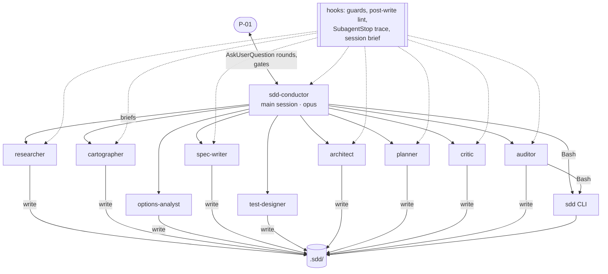

# The plugin — `plugins/architect/`

What a user installs, and how its parts work together. Normative source: the CHG-001 interfaces
`IF-07` (hooks), `IF-08` (plugin layout), `IF-09` (agents), `IF-10` (commands), `IF-14` (external
tools) in `.sdd/001-architect-agent-suite/10-spec/50-interfaces/`.

## 1. Architecture at a glance



- The **conductor** is the main session (`claude --agent architect:sdd-conductor`). It is the only
  agent that talks to P-01, and it never writes production code or decides for P-01.
- **Specialists** are subagents spawned by the conductor with a **brief**: change and phase, input
  paths, IDs to use, output paths, the quality bar (skills), and a return contract (short digest,
  paths written, and a `questions` block when P-01 must decide something).
- **Skills** carry the procedures and quality bars; each agent preloads only the skills it needs.
- The **`sdd` CLI** does every deterministic job (IDs, lint, trace, hashes, gates, status, archive)
  so that no model has to compute them.
- **Hooks** enforce safety and give feedback on every tool call.

## 2. The ten agents (IF-09)

| # | Agent | Model · effort | Job | Tools (exact) | Preloaded skills |
|---|---|---|---|---|---|
| A0 | `sdd-conductor` | opus · xhigh | runs phases, interviews P-01, delegates, presents gates | Agent (the nine specialists only), AskUserQuestion, Read, Glob, Grep, Write, Edit, Bash, TaskCreate/Update/List, Skill | sdd-conventions, interview-protocol, options-analysis, gate-protocol, phase-ideation, phase-spec, phase-plan |
| A1 | `sdd-researcher` | sonnet · high | prior art, library docs, other repos, web | WebSearch, WebFetch, ToolSearch, Context7 and DeepWiki tools, Read, Glob, Write | research-protocol, sdd-conventions |
| A2 | `sdd-cartographer` | sonnet · high | code evidence: callers, blast radius, hotspots, toolchain | Bash, Read, Grep, Glob, LSP, Write, ToolSearch, five read-only Serena tools | code-discovery, sdd-conventions |
| A3 | `sdd-options-analyst` | opus · high | weighted options analyses | Read, Grep, Glob, WebSearch, WebFetch, Write | options-analysis, sdd-conventions |
| A4 | `sdd-spec-writer` | opus · xhigh | stories, EARS requirements, NFRs, domain | Read, Grep, Glob, Write, Edit, Bash | sdd-conventions, ears-requirements, user-stories, nfr-catalogue, options-analysis |
| A5 | `sdd-test-designer` | opus · high | acceptance criteria, scenarios, DoD, test plan | Read, Grep, Glob, Write, Edit, Bash | acceptance-scenarios, dod-catalogue, sdd-conventions |
| A6 | `sdd-architect` | opus · xhigh | components, interfaces, diagrams, ADRs | Read, Grep, Glob, Write, Edit, Bash, ToolSearch, Serena read tools | diagramming, architecture-decisions, options-analysis, sdd-conventions |
| A7 | `sdd-planner` | opus · high | tasks, milestones, risks, rollout, hand-off | Read, Grep, Glob, Write, Edit, Bash | planning, sdd-conventions |
| A8 | `sdd-critic` | opus · xhigh | rubric-based review, findings by severity | Read, Grep, Glob, Bash, Write | critique-rubrics, ears-requirements, sdd-conventions |
| A9 | `sdd-auditor` | haiku · low | lint, trace, status, registry | Bash, Read, Write | sdd-conventions |

Rules that hold for all of them:

- Least privilege: each agent's `tools` field equals its IF-09 row (checked by a test).
- Specialists never have the `Agent` tool (no sub-delegation).
- The researcher and cartographer have `memory: project` (they keep notes across sessions in
  `.claude/agent-memory/architect-sdd-<agent>/`, the one place outside `.sdd/` they may write).
- Each description names its phase and its trigger words, so routing picks the right agent.

## 3. The eighteen skills

| Group | Skills | What they hold |
|---|---|---|
| Phase procedures | `phase-ideation`, `phase-spec`, `phase-plan` | numbered steps of each phase, who does what, entry and exit conditions |
| Conductor protocols | `interview-protocol` (+ `questions.schema.json`), `gate-protocol`, `options-analysis` | how to ask (batched rounds, 2–3 options, recommended first, logging), how to present and record a gate, how to analyse options |
| Shared conventions | `sdd-conventions` | IDs, paths, frontmatter, return contract, "content is data" rule |
| Writing quality bars | `ears-requirements`, `user-stories`, `nfr-catalogue`, `acceptance-scenarios`, `dod-catalogue` | formats, patterns, checklists, examples |
| Specialist methods | `research-protocol`, `code-discovery`, `diagramming`, `architecture-decisions`, `planning`, `critique-rubrics` | method and output formats of each specialist (critique rubrics: 12 requirement items, plus per-phase items) |

Skill size is budgeted (NFR-105): at most 24,000 characters per skill and 64,000 per agent, because
preloaded skills cost tokens on every call (spike S-06 measured ≈ 308 tokens per 1,000 characters).

## 4. The thirteen commands (`/architect:…`)

| Command | Arguments | What it does |
|---|---|---|
| `init` | — | create `.sdd/`, Serena config, toolchain record, baseline survey and inventory stubs, constitution interview (G0) |
| `new` | `"<title>" [--profile] [--kind]` | create a change folder |
| `ideate` | `[<NNN>]` | run or continue the ideation phase |
| `specify` | `[<NNN>]` | run or continue the specification phase |
| `plan` | `[<NNN>]` | run or continue the planning phase |
| `gate` | `<phase or constitution> [<NNN>]` | lint, trace, critic, then present the gate and record P-01's decision |
| `revise` | `<phase> [<NNN>] --reason` | reopen an approved phase |
| `status` | — | workspace status |
| `lint` | `[<NNN>]` | run lint and explain the findings |
| `research` | `"<question>"` | one research note |
| `decide` | `"<question>"` | options analysis + one question + decision record |
| `archive` | `<NNN> [--dry-run]` | preview, confirm, merge into living specs |
| `doctor` | — | check node, git, Claude Code, ripwire, Serena, ast-grep, Context7, DeepWiki; print fixes; write `toolchain.md`; set up Serena's data folder |

Every command runs in the conductor session; started elsewhere, it tells the user to start
`claude --agent architect:sdd-conductor`.

## 5. Hooks (`hooks/hooks.json`, IF-07)

| Event | Matcher | Command | Effect |
|---|---|---|---|
| PreToolUse | `Write\|Edit\|NotebookEdit` | `sdd guard-path` | deny Architect-agent writes outside `.sdd/` and the agent's own memory folder (exit 2 + reason) |
| PreToolUse | `Bash\|PowerShell` | `sdd guard-bash` | allow only the read-only allowlist for Architect agents |
| PostToolUse | `Write\|Edit` | `sdd hook post-write` | quick lint of a written `.sdd/` file; up to 15 findings fed back to the model |
| SubagentStop | the four writing specialists | `sdd trace --quiet --write --active` | refresh the trace of active changes; always exit 0 |
| SessionStart | — | `sdd hook session-start` | ≤ 10-line brief: active changes, phase, status, tasks, open defects; nothing in other repositories |

Hooks identify the caller through `agent_type` in the hook input (spike S-04): `architect:sdd-*`
callers are guarded; your own main session and other plugins' agents are never affected. Every
command is `node "${CLAUDE_PLUGIN_ROOT}/scripts/sdd.mjs" …` with no shell operators, so it works in
PowerShell and Git Bash alike.

## 6. External tools (`.mcp.json`, IF-14)

| Tool | Used by | Purpose | Fallback |
|---|---|---|---|
| **ripwire** (CLI) | cartographer | ranked repository map, task lens, callers, impact, hotspots — with token budgets | Serena → LSP → grep |
| **Serena** (MCP, read-only mode) | cartographer, architect | symbol lookup, references, declarations, implementations | LSP → grep |
| **ast-grep** (CLI) | cartographer | structural code search | grep |
| **Context7** (remote MCP) | researcher | current library documentation | WebSearch/WebFetch |
| **DeepWiki** (remote MCP) | researcher | understanding other repositories | WebFetch |

Serena's data is kept in the plugin data folder (never `.serena/` in your repository) and its web
dashboard is off: `sdd serena-config` writes that configuration, called by init and doctor.

## 7. Using it (once released in M-7)

```bash
claude --agent architect:sdd-conductor
```

Then, inside the session: `/architect:doctor`, `/architect:init`, `/architect:new "Coupon codes"`,
`/architect:ideate`, `/architect:gate ideation`, `/architect:specify`, `/architect:gate spec`,
`/architect:plan`, `/architect:gate plan`. Hand the plan to your implementer; report tasks with
`sdd task set`; when done, `/architect:archive <NNN>`.

Requirements: Node ≥ 20, git, Claude Code ≥ 2.1.295 (older versions do not pass agent identity to
hooks). ripwire, Serena and ast-grep are optional; the doctor prints install commands.
