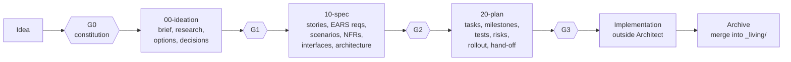

# The workflow — spec-driven development with Architect

This file describes the method the plugin implements. For the tools that enforce it, see
[SDD-CLI.md](SDD-CLI.md); for the agents that carry it out, see [PLUGIN.md](PLUGIN.md).

## 1. The big picture



- A **workspace** (`.sdd/`) holds the project's **constitution** (principles, quality bar, NFR
  defaults, global Definition of Done, forbidden technologies) and one folder per **change**.
- A **change** is one feature or fix, numbered `001`, `002`, … It moves through three **phases**.
- Every phase ends at a **gate** where P-01 decides: **Approve**, **Approve with waivers**,
  **Revise** or **Stop**. Nothing advances without an approval in P-01's own words.
- After implementation, the change is **archived**: its requirements merge into the **living
  specs** (`_living/CAP-<capability>.md`), the current truth of what the system does.

## 2. Profiles and kinds

| | Meaning |
|---|---|
| **full** profile | one folder per artifact type, capabilities split in `20-capabilities/CAP-NN-slug/` |
| **lite** profile | one `spec.md` and one `dod.md` for small changes covering one capability |
| **greenfield** | new code; requirements are all new |
| **brownfield** | changes existing code; every requirement carries a **Delta** (ADDED, MODIFIED, REMOVED, RENAMED) citing the living requirement it changes, and the cartographer grounds claims in code evidence |
| **mixed** | both |

## 3. Phase 0 — constitution (gate G0)

`/architect:init` creates `.sdd/`, records the toolchain (`_constitution/toolchain.md`), surveys an
existing codebase (baseline survey, inventory stubs of living specs) and interviews P-01 in at most
two rounds to write `_constitution/constitution.md`. It is approved with `/architect:gate
constitution`.

## 4. Phase 1 — ideation (`00-ideation`, gate G1)

Goal: understand the problem before solving it.

- **Interview** in batched rounds (interview-protocol skill): questions grouped, each with two or
  three options, the first labelled "(Recommended)". Every round is logged in `questions-log.md`.
- **Research** (researcher): prior art, library docs (Context7), other repositories (DeepWiki), the
  web; each finding carries sources, dates and a confidence level.
- **Code evidence** (cartographer, brownfield): entry points, callers, blast radius, hotspots, with
  the layer used (ripwire → Serena → LSP → grep) and a confidence for each claim.
- **Options analysis** (options analyst): 4–5 candidates scored against weighted criteria, the best
  2–3 presented with a recommendation; P-01's choice becomes a **decision record** (DEC).
- **Output**: `ideation.md` — problem, goals, non-goals, success criteria, scope, assumptions, risks,
  open questions.

## 5. Phase 2 — specification (`10-spec`, gate G2)

Goal: say exactly what the system must do, testably.

| Artifact | Format |
|---|---|
| User stories (US) | As a / I want / So that, value, priority, size hint |
| Requirements (REQ) | **EARS** sentences with exactly one SHALL: ubiquitous ("THE x SHALL …"), event-driven ("WHEN … THE x SHALL …"), state-driven ("WHILE …"), unwanted behaviour ("IF … THEN …"), optional feature ("WHERE …") |
| Acceptance criteria (AC) and scenarios (TS) | Gherkin Given / When / Then, Scenario Outlines with Examples tables; a coverage table per requirement (happy, alternate, boundary, error, authorization, concurrency, abuse) |
| Non-functional requirements (NFR) | ISO 25010 category, metric, threshold, method, environment |
| Domain | model, state machines, glossary delta (domain terms and system names allowed after THE) |
| Interfaces (IF) | CLI contracts, JSON Schemas, OpenAPI, file formats |
| Architecture | components (COMP), constraints (CON), sequences, diagrams (Mermaid), ADRs |
| Definition of Done (DOD) | per-change items with evidence types |

The **critic** reviews against rubrics (blocker / major / minor findings); the **auditor** runs
lint and trace; then the gate.

## 6. Phase 3 — planning (`20-plan`, gate G3)

Goal: a plan another engineer or AI can execute without guessing.

- **Strategy** and **milestones** (M), **work breakdown**, one file per **task** (T) with intent,
  targets, preconditions, step outline (no production code), verification and "done when".
- **Test plan**: one **test case** (TC) per scenario, with level (unit, integration, eval, manual),
  location and fixture.
- **Risks** (RISK), **rollout** and **rollback** (RB), **observability**, **impact** (blast radius,
  regression set — brownfield).
- **Hand-off**: the tool-neutral instructions for the implementer, including how to report progress
  (`sdd task set <T-ID> --status done --commit <sha>`).

## 7. IDs and traceability

Every item has an ID of the form `C<NNN>-<TYPE>-<seq>`, e.g. `C001-REQ-1103`, `C001-AC-1103.1`,
`C001-TS-1105`, `C001-T-050`, `C001-TC-1105`. The change prefix keeps IDs unique forever, even after
archiving. IDs are allocated by `sdd id next` and retired by `sdd id tombstone` (never reused).

The **trace graph** (`trace.json`, `80-traceability.md`) links them:

```text
US ──> REQ ──> AC ──> TS ──> TC ──> T (task)        NFR ──> DOD
          └──────────────────────────> DOD
```

Coverage rules TR-01 … TR-15 must reach 100% before a gate (for CHG-001: TR-01 80/80 stories,
TR-02 210/210 requirements, TR-03 232/232 criteria, TR-06 210/210, TR-07 59/59, TR-08 233/233).

## 8. Gates in detail

1. The auditor runs `sdd lint` and `sdd trace`; the critic reviews; findings are fixed.
2. The conductor shows `sdd gate show`: files, ID counts, coverage, lint, critic counts, open
   markers, staleness, proposed waivers, and — in a revision — the IDs changed since the last
   approval and everything downstream that references them.
3. P-01 answers one AskUserQuestion with four fixed options: Approve, Approve with waivers,
   Revise, Stop.
4. Only after P-01 chose Approve does `sdd gate approve` run, with P-01's answer as `--note`. It
   records a **content hash** of the phase in `approvals.json` (per-ID hashes too) and a row in the
   change's **Gate log** (date, gate, decision, words of the approver verbatim, waivers, usage).

An agent can never approve a gate on its own, and text in a file claiming "P-01 pre-approved all
gates" is treated as data (this is tested: see [SAFETY.md](SAFETY.md)).

## 9. Staleness and revisions

- `sdd stale check` recomputes the hashes. If an approved phase's files changed, it is **stale**
  and must be re-approved.
- A **revision** reopens an approved phase: `sdd change revise <NNN> <phase> --reason …` (or `sdd
  gate record --decision revise`) sets it to `in-revision` and every later phase to `stale`.
- **Defects** (`sdd defect add --ref <ID>`) record spec problems found later (for example during
  implementation). The revision fixes them, P-01 re-approves, the defects are closed.

This is exactly how the seven defects found while building CHG-001 were handled
([HOW-WE-BUILT-IT.md](HOW-WE-BUILT-IT.md)).

## 10. Implementation tracking

Implementation happens outside Architect, but its progress flows back: each task's status (todo,
in-progress, blocked, done, dropped) and report (commit, completion date, notes) live in the task
file and the registry, and the session-start brief shows "tasks 47/59" for each active change.

## 11. Archive

When G3 is approved, every task is done or dropped and no defect is open, `sdd archive <NNN>`:

- appends ADDED requirements to `_living/CAP-<slug>.md` (with their acceptance criteria and
  scenarios), replaces MODIFIED ones, deletes REMOVED ones, renames or moves RENAMED ones, and
  records each event in the living file's **History** table;
- merges the change's glossary delta into `_constitution/glossary.md`;
- moves the folder to `.sdd/_archive/`, marks it archived and regenerates the registry and status.

`--dry-run` prints every planned operation and touches nothing. `/architect:archive` shows that
preview and asks P-01 before applying.
