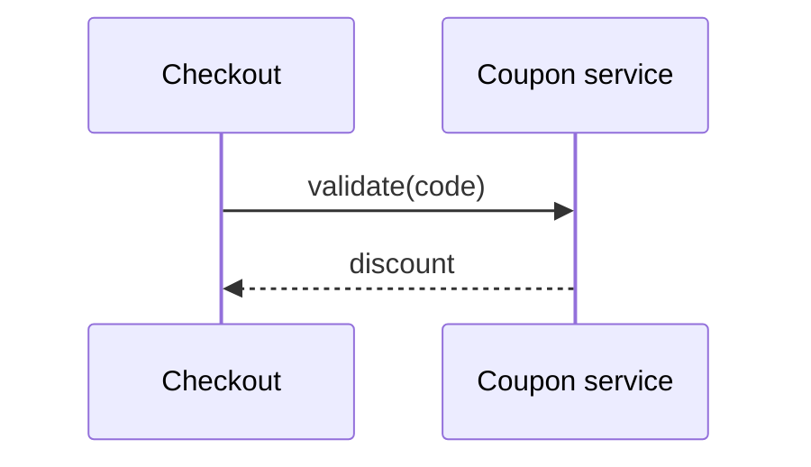

# Architecture and diagrams

The architecture describes components and their contracts at the level a reviewer can check
against the requirements. Mermaid only (diagrams render in the repository host; Archify is
deferred).

## architecture.md sections

In this order (LINT-ARCH-002):

1. **Context and scope** — the system boundary, external actors and systems.
2. **Component catalogue** — one entry per component (below).
3. **Runtime flows** — a table: flow, steps, Realizes (REQ and TS IDs).
4. **Data view** — entities by owning component, stores, retention.
5. **Deployment view** — where each component runs.
6. **Cross-cutting concerns** — security, observability, error handling, configuration.
7. **Constraints** — pointer to `constraints.md`.
8. **Diagrams** — the component view and one sequence diagram per runtime flow.
9. **As-is to to-be delta** — brownfield and mixed changes only: what exists, what changes.

## Component entry

```markdown
### C004-COMP-02 — Coupon service
- **Name:** Coupon service
- **Status:** new | existing | modified | removed
- **Responsibility:** validates coupon codes and computes discounts
- **Realizes:** C004-REQ-101, C004-REQ-102, C004-NFR-101
- **Interfaces:** C004-IF-01
- **Depends on:** C004-COMP-01
- **Owned data:** Coupon, Redemption
- **Evidence:** E-3 (`src/checkout/payments.ts:14` › `createIntent()`, layer ripwire)   (existing, modified, removed)
```

- Every field present (LINT-ARCH-003). `Evidence` cites cartographer evidence (path, symbol,
  layer) for every component that is not `new` (LINT-ARCH-005).

## Diagrams

- **Component view:** one Mermaid `flowchart` whose node IDs are the component IDs with `-`
  replaced by `_` (`C004_COMP_02["Coupon service"]`); edges follow `Depends on`.
- **Runtime flows:** for each flow in the Runtime flows table, one Mermaid `sequenceDiagram`
  under a heading naming the flow, with participants named by component ID (`participant
  C004_COMP_02 as Coupon service`) and a note or title naming the TS IDs the flow realizes
  (LINT-ARCH-004).



## Interfaces

Register every interface in `50-interfaces/README.md`: ID `IF-<seq>`, kind, file, provider COMP,
consumer COMPs, REQ IDs (LINT-IF-002 for an unregistered file). Formats (C001-IF-03 §9):

| Kind | Format | File | First line / marker |
|---|---|---|---|
| HTTP API | OpenAPI 3.1 | `openapi.yaml` | `openapi: 3.1.0` |
| JSON document | JSON Schema 2020-12 | `<name>.schema.json` | `"$schema": "https://json-schema.org/draft/2020-12/schema"` |
| Event stream | AsyncAPI 3.0 | `events.asyncapi.yaml` | `asyncapi: 3.0.0` |
| CLI | CLI contract | `<name>-cli.md` | headings Synopsis, Commands, Exit codes, Output |
| Other conventions | Markdown, numbered sections | `<name>.md` | — |

Files must parse (YAML/JSON valid).

## Errors and constraints

- `50-interfaces/errors.md`: one row per error condition: code (`ERR-<AREA>-<nnn>`), condition,
  user-facing message, REQ or AC IDs. Every error code a requirement mentions has a row
  (LINT-ERR-001).
- `60-architecture/constraints.md`: `CON-<seq>`, statement, source (DEC, ADR, NFR or constitution
  ID), affected COMP IDs (LINT-CON-001 when the source is missing).
