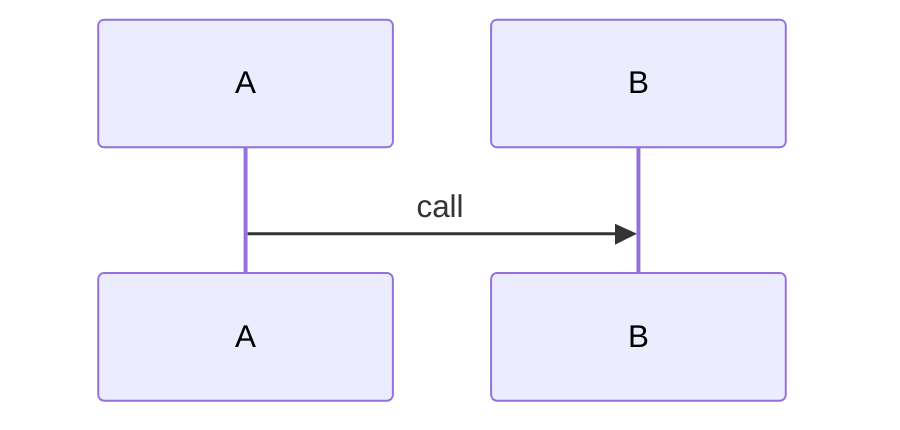

# Architecture

## 1. Context and scope

The fixture.

## 2. Component catalogue

### C004-COMP-01 — Component
- **Name:** Thing
- **Responsibility:** does the thing
- **Owned data:** none
- **Interfaces:** none
- **Depends on:** none
- **Realizes:** C004-REQ-101
- **Status:** new

## 3. Runtime flows

| Flow | Description | Scenarios realized |
|---|---|---|
| F1 | A flow | C004-TS-101 |

## 4. Data view

Files.

## 5. Deployment view

Local.

## 6. Cross-cutting concerns

None.

## 7. Constraints

None.

## 8. Diagrams

### Component view

### F1 — A flow (realizes C004-TS-101)

